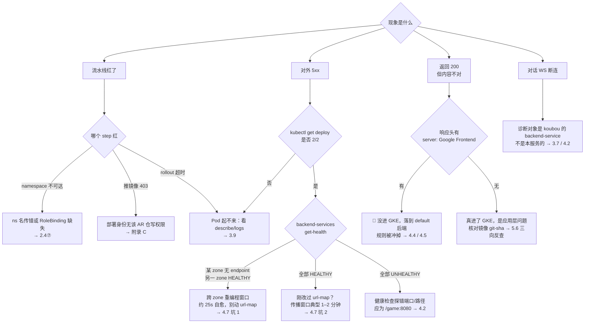

# rezonalab-game-web CI/CD 与部署手册

| 项 | 值 |
|---|---|
| 版本 | v1.1 |
| 最后核实日期 | 2026-07-31（资源名、行号、命令输出于该日回源核对）；**2026-08-27 改写分支拓扑与发布流程**（§1.5 / §2.1 / §2.2 / §5.2 / §5.3），云侧资源未复核 |
| 适用分支 | `dev`（引用的**行号会随提交漂移**，行号仅作定位提示，冲突时以文件当前内容为准） |
| 维护者 | 待补 |
| 反馈渠道 | 待补 |

---

## 前言

### 读者画像

本手册面向三种人：**第一次给这个仓库发版的工程师**、**要把一个新环境接进负载均衡的 SRE**、**线上出问题被叫起来排查的值班人**。假定你会用 `git` / `kubectl` / `gcloud` / `gh` 的基本命令，但**不假定**你了解本项目的历史、命名约定与那几个已经踩过的坑。

### 讲什么 / 不讲什么

**讲**：CI 质量闸门、镜像构建与变量注入、三环境部署流水线、集群运行时（Deployment / Service / NEG / HPA / PDB / 探针）、共享 url-map 的接入与巡检、发布与回滚的操作流程、故障排查决策树、权限与契约测试。

**不讲**：应用代码架构——store / Koubou 协议 / 画布 / UI 令牌那一整套请看仓库根目录的 `CLAUDE.md`，本手册一律不重复。本手册也**不讲**上游 pgc / koubou / Rezona Canvas / biz-api 各自的内部实现，只讲它们和我们在同一个 url-map 上如何共存。

### 冲突时以什么为准

> **源文件 > 本手册 > 仓库内旧文档。**

- 手册里的任何描述与 `.github/workflows/*`、`deploy/*`、`scripts/*`、`tests/deploy/*` 的实际内容冲突时，**以源文件为准**，并回来修手册。
- 手册与 `deploy/README.md`、`docs/deploy/*`、`CLAUDE.md` 里的部署段落冲突时，**以本手册为准**——那些旧文本里已知有过期表述，登记在附录 F。
- 手册引用的行号（写作 `路径:起-止`）会随提交漂移，**按内容定位，不要按行号定位**。

### 标记含义

| 标记 | 含义 |
|---|---|
| 🔴 | 致命。做错会打到别人的线上环境、冲掉别人的路由，或造成不可逆后果 |
| ⚠️ | 易踩。做错会浪费时间或得出错误结论，但可恢复 |
| ℹ️ | 补充。背景、原理、为什么当初这么设计 |
| ✅ | 判据。怎么判定「这一步真的做成了」，而不是靠感觉 |

### 三条阅读路径

**① 今天要发版**（改完代码，要把它送上 develop / stage / production）

1. §5.2 日常发布流程 —— 从特性分支到三个环境的完整动作序列
2. §2.9 操作手册：触发、观察、验证、回滚 —— 每个 workflow 怎么触发、怎么看
3. §5.5 验证清单 —— 发完怎么证明它真的上去了

**② 今天要接新环境**（stage 或 prod 第一次接进 LB）

1. §5.4 新环境从零接入的 runbook —— 顺序与前置条件
2. §4.2 `deploy/setup-lb.sh` 三步逐项拆解 —— 健康检查 / backend-service / 挂 NEG
3. §4.5 Runbook：url-map 变更（export → 断言 → validate → import）—— 🔴 全手册风险最高的一节，**唯一权威流程**

**③ 线上出问题了**

1. §5.6 故障排查决策树 —— 从症状分诊到具体命令
2. §5.5 验证清单 —— 先用一屏命令定位「坏在哪一跳」
3. §5.7 回滚 —— 以及它的三条局限（别指望 `rollout undo` 能救所有事）

> 只有 5 分钟：直接读下面的第 0 章速查卡，它是一页可打印的浓缩版。

---

## 第 0 章 · 速查卡

本章不解释原理，只给结论与命令。每条都标了正文出处，看不懂就去翻。

### 0.1 五条红线

**🔴 一、`gcloud compute url-maps patch` 永久禁用。**
它是**整体替换 `pathMatchers`**，不是增量合并——后写入者会把先写入者的规则一起冲掉。2026-07-29 实际发生过：三个人各自 patch，pgc 的 1 条 pathRule（2 个 path）与 Rezona Canvas 的 2 条 pathRule（6 个 path）被冲掉，对外全部落到官网 SPA fallback，返回 200 但内容全错，无人发现直到用户在浏览器撞到。
**唯一允许的改法**：`export` → 备份 → 追加 → 文本 diff → 集合比对断言脚本 → `gcloud compute url-maps validate` → `import` → 双份回归 → 广播 → 翻 `wired`。完整流程见 **§4.5**，事故复盘见 §4.4。

**🔴 二、四条命名轴不可互相替换。**
GitHub environment（`develop`/`stage`/`production`）≠ k8s namespace（`rezonalab-game-{dev,stage,prod}`）≠ `lb:audit --env`（`dev`/`stage`/`prod`）≠ `app_env`（三环境恒为 `production`）。
**同名的 `develop` / `production` 那两个 namespace 属于 taluna 老栈的线上环境**，把 `environment` 当 namespace 用 = 直接 `kubectl apply` 到别人的生产资源上。全表见 §0.2，原理见 §1.2，护栏见 `tests/deploy/namespace-isolation-contract.test.ts`。

**🔴 三、判断「流量是不是真进了 GKE」，看 `server` 响应头，不看状态码。**
响应里**没有** `server: Google Frontend` 才说明请求进了我们的 Pod；**带**这个头 = 落到了 default 后端的官网 SPA，而它对未知路径返回 **200 + HTML**——只看状态码一定被骗。
⚠️ 跑判据前先用 `/` 做正对照：`/` 必须**有** `server: Google Frontend`；如果连 `/` 都抓不到 `server` 头，是你的 curl 管线坏了，下面所有的「空」都是假绿。详见 §5.5。

**🔴 四、dev → main 晋级只能 merge commit，禁止 squash。**
`scripts/release-board`（`pnpm board`）判定 feature 上线到哪一环靠**双源**：提交里的 `Feature:` trailer（主）+ merge commit 的 subject（兜底存量、提供标题与合入时间）。squash 会把两者同时打掉——merge 结构压平、trailer 被挤进正文中段后 `%(trailers)` 取不到（实测返回空），且**不可逆**。见 §5.2。
ℹ️ `main` 的分支保护里 `required_linear_history: false`，也就是说**平台层面不会拦你**——这条靠人守。

**🔴 五、查默认分支状态，一律先 `git fetch origin --prune`，再用 `origin/main` 或 `gh`，绝不用本地 `main`。**
本地 `main` 引用可能落后很多（实测 `git rev-list --count main..origin/main` = 246），据此判断「某个 workflow 还没进默认分支」会得出完全相反的结论。schedule 触发只从**默认分支**生效，这类判断错一次就等于误判整条防线的启停状态。

```bash
git fetch origin --prune
git ls-tree --name-only origin/main .github/workflows/   # 默认分支上到底有哪些 workflow
gh run list --workflow lb_route_audit.yml --limit 5      # 它到底跑没跑、跑成没成
```

**判据**：判断默认分支上的任何事实，命令里必须出现 `origin/` 或 `gh`；出现裸 `main` 就是错的。

### 0.2 命名总表

三套环境同项目、同集群（`rezonaai` / `us-east1` / `autopilot-cluster-1`），只靠 namespace 隔离。**同一套环境在不同系统里叫不同名字**，下表按「维度 × 环境」排，四条命名轴用 🔴 标出。

| 维度 | develop | stage | production | 出处 |
|---|---|---|---|---|
| 🔴 **轴 1** GitHub environment | `develop` | `stage` | `production` | `deploy_dev.yml` / `deploy_stage.yml` / `deploy.yml` 的 `environment:` |
| 🔴 **轴 2** k8s namespace | `rezonalab-game-dev` | `rezonalab-game-stage` | `rezonalab-game-prod` | 同上的 `namespace:` |
| 🔴 **轴 3** `lb:audit --env` 值 | `dev` | `stage` | `prod` | `scripts/lb-route-audit/expected.ts` 的 `env` |
| 🔴 **轴 4** `app_env` → `NODE_ENV` | `production` | `production` | `production` | 三环境**一律 production**，不区分环境 |
| 对外域名 | `devlab.rezona.ai` | `stalab.rezona.ai` | `lab.rezona.ai` | `expected.ts` 的 `host` |
| url-map（**五方共用**） | `rezona-lab-dev-urlmap` | `rezona-lab-stage-urlmap` | `rezona-lab-prod-urlmap` | `expected.ts` 的 `urlMap` |
| path matcher | `rezona-lab` | `rezona-lab` | `rezona-lab` | 三环境同名 |
| GCP / k8s 资源名后缀 | `-develop` | `-stage` | `-production` | **等于轴 1，不是轴 2/3** |
| Deployment | `rezonalab-game-web-develop` | `rezonalab-game-web-stage` | `rezonalab-game-web-production` | `deploy/k8s-deployment.yaml` |
| Service | `rezonalab-game-web-develop-service` | `…-stage-service` | `…-production-service` | 同上 |
| NEG（GKE 自动建） | `rezonalab-game-web-develop-neg` | `…-stage-neg` | `…-production-neg` | Service 的 `cloud.google.com/neg` 注解 |
| backend-service | `rezonalab-game-web-develop-backend` | `…-stage-backend` | `…-production-backend` | `deploy/setup-lb.sh` |
| health-check | `rezonalab-game-web-develop-health-check` | `…-stage-health-check` | `…-production-health-check` | 同上 |
| HPA min–max | `2–5` | `2–5` | `2–10` | `deploy_*.yml` 的 `hpa_min`/`hpa_max` |
| 镜像仓库路径 | `…/rezonalab-game-web-develop` | `…/rezonalab-game-web-stage` | `…/rezonalab-game-web-production` | `us-east1-docker.pkg.dev/rezonaai/rezonalab-game-repo/…` |

⚠️ 一眼要认出的三处反直觉：

1. Deployment 叫 `rezonalab-game-web-develop`，却跑在 `rezonalab-game-dev` 里——**不是笔误**（轴 1 和轴 2 各管各的）。
2. develop 环境的容器里 `NODE_ENV=production`——**不是配置错误**（轴 4 标的是 Next 的运行模式，不是环境）。
3. 我们占的 path 是 `/game` 与 `/game/*`，但 `/game/pgcserver{,/*}` 属 pgc、`/game/koubou{,/*}` 属 koubou——GCLB **按最长前缀优先**，三者共存无需调序。见 §4.3。

### 0.3 十条最常用命令

| # | 目的 | 命令 | ✅ 判据 |
|---|---|---|---|
| 1 | 同步并查默认分支真实状态（红线五） | `git fetch origin --prune && git log --oneline -3 origin/main` | 任何关于 `main` 的结论都必须在这条**之后**得出 |
| 2 | 提交前四件套（与 CI 的 `quality` job 同构） | `pnpm lint && pnpm exec tsc --noEmit && pnpm test && pnpm build` | 退出码 `0`。本地绿了 CI 才可能绿 |
| 3 | 发 develop | `git push origin dev` | `Deploy (develop)` 自动起一次 run（见 #4） |
| 4 | 看部署记录 | `gh run list --workflow "Deploy (develop)" --limit 5` | 最近一条 `success`；`queued` 是被同组 concurrency 排队，正常 |
| 5 | 看失败日志 | `gh run view <run-id> --log-failed` | 只打印失败步骤，别全量翻日志 |
| 6 | 归属判据：流量真进 GKE 了吗（红线三） | `curl -sS -o /dev/null -D - https://devlab.rezona.ai/game \| grep -i '^server:'` | **无输出** = 真进了 GKE；打印 `Google Frontend` = 落到 default 后端。先用 `/` 做正对照 |
| 7 | 集群四件套 | `kubectl get deploy,svc,hpa,pdb -n rezonalab-game-dev` | Deployment `READY 2/2` 起步；HPA 有 `TARGETS` 数值而非 `<unknown>` |
| 8 | 线上跑的到底是哪个 commit | `kubectl get deploy rezonalab-game-web-develop -n rezonalab-game-dev -o jsonpath='{.spec.template.metadata.annotations.app\.kubernetes\.io/git-sha}'` | 输出的 sha 等于你以为发上去的那个 |
| 9 | 共享 url-map 路由巡检（只读） | `pnpm lb:audit`（或 `--env dev\|stage\|prod`） | 退出码 `0` = 健康；`1` = 路由偏离（走 §4.5 加回来）；`2` = 取数失败（gcloud 不可用 / 无权限），**不是**路由坏了 |
| 10 | LB 后端端点健康 | `gcloud compute backend-services get-health rezonalab-game-web-develop-backend --global --project=rezonaai` | 至少 2 个端点 `HEALTHY`；全 `UNHEALTHY` 而 Pod 正常 → 查健康检查端口是否 `8080`、路径是否 `/game` |

⚠️ 三条通用注意：
- 换环境时**整行一起换**（namespace、资源名后缀、域名都要跟着改），别只改一个词——参照 §0.2 同一行。
- 路径参数里 `--source=~/...` 的 `~` **不会展开**，一律写 `--source="$HOME/..."`。
- 本机若设了 `GOOGLE_APPLICATION_CREDENTIALS`，`kubectl` 命令前加 `env -u GOOGLE_APPLICATION_CREDENTIALS`。

### 0.4 三条分诊入口

| 症状 | 先做什么 | 去哪一节 |
|---|---|---|
| **部署红了**（workflow 失败） | `gh run view <run-id> --log-failed` 定位失败步骤：推镜像 403 → 仓库名/权限；namespace 不可达 → 轴 2 写错或 RBAC；`rollout status` 超时 → 去集群看 Pod 事件 | §2.9 → §2.10 → §3.9 |
| **对外 503**（浏览器打不开） | 先 `pnpm lb:audit`（#9）再 `get-health`（#10），分清是「路由没了」还是「后端没有健康端点」；滚动发布窗口内的短暂 503 见 §3.5 的 NEG 跨 zone 重编程一节 | §5.6 → §4.6 → §3.5 |
| **200 但内容不对**（页面在，是别人的） | 立刻跑红线三的 `server` 头判据（#6），几乎可以确定是 url-map 规则被冲掉了 | §5.5 → §4.4 → §4.5 |

---

---

## 第 1 章 · 全局心智模型

这一章不教你操作，只帮你建立坐标系。读完之后，你应该能回答四个问题：**这个服务是什么、它跑在哪三套环境里、一次发布从 `git push` 到用户看到页面中间都发生了什么、以及哪几处一旦写错会伤到别人**。后面每一章都是在这张地图上放大某一块。

名词一律以**附录 A 术语表**为准，资源名与参数一律以**附录 B 命名与参数总表**为准，本章不重复定义，只在首次出现处给一句话直觉。

如果你只有五分钟，先看 §1.2 的三环境矩阵和 §1.3 的端到端全景图，这两处是本项目最容易搞错的地方。

---

### 1.1 这个服务是什么

`rezonalab-game-web` 是 Rezona Lab 的**游戏创作前端**，技术栈是 Next.js 16 + React 19，但它有一个关键的非常规点：**它不是标准 Next 应用，而是一个带自定义 HTTP 服务器的应用**。入口是仓库根目录的 `server.ts`——它自己 `createServer(...)`、自己 `listen`，把请求交给 Next 的 handler。

这一个事实产生两条贯穿全书的连锁后果（`deploy/dockerfile:1-2`、`deploy/dockerfile:33-41`）：

1. **不能用 Next standalone 打包**——standalone 会生成它自己的 `server.js`，与我们的自定义入口互斥；
2. **镜像必须保留完整 `node_modules`**（含 `tsx`），运行时用 `/app/node_modules/.bin/tsx server.ts` 直接跑 TypeScript 入口。

细节见 §2.6。

> ⚠️ 一个容易被误传的因果：`server.ts` 里确实有 `server.on('upgrade', ...)`，但**生产分支只是把 upgrade 全量转交给 Next**（`server.ts:53-55`），Next 只拿它做 HMR。`ws` 这个包只被 `src/server/koubou/ws-proxy.ts` 引用，而该模块在 `server.ts:37-38` 的 `if (dev)` 分支里**动态 import**，生产根本不加载。`server.ts:34` 的注释把这层意思写死了：「生产:对话直连 Koubou WS(同站,cookie 直达),本地不托管 agent WS,upgrade 全量交 Next(HMR)。」**生产环境本服务不托管任何业务 WebSocket。** 详见本节末尾「对话 WebSocket 走哪条路」。

它在整个体系里的位置是 **BFF**（Backend For Frontend，只为前端服务的服务端层，不是业务后端）——一层薄的服务端代理，替浏览器转发请求、做 SSR 渲染，但**自己不持有任何数据**：

- 不连数据库，不连 Cloud SQL；
- 不读写 GCS 存储桶；
- 没有 Workload Identity（GKE 里把 Pod 绑定到 GCP 服务账号的机制），Pod 用 namespace 的默认 ServiceAccount，**在 GCP 侧什么权限都没有**（`.github/workflows/_deploy.yml:3-4` 明确说明「运行时不碰 GCP，因此不注入 workload GSA」）；
- 唯一的上游是环境变量 `PGC_BASE_URL` 指向的那个域名。

所谓「唯一上游」其实是个同域回环：`PGC_BASE_URL` 填的是**本环境自己的对外域名**（dev 是 `https://devlab.rezona.ai`，见 `.github/workflows/deploy_dev.yml:36`），请求打出去后由同一个负载均衡器按路径前缀再分流回集群内的其他服务。三个真实上游是：

| 上游 | 路径前缀 | 职责 | 本 BFF 的接入点 |
|---|---|---|---|
| **pgc**（仓库 `rezonalab-game-server`） | `/game/pgcserver` | 项目、画布资产、游戏版本的 REST 接口 | `src/app/api/pgc/[...path]/route.ts` |
| **koubou** | `/game/koubou` | AI agent 会话（HTTP + WebSocket） | `src/app/api/koubou/[...path]/route.ts` |
| **biz-api** | `/tln/biz` | 主站业务后端：充值配置 / 建单等 | `src/app/api/biz/[...path]/route.ts` |

> **这三个前缀不在任何环境变量里**。env 只存裸域名（`PGC_BASE_URL` 被 pgc 与 koubou 共用，装不下两个前缀），前缀在代码层拼接，**唯一契约源是 `src/lib/backend-routes.ts:4-7`**（`PGC_PREFIX` / `KOUBOU_PREFIX` / `BIZ_PREFIX`）。去 env 里找前缀是找不到的。

鉴权是 **cookie 制**：浏览器在 `*.rezona.ai` 下携带 session cookie，BFF 原样透传给上游（`src/server/cookie.ts` 的 `resolveForwardCookie`）。**注意分工**：拿这个 cookie 去 biz-api 的 `/tln/biz/me` 自省「当前用户是谁」的，是 **pgc / koubou 服务端**，不是本 BFF；本 BFF 只负责把 cookie 原样带上。

所以本服务**不需要任何服务账号凭据**——历史上的 `PGC_EMAIL` / `PGC_PASSWORD` 与配套 Secret 已经删除（`deploy/k8s-deployment.yaml:74-78` 注释）。这一点对运维意义重大：**这个服务泄漏了也拿不到数据**，它的安全边界基本等于「能转发用户自己的 cookie」。

**对话 WebSocket 走哪条路。** 生产环境下，浏览器**直连** `wss://<域名>/game/koubou`（`src/koubou/wsBase.ts:13-21` 的 `resolveKoubouWsBase`：由 `NEXT_PUBLIC_PGC_BASE_URL` 把 `https` 换成 `wss`，再拼 `KOUBOU_PREFIX`）。按 url-map 的最长前缀匹配，这条流量落在 **koubou 的 backend-service** 上，**一个字节都不经过本前端的 Pod**。只有本地开发才会走 `server.ts` 里的 dev WS 代理（`/dev-ws/koubou/*`），那是为了打通本地 LB 会话亲和的临时手段。

> 🔴 由此推出一条排障纪律：**agent 对话断线要去查 koubou 的 backend-service，不是查我们的。** 我们这条 backend 上的任何超时参数都影响不到它，详见 §1.3 末尾与 §5.6。

再往上一层，三个服务（本前端、pgc、koubou）**共用同一个 Kubernetes namespace**，也共用同一个对外域名和同一张路由表。这是本项目最主要的耦合来源，§1.2 和 §1.4 会展开。

---

### 1.2 三环境与四条命名轴

先立一个物理前提：**三套环境同项目、同集群，只靠 namespace 隔离**。所有坐标都集中在 `.github/workflows/_deploy.yml:66-72` 的 `env:` 块里，三个环境共用：

| 常量 | 值 |
|---|---|
| `PROJECT_ID` | `rezonaai` |
| `REGION` | `us-east1` |
| `CLUSTER_NAME` | `autopilot-cluster-1`（GKE Autopilot） |
| `ARTIFACT_REGISTRY_REGION` / `REPOSITORY_NAME` | `us-east1` / `rezonalab-game-repo`，即 `us-east1-docker.pkg.dev/rezonaai/rezonalab-game-repo` |
| `SERVICE` | `rezonalab-game-web`（所有 k8s 资源名的词根） |

**同一个集群里还住着 taluna 老栈**（`docs/deploy/rezonalab-dev-bringup.md:43`「与 taluna 同集群，靠 namespace 隔离」）。这就是「namespace 写错会打到别人身上」的物理原因——不是逻辑上的忌讳，是真的会 `kubectl apply` 到别人的资源上。

本项目有 develop / stage / production 三套环境。**同一套环境在不同系统里有不同的名字**，这是新人第一天最大的困惑源，先把表贴出来（完整版含全部资源名见附录 B）：

| GitHub Environment | k8s namespace | `lb:audit --env` | 对外域名 | url-map | GCP 资源名后缀 |
|---|---|---|---|---|---|
| `develop` | `rezonalab-game-dev` | `dev` | `devlab.rezona.ai` | `rezona-lab-dev-urlmap` | `-develop` |
| `stage` | `rezonalab-game-stage` | `stage` | `stalab.rezona.ai` | `rezona-lab-stage-urlmap` | `-stage` |
| `production` | `rezonalab-game-prod` | `prod` | `rezona.ai`（2026-09-03 起主域；旧域 `lab.rezona.ai` 的 `/game/*` 永久直连） | `rezona-lab-prod-urlmap` | `-production` |

同一行的六列指的是同一套环境。**注意第一列和最后一列用的是同一个词**（`develop` / `stage` / `production`），中间几列各有各的简写（`dev` / `stage` / `prod`）。所以 dev 环境的 Deployment 叫 `rezonalab-game-web-develop`，却跑在名为 `rezonalab-game-dev` 的 namespace 里——**这不是笔误**。

> ℹ️ GitHub Environment 侧目前只存在 `develop` 与 `stage` 两个（`stage` 是首次 stage 部署时自动创建的），`production` 尚不存在，首次 prod 部署时会自动创建；三者都没有配置 protection rules。也就是说**当前没有任何审批闸门**，详见 §2.3。

#### environment 与 namespace 为什么解耦

在 `.github/workflows/_deploy.yml` 里，`environment` 和 `namespace` 是**两个独立的必填输入**（`.github/workflows/_deploy.yml:10-21`），各管各的：

- **`environment`** 决定两件事：① GitHub Environment 作用域（`:77` 的 `environment: ${{ inputs.environment }}`，决定这次运行能取到哪套 secret、受哪条审批规则约束）；② **所有资源名的后缀**——镜像仓库路径 `…/rezonalab-game-web-develop`（`:102`）、Deployment `rezonalab-game-web-develop`、Service `…-develop-service`、NEG `…-develop-neg`、backend-service `…-develop-backend`。
- **`namespace`** 只决定一件事：`kubectl apply` 把这些资源建到集群的哪个隔离区。

历史上这两者是同名的：本仓库是从 `taluna-game` 迁移过来的，老栈的 namespace 直接叫 `develop` / `production`（`.github/workflows/_deploy.yml:14-18`；`docs/deploy/rezonalab-dev-bringup.md:17`「旧：`develop`（与 taluna 全栈混住）」），把 `environment` 当 namespace 用毫无问题。迁库到 Rezona Lab 之后 namespace 换成了 `rezonalab-game-{dev,stage,prod}`，而**老 taluna 栈仍然活着、仍然占着那些 namespace**（迁移期间实测 `tlndev.taluna.ai/game` 始终 200，两套环境并行维护）。

于是形成了本项目最危险的不变式：

> 🔴 **任何一处把 `environment` 当 namespace 用，就会打进 taluna 老栈的线上环境。**

首次部署前专门做过一轮隔离改造（提交 `07cf038`），修掉四类沿用自 taluna 的写法：namespace 硬编码 `develop`（一跑就会顶掉线上已跑 51 天的 `taluna-game-develop`）、Artifact Registry 仓库名沿用 `rezonago-repo`、用 `kubectl get namespace` 探测 namespace（部署身份根本没有集群级 `get namespaces`，一定被 RBAC 拒，见附录 C）、以及 Deployment / 探针等一系列服务名。

顺带一提，最小权限设计在首次部署时立刻证明了自己的价值：迁库后第一次跑部署，因为 `REPOSITORY_NAME` 还残留着 taluna 的 `rezonago-repo`，推镜像时直接 403 失败——部署身份只有新仓库的写权限，老仓库根本推不进去（`docs/deploy/rezonalab-dev-bringup.md:31-33`）。**权限把配置错误挡在了污染发生之前。**

#### 第四个名字：`app_env` → `NODE_ENV`，三个环境一律 `production`

还有一层命名会让新人当场以为「部署错了」：`_deploy.yml` 有个必填 input `app_env`，它被渲染进容器的 `NODE_ENV`（`deploy/k8s-deployment.yaml:70-71`）。**三个 `deploy_*.yml` 传的都是 `app_env: production`**（`.github/workflows/deploy_dev.yml:26`、`.github/workflows/deploy_stage.yml:23`、`.github/workflows/deploy.yml:24`）。

也就是说，develop 环境的容器里 `NODE_ENV=production`。这**不是**配置错误：`NODE_ENV` 标的是「Next 的运行模式」（生产构建产物 + 生产优化），不是「哪套环境」。环境的区分靠 namespace 与 `DD_ENV`（`deploy/k8s-deployment.yaml:89-90`，取 `${ENVIRONMENT}`），不靠 `NODE_ENV`。`.github/workflows/_deploy.yml:23` 的注释把这层意思写死了：「NODE_ENV 运行时（容器内统一 production，环境靠命名空间隔离）」。

#### 真实踩过的 bug（提交 `6317ad9`）

即便做过隔离改造，`_deploy.yml` 末尾那个 `Status` 步骤还是漏了一处，写成了：

```bash
NS="${{ inputs.environment }}"      # 错：查的是 taluna 老栈的 ns
kubectl get deploy,svc,hpa -n "$NS" || true
```

这个 bug 之所以能潜伏很久，是因为**末尾的 `|| true` 把 RBAC 拒绝吞掉了**——CI 一直显示绿色，这个步骤从头到尾从没显示过本次部署的真实状态，也没人注意到它查的是别人的 namespace。这是一个经典组合：**错误的变量 + 静默的错误处理 = 长期无感知的假象**（本章后面还会遇到两处同构的「静默失败」，见 §1.4 与 §1.6）。

修复后由 `tests/deploy/namespace-isolation-contract.test.ts` 锁死，它用正则扫 `_deploy.yml`，断言：

1. 所有 `NS="${{ inputs.X }}"` 赋值里的 `X` 都是 `namespace`；
2. 所有 `--namespace=${{ inputs.X }}` 里的 `X` 都是 `namespace`；
3. 三个 `deploy_*.yml` 传的 namespace 值分别是 `rezonalab-game-{dev,stage,prod}`。

三条都额外断言「匹配数量 > 0」，防止正则失配导致空数组恒等于空数组的假绿。**这个「先断言匹配数 > 0」的写法是本仓契约测试的通用纪律**，写新的扫描式断言时照抄。

#### 环境之间的三处不对称

三套环境不是同一份配置的三个副本，有三处刻意的差异（精确取值见附录 B）：

| 维度 | develop | stage | production | 出处 |
|---|---|---|---|---|
| **镜像** | `…-develop:*` | `…-stage:*` | `…-production:*`，**三者不可互换** | `.github/workflows/_deploy.yml:102`、`:116-119` |
| **HPA / 资源** | `2–5` 副本；requests `500m/1Gi`，limits `4/8Gi` | `2–5` 副本；基线 `250m/512Mi` · `1/1Gi` | `2–10` 副本；基线 `250m/512Mi` · `1/1Gi` | `.github/workflows/deploy_dev.yml:28-34`、`.github/workflows/deploy_stage.yml:24-25`、`.github/workflows/deploy.yml:25-26`、`.github/workflows/_deploy.yml:49-64` |
| **Datadog APM** | 注入 `NODE_OPTIONS=--import dd-trace/initialize.mjs` + `DD_TRACE_ENABLED=true` | 空 / `false` | 空 / `false` | `.github/workflows/_deploy.yml:164-172` |

**为什么镜像不能复用。** Next.js 把所有 `NEXT_PUBLIC_*` 开头的变量**编译进发给浏览器的 JS bundle**，值在 `next build` 那一刻就固化了，所以只能走 docker `build-args`。本项目有三个这样的变量，其中 `NEXT_PUBLIC_PGC_BASE_URL` 每个环境的域名不同——于是**一个镜像只属于一个环境，不能「dev 验过的镜像直接推 prod」**，镜像路径也因此带环境后缀：

```text
us-east1-docker.pkg.dev/rezonaai/rezonalab-game-repo/rezonalab-game-web-develop:dev-9741117
                                                     └── environment 后缀      └── ①  └── ②
① = 触发 workflow 的 ref 名（GITHUB_REF_NAME，斜杠替换成短横线）
② = checkout 出 inputs.ref 之后的 HEAD 短 sha
```

⚠️ ① 和 ② 来自**两个不同的来源**（`.github/workflows/_deploy.yml:100-101`）：`BRANCH_SAFE` 取触发 workflow 的 ref 名，`SHA_SHORT` 取实际被部署那个 ref 的 HEAD。手动 dispatch 时两者可以不是同一个分支（见 §1.3 的脚坑），于是 tag 会出现「分支名说 A、sha 属于 B」的情况——**以 sha 为准**。除了这个 sha tag，还会打一个浮动的 `:<分支名>` 标签（`:104`）。用 sha 而不是 `latest`，是为了能精确定位与重放某一次提交。

构建期烘入与运行时注入的完整对照（含第三个变量 `NEXT_PUBLIC_APP_ENV`）是第 2 章的核心，见 §2.5。这里只留一条最容易混的：**别把 `PGC_BASE_URL` 和 `NEXT_PUBLIC_PGC_BASE_URL` 搞混**——前者不带 `NEXT_PUBLIC_` 前缀，是给**服务端**用的，通过 k8s 环境变量在**运行时**注入（`.github/workflows/_deploy.yml:161` → `deploy/k8s-deployment.yaml:77-78`）。同一个概念存在两个变量、值相同、注入时机完全不同。

**为什么资源必须走 input、不能写死在模板里。** `k8s-deployment.yaml` 一份模板三个环境共用；如果把 develop 抬高后的 `500m/1Gi · 4/8Gi` 直接写进模板，stage 与 prod 会被静默放大，同时**稀释它们的 HPA utilization**（同样的绝对负载，除以更大的 request 后百分比更低，扩容更晚触发）。`.github/workflows/_deploy.yml:46-48` 的注释和 `tests/deploy/dev-ha-contract.test.ts:45-55` 的用例（断言 prod 渲染出 `250m/512Mi · 1/1Gi` 且 `hpa_max=10`）都在防这一件事。

---

### 1.3 端到端全景：一次发布都发生了什么

下图是 develop 环境的完整链路。**方括号里标的是执行者**，右侧标注了这一段是「每次发版都跑」还是「每个环境只做一次」。

```text
① 代码进入 dev 分支                                            [人]            每次
   特性分支 --no-ff 合入 → git push origin dev
   │
   ├─► ② ci.yml   job: quality                                 [GHA]           每次（所有分支 + PR）
   │       pnpm install → lint → tsc --noEmit → vitest → next build
   │       纯检查，不碰云、不部署；不是 ③ 的前置门禁
   │
   └─► ③ deploy_dev.yml --uses--> _deploy.yml                  [GHA]           每次
           瘦封装（自身无逻辑，只 uses + secrets: inherit，传环境差异参数）
           │
           ├─ ③a  Checkout(inputs.ref) → Buildx build & push   [GHA]
           │        build-args: NEXT_PUBLIC_BASE_PATH / _PGC_BASE_URL / _APP_ENV
           │        push → us-east1-docker.pkg.dev/rezonaai/rezonalab-game-repo/
           │                rezonalab-game-web-develop:dev-<sha7>   (+ 浮动 :dev)
           │
           ├─ ③b  gcp-auth → get-gke-credentials               [CI SA]
           │        探测 namespace: kubectl get serviceaccounts -n $NS
           │        (步骤名 "Create namespace if missing"，但它从不创建，探不到就 exit 1)
           │
           ├─ ③c  envsubst 渲染 → kubectl apply                [CI SA]
           │        k8s-deployment.yaml → Deployment + Service(NEG 注解)
           │        hpa.yaml            → HPA + PDB
           │
           ├─ ③d  kubectl rollout status --timeout=300s        [CI SA]
           │
           └─ ③e  Status: kubectl get deploy,svc,hpa -n $NS    [CI SA]
                    if: always()，末尾 || true 不阻断（曾在此处埋过 §1.2 的 bug）
           │
④ notify  独立 job：needs=[build-push-deploy], if: always()     [GHA]           每次
     成败都发 Lark，但 if: env.NOTIFY_WEBHOOK != ''
     现状：仓库 secret 只有 GCP_SA_KEY，LARK_WEBHOOK_URL 未配 → 该步 skipped，收不到通知
           │
           │  新 Pod Ready
           ▼
⑤ NEG controller 同步端点                                       [GKE 集群自身]  自动·持续
     读 Service 注解 cloud.google.com/neg
     → 维护 zonal NEG  rezonalab-game-web-develop-neg（dev 实测 us-east1-b/c/d 各一个）
     Pod 增删 / 跨 zone 漂移都跟进；CI 不参与、也无权参与
           │
           │  端点列表变化
           ▼
⑥ LB 接入                                                       [人工 SRE]      ★每环境仅一次★
   ⑥a  deploy/setup-lb.sh（幂等，可重复跑）
         health-check    rezonalab-game-web-develop-health-check
                         HTTP GET /game : 8080
                         check-interval=10s  timeout=5s  healthy=1  unhealthy=3
         backend-service rezonalab-game-web-develop-backend
                         EXTERNAL_MANAGED + HTTP + port-name=http + timeout=3600
         add-backend     把全部 zone 的 zonal NEG 挂上
                         balancing-mode=RATE, max-rate-per-endpoint=100
                         （漏挂 zone = Pod 漂过去就零端点全站 503）
   ⑥b  改共享 url-map：export → 追加 /game 与 /game/* → 断言比对 → validate → import
         脚本只打印片段、刻意不自动执行——这是唯一碰共享资源的步骤（权威流程见 §4.5）
           │
           ▼
⑦ 用户  https://devlab.rezona.ai/game
     GCLB(最长前缀匹配) → backend-service → NEG → Pod:8080 → tsx server.ts
```

几个必须一起记住的细节：

- **② 和 ③ 是并行的两条独立 workflow**，`ci.yml` 不是 `_deploy.yml` 的前置门禁。同一次 push 到 dev 会同时跑质量检查和部署——CI 挂了不会自动拦住部署。真正的门禁在 `main` 分支上（见 §1.5）。
- **权限边界在 ⑤ 这一刀切开。** Service 上的 NEG 注解不是给 CI 看的，是给集群控制器看的：CI 做的事情止步于 `kubectl apply`，只需要 namespace 内的 `edit`；建 NEG、维护端点列表由集群自身完成，谁也授权不了、也阻止不了；而 ⑥ 那一步写 GCP 网络资源，需要人工 SRE 的 `roles/compute.loadBalancerAdmin`。**推论：LB 接入做完之后，该环境后续所有发版都不用再碰 LB 一个字**——如果你发现自己在为了发版而改 url-map，那说明有别的地方错了。完整权限矩阵见附录 C。
- **端口 8080 而不是 3000，以及三种探测路径**（k8s `readinessProbe` / `livenessProbe` 打 `/game/api/*`、GCP health-check 打 `/game` 本身）的完整口径见 §3.6，那是全文唯一权威来源。这里只记结论：**容器监听 8080，本地开发才是 3000；k8s 探针与 GCP 健康检查是两套独立机制，探的路径不同。**
- **basePath 的连锁反应**：`basePath` 是 Next.js 的全局路径前缀，本项目部署时是 `/game`（`NEXT_PUBLIC_BASE_PATH`）。因此根路径 `/` 在容器里是 404，所有探针、健康检查、路由规则都必须带 `/game` 前缀。
- **滚动发布策略**：`maxSurge=1 / maxUnavailable=0 / minReadySeconds=10` + `preStop: sleep 10` + `terminationGracePeriodSeconds: 30`，配 PDB 与 `topologySpreadConstraints` 跨 zone 打散。`preStop` 的 sleep 是让 GCLB 先把本端点从 NEG 摘掉，再让进程收 SIGTERM，避免在途请求打到正在终止的 Pod。八道防线逐条见 §3.5。
- **LB 侧的容量口径**：`--balancing-mode=RATE --max-rate-per-endpoint=100`（`deploy/setup-lb.sh:23`、`deploy/setup-lb.sh:62-66`）。**LB 认为的总容量 = 端点数 × 100 rps**；HPA 上限 5 时约 500 rps 封顶，超出会溢出。压测或流量高峰下的 503，**先查这里，不是先查 url-map**（分诊见 §4.7）。
- **backend-service 的 `timeout=3600`**（`deploy/setup-lb.sh:37-46`，由 `tests/deploy/setup-lb-contract.test.ts` 锁住）。GCLB 的 `timeoutSec` 是连接**最大存活时长**（不是空闲超时），standalone NEG 模式下 `BackendConfig` 不生效，所以只能直接设在 backend-service 上。但要说清楚：**生产的对话 WebSocket 是浏览器直连 `/game/koubou`、落在 koubou 的 backend-service 上**（见 §1.1），走不到我们这条 backend。我们这边的 3600 s 是 `/game/api/agent/ws` 时代的历史遗留 + 纵深防御，**不要**理解成「因为我们自己托管 ws 所以必须放宽」，更不要拿它去解释 agent 对话断线。
  > ⚠️ `deploy/README.md`、`deploy/setup-lb.sh:94` 与仓库根 `CLAUDE.md` 里都还留着「WS 超时设在 backend-service」以及已删端点 `/game/api/agent/ws` 的字样，属过期文本，已登记在附录 F。

#### 四条部署链路的触发方式

| workflow | 触发 | 目标 |
|---|---|---|
| `deploy_dev_pr.yml` | 推 `dev` / 给 PR 打摘 `deploy-for-testing` 标签 / 带标签 PR 推新提交或关闭 | develop。合成 `test` = `dev` + 全部带标签 PR 后部署它；冲突则整次不部署。⚠️ **该标签当前在仓库里尚不存在，第一次用要先创建**，见 §5.3 |
| `deploy_dev.yml` | **仅**手动 dispatch（`branch` 默认 `dev`） | develop 的旁路直发，叠合链故障时才用。**刻意没有 push 触发器**——两条链同挂 push 会让 develop 上跑的是 `dev` 还是叠合体取决于排队顺序 |
| `deploy_stage.yml` | 仅手动 dispatch（`branch` 默认 `main`） | stage。只接受 `main` 上的 commit |
| `deploy.yml` | 仅手动 dispatch（`branch` **无默认、必填**） | production，只接受 `release/*` 上的 commit，**不绑任何分支或 tag 自动触发**——所以**合进 `main` 什么部署也不会发生** |

**concurrency 是「同环境串行、跨环境并行」**，不是四者共用一个组：`deploy_dev.yml` 与 `deploy_dev_pr.yml` **共用** `deploy-develop` 组（concurrency 组是**仓库级、跨 workflow 生效**的），而 `deploy_stage.yml` 用 `deploy-stage`、`deploy.yml` 用 `deploy-production`，各自独立——所以一次 dev 部署不会挡住 prod 部署。三组都是 `cancel-in-progress: false`，**排队而不是打断**，避免半途取消留下混合状态（镜像已推、manifest 只 apply 了一半）。展开见 §2.8。

---

### 1.4 五方共用 url-map：本项目最强的耦合点

`rezona-lab-{dev,stage,prod}-urlmap` 这张路由表由**五方共用**：本前端、pgc、koubou、Rezona Canvas、biz-api。它们靠路径前缀分流，GCLB 按**最长前缀优先**匹配，所以彼此共存、追加顺序不影响匹配。完整分流表与匹配规则见 §4.3。

对本前端来说只需要记住两件事：

1. **我们只占 `/game` 与 `/game/*` 两条 path，从不占 `default`**（由巡检代码显式断言，`scripts/lb-route-audit/audit.ts:74-80`）。GCLB 的 `pathRule` 只认精确串和结尾的 `/*`，没有 `api*` 这种写法；裸路径 `/game` 和带斜杠通配 `/game/*` 是**两条独立规则**，少任何一条都会静默出问题。
2. **比 `/game` 更长的前缀 `/game/pgcserver`、`/game/koubou` 属于别人**，它们优先于我们匹配。改路由时把它们碰掉，等于把 pgc 或 agent 会话打断。

> 🔴 **铁律：`gcloud compute url-maps patch` 是整体替换 `pathMatchers`，不是增量合并。**
>
> 2026-07-29 实际发生过事故：三个人先后各自 `patch` 同一张 url-map，最后写入者把前面所有人的规则一起冲掉，对外返回官网 SPA，无人发现直到用户在浏览器撞上。完整复盘（时间线、量化影响、行动项）在 §4.4 与附录 E，本处不重复。
>
> 因此改这张表**只能** `export → 改 → 断言比对 → validate → import`，只追加自己的规则，不动别人的、不动 `default`。**唯一权威流程在 §4.5**，任何简写版都不算数。

由此衍生出两条贯穿全文的判据，现在就记住（原始出处：`docs/deploy/rezonalab-dev-bringup.md §5`「两个易误判的坑」）：

- ✅ **判据一：怎么确认流量真进了 GKE。** 响应头里**没有** `server: Google Frontend` 才说明打到了我们的 Pod；**带**这个头意味着落到了 `default` 后端的官网 SPA fallback——这正是规则被冲掉时的典型表现，而且它返回 200，肉眼看着「好像正常」。完整验证清单（含 `/` 的正对照）见 §5.5。
- ✅ **判据二：503 不一定是配置坏了。** 有两个已知的、会自愈的误判陷阱：① 滚动发布期 standalone NEG 的跨 zone 重编程窗口（实测约 25 s，量级与健康检查阈值吻合）；② url-map import 的生效传播窗口（典型 1–2 分钟，上限按 5 分钟等）。看到 503 的第一反应应该是查 `backend-services get-health`，**不是**去改 url-map。分诊见 §4.7。

因为这条路径的失败是静默的，仓库里补了一套**只读巡检**：`scripts/lb-route-audit/`（纯逻辑 `audit.ts` + 期望表 `expected.ts` + CLI 边界层 `index.ts`，命令 `pnpm lb:audit`）配合 `.github/workflows/lb_route_audit.yml`（`cron: 37 */4 * * *` 每 4 小时 + 手动 dispatch）。它检查四类问题（我们的两条 path 逐条仍在且指向我们的 backend / 更长前缀邻居仍在且不指向我们 / 我们没占 default / path matcher 仍在），退出码分三档：`0` 健康、`1` 路由偏离、`2` 取数失败——**取数失败与路由异常必须分开，混同会训练出忽视告警的习惯**（`scripts/lb-route-audit/index.ts:48-49` 的注释）。机制细节见 §4.6。

⚠️ 这套巡检有**三个静默开关**，任何一个打开都会让 job 看着绿、其实什么也没查：

1. **workflow 不在默认分支上。** GitHub 的定时触发器只从默认分支运行，所以它**必须待在 `main`**。本仓已经满足（见 §1.6）；反面教材是 `rezonalab-game-server` 的同名 workflow，只留在其 dev 分支，`gh run list` 直接返回 `404: not found on the default branch`，**一次都没跑过**。
2. **`GCP_SA_KEY` 缺失。** `.github/workflows/lb_route_audit.yml:28-38` 先探测 secret 是否存在，缺了就只发一条 `::warning::` 并让后续所有 step 的 `if:` 全部为假，**job 仍然是绿的**。（这是刻意设计：不能对认证步骤用 `continue-on-error`，那样 key 过期或被吊销时会被吞成成功，等于在凭据最该被修的时候把监控静默关掉。缺 secret 才跳过。）
3. **`expected.ts` 里该环境 `wired: false`。** 未接入的环境会被静默过滤掉，一行都不打印。新环境接入 LB 后必须手动翻成 `true`，见 §1.6 与 §4.6。

看到巡检全绿时，先确认它真的跑了。

---

### 1.5 两条护栏：分支拓扑与契约测试

**分支拓扑**是四条线：`dev`（自由演进）· `test`（机器合成）· `main`（只收挑拣）· `release/YYYY-MM-DD`（冻结快照）。配置于 2026-07-30、2026-08-27 扩充，见 `docs/deploy/rezonalab-dev-bringup.md §7`，完整设计见 `docs/superpowers/specs/2026-08-27-merge-strategy-alignment-design.md`。

- `dev` 是集成分支，特性分支用 `--no-ff` 合进来后直推。禁强推、禁删分支，但**刻意不加 required status check**——GitHub 的 required check 对**直接 push** 同样生效，而直推的 commit 在推送那一刻还没有 check 结果，会被一律拒绝，等于封死 dev。CI 照样每次跑，只是不阻断。
- `test` 是**机器分支**：`deploy_dev_pr.yml` 把 `dev` + 全部带 `deploy-for-testing` 标签的 open PR 叠合后 force-push 上去，develop 环境只部署它。**人不推它**——这条靠约定而非分支保护（为什么刻意不配保护，见 `rezonalab-dev-bringup.md §7`）。无标签 PR 时 `test` 与 `dev` 同 SHA。
- `main` 是发布线，必须走 PR + required checks `quality` + `branch-policy`，批准数取 0（目前单人维护，要求 1 会自锁）。head 只收 `pick/*` `backport/*` `docs/*` `chore/*`。
- `release/YYYY-MM-DD` 按需从 `main` 切，是 **prod 的唯一部署源**；补丁走 `backport/*` PR，并成对 pick 一份回 `main`。
- 人写的三条都是 `enforce_admins=false`——管理员可在故障时绕过，但别当常态。
- **`main` / `release` 都不是「部署触发器」**：合进去不会触发任何部署，上线永远是人工 dispatch。
- **合入 `main` / `release` 只能用 merge commit，禁止 squash**：`scripts/release-board`（`pnpm board`）的两个身份源（`Feature:` trailer 与 merge subject）会被 squash 同时打掉——trailer 被挤进正文中段就取不到了。

> 🔴 **`dev` 与 `main` 互不为祖先是刻意的**，不是事故。两线独立演进才有「只发某一个特性」的余地。因此本仓**不引入** `rezonalab-game-server` 那套 `main ⊆ dev` 血缘不变量与分叉报警——在这里它是错的判据。想知道某特性上线到哪一环，看 `pnpm board`，不要去比 `git rev-list --left-right`。

> ⚠️ **查默认分支上有什么，一律先 `git fetch origin --prune`，再用 `origin/main` 或 `gh` 去查，绝不要用本地 `main`。** 本仓日常只在 `dev` 上工作，本地 `main` 引用可以陈旧到几百个 commit（复核当天实测 `git rev-list --count main..origin/main` = 246）。用陈旧的本地 `main` 判断「某个文件在不在 main 上」，会得到与事实完全相反的结论——本手册第一版就在「路由巡检是否已启用」这一条上踩过（见附录 G）。

**契约测试**是一套用测试锁住基础设施口径的机制：`tests/deploy/` 下六个文件把 namespace 隔离、develop 高可用参数与 prod 不被连累、LB 命名与阈值、叠合部署的参数一致性与机制不变式、三环境部署源映射、dispatch 入参（prod 必填无默认）逐条断言死，`scripts/lb-route-audit/` 下两个文件锁住巡检的纯逻辑与期望表。它们跑在 `pnpm test` 里（因而也在 CI 的 `quality` job 里），改配置忘了同步就会 CI 红；本地单跑用 `pnpm exec vitest run tests/deploy`。

**「改了什么会红 → 去改哪 → 各测试守什么 → 已知覆盖缺口」的完整索引见附录 D。** 这里只留一条使用纪律：看到这些测试失败，**不要直接改测试让它变绿**——它们的存在意义正是逼你回头确认那个改动是不是有意为之。

---

### 1.6 当前进度与已知待办（截至 2026-07-31）

**本表是全文唯一的进度表**，其余章节一律引用此处；与仓库内旧文档冲突时以本表为准。

| 环境 | 应用部署 | health-check / backend-service / NEG | url-map 规则 | 巡检覆盖 |
|---|---|---|---|---|
| develop | 已上线并实测 | 三个 zone 全挂 | 已 import | 已覆盖（`wired: true`） |
| stage | 已部署（2/2 Running） | 已建，三 zone NEG 已挂 | **尚未 import**（故 `stalab.rezona.ai/game` 尚不通） | 未覆盖（`wired: false`，被跳过） |
| production | 未做 | 未建 | 未加 | 未覆盖（`wired: false`，被跳过） |

**路由巡检本身已经在跑。** `.github/workflows/lb_route_audit.yml` 与 `scripts/lb-route-audit/` 都已在默认分支 `main` 上（`git ls-tree --name-only origin/main .github/workflows/` 可复核），并按 `cron: 37 */4 * * *` 每 4 小时定时执行；2026-07-31 复核最近四次运行（三次 `schedule` + 一次 `workflow_dispatch`，分支均为 `main`）全部 success。**所以它不是待办，stage 的 url-map import 可以直接做，不必等任何前置。**

当前唯一的关键待办是：**给 stage 做 url-map import**（严格按 §4.5 执行），随后是 production 的首次 LB 接入。

> ⚠️ 新环境接入 LB 之后，**记得把 `scripts/lb-route-audit/expected.ts` 里该环境的 `wired` 翻成 `true`**（`scripts/lb-route-audit/expected.ts:27` 与 `:37` 各有一条 TODO），否则巡检会一直跳过它——等于新环境的路由裸奔。这是 §1.4 那三个「静默开关」里的第三个。

> ℹ️ 仓库里的 `docs/deploy/rezonalab-dev-bringup.md:159` 那张前置条件表仍写着「前端自己的 NEG / backend / health-check 只有 develop 那套」——它停留在 stage 部署**之前**的时点，已登记在附录 F。

三个环境的 namespace 与 url-map 都已由运维预建，部署身份在三个 namespace 都有 `edit` RoleBinding；证书、静态 IP、DNS 由运维侧持有，本仓库不创建。

> ⚠️ **别把 pgc 的资源当成自己的**：`rezonalab-game-{dev,stage,prod}-backend` 和 `rezonalab-game-{develop,stage,production}-neg` 是 **pgc 后端**的，三个环境都已存在。本前端的资源一律带 `-web-` 中缀：`rezonalab-game-web-${ENV}-{neg,backend,health-check}`。认错会把 `/game` 指到 pgc 上。

---

### 1.7 先跑五条命令把概念对上真实资源

在读后面的章节之前，先用这几条命令把上面的抽象概念对上真实资源。**这些命令全部只读**（不写任何 GCP / k8s 资源），但**只读 ≠ 免凭据**——你需要先完成两步前置：

```bash
# 前置：用你本人的 Google 账号登录，并设好默认项目
gcloud auth login && gcloud config set project rezonaai

# 前置：拉取集群的 kubeconfig（命令 1 依赖它）
gcloud container clusters get-credentials autopilot-cluster-1 \
  --region us-east1 --project rezonaai
```

另外，命令 1 前面的 `env -u GOOGLE_APPLICATION_CREDENTIALS` 不是噪音：它**临时清掉指向某个服务账号 key 文件的环境变量**，强制 `kubectl` 使用你本人的用户凭据。本机上如果残留着这个变量（跑过部署脚本、装过某些工具都可能留下），`kubectl` 会拿那个 SA 的身份去访问集群，权限与你本人不同、报错也会很费解（完整说明见 §4.1）。命令 5 还额外要求本机已 `pnpm install`。

```bash
# 1) 看 develop 环境的 k8s 资源（注意 -n 用的是 namespace，不是 environment）
env -u GOOGLE_APPLICATION_CREDENTIALS \
  kubectl get deploy,svc,hpa,pdb -n rezonalab-game-dev
# 预期：deployment rezonalab-game-web-develop 显示 READY 2/2；
#       service …-develop-service 是 ClusterIP 80/TCP；HPA MINPODS=2 MAXPODS=5
```

```bash
# 2) 确认 LB 后端有 ≥2 个健康端点
gcloud compute backend-services get-health rezonalab-game-web-develop-backend \
  --global --project=rezonaai \
  --format="value(status.healthStatus[].healthState)" | sort | uniq -c
# 预期：HEALTHY 计数 ≥ 2
```

**判据**：若某 zone 显示无 endpoint，先看 §1.4 判据二与 §4.7 再决定要不要动手。

```bash
# 3) 看共享 url-map 的完整路由结构（原始数据，用于人工比对）
gcloud compute url-maps describe rezona-lab-dev-urlmap \
  --global --project=rezonaai --format="json(pathMatchers)" \
  | jq -r '.pathMatchers[] | .name as $m
           | .pathRules[] | "\($m)  \(.paths|join(","))  ->  \(.service|split("/")|last)"'
# 预期：能看到 /game,/game/* -> rezonalab-game-web-develop-backend，
#       以及更长前缀的 /game/pgcserver、/game/koubou 指向别人的 backend
```

**判据**：日常巡查用命令 5 就够；这条只在 audit 报错后拿来看原始结构、定位是哪一条被改了。

```bash
# 4) 从用户视角验证真的进了 GKE（干净 GET、不带条件头，只看响应头）
curl -s -o /dev/null -D - https://devlab.rezona.ai/game
# 预期：HTTP/2 200 + content-type: text/html，且响应头里没有 server: Google Frontend
```

**判据**：出现 `server: Google Frontend` = 落到了官网 SPA fallback，路由规则可能被冲掉了（§1.4 判据一，完整验证清单见 §5.5）。

```bash
# 5) 跑一次路由巡检（只读，不改任何 GCP 资源）
pnpm lb:audit
# 预期：只有一行 —— ✔ dev（devlab.rezona.ai）：/game, /game/* -> rezonalab-game-web-develop-backend
```

**判据**：stage / prod 因 `wired=false` 被**静默过滤掉，一行都不打印**（`scripts/lb-route-audit/index.ts:32`）；要单独看某个环境用 `pnpm lb:audit --env stage`，这时才会打印「尚未接入 LB…跳过」。退出码 `0` 健康 / `1` 路由偏离 / `2` 取数失败——注意传了不存在的 env 名时退出码是 `2`，不是 `1`。

---

### 1.8 接下来读哪一章

| 你要做的事 | 去看 |
|---|---|
| 改代码、提 PR、把功能推上 dev；理解 CI 各步在检查什么、分支保护为什么这么配、镜像 tag 与构建期烘入 | **第 2 章 CI 与部署流水线** |
| 读懂 envsubst 渲染出的 manifest、HPA / PDB / 滚动策略 / 探针 / 资源配额各自的取值理由，以及「CI 红 ≠ 线上坏」怎么判 | **第 3 章 集群运行时** |
| 给 **stage 或 production 做首次上线**（当前最紧要的待办），或任何改共享 url-map 的动作 | **第 4 章 LB 接入与共享 url-map**，务必逐字照做 §4.5 |
| 本地把项目跑起来、日常发布、页面 503 / 返回官网 SPA / Pod 起不来 / 对话 WebSocket 断线、回滚 | **第 5 章 日常操作与故障排查** |
| 查名词、查资源名与阈值、查我该找谁要权限、查某个测试守的是什么、查仓库里哪些字不能信 | **附录 A / B / C / D / F** |

仓库内的一手材料（`deploy/README.md`、`docs/deploy/*.md`、各 workflow、契约测试）清单见**附录 H**——本手册是对它们的整理与解释，遇到冲突时以源文件和最新实测为准。

两条最容易踩的坑，无论你读哪一章都先记住：**namespace ≠ environment**（写错会打到 taluna 老栈），**共享 url-map 只能 export → 断言 → validate → import**（`patch` 是整体替换，会静默冲掉别人的规则）。

---

## 第 2 章 · CI 与部署流水线

本章讲透 `.github/` 目录下的全部机制：7 个 workflow 文件各自何时跑、跑什么；质量闸门 `ci.yml` 为什么是 `main` 分支保护的必过项，以及**它并不是部署的前置**；三个 `deploy_*.yml` 如何以「瘦封装」的形式复用同一条部署本体 `_deploy.yml`；以及本章最关键的知识点——**构建期烘入的 `NEXT_PUBLIC_*` 与运行时注入的服务端 env 是两套完全不同的东西，由它推导出「镜像不能跨环境复用」**。

阅读前需要的两个背景（第 1 章已述，这里复述结论以便本章自足）：

- 本仓 `rezonalab-game-web` 是 **BFF**（Backend For Frontend，只做服务端代理与 SSR 的前端服务）。它不碰数据库、不碰对象存储、不用 Workload Identity，唯一上游是同域的 `PGC_BASE_URL`。因此部署流水线里**没有** DB 迁移步骤，也**不给 Pod 绑任何 GCP 服务账号**——Pod 用命名空间默认 ServiceAccount 即可（`_deploy.yml` 头部注释写明了这一点）。
- **GitHub environment 与 k8s namespace 已解耦**，这是全仓最危险的不变式：

| GitHub environment | k8s namespace | 域名 | 资源名后缀 |
|---|---|---|---|
| `develop` | `rezonalab-game-dev` | `devlab.rezona.ai` | `-develop` |
| `stage` | `rezonalab-game-stage` | `stalab.rezona.ai` | `-stage` |
| `production` | `rezonalab-game-prod` | `rezona.ai`（旧域 `lab.rezona.ai` 永久直连） | `-production` |

  （四条命名轴的完整对照——含 `pnpm lb:audit --env` 那一套——见**附录 B**，本表只取本章会用到的四列。）

  `environment` 决定 **k8s 资源名后缀**和 **GitHub 环境作用域**（环境级 secret / 保护规则）；`namespace` 决定资源建在集群的哪个隔离区。两者历史上同名，迁库后拆开了，因为 **taluna 老栈仍占用着 `develop` / `stage` / `production` 这三个 namespace**。任何一处把 `environment` 当 namespace 用，`kubectl apply` 就会打到 taluna 的线上环境——`_deploy.yml` 第 15–18 行的 input 注释把这句话写成了警告。

---

### 2.1 全景：7 个 workflow 文件（1 个本体 + 6 个入口）

`.github/workflows/` 下实有 7 个文件。其中 `_deploy.yml` 是**部署本体**（只能被调用，不能被触发），其余 6 个都是**入口**。

| 文件 | `name:` | 触发方式 | 干什么 | 能否直接触发 |
|---|---|---|---|---|
| `ci.yml` | CI | `push` 到**任意**分支（`branches: ["**"]`）+ 所有 `pull_request` | 两个 job：`quality`（install → lint → tsc → test → build，纯检查不碰云）与 `branch-policy`（仅 PR，判谁能合进谁） | 否（无 `workflow_dispatch`），但推一次提交即触发 |
| `_deploy.yml` | \_deploy | 仅 `workflow_call` | 部署本体：**校验部署源** → 构建镜像 → 推 Artifact Registry → `envsubst \| kubectl apply` → 等 rollout → Lark 通知 | **否**。只有 `on: workflow_call`，Actions 页面上没有它的 Run 按钮 |
| `deploy_dev.yml` | Deploy (develop) | **仅** `workflow_dispatch`（input `branch`，default `dev`） | 叠合链故障时的旁路直发。**刻意没有 push 触发器**（见 §5.2 红字） | 是 |
| `deploy_stage.yml` | Deploy (stage) | 仅 `workflow_dispatch`（input `branch`，default `main`） | 瘦封装：stage 环境参数。只接受 `main` 上的 commit | 是 |
| `deploy.yml` | Deploy (production) | 仅 `workflow_dispatch`（input `branch`，**无默认、必填**） | 瘦封装：production 环境参数。只接受 `release/*` 上的 commit，**不绑任何分支 / tag 自动触发** | 是 |
| `deploy_dev_pr.yml` | Deploy (develop, test 叠合) | `pull_request` 的 `labeled` / `unlabeled` / `synchronize` / `reopened` / `closed` + `push` 到 `dev` | 把 `dev` + 全部带 `deploy-for-testing` 标签的 PR 叠合成 `test` 并部署 develop；冲突则中止不部署 | 否（由 PR 动作与 dev 推送驱动） |
| `lb_route_audit.yml` | LB route audit (read-only) | `schedule`（`37 */4 * * *`，每 4 小时）+ `workflow_dispatch` | 只读巡检共享 url-map 的路由规则是否被别人覆盖 | 是 |

验证这张表最快的方式：

```bash
gh workflow list
```

**判据**：输出 7 行（名称 + `active` + id），与上表 `name:` 列一一对应。

> ℹ️ `lb_route_audit.yml` 的 `schedule` **只在默认分支（本仓是 `main`）上才会被 GitHub 调度**。本仓这条防线**已经启用**：该文件已在 `origin/main` 上，`gh run list --workflow lb_route_audit.yml` 可以看到每 4 小时一次的 `schedule` 触发记录、分支 `main`、全部成功。反面教材是姊妹仓 `rezonalab-game-server`——同名 workflow 只留在它的 `dev` 分支上，`gh run list` 直接返回 `404: not found on the default branch`，一次都没跑过。该 workflow 的细节属于第 4 章，本章不展开。
>
> ⚠️ 顺带一条排查纪律：**查默认分支上有什么，一律先 `git fetch origin --prune`，再用 `origin/main` 或 `gh` 去查，绝不用本地 `main`。** 本地 `main` 常年落后（`git rev-list --count main..origin/main` 动辄几百），拿它做 `git cat-file -e main:<path>` 会得到「文件不存在」这种彻底相反的结论。
>
> ⚠️ **`main` 上的 workflow 会滞后于 `dev`**：两条线刻意互不为祖先，改动要经 `pick/*` PR 才到 `main`。所以在 `main` 上读到旧版触发器 / 旧注释属于预期。本仓的约定是：**`on:` 块是触发条件的唯一准绳**，且以你当前所在分支的文件内容为准。

#### CI 不是部署的前置（读到这里必须先记住）

这是新人最容易想当然的一点：**`ci.yml` 和部署 workflow 之间没有任何依赖关系**。

- `deploy_dev.yml` / `deploy_dev_pr.yml` 都是**独立 workflow**，没有 `needs:` 指向 `ci.yml`，`ci.yml` 也没有把结果暴露成部署的门禁。
- `dev` 分支**刻意没有加 required check**（原因见 2.2 节末尾）。所以推 `dev` 时，CI 和叠合部署是**并行起跑**的两条流水线；**CI 挂了，部署照样把镜像推上 develop 环境并完成滚动更新**。
- 标签叠合部署同理：打上 `deploy-for-testing` 就参与叠合，不要求该 PR 的 CI 已经绿。

不同环境的真实门禁强度：

| 环境 | 触发方式 | CI 是不是前置 | 部署源校验拦什么 |
|---|---|---|---|
| develop（叠合） | 自动 | **不是**。唯一兜底是「你自己盯着 CI 结果」 | 只接受 `test` / `dev` 上的 commit |
| develop（手动 dispatch） | 手动 | 不是 | 同上 |
| stage | 手动 dispatch，默认 `main` | **实质上是**。代码进 `main` 必须走 PR 且 `quality` 通过 | 只接受 `main` 上的 commit |
| production | 手动 dispatch，必填 `release/*` | **实质上是**（release 从 `main` 切） | 只接受 `release/*` 上的 commit |

换句话说：**生产链路上 CI 是真前置，但它是通过「保护 `main` 分支」间接实现的，而不是通过流水线依赖。** 这层保护本来有个洞——手动 dispatch 时把 `branch` 填成任意未过 CI 的分支就绕过去了。`_deploy.yml` 的 `Validate deploy source` 把三个环境各自的合法来源钉死来堵它（§5.5 与 `tests/deploy/deploy-source-contract.test.ts`）。

> 🔴 **但它在 `main` 上生效之前，prod 链路上等于不存在。** `workflow_dispatch` 跑的是**所选 ref 上的 workflow 文件**，而 Actions 页面的 ref 选择框默认就是默认分支 `main`。`dev` 与 `main` 互不为祖先，所以在这批流水线经 `pick/*` PR 落到 `main` 之前，从网页点 "Deploy (production)" 跑的仍是 `main` 上的旧文件——`branch` 有默认值 `main`、不必填、没有部署源校验，**一键就能把 `main` tip 发到 prod**，正是这套改造要消灭的那个动作。校验只有落到 `main`（并随之进入新切的 `release/*`）之后才真正拦得住。

---

### 2.2 `ci.yml`：质量闸门与分支策略闸

```yaml
name: CI

on:
  push:
    branches: ["**"]
  pull_request:

permissions:
  contents: read

jobs:
  quality:   # ← 这个 job 名就是分支保护里的 required check 名
    runs-on: ubuntu-latest
```

主 job `quality`，**3 步环境准备 + 5 步实质检查**，共 8 个 step 严格串跑，任何一步非零退出即整体失败。

另有一个 `branch-policy` job（2026-08-27 加）：只在 `pull_request` 事件上跑，调
`scripts/branch-policy/index.ts` 判「谁能合进谁」（判定表见 §1.5 与
`docs/superpowers/specs/2026-08-27-merge-strategy-alignment-design.md §5.5 ①`，纯逻辑单测在
`scripts/branch-policy/lib.test.ts`）。它与 `quality` **并列、互不 `needs`**——分支名写错不该
挡住测试结果，两个信号各看各的。**它是 `main` / `release/*` 的 required check 之一**——不进
required 的话，分支名合错只是个红叉，`gh pr merge` 照样能合（批准数 0 时尤其容易顺手合掉）。
本节末「`dev` 不加 required check」那条**只约束 `dev`**，`main` / `release/*` 本就只走 PR，
给它们加不会波及 dev 的直推节奏。本地复现：

```bash
GITHUB_BASE_REF=main GITHUB_HEAD_REF=dev pnpm exec tsx scripts/branch-policy/index.ts
# 预期：exit 1，并提示改从 origin/main 切 pick/<主题>
```

环境准备三步：`actions/checkout@v6` → `pnpm/action-setup@v4`（`version: 11`）→ `actions/setup-node@v4`（`node-version: 22`，`cache: pnpm`）。pnpm 版本钉在 11 是因为 `pnpm-workspace.yaml` 用了 `allowBuilds`，需要 pnpm 10+。

5 个实质步骤：

| 步骤 | 命令 | 抓什么 |
|---|---|---|
| Install deps | `pnpm install --frozen-lockfile` | lockfile 与 `package.json` 不一致时直接失败（不静默改 lockfile） |
| Lint | `pnpm lint`（即 `eslint`） | 代码规范；注意本仓规定 `eslint-disable` 必须带 `-- 理由` |
| Typecheck | `pnpm exec tsc --noEmit` | **单独跑**。Next 16 的 `next build` 用自己的编译管线，覆盖面与全量 `tsc` 不完全一致 |
| Test | `pnpm test`（`vitest run`） | 含 `tests/deploy/*.test.ts` 这批**部署契约测试**——改 HA 参数、LB 口径、namespace 用法都会在这里挂 |
| Build | `pnpm build`（`next build`） | 最后一道：能编译过才允许合并 |

**实测耗时**（run `30562760277`，2026-07-30，`dev` 分支 push 触发，逐 step 起止时间取自 GitHub API）：

| 步骤 | 耗时 |
|---|---|
| 环境准备三步合计 | ~10s |
| Install deps | 9s |
| Lint | 23s |
| Typecheck | 15s |
| **Test** | **4m32s** |
| Build | 43s |
| job 总计 | ~6m13s |

自查命令：

```bash
gh api repos/rezona-ai/rezonalab-game-web/actions/runs/30562760277/jobs \
  --jq '.jobs[0].steps[] | "\(.name)\t\(.started_at)\t\(.completed_at)"'
```

**关于排序，实测推翻了一个常见说法**：这个流水线**不是**严格「从便宜排到贵」——`Test`（4m32s）才是最慢的一步，`Build` 只要 43s。真正成立的性质是：**Lint + Typecheck 一共只要 38 秒，把语法 / 类型这类高频低级错误在不到一分钟内暴露掉**，不必等四分半的测试跑完。真要压总时长，该动的是测试（vitest 的 jsdom 组件测试占大头），不是调整步骤顺序。

**它同时是分支保护的 required check**。实测配置：

```bash
gh api repos/rezona-ai/rezonalab-game-web/branches/main/protection \
  --jq '{checks: .required_status_checks.contexts, approvals: .required_pull_request_reviews.required_approving_review_count, admins: .enforce_admins.enabled, force: .allow_force_pushes.enabled}'
```

**判据**：输出 `{"checks":["quality"],"approvals":0,"admins":false,"force":false}`——`main` 要求 PR + `quality` 通过才能合并；批准数设 0（单人维护不至于自锁）；`enforce_admins=false`；禁强推、禁删。

**`dev` 分支刻意不加 required check**——这是个反直觉但必要的决定：GitHub 的 required check 对**直接 push** 同样生效，而直推的 commit 在被推送的那一刻还没有任何 check 结果，会被一律拒绝，等于把 `dev` 彻底封死。`dev` 只开「禁强推 / 禁删」，查法同上把 `main` 换成 `dev`，预期 `required_status_checks` 字段整个不存在。

**已知的重复**：同仓分支上开 PR 时，`push` 和 `pull_request` 两个触发器都会命中，CI 会跑两遍（在 Actions 列表里表现为同一 commit 上两个 `CI` run）。这是有意保留的冗余（分支上直推也想要 CI），代价是多烧一份 runner 时间。

**`ci.yml` 没有 `concurrency` 声明**——与 2.8 节讲的部署队列形成对比。连推 N 次会实打实地堆 N 个 CI run，老的不会被取消。这是刻意的：CI 是纯检查、无副作用，每个 commit 都拿到自己的结论比「只留最新」更有价值（否则中间 commit 的绿灯状态永远缺失，`git bisect` 时无据可依）。部署则相反——部署有副作用且指向同一个集群资源，必须排队。

---

### 2.3 「瘦封装 + 可复用本体」的设计

三个 `deploy_*.yml` 加上 `deploy_dev_pr.yml`，合计 **166 行**（39 + 31 + 33 + 63），**没有一行实际的部署逻辑**。它们全部长这样：

```yaml
jobs:
  deploy:
    uses: ./.github/workflows/_deploy.yml
    secrets: inherit
    with:
      environment: develop
      namespace: rezonalab-game-dev
      # ...
```

#### `workflow_call` 机制

`_deploy.yml` 声明 `on: workflow_call:` 并定义一组带类型的 `inputs`，就变成了一个「可复用工作流」（reusable workflow）。它**不能被直接触发**——Actions 页面上没有它的 Run 按钮，`gh workflow run _deploy.yml` 也会失败。这是刻意的：部署本体不应该被人在不填环境参数的情况下裸跑。

调用方用 `uses: ./.github/workflows/_deploy.yml` 引用（本仓内路径写法）。**一个必须记住的坑**：`_deploy.yml` **本体的版本来自触发这次 run 的 ref，而不是 `inputs.ref`**。

- 推 `dev` 触发 `deploy_dev.yml` → 用的是 `dev` 分支上的 `_deploy.yml`，部署 `dev` 的代码。一致，没问题。
- 手动 dispatch 时，GitHub 会让你**先选一个分支来跑这个 workflow**，再填 `branch` 输入。这两者是独立的：workflow YAML（含 `_deploy.yml`）取自你选的分支，被 checkout 编译成镜像的源码取自 `inputs.branch`。**如果你从 `dev` 分支 dispatch 生产部署但 `branch` 填 `main`，跑的是 dev 版的流水线定义、部的是 main 的代码。** 生产部署请始终从 `main` dispatch。

#### `secrets: inherit`

可复用工作流默认拿不到调用方的 secret，必须逐个 `secrets: { KEY: ${{ secrets.KEY }} }` 显式转发。`secrets: inherit` 是「全量继承」的简写——调用方能看到的仓库级 + 环境级 secret 全部可用。本流水线用到两个名字：

- `GCP_SA_KEY`：部署身份 `rezonalab-game-deployer@rezonaai.iam.gserviceaccount.com` 的 JSON key。
- `LARK_WEBHOOK_URL`：飞书自定义机器人的 webhook 地址。

**当前实际配置（2026-07-31 实测）**：

```bash
gh secret list
```

输出只有一行：

```text
GCP_SA_KEY	2026-07-30T09:31:47Z
```

也就是说 **`LARK_WEBHOOK_URL` 目前根本没配**（仓库级没有；两个 Environment 的 secret 数也都是 0，`gh api repos/{owner}/{repo}/environments/develop/secrets` 返回 `{"total_count":0,"secrets":[]}`）。后果可在最近一次 develop 部署上直接验证：

```bash
gh api repos/rezona-ai/rezonalab-game-web/actions/runs/30562760682/jobs \
  --jq '.jobs[] | {name, steps: [.steps[] | {name, conclusion}]}'
```

`deploy / notify` 这个 job 里 `Notify Lark` 的 `conclusion` 是 **`skipped`**——即「部署成功了，但没人收到通知」，而且整条 run 仍然是绿的。**这就是 `if: env.NOTIFY_WEBHOOK != ''` 的代价：通知缺失永远不会报错。**

#### secret 到底该配在哪：两条硬约束

1. **`LARK_WEBHOOK_URL` 必须配在仓库级（Repository secrets）。** 因为 `_deploy.yml` 的 `notify` job **没有**声明 `environment:`（`_deploy.yml:189-195`），它读不到任何 Environment secret。配成环境级 = 解析为空 = 静默跳过。
2. **`GCP_SA_KEY` 也必须配在仓库级。** 这条不是猜的，仓库里有硬证据：`lb_route_audit.yml` 的 `audit` job 同样**没有** `environment:` 声明，却直接读 `${{ secrets.GCP_SA_KEY }}`（第 31 行的 `Detect credentials` 与第 44 行的认证步骤）。一旦把它挪成 Environment secret，`Detect credentials` 会判定为缺失并打一条 `::warning::` 然后**把后续所有步骤跳过**——恰好就是该 workflow 自己在注释里警告的那个场景：「在凭据最需要被修的时候把监控静默关掉」。

> **判据**：`gh secret list` 应当能看到 `GCP_SA_KEY`（今天如此）与 `LARK_WEBHOOK_URL`（待补）**两项都在仓库级**。看不到就意味着对应能力处于静默关闭状态。

#### `environment:` 声明的双重作用，以及当前有没有闸门

`build-push-deploy` job 声明了 `environment: ${{ inputs.environment }}`（`_deploy.yml:77`）。这行有两个效果：解锁该 GitHub Environment 下的环境级 secret；让这次 run 受该 Environment 的**保护规则**约束（required reviewers、wait timer、允许的分支等）。

**现状（2026-07-31 实测，不是假设）**：

```bash
gh api repos/rezona-ai/rezonalab-game-web/environments --jq '.environments[].name'
gh api repos/rezona-ai/rezonalab-game-web/environments/develop --jq '{protection_rules, deployment_branch_policy}'
```

- 第一条输出 `develop` 和 `stage` **两个**——`production` 这个 Environment **还不存在**（生产从未部署过；首次跑 `deploy.yml` 时 GitHub 会自动创建它，默认无任何保护规则）。
- 第二条对 `develop` 和 `stage` 都输出 `{"protection_rules":[],"deployment_branch_policy":null}`。

**结论：目前三个环境一个人工闸门都没有，dispatch 生产部署会立刻开跑，不会卡在 pending 等审批。** 如果将来要给生产上闸，正确位置就是这里（Environment → Deployment protection rules → Required reviewers），比在 YAML 里写 `if:` 判断可靠得多——YAML 条件可以被改 workflow 的人绕过，Environment 保护规则不能。

#### 完整参数对照表

`_deploy.yml` 的 12 个 input **全部是 `type: string`**，包括 `hpa_min` / `hpa_max`——所以调用方写的是 `hpa_min: "2"` 带引号。这不是笔误：`workflow_call` 虽然支持 `type: number`，但这两个值最终是被 `envsubst` 做**文本替换**塞进 `deploy/hpa.yaml` 的 `minReplicas: ${HPA_MIN_REPLICAS}`，全程当字符串处理更省心；漏引号在 YAML 里会被解析成数字然后再转回字符串，当前值域下结果相同，但没必要给自己留这个不确定性。

| input | 必填性 | `_deploy.yml` default | develop | develop（PR 标签） | stage | production |
|---|---|---|---|---|---|---|
| `environment` | required | — | `develop` | `develop` | `stage` | `production` |
| `namespace` | required | — | `rezonalab-game-dev` | `rezonalab-game-dev` | `rezonalab-game-stage` | `rezonalab-game-prod` |
| `app_env` | required | — | `production` | `production` | `production` | `production` |
| `hpa_min` | required | — | `"2"` | `"2"` | `"2"` | `"2"` |
| `hpa_max` | required | — | `"5"` | `"5"` | `"5"` | `"10"` |
| `ref` | required | — | `${{ inputs.branch }}`（默认 `dev`） | `${{ needs.compose-test.outputs.sha }}`（合成 SHA） | `${{ inputs.branch }}`（默认 `main`） | `${{ inputs.branch }}`（**必填无默认**） |
| `pgc_base_url` | optional | `""` | `https://devlab.rezona.ai` | 同 develop | `https://stalab.rezona.ai` | `https://lab.rezona.ai` |
| `public_pgc_base_url` | optional | `""` | `https://devlab.rezona.ai` | 同 develop | `https://stalab.rezona.ai` | `https://lab.rezona.ai` |
| `app_cpu_request` | optional | `250m` | **`500m`** | **`500m`** | 不传 → 用默认 | 不传 → 用默认 |
| `app_mem_request` | optional | `512Mi` | **`1Gi`** | **`1Gi`** | 不传 → 用默认 | 不传 → 用默认 |
| `app_cpu_limit` | optional | `1` | **`4`** | **`4`** | 不传 → 用默认 | 不传 → 用默认 |
| `app_mem_limit` | optional | `1Gi` | **`8Gi`** | **`8Gi`** | 不传 → 用默认 | 不传 → 用默认 |

几点解释：

- 🔴 **每个环境只认自己那条线，填错 ref 会在构建之前被 `_deploy.yml` 的 `Validate deploy source` 拦下**（production ← `release/*`、stage ← `main`、develop ← `test` / `dev`）。所以「手动 dispatch 时随手填个分支」这条老路已经走不通了——这也意味着 `deploy_dev.yml` 的旁路直发只能填 `dev` 或 `test`：

  ```bash
  gh workflow run "Deploy (develop)" --ref dev -f branch=dev
  ```

  ⚠️ `--ref` 与 `-f branch=` 管的是不同的事（前者决定跑哪个 ref 上的 workflow 文件、也决定 `pnpm board` 读到的 `headSha`，后者决定部署哪个 commit），**两者必须同值**，理由见 §5.2 的红字。

- **`app_env` 三环境都是 `production`**。这个 input 只喂给容器里的 `NODE_ENV`。`NODE_ENV=development` 会让 Next.js 走开发模式（不用预编译产物、性能垮掉），所以哪怕是 develop 环境，容器内也必须是 `production`；**环境隔离靠 namespace 和域名，不靠 `NODE_ENV`**。具体后果见 2.5 节的「双重定义」失败模式。
- **资源只有 develop 抬高**（500m/1Gi request、4/8Gi limit）。`_deploy.yml` 保留 250m/512Mi · 1/1Gi 的基线默认值，正是为了让 stage / prod 不传时自动落回基线。**绝不能把资源硬编码进 `deploy/k8s-deployment.yaml`**——那个模板三环境共享，硬编码会静默放大 stage/prod 的资源，并稀释它们 HPA 的 CPU utilization 分母，导致该扩容时不扩容。`dev-ha-contract.test.ts` 的最后两个用例专门渲染 production 模板来断言这件事没被破坏。
- **`hpa_max` 只有 prod 是 10**，其余是 5。`hpa_min` 一律 2：standalone NEG 模式下副本掉到 0 就是全站 503，min=2 是硬底线。
- **`pgc_base_url` 与 `public_pgc_base_url` 值总是相同**，但注入时机天差地别——见 2.5 节，这是本章的核心。
- **prod 的 `ref` 兜底 `github.ref_name` 实际是死代码**：`workflow_dispatch` 的 `branch` 有 default `main`，永远非空。stage 干脆没写兜底（`ref: ${{ inputs.branch }}`），是更诚实的写法。

#### 一条容易被忽略的安全边界

`_deploy.yml` **没有声明任何 `permissions:` 块**（全仓只有 `ci.yml` 和 `lb_route_audit.yml` 声明了）。这意味着它的 `GITHUB_TOKEN` 走仓库默认权限；再叠加 `secrets: inherit` 的全量继承，得到一个必须写明的结论：

> **任何能修改 `.github/workflows/` 并把改动推上 `dev` 的人，等价于拿到了 `GCP_SA_KEY`。** 推 `dev` 会自动触发部署，而部署 workflow 里可以跑任意 shell（比如把凭据打印或外发）。`dev` 分支没有 required check、没有 review 要求，唯一的门槛是仓库写权限。

缓解方向（按代价从低到高，目前都还没做）：给 `_deploy.yml` 加最小 `permissions: contents: read`；把 `secrets: inherit` 改成显式转发以缩小暴露面；给 `production` Environment 配 required reviewers；最终迁到 Workload Identity Federation（OIDC 短期令牌，仓库里不再存长期 key）。**在做到这些之前，请把「谁有本仓 write 权限」当作「谁有 GCP 部署权限」来管理。**

---

### 2.4 `_deploy.yml` 逐步骤展开

`_deploy.yml` 有两个 job：`build-push-deploy`（主体，10 个步骤）和 `notify`（`needs` 前者，`if: always()`）。全局 `env` 固定了平台坐标：

```yaml
env:
  PROJECT_ID: rezonaai
  REGION: us-east1
  CLUSTER_NAME: autopilot-cluster-1
  ARTIFACT_REGISTRY_REGION: us-east1
  REPOSITORY_NAME: rezonalab-game-repo
  SERVICE: rezonalab-game-web
```

`build-push-deploy` 还声明了一个 job 输出：

```yaml
outputs:
  image-tag: ${{ steps.image_tag.outputs.image-tag }}
```

这个输出的唯一消费者是 `notify` job 的 `IMAGE` 环境变量（见本节末尾的「`notify` job」）——Lark 通知里那行「镜像: ...」就是从这里来的。

下面先逐个展开 `build-push-deploy` 的 10 个步骤（① ~ ⑩），再讲独立的 `notify` job。

#### ① Checkout — `actions/checkout@v6`

```yaml
with:
  ref: ${{ inputs.ref }}
  fetch-depth: 0
```

**做什么**：把 `inputs.ref` 指定的代码拉下来。这一步决定「部署哪份代码」。

**关于 `fetch-depth: 0`**：拉全量历史。**现有步骤里唯一用到 git 的只有 `git rev-parse --short=7 HEAD`，浅克隆（depth=1）完全够用**；保留全量历史是留余量（将来若在流水线里跑 `scripts/release-board` 这类需要历史的工具不用改），代价是大仓上多几秒。这是推测性的设计余量，不是已经生效的必要条件——不要因为「一定有深意」而不敢改。

#### ② Set up Docker Buildx — `docker/setup-buildx-action@v4`

**做什么**：启用 BuildKit 构建器（builder）。

**为什么**：后面 `build-push-action` 用到的 `cache-from` / `cache-to`（尤其 `type=gha` 和 `type=registry,mode=max`）都是 BuildKit 独有能力，经典 `docker build` 不支持。没有这步，缓存配置会直接报错。

#### ③ GCP auth — 本仓自制复合 action `./.github/actions/gcp-auth`

调用方（`_deploy.yml:90-95`）：

```yaml
- name: GCP auth
  uses: ./.github/actions/gcp-auth
  with:
    credentials_json: ${{ secrets.GCP_SA_KEY }}
    project_id: ${{ env.PROJECT_ID }}
    artifact_registry_region: ${{ env.ARTIFACT_REGISTRY_REGION }}
```

composite action 本体（`.github/actions/gcp-auth/action.yml`）有 **3 个 input**，三步：

```yaml
runs:
  using: composite
  steps:
    - name: Authenticate to Google Cloud
      uses: google-github-actions/auth@v3
      with:
        credentials_json: ${{ inputs.credentials_json }}
    - name: Set up Cloud SDK
      uses: google-github-actions/setup-gcloud@v3
      with:
        project_id: ${{ inputs.project_id }}
    - name: Log in to Google Artifact Registry
      shell: bash
      run: |
        gcloud --quiet auth configure-docker ${{ inputs.artifact_registry_region }}-docker.pkg.dev
```

注意 **region 不是写死的**，它是第三个 input，由 `_deploy.yml` 从全局 `env.ARTIFACT_REGISTRY_REGION` 传入。要换 Artifact Registry 区域，只需改 `_deploy.yml` 顶部那一个变量，composite action 不用动。

**为什么抽成 composite action**：这三步在 `_deploy.yml` 和未来任何需要 GCP 的 workflow 里都要原样重复；抽出来后，将来从 SA key 迁到 Workload Identity Federation（OIDC，无长期密钥）只需要改这一个文件。（`lb_route_audit.yml` 目前是自己写的两步认证而没有复用这个 action，因为它不推镜像、不需要第三步。）

**为什么第三步不可省**：`docker push` 到 Artifact Registry 需要 Docker 客户端知道怎么给 `*-docker.pkg.dev` 取 token。`configure-docker` 就是往 `~/.docker/config.json` 里写 credential helper。少了它，推镜像会报 `denied: Permission "artifactregistry.repositories.uploadArtifacts" denied`，看起来像权限问题，实际是没配凭据助手。

**权限模型提醒**（完整矩阵见**附录 C**）：这把 key 对应的部署身份**只有极小权限**——项目级只有 `roles/compute.networkViewer` + `roles/container.clusterViewer` 两个只读角色，加上 `rezonalab-game-repo` 仓库上的 `artifactregistry.writer` 和三个 namespace 内的 `edit` RoleBinding。它**不能写任何 LB 资源**。这不影响部署：Service 上的 `cloud.google.com/neg` 注解是由**集群内的 NEG controller 用集群自身身份**去建 NEG 并同步端点的，跟部署身份无关。

#### ④ Determine image tag

```bash
BRANCH_SAFE="${GITHUB_REF_NAME//\//-}"
SHA_SHORT=$(git rev-parse --short=7 HEAD)
IMAGE_REPO="${ARTIFACT_REGISTRY_REGION}-docker.pkg.dev/${PROJECT_ID}/${REPOSITORY_NAME}/${SERVICE}-${{ inputs.environment }}"
echo "image-tag=${IMAGE_REPO}:${BRANCH_SAFE}-${SHA_SHORT}" >> $GITHUB_OUTPUT
echo "branch-tag=${IMAGE_REPO}:${BRANCH_SAFE}" >> $GITHUB_OUTPUT
echo "cache-image=${IMAGE_REPO}:buildcache" >> $GITHUB_OUTPUT
echo "cache-scope=${SERVICE}-${{ inputs.environment }}-build" >> $GITHUB_OUTPUT
```

产出的镜像地址形如：

```text
us-east1-docker.pkg.dev/rezonaai/rezonalab-game-repo/rezonalab-game-web-develop:dev-9741117
```

**为什么仓库路径带 `-${environment}` 后缀**：因为**镜像不能跨环境复用**（2.5 节详述）。三个环境的镜像内容不同，必须分开存放，否则 `:main-abc1234` 这种 tag 会在三个环境间撞名。

**为什么用 `分支名-短sha` 而不是 `latest`**：`latest` 是浮动的，出事时无法确定线上跑的到底是哪个 commit，也无法精确回滚。带 sha 的 tag 是不可变的。

**关于那个浮动的 `:分支名` 标签（重要的可靠性限制）**：`branch-tag` 会和 `image-tag` 一起被推上去（见 ⑤ 的 `tags:` 块）。它**只适合人肉 `docker pull` 看最新构建，永远不要拿它判断线上跑的是什么**。两个原因：

1. 它是浮动的，同分支下一次构建就把它指向新镜像；
2. **构建推送发生在 rollout 之前**。如果 `Wait for rollout` 超时失败，镜像**已经**进了 Artifact Registry 并占住了浮动 tag，但集群上跑的还是旧副本（`maxUnavailable: 0` 保住了它们）。此时 `:dev` 指向的是一个**从未成功上线过**的镜像。

判断线上版本的唯一可靠方式是问集群要（见 2.9 节的操作手册）。

**踩过的坑 / 注意事项**：

- `${GITHUB_REF_NAME//\//-}` 是 bash 的全局替换，把 `feat/foo` 变成 `feat-foo`——Docker tag 不允许 `/`。
- `GITHUB_REF_NAME` 是**触发事件的 ref**，不是 `inputs.ref`。手动 dispatch 时如果你从 `main` 触发但 `branch` 填了别的分支，tag 会写成 `main-<那个分支的短 sha>`，**分支名部分具有误导性**。sha 部分永远是准的（`git rev-parse HEAD` 在 checkout 之后跑）。
- PR 标签部署时 `GITHUB_REF_NAME` 是 `123/merge` → tag 变成 `123-merge-<head 短 sha>`。看到这种 tag 就知道是 PR 试部署。

#### ⑤ Build and push image — `docker/build-push-action@v7`

```yaml
with:
  context: .
  file: ./deploy/dockerfile
  push: true
  platforms: linux/amd64
  provenance: false
  build-args: |
    NEXT_PUBLIC_BASE_PATH=/game
    NEXT_PUBLIC_PGC_BASE_URL=${{ inputs.public_pgc_base_url }}
    NEXT_PUBLIC_APP_ENV=${{ inputs.environment }}
  tags: |
    ${{ steps.image_tag.outputs.image-tag }}
    ${{ steps.image_tag.outputs.branch-tag }}
  cache-from: |
    type=gha,scope=${{ steps.image_tag.outputs.cache-scope }}
    type=registry,ref=${{ steps.image_tag.outputs.cache-image }}
  cache-to: |
    type=gha,mode=max,scope=${{ steps.image_tag.outputs.cache-scope }}
    type=registry,ref=${{ steps.image_tag.outputs.cache-image }},mode=max
```

**`tags:` 两行 = 一次 push 打两个 tag**：不可变的 `:分支名-短sha` 和浮动的 `:分支名`。这就是 ④ 里 `image-tag` / `branch-tag` 两个 output 的落点。

**`platforms: linux/amd64`**：必须显式指定。GKE 节点是 amd64；如果 runner 换成 arm 或有人本地构建推上去，架构不匹配会以 `exec format error` 的形式在 Pod 启动时才炸，很难查。

**`provenance: false`**：BuildKit 默认会附加 SLSA provenance 证明，这会把推上去的东西变成一个 **manifest list**（多个 manifest 的索引）而不是单个镜像 manifest。部分工具链（以及某些扫描 / 拉取路径）对此处理不佳，关掉最省事。

**双层缓存**：

- `type=gha`：GitHub Actions 自带的构建缓存，快，但**按分支隔离**（feature 分支读不到 `main` 的缓存），且有容量上限会被驱逐。`scope` 带上 `${SERVICE}-${environment}-build`，保证 develop / stage / production 的缓存互不覆盖——它们的 `NEXT_PUBLIC_*` build-arg 不同，构建层根本不能互相复用，共用 scope 只会互相驱逐。
- `type=registry,ref=...:buildcache,mode=max`：把缓存写进 Artifact Registry 的一个特殊 tag。慢一点，但**跨分支、跨 runner 有效**，是 gha 缓存 miss 时的兜底。`mode=max` 表示连中间层一起缓存（而非只缓存最终层）。

**`NEXT_PUBLIC_APP_ENV` 直接透传 `inputs.environment` 原名**（`develop` / `stage` / `production`），映射收在 `src/lib/analytics/config.ts` 的 `resolveGa4()` 一处：`production`→`env=prod`（不开 debug）/ `stage`→`stage` / `develop`→`dev` / 未设→`local`。**注意映射不是恒等的**——GitHub environment 叫 `production` / `develop`，前端埋点标识叫 `prod` / `dev`（短名别名也收，手工构建填 `prod` 不会被误判成 `local`）。GA4 property 三套环境共用 `G-HXYXWKDJLQ`，`env` 参数是区分环境的唯一手段。

#### ⑥ Get GKE credentials — `google-github-actions/get-gke-credentials@v3`

```yaml
with:
  cluster_name: ${{ env.CLUSTER_NAME }}   # autopilot-cluster-1
  location: ${{ env.REGION }}             # us-east1
```

**做什么**：生成 kubeconfig，让后续的 `kubectl` 能连上集群。

**为什么用官方 action 而不是 `gcloud container clusters get-credentials`**：后者依赖 `gke-gcloud-auth-plugin` 这个额外二进制，runner 上不一定有，装它又是一步。这个 action 直接写好带 exec-credential 的 kubeconfig。

**注意 `location` 用的是 region（`us-east1`）而不是 zone**——集群是 regional Autopilot 集群，Pod 会被调度到该 region 的多个 zone。这也是为什么 LB 侧必须把**全部 zone** 的 zonal NEG 都挂上（见第 4 章）。

#### ⑦ Create namespace if missing —— 其实是「探测 namespace 可达性」

```bash
# namespace 由运维预建；本身份只在该 ns 内有权限，没有集群级 namespace 权限。
NS="${{ inputs.namespace }}"
if kubectl get serviceaccounts -n "$NS" >/dev/null 2>&1; then
  echo "namespace $NS reachable"
else
  echo "::error::namespace $NS 不存在或无权限访问。"
  exit 1
fi
```

**做什么**：在真正 apply 之前先确认目标 namespace 存在且本身份有权限，把失败提前到一个有清晰错误信息的地方。

**为什么用 `kubectl get serviceaccounts -n "$NS"` 而不是 `kubectl get namespace "$NS"`**：这是**两个仓库都踩过的坑**。部署身份**没有** cluster 级的 `get namespaces` 权限，它只有三个 namespace 内的 `edit` RoleBinding。用 `get namespace` 探测会被 RBAC 拒绝，于是流水线在 namespace 明明存在的情况下报「namespace 不存在」。改成查 namespace **内部**的资源（ServiceAccount 是每个 ns 必有的 `default` SA），既能证明 ns 存在，又落在 `edit` 权限范围内。

自己复现这个权限差异（需在配好该身份的环境里跑）：

```bash
kubectl auth can-i get namespaces
# 预期：no

kubectl get sa -n rezonalab-game-dev
# 预期：至少一行 `default   ...`（表明 ns 存在且有权限）
```

**步骤名是历史遗留**：它叫 "Create namespace if missing"，但实际上**不创建**任何东西——namespace 由运维预建。

#### ⑧ Deploy manifests —— `envsubst | kubectl apply`

这一步的写法有个细节值得单独讲：**镜像地址是唯一一个不经 `${{ }}` 内联进 shell 的值**，它走 step 级 `env:`：

```yaml
- name: Deploy manifests
  env:
    IMAGE_TAG: ${{ steps.image_tag.outputs.image-tag }}
  run: |
    export ENVIRONMENT="${{ inputs.environment }}"
    export NAMESPACE="${{ inputs.namespace }}"
    export IMAGE_TAG                      # ← 裸 export，值来自上面的 step env
    export APP_RUNTIME_ENV="${{ inputs.app_env }}"
    export HPA_MIN_REPLICAS="${{ inputs.hpa_min }}"
    export HPA_MAX_REPLICAS="${{ inputs.hpa_max }}"
    export APP_CPU_REQUEST="${{ inputs.app_cpu_request }}"
    export APP_MEM_REQUEST="${{ inputs.app_mem_request }}"
    export APP_CPU_LIMIT="${{ inputs.app_cpu_limit }}"
    export APP_MEM_LIMIT="${{ inputs.app_mem_limit }}"
    export PGC_BASE_URL="${{ inputs.pgc_base_url }}"
    export GITHUB_SHA="${{ github.sha }}"
    export DEPLOYED_AT="$(date -u +%Y-%m-%dT%H:%M:%SZ)"
    if [ "${{ inputs.environment }}" = "develop" ]; then
      export DD_NODE_OPTIONS="--import dd-trace/initialize.mjs"
      export DD_TRACE_ENABLED="true"
    else
      export DD_NODE_OPTIONS=""
      export DD_TRACE_ENABLED="false"
    fi
    envsubst < deploy/k8s-deployment.yaml | kubectl apply -f -
    envsubst < deploy/hpa.yaml | kubectl apply -f -
```

**为什么单单 `IMAGE_TAG` 走 step env**：`${{ }}` 表达式是在 shell 脚本被组装的时候做**文本拼接**的——值里的引号、`$`、反引号会被 shell 当成语法。其余变量都是 workflow 里写死的字面量（域名、数字、环境名），可控；`image-tag` 是**上一步计算出来**的，含 registry 路径和分支名（分支名来自用户，可能包含奇怪字符）。走 step `env:` 让 runner 把值直接放进进程环境，不经过 shell 解析，杜绝注入。**新增任何「由上游步骤计算得出」或「含用户可控内容」的变量时，照抄这个写法，不要用 `${{ }}` 内联。**

**做什么**：把两个 YAML 模板里的 `${VAR}` 占位符替换成本次部署的实际值，直接管道喂给 `kubectl apply -f -`（不落磁盘）。两个模板一共渲染出 4 种资源：`k8s-deployment.yaml` → Deployment + Service（带 NEG 注解）；`hpa.yaml` → HPA + PDB。

**为什么用 `envsubst` 而不是 Helm / Kustomize**：YAGNI。三个环境的差异只有十来个标量值（副本上下限、四个资源配额、后端地址、namespace、镜像 tag），一个 **GNU gettext**（Debian/Ubuntu 包名 `gettext-base`，`ubuntu-latest` runner 预装）自带的命令就够了。引入 Helm 意味着同时引入 chart 版本管理、values 分层、release 状态与 `helm rollback` 这一整套并行于 `kubectl` 的世界观，而我们要表达的信息量还不到十行 `export`。Kustomize 同理：overlay 的表达力用不上，却要求读者先理解 patch 合并语义才能看懂一份 manifest 最终长什么样。当前这套的可读性上限很低但下限很高——**`envsubst` 的渲染结果就是模板逐字替换后的样子，任何人 `export` 几个变量就能在本地复现一模一样的 YAML**。

> ℹ️ 这个取舍成立的前提是「差异只有标量值」。哪天出现「某环境要多一个 Sidecar / 少一个 Service」这类**结构性差异**，`envsubst` 就撑不住了，那时该重新评估 Kustomize。在此之前不要提前引入。

**`envsubst` 的替换语义、以及它的三类失败模式**（未定义变量静默变空串、`$` 被无差别吞掉、`replicas: 2` 是硬编码字面量而非变量）属于渲染层的知识，**统一放在 §3.2 讲**，本节不重复。本章只需要记住由它引出的一条流水线级后果：**漏传 `pgc_base_url` 不会让部署变红**——渲染出 `PGC_BASE_URL: ""`，Pod 照样 Ready、`rollout status` 照样成功，故障只在浏览器里显形。判据见 2.10 速查表。

**`DEPLOYED_AT` 每次都变，这是特性不是 bug**：它被写进 Pod 模板的 annotation `app.kubernetes.io/deployed-at`。Pod 模板变了，Deployment 就会创建新 ReplicaSet 并触发滚动更新——**即使镜像 tag 完全没变**。所以「重新 dispatch 一次相同的 ref」一定会真的滚一遍，而不是 `kubectl apply` 报 `unchanged` 然后什么都不做。

**`GITHUB_SHA` 的一个已知粗糙点**：它取 `${{ github.sha }}`。对 `push` 触发来说这就是被部署的 commit，准确。但对 **PR 标签部署**来说，`github.sha` 是 PR 的**合并预览 commit**，而镜像是从 `pull_request.head.sha` 构建的——两者不同。也就是说 PR 试部署的 Pod annotation `app.kubernetes.io/git-sha` 与 Datadog 的 `DD_VERSION` 会显示 merge sha 而非 head sha。排查 PR 环境时请以**镜像 tag** 为准（tag 里的短 sha 一定是 head）。

**Datadog 灰度，以及一个必须点破的命名错位**：只有 develop 注入 ESM preload（Node ≥ 20.6 的 `--import`，一步完成 tracer init + loader hook）；其余环境注入空串 = 不加载 tracer，prod 零变更。`DD_*` 系列变量三环境都注入，未 preload 时无副作用。`DD_AGENT_HOST` 用 `fieldRef: status.hostIP` 取本节点 IP，指向节点上的 Datadog Agent DaemonSet。

> ⚠️ **shell 侧的变量名是 `DD_NODE_OPTIONS`，但容器里的 env 键名是 `NODE_OPTIONS`**（`deploy/k8s-deployment.yaml:83-84` 写的是 `- name: NODE_OPTIONS` / `value: "${DD_NODE_OPTIONS}"`）。`DD_NODE_OPTIONS` 只是模板占位符，**集群里不存在这个键**。拿它去 `kubectl get deploy -o yaml | grep DD_NODE_OPTIONS` 会一无所获，很容易误判成「灰度没生效」。正确的查法：
>
> ```bash
> kubectl -n rezonalab-game-dev get deploy rezonalab-game-web-develop \
>   -o jsonpath='{.spec.template.spec.containers[0].env[?(@.name=="NODE_OPTIONS")].value}'
> ```
>
> **判据**：develop 输出 `--import dd-trace/initialize.mjs`；stage / production 输出**空串**。

#### ⑨ Wait for rollout

```bash
kubectl rollout status deployment/${SERVICE}-${{ inputs.environment }} \
  --namespace=${{ inputs.namespace }} --timeout=300s
```

**做什么**：阻塞到所有新副本 Ready，或 5 分钟超时后以非零码退出（→ job 失败 → Lark 报失败，前提是 webhook 配了）。

**为什么必须有这一步**：`kubectl apply` 只是把期望状态写进 API server，**它立刻返回成功**，跟 Pod 能不能起来毫无关系。没有 `rollout status`，一次镜像根本起不来的部署也会显示绿色。

**注意它不会自动回滚**。超时失败后，Deployment 停在「新旧 ReplicaSet 并存」的状态：由于 `maxUnavailable: 0`，**旧副本不会被下掉，线上仍在服务**（这正是 `maxUnavailable: 0` 最大的价值）。人工恢复见 2.9 节的回滚小节。

**滚动参数与本步骤的关系**（`deploy/k8s-deployment.yaml` 里定的）：`maxSurge: 1` / `maxUnavailable: 0` / `minReadySeconds: 10` + `preStop: ["sleep","10"]` + `terminationGracePeriodSeconds: 30`。`minReadySeconds: 10` 意味着新 Pod 就绪后还要再稳 10 秒才计入可用，给 NEG 端点同步留缓冲；这也让 `rollout status` 的耗时比裸就绪时间长十几秒，**属正常，不要以为卡住了**。

#### ⑩ Status

```bash
- name: Status
  if: always()
  run: |
    NS="${{ inputs.namespace }}"
    kubectl get deploy,svc,hpa -n "$NS" || true
```

**做什么**：无论成败都打印一遍当前环境的资源状态，方便直接在 run 日志里看结果，不用再去开终端。

**踩过的坑（2026-07-30 修复）**：这里原本写的是 `NS="${{ inputs.environment }}"`。由于 environment 与 namespace 已解耦，`develop` / `stage` / `production` 恰好是 **taluna 老栈的 namespace 名**——这条命令要么查到别人的资源、要么被 RBAC 拒绝，而末尾的 `|| true` 把拒绝**完全吞掉**了，于是这个步骤从上线以来**从未显示过本次部署的真实状态**，日志里一片空白也没人察觉。

修复方式是改用 `inputs.namespace`，并由 `tests/deploy/namespace-isolation-contract.test.ts` 锁死。该测试做三件事：

- 用正则扫 `_deploy.yml`，断言**所有** `NS="${{ inputs.X }}"` 赋值里的 `X` 都是 `namespace`；
- 断言**所有** `--namespace=${{ inputs.X }}` 参数里的 `X` 都是 `namespace`；
- 断言三个 `deploy_*.yml` 传的 `namespace:` 分别是 `rezonalab-game-dev` / `-stage` / `-prod`。

每条断言前都先 `expect(matches.length).toBeGreaterThan(0)`——防止正则失配导致空数组空断言、假绿。

**教训**：`|| true` 只应该加在「失败确实无所谓」的地方，并且要意识到它会同时吞掉「命令写错了」这类信息。

#### `notify` job

```yaml
notify:
  needs: [build-push-deploy]
  runs-on: ubuntu-latest
  if: always()
  env:
    NOTIFY_WEBHOOK: ${{ secrets.LARK_WEBHOOK_URL }}
  steps:
    - name: Notify Lark
      if: env.NOTIFY_WEBHOOK != ''
      env:
        RESULT: ${{ needs.build-push-deploy.result }}
        ENVIRONMENT: ${{ inputs.environment }}
        SHA: ${{ github.sha }}
        IMAGE: ${{ needs.build-push-deploy.outputs.image-tag }}   # ← job 输出在这里被消费
        RUN_URL: ${{ github.server_url }}/${{ github.repository }}/actions/runs/${{ github.run_id }}
      run: |
        if [ "$RESULT" = "success" ]; then
          TEXT=$(printf '✅ rezonalab-game-web / %s 部署成功\n提交: %s\n镜像: %s' "$ENVIRONMENT" "$SHA" "$IMAGE")
        else
          TEXT=$(printf '❌ rezonalab-game-web / %s 部署失败 (%s)\n提交: %s\n详情: %s' "$ENVIRONMENT" "$RESULT" "$SHA" "$RUN_URL")
        fi
        jq -n --arg t "$TEXT" '{msg_type:"text",content:{text:$t}}' \
          | curl -sS -X POST "$NOTIFY_WEBHOOK" -H 'Content-Type: application/json' -d @-
```

**Lark 消息里那行「镜像: ...」的来源**就是 `needs.build-push-deploy.outputs.image-tag`，也就是 `_deploy.yml:78-79` 声明的 job 输出（转发自 ④ 的 `steps.image_tag.outputs.image-tag`）。跨 job 传值必须走 `outputs`，`env` 和文件系统都不跨 job。

**为什么是独立 job 而不是主 job 的最后一步**：`if: always()` 加 `needs` 让它在主 job **失败或被取消时也照跑**，并能通过 `needs.build-push-deploy.result` 读到真实结果（`success` / `failure` / `cancelled` / `skipped`）。写成主 job 的步骤也能做到，但独立 job 让「部署」和「通知」的失败互不污染——通知挂了不会把部署标红。

**为什么直接 `curl` 而不用第三方通知 action**：规避第三方 action 依赖的 Node 运行时被 GitHub 弃用（`node16` → `node20` → …）后突然报警告甚至失效的问题。`curl` + `jq` 都是 runner 自带的（`_deploy.yml:196` 的注释写明了这个理由）。

**为什么用 `jq -n --arg` 拼 JSON 而不是字符串插值**：commit message / 镜像 tag 里可能出现引号、反斜杠、换行。手写 JSON 字符串会被这些字符打断，`jq --arg` 负责正确转义。

**`if: env.NOTIFY_WEBHOOK != ''` 的代价**：没配 webhook 时静默跳过，不让通知缺失变成部署失败。**当前仓库正处于这个状态**（见 2.3 节实测：`gh secret list` 里没有 `LARK_WEBHOOK_URL`，最近一次 develop 部署的 `Notify Lark` step conclusion 是 `skipped`）。如果你从没收到过部署通知，先按 2.3 节把它配到 **Repository secrets**。

---

### 2.5 镜像构建与变量注入分野（本章最重要）

这是本项目最容易让新人困惑的一点：**同一个后端地址在代码里以两个名字存在，值一模一样，注入时机却完全不同。**

| | `NEXT_PUBLIC_PGC_BASE_URL` | `PGC_BASE_URL` |
|---|---|---|
| 谁读它 | **浏览器**里运行的 JS | **容器里**的 Node 进程（BFF 代理） |
| 什么时候确定 | `next build` 那一刻 | 容器启动那一刻 |
| 怎么注入 | Docker `build-args` → Dockerfile `ARG`/`ENV` → `next build` | k8s Deployment 的 `env:`（经 envsubst 渲染） |
| 改它要做什么 | **重新构建镜像** | 改 manifest 重新 apply（镜像不变） |
| 在哪定义 | `_deploy.yml:116-119` 的 `build-args` 块 | `deploy/k8s-deployment.yaml:69-96` 的 `env:` 块 |

#### 为什么 `NEXT_PUBLIC_*` 必须在构建期

Next.js 对 `NEXT_PUBLIC_` 前缀的环境变量做的是**编译期文本替换**：源码里写的 `process.env.NEXT_PUBLIC_PGC_BASE_URL`，在 `next build` 产出的客户端 bundle 里会被**字面量替换**成 `"https://devlab.rezona.ai"`。浏览器里根本没有 `process.env` 这个东西，不可能在运行时读取——所以这个值在构建完成的那一刻就被固化进了 JS 文件里。

本项目 CI 注入三个这样的变量：

- **`NEXT_PUBLIC_BASE_PATH`**：`_deploy.yml:117` **直接写死 `/game`**，它**不是** `workflow_call` input，三个环境完全一致，不可按环境参数化。应用部署在共享 HTTPS LB 的 `/game/*` 前缀下。消费者：`next.config.ts:5`（设 `basePath`）、`src/lib/basePath.ts:5`（导出 `BASE_PATH` 供 `apiPath()` / `assetPath()` 使用——浏览器端的绝对路径 Next 不会自动加前缀，必须手工包一层，否则会命中 LB 上别人的 `/api/*` 规则）、`src/lib/pgc/url.ts:38`（拼分享页 URL）。
- **`NEXT_PUBLIC_PGC_BASE_URL`**：取自 input `public_pgc_base_url`。浏览器直连媒体资源用（`src/lib/pgc/url.ts:9`）；`src/client/useKoubouConnection.ts:51` 由它派生 Koubou WebSocket 地址（`https→wss`，生产环境 WS 不过 Next 代理，浏览器直连后端）；`src/app/share/[code]/[version]/route.ts:56` 用它拼分享页的 `<base>`。
- **`NEXT_PUBLIC_APP_ENV`**：GitHub environment 原名（`develop` / `stage` / `production`），被 `src/lib/analytics/config.ts` 的 `resolveGa4()` 读取，决定 GA4 事件的 `env` 参数与 `debug_mode`（property 三套环境共用）。

> 顺带澄清一个容易混的变量：`NEXT_PUBLIC_KOUBOU_BASE_URL` 是**纯本地调试变量**（配合 `KOUBOU_BASE_URL` 让浏览器 WS 直连本机 Koubou），**CI 从不注入它**，三个线上环境都没有它。别在 workflow 里找它。

#### 推论：镜像不能跨环境复用

既然 `devlab.rezona.ai` / `stalab.rezona.ai` / `lab.rezona.ai` 被**编译进了 JS 文件**，那么 develop 环境的镜像和 stage 环境的镜像，**即使源码 commit 完全相同，产物也不同**。

这就否定了一种在别处很常见、看起来也很美的做法——「**build once, deploy everywhere**」：构建一次，同一个镜像依次晋级 dev → stage → prod，保证「测过的二进制就是上线的二进制」。在这个项目里做不到，因为浏览器 bundle 里烧死了域名。

流水线因此做了三件事来适配：

1. **镜像仓库路径带环境后缀**：`.../rezonalab-game-web-develop`、`-stage`、`-production`，三条独立的镜像线。
2. **构建缓存按环境隔离**：`cache-scope` 带 `${environment}`。不隔离的话，三个环境交替构建会互相驱逐对方的层缓存（`next build` 那一层的缓存键因 build-arg 不同而必然 miss），命中率归零。
3. **晋级靠重新构建同一个 commit**，而不是搬运镜像。所以 `deploy_stage.yml` / `deploy.yml` 的输入是 **git ref**（`branch: main`），不是镜像 tag。

**这带来一个必须承认的风险**：dev 上验证过的镜像和 prod 上跑的镜像不是同一个二进制。缓解手段是三个环境用同一个 commit、同一个 Dockerfile、同一条流水线，差异被压缩到只有三个 build-arg 的字符串值。**如果哪天要真正做到 build-once，得把 `NEXT_PUBLIC_*` 改成运行时从服务端下发（例如注入到 `window.__CONFIG__` 或走一个配置接口）——这是一次架构改动，不在当前范围内。**

#### 服务端 env 为什么可以运行时注入

`PGC_BASE_URL`（不带前缀）只被 Node 进程读到：`src/server/pgc/proxy.ts`、`src/server/koubou/proxy.ts`、以及签 ws-ticket 的路由。服务端进程可以正常访问 `process.env`，所以这个值走 k8s Deployment 的 `env:`，改它只要 `kubectl apply` 一下、滚动重启即可，**不用重建镜像**。

#### 失败模式：`NODE_ENV` 在镜像 ENV 与 k8s env 里被定义了两次

这一条必须单独讲，因为它是**双重定义 + 静默降级**的组合，Pod 会照样 Ready、rollout 会照样成功。

- `deploy/dockerfile:32` 在 runner 层写了 `ENV NODE_ENV=production PORT=8080 ...`——镜像自带这两个值。
- `deploy/k8s-deployment.yaml:70-73` 又定义了容器 env `NODE_ENV: "${APP_RUNTIME_ENV}"` 和 `PORT: "8080"`——**k8s 的 `env:` 覆盖镜像的 `ENV`**。

后果：如果哪天 `app_env` 这个 input 传了空（或有人误改），envsubst 会静默渲染出 `NODE_ENV: ""`，容器 env 覆盖掉镜像里的 `production`，于是 `server.ts:6` 的

```ts
const dev = process.env.NODE_ENV !== 'production';
```

判成 `true` → **生产容器跑 Next 开发模式**（不用预编译产物、性能垮掉），并且会去动态 import dev WS 代理模块。**Pod 仍然 Ready，探针仍然 200，`rollout status` 仍然成功**，只有响应变慢和行为异常。

```bash
kubectl -n rezonalab-game-dev exec deploy/rezonalab-game-web-develop -- printenv NODE_ENV
# 预期：production
```

**判据**：输出为空或 `development` 即命中该故障。同理 `PORT` 预期 `8080`。

（这也解释了为什么 `app_env` 被设计成 `required: true` 而不是给个 default——required input 缺失会让 workflow 直接语法错误，比渲染成空串好得多。）

#### 一个交叉点：`NEXT_PUBLIC_BASE_PATH` 在 Dockerfile 里出现了两次

```dockerfile
FROM base AS build
ARG NEXT_PUBLIC_BASE_PATH=""
ARG NEXT_PUBLIC_PGC_BASE_URL=""
ARG NEXT_PUBLIC_APP_ENV=""
ENV NEXT_PUBLIC_BASE_PATH=${NEXT_PUBLIC_BASE_PATH} \
    NEXT_PUBLIC_PGC_BASE_URL=${NEXT_PUBLIC_PGC_BASE_URL} \
    NEXT_PUBLIC_APP_ENV=${NEXT_PUBLIC_APP_ENV}
...
FROM base AS runner
ARG NEXT_PUBLIC_BASE_PATH=""
ENV NODE_ENV=production PORT=8080 NEXT_PUBLIC_BASE_PATH=${NEXT_PUBLIC_BASE_PATH}
```

**为什么要写两遍**：Docker 的 `ARG` / `ENV` 作用域仅限于声明它的那个 build stage，跨 stage 不继承。而 `NEXT_PUBLIC_BASE_PATH` 有**双重身份**——构建期要烘进客户端 bundle，**运行期容器内的 Node 进程还要读它**：

1. **`next.config.ts` 在容器启动时被求值。** `server.ts:8,11` 调 `next({ dev })` 然后 `await app.prepare()`，这会加载 `next.config.ts`；该文件第 5 行 `const basePath = process.env.NEXT_PUBLIC_BASE_PATH || ''` 决定**正在运行的这个 server 认不认 `/game/*` 路由**。这也是为什么 runner 层要把 `next.config.ts` 源文件 COPY 进去（它不是 `.next` 构建产物的一部分）。runner 层不设这个 ENV，运行时 basePath 就成了空串，与构建产物的前缀对不上，`/game/*` 请求打不到页面。
2. **SSR / 服务端路由代码也在 Node 进程内读它**：`src/lib/basePath.ts:5` 的 `BASE_PATH`、`src/lib/pgc/url.ts:38`。

另外两个 `NEXT_PUBLIC_*` 只在构建期需要（它们的值已经被 Next 编译进产物），runner 层就没有再声明。

> ⚠️ **仓库里有一处误导性注释**：`deploy/dockerfile:30` 在 runner 层的 `ARG` 上方写着「server.ts 运行时也要按同一前缀匹配 WS 升级路径」。**这句话与代码不符**——`server.ts` 全文（57 行）**一次都没有引用** `NEXT_PUBLIC_BASE_PATH`（`grep -rn NEXT_PUBLIC_BASE_PATH server.ts` 无输出），它只做访问日志 + upgrade 转发；而 dev WS 代理挂的路径是 `/dev-ws/koubou/*`（**不带** `/game` 前缀），且只在 `dev === true` 分支挂载，生产容器 `NODE_ENV=production` 根本不走那条分支。runner 层需要这个 ENV 的真实理由是上面那两条。**看到这条注释请以本节为准**（该条已登记在**附录 F**）。

---

### 2.6 Dockerfile：一个 `base` + 三层（deps / build / runner）

`deploy/dockerfile`，共 41 行，4 个 stage，基础镜像 `node:22-slim`。

```text
base ──┬──▶ deps    : COPY package.json pnpm-lock.yaml pnpm-workspace.yaml
       │              RUN pnpm install --frozen-lockfile      ← 含 dev 依赖
       │
       ├──▶ build   : COPY --from=deps node_modules; COPY . .
       │              ARG/ENV NEXT_PUBLIC_{BASE_PATH,PGC_BASE_URL,APP_ENV}
       │              RUN pnpm build
       │
       └──▶ runner  : ARG/ENV NEXT_PUBLIC_BASE_PATH; ENV NODE_ENV/PORT
                      COPY --from=deps  node_modules
                      COPY --from=build .next / public
                      COPY --from=build server.ts / next.config.ts
                                        / tsconfig.json / package.json / src
                      EXPOSE 8080
                      CMD ["/app/node_modules/.bin/tsx", "server.ts"]
```

**`base` 层做的两件事**：

```dockerfile
FROM node:22-slim AS base
ENV PNPM_HOME=/pnpm PATH=$PNPM_HOME:$PATH
RUN corepack enable
```

`corepack enable` 让 `pnpm` 命令可用（Node 自带 corepack，按 `package.json` 的 `packageManager` 字段解析版本）；`PNPM_HOME` + `PATH` 是 corepack 安装 pnpm shim 的落点，不设的话 pnpm 装到临时目录、`PATH` 里找不到。`deps` / `build` / `runner` 三层都 `FROM base`，共享这份准备。

**为什么先只 COPY 三个依赖描述文件再 install**：Docker 层缓存按「指令 + 输入文件内容」判定。只要 `pnpm-lock.yaml` 没变，`deps` 层就整层命中缓存，`pnpm install`（最慢的一步之一）直接跳过。如果一上来就 `COPY . .`，改任何一行源码都会让依赖重装。

**为什么 `deps` 层装 dev 依赖（不加 `--prod`）**：两个原因。

1. **构建期**：`next build` 需要 TypeScript、Tailwind/PostCSS、`babel-plugin-react-compiler`（`next.config.ts` 开了 `reactCompiler: true`）等 devDependencies。
2. **运行期还需要 `tsx`**——它在 devDependencies 里，是容器的实际入口（见下）。

顺带澄清一个常见的错误理由：**`eslint` 不是构建期必需的**。本项目用 Next 16，`next build` 已经不再跑 ESLint；lint 是 CI 里独立的 `pnpm lint` 步骤，跑在 runner 上而不是镜像里。eslint 只是作为 devDependency 被 `deps` 层顺带装上而已。

#### 为什么不能走 Next standalone

Next.js 的 `output: 'standalone'` 会产出一个自包含的 `server.js` 加一份裁剪过的最小 `node_modules`，镜像能小一个数量级。**本项目用不了**，理由很直接：

**应用有一个自定义入口 `server.ts`，而 standalone 产出的是 Next 自己的 `server.js`。** standalone 不会包含你的入口文件，也不会把「Next 不认识但你的服务器需要」的依赖（`ws`、`tsx`，以及 `@/server/logging` 这类只被自定义入口 import 的本仓模块）打进裁剪后的 `node_modules`。

这个自定义入口在两种环境下承担不同职责（`server.ts:34-55`）：

- **生产**：`server.on('upgrade', (req, socket, head) => upgrade(req, socket, head))`——**upgrade 全量交给 Next**（只用于 HMR，生产其实用不上）。生产的对话 WebSocket 是**浏览器直连后端**（由 `NEXT_PUBLIC_PGC_BASE_URL` 派生 `wss://`，见 `src/koubou/wsBase.ts`），**不经过本服务**。自定义入口在生产的真实价值是**结构化访问日志**（透传 / 生成 `x-request-id`，请求收尾记一条 JSON 日志，跳过 `/_next` 等高频静态资源）和进程编排。
- **本地开发**（`dev === true`）：额外把 `/dev-ws/koubou/*` 分流到 dev WS 代理（**动态** import `@/server/koubou/ws-proxy`，`ws` 包的唯一 import 点在那里），用于打通 LB 会话亲和。这条分支在生产镜像里永远不执行。

所以 runner 层的做法是：**保留 `deps` 层的完整 `node_modules`**，加上 `.next` 构建产物、`public`、以及 `server.ts` 运行所需的最小源码集合。

**为什么 `src` 和 `tsconfig.json` 必须带上**（这一点常被用错误的理由解释）：

- Next App Router 的 route handler / SSR 代码**是**被 `next build` 编译进 `.next` 的，这部分不需要源码。
- 真正需要 `src` 的是**自定义入口的依赖树**：`server.ts:4` 写着 `import { logRequest, resolveRequestId, isLogSkippedPath } from '@/server/logging'`（dev 分支还会动态 import `@/server/koubou/ws-proxy`）。这些模块**不在 `.next` 产物里**，由 `tsx` 在容器启动时按需转译。
- 而 `@` → `src` 这个路径别名是靠 **`tsconfig.json` 的 `paths`** 解析的——所以它也必须在 COPY 列表里，否则 `tsx` 起不来会报模块找不到。
- `next.config.ts` 的理由见 2.5 节末尾（启动时被 `app.prepare()` 求值）。

**代价**：镜像明显偏大（完整 `node_modules` 含全部 dev 依赖）。这是自定义服务器换来的确定性成本，接受它。

#### 为什么 `CMD` 直接调 tsx 二进制

```dockerfile
# 直接跑 tsx 二进制，不用 `pnpm exec`：后者会触发 pnpm 依赖状态检查
# （重下 corepack + install），并因构建脚本被忽略而 exit 1，导致容器崩溃。
CMD ["/app/node_modules/.bin/tsx", "server.ts"]
```

**不能写 `CMD ["pnpm", "exec", "tsx", "server.ts"]`，也不能写 `pnpm start`。** 原因引自 Dockerfile 自己的注释（上方两行）：`pnpm exec` 在执行前会做一次**依赖状态检查**——尝试重新走 corepack 下载 pnpm、校验 `node_modules` 状态，在容器里这一步会**因构建脚本被忽略而 exit 1**，直接导致容器崩溃、Pod 进入 `CrashLoopBackOff`。

**具体触发条件没有再深挖**，结论是经验性的：**容器内不要经 pnpm 包装层起进程。** 直接给绝对路径调 `.bin/tsx` 绕过了整个 pnpm 包装层——它就是个普通可执行文件，起进程、跑 `server.ts`，没有任何额外检查。

**排查提示**：如果哪天 Pod 起不来且日志里出现 pnpm 相关的报错而不是应用日志，第一个怀疑对象就是有人把 CMD 改回了 `pnpm ...`。

#### `EXPOSE 8080` / `ENV PORT=8080`

容器监听 **8080 而不是本地开发的 3000**。原因是 GKE 集群的健康检查防火墙规则已经放行了 8080——用一个白名单外的端口，GCLB 的健康检查会被防火墙拦掉，backend-service 上所有端点显示 `UNHEALTHY`，表现为全站 503，而 Pod 本身完全正常。这是极难自查的一类故障，所以端口固定不动（`k8s-deployment.yaml:62` 的注释也写明了这一点）。

Service 是 `port: 80 → targetPort: 8080`，但 **standalone NEG 模式下 LB 是直连 Pod 的 8080**，不经过 Service ClusterIP——所以 GCLB 的 health check 也配在 `--port=8080`（`--request-path=/game`）。

**k8s 探针与 GCLB 健康检查是两套独立的检查，路径故意不同**（完整设计与阈值语义见 §3.6，这里只给对照）：

| 检查方 | 路径 | 端口 |
|---|---|---|
| k8s `readinessProbe` | `/game/api/readyz` | 8080 |
| k8s `livenessProbe` | `/game/api/healthz` | 8080 |
| GCLB health check | `/game` | 8080 |

与本节相关的只有一点：`basePath=/game` 之后**根路径 `/` 会 404**，所以三条路径都必须带 `/game` 前缀——这是 `NEXT_PUBLIC_BASE_PATH` 这个构建期变量在运维面上的直接后果（见 2.5）。

---

### 2.7 `deploy_dev_pr.yml`：叠合部署的完整生命周期

> 🔴 **本节原先描述的 `deploy-pr` / `redeploy-dev` 两个 job 已于 2026-08-27 删除**，整套「打标签把 PR head 顶上 develop、摘标签回滚 dev」的覆盖式机制被叠合部署取代。旧文本已移除，不留半新半旧的混合描述——**操作口径以 §5.3 为准**，本节只讲实现结构。

`deploy_dev_pr.yml` 现在是两个 job：

```text
compose-test （普通 job，跑在 ubuntu-latest）
  ├─ checkout ref=dev, fetch-depth=0
  ├─ Collect labeled PRs   ← github-script：列出所有 open 且带 deploy-for-testing 的同仓 PR
  ├─ Compose test branch   ← 逐个 git merge --no-ff；成功则 force-push 到 test
  └─ Comment on conflicting PR  ← 仅 status == 'conflict' 时
        ↓ needs + if: status == 'success'
deploy （uses: ./.github/workflows/_deploy.yml）
  └─ ref = compose-test 输出的合成 SHA
```

**触发**：`pull_request` 的 `labeled` / `unlabeled` / `synchronize` / `reopened` / `closed`，外加 `push: branches: [dev]`。

**`compose-test` 的 `if`** 由三段构成：

```yaml
github.event_name == 'push' ||
((github.event.pull_request.head.repo.full_name == github.repository) &&
 (contains(github.event.pull_request.labels.*.name, 'deploy-for-testing') ||
  (github.event.action == 'unlabeled' && github.event.label.name == 'deploy-for-testing')))
```

- 第一段接住推 `dev`。push 事件下 `github.event.pull_request` 为 null，`contains` 对空取 false，后两段自然不命中。
- **同仓校验必须放在 job 的 `if` 里，不能只在收集步骤里过滤**：`pull_request` 来自 fork 时 `GITHUB_TOKEN` 恒为只读（`permissions:` 只能收窄不能放宽），force-push 会 403 → 整条叠合链红一次、develop 不更新、PR 侧还没有任何提示。
- `contains(labels…)` 覆盖 `labeled` / `synchronize` / `reopened` / `closed`（这些事件的 payload 里标签还在）。
- **`unlabeled` 要单独一段**：摘标签时该标签已从 `labels` 数组里移除，只能靠 `github.event.label.name` 认出来。少了这一段，摘标签不会重新叠合，被摘掉的 PR 会一直留在 develop 上。

**冲突路径**（`Compose test branch` 里）：

```bash
if ! git merge --no-ff --no-edit -m "…" "pr-${pr}"; then
  echo "conflict_pr=${pr}"   >> "$GITHUB_OUTPUT"   # ← 先写输出
  echo "conflict_with=…"     >> "$GITHUB_OUTPUT"
  echo "status=conflict"     >> "$GITHUB_OUTPUT"
  git merge --abort || true                        # ← 再 abort，且容错
  exit 0
fi
```

两处细节都是有意为之，别顺手「整理」掉：

- **写输出在 `git merge --abort` 之前，且 abort 带 `|| true`**：merge 若因非冲突原因失败（unrelated histories 等），此时没有 `MERGE_HEAD`，`git merge --abort` 会以 128 退出；在 `set -euo pipefail` 下脚本当场中止，输出没写成、留评论那一步被跳过——冲突就变成一次无人知晓的静默失败。
- **`exit 0` 而不是 `exit 1`**：让这个 step 判成功，后面 `if: steps.compose.outputs.status == 'conflict'` 的评论步骤才跑得到。部署被拦住靠的是 `deploy` job 的 `if: needs.compose-test.outputs.status == 'success'`，不是靠让 job 变红。

> ⚠️ **由此带来一个判读陷阱**：冲突时整个 run 的 conclusion 仍是 `success`（compose job 正常结束，deploy job 被 skip）。**别只看 run 级别的绿**，要看 job：`gh run view <id> --json jobs --jq '.jobs[].name,.jobs[].conclusion'`。

**环境参数**与 `deploy_dev.yml` 逐项一致（含 `namespace`），由 `tests/deploy/deploy-for-testing-contract.test.ts` 守护；同文件另有五条机制不变式断言（基线是 dev、部署合成 SHA、force-push 到 test、`deploy_dev.yml` 无 push 触发器、冲突不部署且留痕）。

### 2.8 `concurrency`：仓库级跨 workflow 串行

```yaml
# deploy_dev.yml 与 deploy_dev_pr.yml 都写：
concurrency:
  group: deploy-develop
  cancel-in-progress: false
```

**关键事实：concurrency group 的命名空间是仓库级的，跨 workflow 生效。** 只要 group 字符串相同，不管声明在哪个 workflow 文件里，GitHub 都认为它们是同一个互斥组。

所以 `deploy_dev.yml`（push 到 dev）和 `deploy_dev_pr.yml`（PR 标签）**共用 `deploy-develop` 这把锁**，永远不会同时对 `rezonalab-game-dev` 命名空间执行 `kubectl apply`。

**为什么必须串行**：两条流水线都往同一个 Deployment 打 `apply`。并发执行的典型灾难是——PR 部署刚 apply 了 PR 镜像，dev push 部署紧接着 apply 了 dev 镜像，两次滚动交叉，最终线上跑的是哪个取决于时序；更糟的是 `rollout status` 会等到一个「不是自己那次」的 rollout，报了成功但部署的不是自己的代码。

**`cancel-in-progress: false` 的语义（容易误解）**：

- 正在跑的 run **不会**被新来的 run 取消——部署跑到一半被砍掉会留下半推的镜像或半滚的 Deployment，比排队糟得多。
- 新来的 run 进入 pending 排队。
- **但队列只有一个位置**：如果已经有一个 pending run，再来第三个，**中间那个 pending 会被取消**，只保留最新的。也就是说连续快速推 3 次 dev，你会看到「第 1 次跑完 → 第 2 次被取消 → 第 3 次跑」。这通常是想要的（中间版本没必要部署），但**看到 `cancelled` 状态的 run 不要以为是故障**。

三个环境各有独立的组：`deploy-develop` / `deploy-stage` / `deploy-production`，互不阻塞——发 stage 不会因为 dev 正在部署而排队。

**`_deploy.yml` 自身没有 concurrency 声明**，锁完全由调用方持有。这是对的：本体不知道自己在为哪个环境服务，锁的粒度必须由调用方决定。

**与 `ci.yml` 的对照**：`ci.yml` 刻意**没有** concurrency（见 2.2 节末尾）——纯检查、无副作用，每个 commit 都该拿到自己的结论。判断某个 workflow 该不该排队，标准就是这一条：**它有没有对共享资源的副作用。**

---

### 2.9 操作手册：触发、观察、验证、回滚

以下命令可直接复制执行。`gh` 相关的在任意配好 `gh auth` 的机器上都能跑；`kubectl` 相关的需要先取得集群凭据。

#### 触发一次部署

```bash
# develop —— 必须显式传 branch=dev，否则默认部 main（见 2.3 节的红字警告）
gh workflow run "Deploy (develop)" -f branch=dev

# stage
gh workflow run "Deploy (stage)" -f branch=main

# production
gh workflow run "Deploy (production)" -f branch=main
```

**判据**：命令本身无输出、退出码 0（`gh` 只负责投递 dispatch 请求）。**它不会告诉你 run id**，需要下一步去查。

#### 观察这次部署

```bash
gh run watch $(gh run list -w "Deploy (stage)" -L1 --json databaseId -q '.[0].databaseId')
```

**判据**：终端实时刷新 job / step 状态，成功时最后一行是 `✓ <workflow> ... completed with 'success'`，退出码 0；失败退出码非 0。

事后查看某次 run 的每个 step 结论：

```bash
gh api repos/rezona-ai/rezonalab-game-web/actions/runs/<RUN_ID>/jobs \
  --jq '.jobs[] | {name, steps: [.steps[] | {name, conclusion}]}'
```

**判据**：`deploy / build-push-deploy` 的 10 个业务 step 全 `success`；`deploy / notify` 的 `Notify Lark` 在 webhook 未配时是 `skipped`（见 2.3）。

#### 确认线上真的跑着你以为的那个镜像

**这是唯一可靠的版本判据**（不要用浮动 tag，理由见 2.4 ④）：

```bash
kubectl -n rezonalab-game-dev get deploy rezonalab-game-web-develop \
  -o jsonpath='{.spec.template.spec.containers[0].image}'
```

输出形如：

```text
us-east1-docker.pkg.dev/rezonaai/rezonalab-game-repo/rezonalab-game-web-develop:dev-9741117
```

**判据**：末尾的 7 位短 sha 应与本次 run 所部署的 commit 一致。对照方式——`git rev-parse --short=7 <你部署的 ref>`，或直接看 run 日志里 `Determine image tag` 步骤的输出。对不上就说明这次部署没生效（可能被 concurrency 挤掉了，或者你看的是另一个环境）。

其余两个环境把 ns / 名字换掉：

```bash
kubectl -n rezonalab-game-stage get deploy rezonalab-game-web-stage    -o jsonpath='{.spec.template.spec.containers[0].image}'
kubectl -n rezonalab-game-prod  get deploy rezonalab-game-web-production -o jsonpath='{.spec.template.spec.containers[0].image}'
```

#### 确认这次滚动真的换了 Pod

```bash
kubectl -n rezonalab-game-dev get pods -l app=rezonalab-game-web,env=develop -o wide
```

**判据**：2 个（或更多，取决于 HPA）Pod 全部 `Running` / `READY 1/1`，`AGE` 是分钟级的新值；`NODE` 列理想情况下分布在不同节点 / 不同 zone（`topologySpreadConstraints` 的软约束，放不下也不 pending，所以同 zone 也不算故障）。

配套看一眼 HPA 和滚动历史：

```bash
kubectl -n rezonalab-game-dev get hpa rezonalab-game-web-develop
# 预期：MINPODS=2 MAXPODS=5；REPLICAS 在部署后可能先回落到 2 再爬升（replicas:2 硬编码，见 §3.3）

kubectl -n rezonalab-game-dev rollout history deployment/rezonalab-game-web-develop
# 预期看到递增的 REVISION 列表
```

#### 回滚：本章只给一条结论

**`kubectl rollout undo` 是止血手段，不是修复。** 它只改集群里的 Deployment，不改代码、不改 CI 状态；而且**下一次任何部署（包括别人推 `dev`、别人合 PR）都会把它覆盖回去**——从流水线的角度看，集群状态永远由「最后一次成功的 apply」决定，手工改动没有产权。

因此从本章能得到的唯一操作结论是：**止血之后必须立刻用一次真正的部署把状态固化下来**（revert 代码后重新部署，或 dispatch 一个已知可用的 ref）。完整的回滚 runbook——首选路径、`rollout undo` 的三条局限、以及 url-map 侧的回滚——统一放在 **§5.7**，不要照本章的片段临场发挥。

#### 部署契约测试：让流水线的约定被 CI 守住

`tests/deploy/` 下 4 个测试文件 + 1 个工具模块，都会在 `ci.yml` 的 Test 步骤里跑（「改了什么会红」的完整索引见**附录 D**）：

| 文件 | 守什么 |
|---|---|
| `manifest.ts` | 工具模块（非测试），见下 |
| `namespace-isolation-contract.test.ts` | environment ≠ namespace 不变式（见 2.4 ⑩） |
| `dev-ha-contract.test.ts` | develop 的 HA 参数（HPA 2/5、`maxUnavailable=0`、`minReadySeconds`、`preStop`、PDB、探针路径、develop 资源 500m/1Gi·4/8Gi），外加**反向断言 production 没被连累**（渲染 prod 模板断言 250m/512Mi·1、且 `not.toContain('cpu: "500m"')`） |
| `deploy-for-testing-contract.test.ts` | PR 标签部署与 `deploy_dev.yml` 的参数一致性（见 2.7） |
| `setup-lb-contract.test.ts` | LB 脚本口径（第 4 章） |

`manifest.ts` 导出 **9 个**函数——5 个原语、4 个按环境封装的渲染入口（下表把 `developVars` / `productionVars` 与 `renderDevelop` / `renderProduction` 各并成一行，故只有 7 行）。另有一个私有函数 `envVars()` 不导出：

| 函数 | 作用 |
|---|---|
| `readRepoFile(relPath)` | 以 `process.cwd()` 为根读仓库内文件（vitest 从仓库根跑） |
| `renderTemplate(tpl, vars)` | 极简 envsubst：替换 `${VAR}`；**未提供的变量保持原样**（与真 envsubst 替换成空串的行为不同，是刻意的——测试里留着占位符更容易发现漏传） |
| `workflowInput(wfPath, key)` | 从某 workflow 的 `with:` 块正则提取一个 input 值，找不到抛错 |
| `deployInputDefault(key)` | 读 `_deploy.yml` 某 `workflow_call` input 的 `default`（靠 6 / 8 空格缩进定位） |
| `resolveInput(wfPath, key)` | 先试 `workflowInput`，抛错则回落 `deployInputDefault`——**模拟真实渲染口径** |
| `developVars()` / `productionVars()` | 组装 develop / production 的渲染变量表（差异值取自对应 `deploy_*.yml`） |
| `renderDevelop(relPath)` / `renderProduction(relPath)` | 把 `deploy/*.yaml` 按对应环境渲染成文本，供结构断言。`dev-ha-contract.test.ts` 全靠这两个 |

> ⚠️ **`manifest.ts:52` 有一行 `NAMESPACE: environment`**（在私有函数 `envVars()` 里，紧挨着上一行的 `ENVIRONMENT: environment`），看起来正好违反本章反复强调的 environment ≠ namespace 不变式。**它是测试内部的占位赋值**：这些测试只断言渲染后的**结构**（HPA 数值、滚动策略、资源、探针），从不断言 namespace 值，所以随便填个非空字符串即可。**别照抄这行去生产代码里**，也别以为它是口径来源——真实 namespace 由 `deploy_*.yml` 的 `namespace:` input 决定，那才是 `namespace-isolation-contract.test.ts` 断言的对象。

**这类测试的价值不在于「测出 bug」，而在于「改的时候强制你同步」**。它们不启动任何服务、不连网，就是读 YAML 文本做正则断言 + 渲染模板做结构断言。改 `deploy/` 或 `.github/workflows/` 下的东西时 CI 挂了，先看是不是这几个文件在提醒你漏改了一处。

单独跑这批测试：

```bash
pnpm exec vitest run tests/deploy
```

**判据**：输出末尾类似 `Test Files  4 passed (4)`，退出码 0。

**写这类测试的一个通用要点（本仓已实践）**：所有基于正则提取的断言都要先 `expect(matches.length).toBeGreaterThan(0)`（或 `toHaveLength(n)`）。正则没匹配到时 `[...matchAll()]` 返回空数组，`expect([]).toEqual([])` 会通过——**测试会在保护对象被改得面目全非时变成永远绿的摆设**。

---

### 2.10 常见问题速查

| 现象 | 大概率原因 | 怎么确认 |
|---|---|---|
| 推 `dev` 后 Actions 里有多个 run 在跑 | `ci.yml` 的 CI（可能两个：push + PR）+ `deploy_dev.yml` 的部署，正常 | 看 workflow 名 |
| CI 挂了但部署还是绿的 / 上线了 | **CI 不是部署的前置**，两条流水线并行 | 见 2.1 节末尾；`dev` 上唯一兜底是自己看 CI |
| 点了「Deploy (develop)」后 develop 变成了发布线版本 | `workflow_dispatch.inputs.branch` 的 default 是 `main` | 重跑并显式 `-f branch=dev` |
| develop 上跑的不是我以为的代码 | develop 部署的是叠合分支 `test`(= dev + 全部带标签 PR),不等于任何单个 PR 的 head | 比对 Deployment 的 git-sha 注解与 `origin/test`;`gh pr list --label deploy-for-testing` 看谁在占(§5.3) |
| `Wait for rollout` 报 `error: timed out waiting for the condition` | 看该 job 的 `Status` 步骤：若显示 `2/2 READY` 但 `UP-TO-DATE 1`，就是 `maxUnavailable=0 + maxSurge=1` 在 Autopilot 上等新节点，5min 判死窗口不够 —— **不是配置错**（2026-08-27 实测，重跑即全绿） | `gh run rerun <id> --failed`。**别去改 manifest / rollout 参数**；先 `curl https://devlab.rezona.ai/game/api/readyz` 确认服务其实是好的 |
| develop 上出现来源不明的部署 | 有人在已关闭的 PR 上摘了 `deploy-for-testing` 标签（`redeploy-dev` 无 `state` 守卫） | 看该 run 的触发事件是不是 `unlabeled` |
| 打 `deploy-for-testing` 标签报 `not found` | 该标签当前**尚未在仓库里创建** | `gh label list`；创建命令见 2.7 开头 |
| fork 贡献者说「打了标签没反应」 | fork PR 被 `if` 静默跳过，PR 上不显示任何 check | 看 PR 的 head repo 是不是本仓 |
| Actions 页面找不到 `_deploy` 的 Run 按钮 | 它只有 `on: workflow_call`，设计如此 | 走 `deploy_dev` / `deploy_stage` / `deploy.yml` |
| 推镜像报 `artifactregistry ... denied` | `gcloud auth configure-docker` 没跑，或 SA key 失效 | 看 GCP auth 步骤日志 |
| 流水线报「namespace 不存在或无权限」 | ns 确实没建；或有人把探测改回了 `kubectl get namespace` | `kubectl get sa -n <ns>` 手工验 |
| `rollout status` 超时失败，但线上还正常 | `maxUnavailable: 0` 保住了旧副本；新副本起不来 | `kubectl -n <ns> describe pod <新 Pod>` 看事件 |
| 浮动 tag `:dev` 指向一个从未上线的镜像 | 镜像 push 发生在 rollout 之前，rollout 失败镜像仍在 | **永远用 `kubectl get deploy -o jsonpath=...image` 判断线上版本** |
| Pod `CrashLoopBackOff`，日志是 pnpm 报错 | `CMD` 被改成了 `pnpm exec ...` | 看 `deploy/dockerfile` 最后一行 |
| 页面能打开但所有接口 502 | `pgc_base_url` 传空，envsubst 静默渲染成 `""` | `kubectl -n rezonalab-game-dev get deploy rezonalab-game-web-develop -o jsonpath='{.spec.template.spec.containers[0].env[?(@.name=="PGC_BASE_URL")].value}'`，预期 `https://devlab.rezona.ai`；**输出为空即命中** |
| 生产容器响应慢、行为像开发模式 | `NODE_ENV` 被渲染成空串（k8s env 覆盖镜像 ENV） | `kubectl -n <ns> exec deploy/rezonalab-game-web-<env> -- printenv NODE_ENV`，预期 `production` |
| 找不到容器里的 `DD_NODE_OPTIONS` | 那是模板占位符名；容器 env 键名是 `NODE_OPTIONS` | `... -o jsonpath='{...env[?(@.name=="NODE_OPTIONS")].value}'`，develop 预期 `--import dd-trace/initialize.mjs` |
| 发版瞬间副本数从 5 掉回 2 | `deploy/k8s-deployment.yaml:21` 的 `replicas: 2` 是硬编码字面量，每次 apply 重置（见 §3.3） | `kubectl -n <ns> get hpa <name> -w` 看 REPLICAS 回落再爬升，**属预期** |
| 改了后端域名、重新 apply 了 manifest，浏览器还连老域名 | 你只改了运行时 env；`NEXT_PUBLIC_PGC_BASE_URL` 烧在 bundle 里，**必须重建镜像** | 见 2.5 |
| 从没收到过 Lark 部署通知 | **当前状态就是收不到**——仓库 secret 实测只有 `GCP_SA_KEY`，`LARK_WEBHOOK_URL` 未配，`Notify Lark` 一律 `skipped`；另一种可能是被配成了环境级 secret | `gh secret list` 看仓库级有没有这一项 |
| PR 环境的 Pod annotation `git-sha` 与镜像 tag 对不上 | `github.sha` 在 PR 事件里是 merge 预览 sha；镜像用的是 head sha | 以镜像 tag 为准 |
| 滚动发布期 `/game` 短暂 503（约 25 秒） | standalone NEG 跨 zone 重编程窗口，**不是流水线问题** | `gcloud compute backend-services get-health`；机制见 §3.5，分诊见 §4.7 |

---

## 第 3 章 · 集群运行时

上一章讲到流水线把镜像推进 Artifact Registry，然后跑了两行看似平平无奇的命令：

```bash
envsubst < deploy/k8s-deployment.yaml | kubectl apply -f -
envsubst < deploy/hpa.yaml            | kubectl apply -f -
```

本章讲透这两行之后发生的一切：模板怎么变成真正的 yaml、`kubectl apply` 的声明式语义、集群里到底立起了哪四种对象、每一条高可用配置分别在挡哪一类故障、探针为什么长成现在这样、Service 上那一行注解如何把 Pod 直接接到 Google 的负载均衡器上，以及部署失败时怎么判断「线上到底坏没坏」。

先约定几个术语，后文不再解释：

- **BFF**（Backend for Frontend）：本服务的定位。它自己不碰数据库、不碰对象存储，只做服务端渲染（SSR）并把浏览器请求代理给上游 `pgc` / `koubou`。唯一上游是 `PGC_BASE_URL`。
- **NEG**（Network Endpoint Group，网络端点组）：GCP 的一种后端集合。**standalone NEG**（独立 NEG）模式下，NEG 里装的是 **Pod IP + 端口**，Google 前端（GCLB）直接把请求打到 Pod，不经过 Service 的 ClusterIP、不经过 `kube-proxy`。这叫「容器原生负载均衡」。
- **端点（endpoint）**：NEG 里的一条 `Pod IP:8080` 记录。「掉到零端点」= NEG 里一条健康记录都不剩 = 对外全站 503。本章一多半的设计都是为了防这件事。
- **自愿驱逐 / 非自愿驱逐**：前者是运维动作（节点升级、缩容、`kubectl drain`），走 Kubernetes 的 eviction API，会先问 PDB 同不同意；后者是意外（节点挂了、OOM 被杀、抢占），谁也拦不住。
- **Autopilot**：GKE 的全托管节点模式。节点不归你管、你也看不到节点池，Pod 需要的算力由 Google 按需开机器；作为代价，你申请的资源会在**准入（admission）**时被平台改写成它允许的档位。本项目跑在 `autopilot-cluster-1`（`rezonaai` / `us-east1`）。
- **三方合并（three-way merge）**：`kubectl apply` 的核心算法——拿「上次 apply 的内容」「集群当前实际内容」「这次要 apply 的内容」三份做 diff，只改需要改的字段，不碰别人（比如 HPA）写进去的字段。

---

### 3.1 apply 之后集群里有什么

两个模板文件一共渲染出四种对象（`deploy/k8s-deployment.yaml` 里两个，`deploy/hpa.yaml` 里两个），外加**一组由集群自动创建的 zonal NEG**（每个 zone 一个）。以 develop 环境为例：

| 对象 | 名字 | 定义在 | 职责一句话 |
|---|---|---|---|
| Deployment | `rezonalab-game-web-develop` | `k8s-deployment.yaml` | 声明「要几个什么样的 Pod」，并负责换版时怎么滚 |
| Service | `rezonalab-game-web-develop-service` | `k8s-deployment.yaml` | 稳定的集群内入口；**更重要的是携带 NEG 注解** |
| HPA | `rezonalab-game-web-develop` | `hpa.yaml` | 按 CPU 利用率在 min/max 之间调副本数 |
| PDB | `rezonalab-game-web-develop-pdb` | `hpa.yaml` | 自愿驱逐时守住「至少还剩多少个」的底线 |
| NEG（非我们创建） | `rezonalab-game-web-develop-neg`，`us-east1-b` / `-c` / `-d` 各一个 | 由 Service 注解隐式声明 | GKE 的 NEG controller 按注解自动建、并持续同步 Pod 端点 |

注意命名规律：所有名字里的后缀是 **`${ENVIRONMENT}`（develop / stage / production）**，不是 namespace。namespace 另有其名（`rezonalab-game-dev` / `-stage` / `-prod`）。这两套命名故意解耦——`environment` 决定资源名后缀和 GitHub 环境作用域，`namespace` 决定建在集群哪个隔离区，因为老的 taluna 栈仍然占着 `develop` / `stage` / `production` 这三个 namespace，绝不能碰。第 2 章已经讲过这个坑，这里只是提醒：你在集群里看到的对象名带 `-develop`，而 `-n` 参数要写 `rezonalab-game-dev`，两者不一致是**设计如此**，不是笔误。

四种对象靠一组共同的标签串起来：

```yaml
app: rezonalab-game-web
env: ${ENVIRONMENT}
```

Deployment 的 `selector.matchLabels`、Pod template 的 `labels`、Service 的 `selector`、PDB 的 `selector`、topology spread 的 `labelSelector` 用的是**同一对标签**。这是刻意的单一来源：改了其中一处而漏改其它处，会出现「PDB 保护的是一组不存在的 Pod」这种沉默失效——PDB 选不中任何 Pod 时不会报错，只会在你真正需要它的那一刻毫无作用。

#### 本服务在前门上的位置：哪些请求真的走到这些 Pod

对外前门是一个由五方共用的外部 HTTPS LB，按 **path 前缀最长匹配**分流。**完整的五方分流表、各 backend-service 的名字与最长前缀匹配的判定规则，权威版本在 §4.3**；本章只需要它回答一个问题——哪些请求真的落到这些 Pod 上。以 develop / `devlab.rezona.ai` 为例，压成三行：

| path | 落到谁 |
|---|---|
| **`/game`、`/game/*`** | **本服务**（`rezonalab-game-web-develop-backend` → 上面那组 NEG） |
| `/game/pgcserver`、`/game/pgcserver/*`、`/game/koubou`、`/game/koubou/*` | 前缀更长，分别落 pgc 与 koubou **自己的** backend-service，不进本服务 |
| 其余（`/canvas*`、`/tln/biz/*`、`default`） | 前门上的另外三方，与本章无关 |

所以真正打到本章这些 Pod 上的，只有三类：SSR 页面（`/game`、`/game/share/...`）、静态资源（`/game/_next/*`）、以及 BFF 的 Route Handler（`/game/api/*`，包含两个探针端点和转发上游的代理路由）。

🔴 **特别注意一条**：Koubou 对话用的 WebSocket 走的是 `wss://devlab.rezona.ai/game/koubou`——`src/koubou/wsBase.ts:20` 的 `resolveKoubouWsBase` 生产分支返回 `toWsBase(pgcBase) + KOUBOU_PREFIX`，而 `KOUBOU_PREFIX = '/game/koubou'`（`src/lib/backend-routes.ts:5`）。按最长前缀，它归 **koubou 自己的 backend-service**，**对话 WS 一个字节都不经过本服务的 Pod**。

本服务在生产环境根本不终结任何长连接：`server.ts` 全文 57 行，`server.ts:34` 的注释原文是「生产:对话直连 Koubou WS(同站,cookie 直达),本地不托管 agent WS,upgrade 全量交 Next(HMR)。」；`server.ts:37` 起的 `if (dev)` 分支才动态 import dev WS 代理，生产分支（`server.ts:53-55`）只有一行 `server.on('upgrade', (req, socket, head) => upgrade(req, socket, head))`，把 upgrade 全量交给 Next（实际只有本地开发的 HMR 用得上）。

后文凡涉及「WS 断线」的判断，都要先想清楚说的是谁家的连接——**对话 WS 断线的诊断对象是 koubou 的 backend-service，不是本服务的**（见 §3.7 对 `--timeout=3600` 的精确表述）。

---

### 3.2 模板不是 yaml：envsubst 渲染机制

`deploy/k8s-deployment.yaml` **不能直接 `kubectl apply`**。打开它第一眼就能看到：

```yaml
metadata:
  name: rezonalab-game-web-${ENVIRONMENT}
  namespace: ${NAMESPACE}
```

`${ENVIRONMENT}` 不是 Kubernetes 语法，Kubernetes 也没有变量。这里用的是最朴素的方案：GNU gettext 的 **`envsubst`**——一个把文本里的 `$VAR` / `${VAR}` 替换成同名环境变量值的命令行工具。没有 Helm、没有 Kustomize，就是字符串替换，然后管道喂给 `kubectl apply -f -`（`-f -` 表示从标准输入读）。

选它的理由是「三个环境共用一份模板」这个诉求恰好只需要变量替换，而 Helm/Kustomize 会引入一整套需要学习和维护的抽象。代价见下面的失败模式。

#### 变量清单

两个模板用到的全部变量，以及它们在 `.github/workflows/_deploy.yml` 的 `Deploy manifests` 步骤里怎么来：

| 模板变量 | 来源 | develop 实际值 |
|---|---|---|
| `${ENVIRONMENT}` | `inputs.environment` | `develop` |
| `${NAMESPACE}` | `inputs.namespace` | `rezonalab-game-dev` |
| `${IMAGE_TAG}` | 上一步 build 的输出 | `us-east1-docker.pkg.dev/rezonaai/rezonalab-game-repo/rezonalab-game-web-develop:dev-9741117` |
| `${APP_RUNTIME_ENV}` | `inputs.app_env` | `production`（三个环境都是 production，环境差异靠 namespace 隔离，不靠 `NODE_ENV`） |
| `${PGC_BASE_URL}` | `inputs.pgc_base_url` | `https://devlab.rezona.ai` |
| `${GITHUB_SHA}` | `github.sha` | 本次提交 sha |
| `${DEPLOYED_AT}` | `date -u +%Y-%m-%dT%H:%M:%SZ` | 每次部署都不同 |
| `${APP_CPU_REQUEST}` / `${APP_MEM_REQUEST}` | `inputs.app_cpu_request` / `app_mem_request` | `500m` / `1Gi` |
| `${APP_CPU_LIMIT}` / `${APP_MEM_LIMIT}` | `inputs.app_cpu_limit` / `app_mem_limit` | `4` / `8Gi` |
| `${HPA_MIN_REPLICAS}` / `${HPA_MAX_REPLICAS}` | `inputs.hpa_min` / `hpa_max` | `2` / `5` |
| `${DD_NODE_OPTIONS}` / `${DD_TRACE_ENABLED}` | 工作流里按环境分支赋值 | develop 为 `--import dd-trace/initialize.mjs` / `true`，stage 与 prod 为空串 / `false` |

最后一行是 Datadog APM（应用性能监控）的灰度开关：只有 develop 注入 **ESM preload**（Node ≥ 20.6 的 `--import` 机制，在任何业务模块之前先加载一个模块，让 `dd-trace` 有机会挂上 loader hook），stage/prod 注入空串等于不接 tracer。**空串是有意义的值**，这一点下面马上会变成一个坑。

#### 失败模式一：忘记 export，变量静默变空串

`envsubst` 对未定义的变量不报错，直接替换成**空字符串**。同一个「空」落在不同位置，后果差别极大，按危险程度从低到高排：

1. **落在 `image:` 这种结构性位置** → 渲染成 `image:`（值为 null），apply 被 API server 拒掉。这反而是**好事**：快速失败，日志立刻红。
2. **落在 `value:` 里的业务变量** → 比如 `PGC_BASE_URL` 空掉，渲染成 `value: ""`。语法合法、apply 成功、Pod 起来了、探针也全绿（探针刻意不探上游，见 §3.6），但所有代理请求指向空基址，表现为线上全量 502，而部署日志一片绿。
3. **落在 `namespace:` 上** → **最危险**。渲染出 `namespace:`（空）时，`kubectl apply` 不报错，而是把对象落到 **kubeconfig 当前上下文的默认命名空间**。在一个「namespace 必须与 environment 解耦、否则会打到 taluna 老栈」的项目里，这等于把最重要的隔离不变式直接击穿，而且没有任何提示。

`_deploy.yml` 把 `namespace` 声明为 `required: true` 且**不给 default**，正是为了让第 3 种情况在工作流层面就无法发生——调用方不传就直接报错，不会一路渲染到集群里。

规矩：**往模板加变量时，同一个 PR 里必须同时改 `_deploy.yml` 的 export 列表**；并且给它一个 `_deploy.yml` 的 `default`（`app_cpu_request` 那一批就是这么做的：`required: false` + `default: "250m"`），这样调用方漏传时拿到的是显式基线值，而不是空串。唯一的例外是 `namespace` 这种「宁可炸也不要猜」的变量，它必须 `required: true` 且无 default。

#### 失败模式二：`$` 是保留字符，且不区分代码与注释

模板里任何不想被替换的 `$` 都会被 `envsubst` 吃掉，**注释也不例外**。`deploy/k8s-deployment.yaml` 第 2–3 行是给人读的变量清单：

```text
# 变量：$ENVIRONMENT $NAMESPACE $IMAGE_TAG $APP_RUNTIME_ENV $GITHUB_SHA $DEPLOYED_AT
#       $PGC_BASE_URL
```

渲染后它会变成一串真实值：`# 变量：develop rezonalab-game-dev us-east1-docker.pkg.dev/... production 9741117 2026-07-31T...`。同理第 5 行注释里的 `rezona-lab-${ENV}-urlmap` 会渲染成 `rezona-lab--urlmap`（`ENV` 没有导出，替换成空串）。第一次本地跑渲染看到这个不要慌，是预期行为。

当前两个模板里没有 shell 脚本片段，`preStop` 用的是 `command: ["sleep", "10"]` 这种不含 `$` 的形式——这不是偶然。如果哪天要往 `preStop` 里塞一段带 `$(...)` 的 shell，就必须处理转义。记住这条约束，比事后调试「为什么我的脚本变量全空了」便宜得多。

#### 本地复现渲染结果

CI 里渲染产物是管道里的临时数据，日志里看不到。改模板前后强烈建议本地渲染一遍肉眼比对：

```bash
cd "$(git rev-parse --show-toplevel)"

# macOS 需先装 gettext 才有 envsubst：brew install gettext && brew link --force gettext
ENVIRONMENT=develop \
NAMESPACE=rezonalab-game-dev \
IMAGE_TAG=us-east1-docker.pkg.dev/rezonaai/rezonalab-game-repo/rezonalab-game-web-develop:dev-local \
APP_RUNTIME_ENV=production \
PGC_BASE_URL=https://devlab.rezona.ai \
GITHUB_SHA=localsha DEPLOYED_AT=2026-07-31T00:00:00Z \
APP_CPU_REQUEST=500m APP_MEM_REQUEST=1Gi APP_CPU_LIMIT=4 APP_MEM_LIMIT=8Gi \
DD_NODE_OPTIONS="--import dd-trace/initialize.mjs" DD_TRACE_ENABLED=true \
  envsubst < deploy/k8s-deployment.yaml
```

**预期输出**：一份完整的 Deployment + Service yaml，其中 `name: rezonalab-game-web-develop`、`namespace: rezonalab-game-dev`、`cpu: "500m"`、`memory: "8Gi"`；开头几行注释里的变量名已被替换成真实值（见上）。

判据命令——注意正则要覆盖 `$VAR` 和 `${VAR}` 两种写法，只 grep `${` 会漏掉注释里的无花括号形式：

```bash
... envsubst < deploy/k8s-deployment.yaml | grep -cE '\$\{?[A-Z_]+\}?'
```

**预期输出 `0`**。（对照：不渲染直接 grep 原模板，2026-07-31 实测为 `28`。）`grep -c` 无匹配时退出码为 1，交互式跑只看计数没问题；**放进 `set -euo pipefail` 的脚本里要写 `|| true`**，否则脚本会在「一切正常」的那一刻中断。

如果你手上有集群凭据，还可以让 API server 帮你校验一遍而不真的写入：

```bash
... envsubst < deploy/k8s-deployment.yaml | kubectl apply --dry-run=server -f -
```

**预期输出**：每个对象一行，以 `(server dry run)` 结尾，例如 `deployment.apps/rezonalab-game-web-develop configured (server dry run)`。

---

### 3.3 `kubectl apply` 的声明式语义

`kubectl apply` 不是「执行一次变更」，而是「把这份期望状态交给集群，你自己去对齐」。它把你提交的 yaml 存成对象上的 `kubectl.kubernetes.io/last-applied-configuration` 注解，下次 apply 时做**三方合并**（上次 apply 的、集群当前实际的、这次要 apply 的），只改需要改的字段。这也是为什么它不会把 HPA 写进 `replicas` 的值随手抹掉——除非你自己也在管这个字段（本项目恰好在管，见下）。

因此它天然**幂等**：同一份渲染结果连 apply 十次，效果和一次一样。这也是为什么部署失败后可以放心重跑整条流水线。

日志里三种结果各自的含义：

| 输出 | 含义 | 什么时候该警觉 |
|---|---|---|
| `created` | 集群里原本没有这个对象 | 首次部署正常；**日常发版出现 `created` 说明对象被人删了**，或者你部署到了错的 namespace |
| `configured` | 对象存在，且这次提交的内容与上次 apply 的有差异，已写入 | 正常发版的常态（见下） |
| `unchanged` | 对象存在，且完全没有差异，什么也没做 | Deployment 出现 `unchanged` 反而**可疑**（见下） |

#### 为什么本项目每次发版 Deployment 必然是 `configured`

Pod template 上挂了两个注解：

```yaml
      annotations:
        app.kubernetes.io/git-sha: "${GITHUB_SHA}"
        app.kubernetes.io/deployed-at: "${DEPLOYED_AT}"
```

`DEPLOYED_AT` 由 `date -u` 现取，**每次部署都不同**。Pod template 变了 → Deployment 的 template hash 变了 → 生成一个新 ReplicaSet → 触发一轮滚动更新。这带来两个有用的性质：

1. 即使代码没变（比如只是重跑一次 dispatch），也一定会真的换一批 Pod，「重启一下试试」在本项目里等价于「重新部署一次」。
2. 每个 Pod 上都带着它对应的 git sha 和部署时间，排障时可以直接问 Pod 自己是哪个版本：

```bash
kubectl get pods -n rezonalab-game-dev -l app=rezonalab-game-web \
  -o custom-columns='POD:.metadata.name,SHA:.metadata.annotations.app\.kubernetes\.io/git-sha,AT:.metadata.annotations.app\.kubernetes\.io/deployed-at'
```

**预期输出**：两行（或更多）Pod，SHA 列都等于本次部署的 commit。若新旧 SHA 混排，说明滚动还没走完。

反过来说，**如果哪次日志里 Deployment 显示 `unchanged`，说明渲染出的 `DEPLOYED_AT` 没变或整个渲染没生效**，那次「部署」其实什么也没发生——而后面的 `kubectl rollout status` 会立刻返回成功，制造出「部署成功但代码没上」的幻觉。这是需要盯的一行日志。

Service / HPA / PDB 则相反：它们不含时间戳，只要参数没改就应当稳定输出 `unchanged`。**HPA 突然 `configured`** 意味着有人改了 min/max 或工作流 input，值得在 PR 里被看见。

#### 一个必须预期到的副作用：apply 会把副本数打回 2

Deployment 模板里写死了 `replicas: 2`，而 HPA 在运行期也在改同一个字段。两者的关系是：**apply 的那一刻把 replicas 强制设回 2，随后 HPA 在下一个调谐周期（默认 15 秒量级）按当前 CPU 重新计算。**

回升有多快取决于 HPA 的 `behavior`——本项目**没有配置 `behavior`**，所以用 Kubernetes 默认值：**扩容没有稳定窗口**（算出该扩就立刻扩，每 15 秒最多翻倍或加 4 个，取大者），**缩容有 300 秒稳定窗口**（要连续 5 分钟都认为该缩才真的缩）。所以在流量高峰期发版，你会看到副本数从 5 掉到 2、然后在一两分钟内爬回去，而不是慢慢磨五分钟。判据：

```bash
kubectl get hpa -n rezonalab-game-dev rezonalab-game-web-develop -w
```

**预期输出**：`REPLICAS` 列先落到 2、随后自行回升；`TARGETS` 列形如 `12%/70%`。如果 `TARGETS` 显示 `<unknown>/70%`，那是另一回事（见 §3.8 末尾）。

模板注释把 `replicas: 2` 说明为「初始副本（随后由 HPA 接管）」，理解成「每次发版的起跑线」更准确。

---

### 3.4 Deployment 逐字段

下面按 `deploy/k8s-deployment.yaml` 的顺序过一遍关键字段。高可用相关的八个字段集中在 §3.5 展开，这里只做定位。

**元信息与选择器**

```yaml
metadata:
  name: rezonalab-game-web-${ENVIRONMENT}
  namespace: ${NAMESPACE}
  labels: { app: rezonalab-game-web, env: ${ENVIRONMENT} }
spec:
  selector:
    matchLabels: { app: rezonalab-game-web, env: ${ENVIRONMENT} }
```

`selector` 在 Deployment 创建后**不可变**。想改标签体系必须删掉重建，而删 Deployment 意味着端点归零。这是本章少数几个「改不了、只能重来」的字段之一，动之前想清楚。

**容器与端口**

```yaml
        - name: rezonalab-game-web
          image: ${IMAGE_TAG}
          ports:
            - name: http
              containerPort: 8080
```

镜像用的是**带 commit sha 的不可变 tag**（`dev-9741117`），不是 `latest`。理由：回滚时能精确指到某一次构建；也避免了「同一个 tag 内容变了」导致不同 Pod 跑不同代码。附带效果是 `imagePullPolicy` 走默认规则——tag 不是 `:latest` 时默认 `IfNotPresent`，节点上已有同名镜像就不再拉，这对滚动速度是好事，也因为 tag 不可变而不会拉到旧内容。

镜像拉不到的现象是 Pod 卡在 `ErrImagePull` / `ImagePullBackOff`（不是 `CrashLoopBackOff`，后者是拉到了但进程反复退出）：

```bash
kubectl -n rezonalab-game-dev get pods -l app=rezonalab-game-web
kubectl -n rezonalab-game-dev describe pod <pod> | sed -n '/Events:/,$p'
```

**判据**：Events 里出现 `Failed to pull image ... denied` 说明是权限（节点身份没有该 Artifact Registry 仓库的读权限），`not found` 说明 tag 拼错或推送根本没成功——两者的修法完全不同。

`containerPort: 8080` 而不是 Next.js 默认的 3000，理由见 §3.6。

**环境变量**

```yaml
          env:
            - name: NODE_ENV
              value: "${APP_RUNTIME_ENV}"     # 三环境统一 production
            - name: PORT
              value: "8080"
            - name: PGC_BASE_URL
              value: "${PGC_BASE_URL}"
            # 以下为 Datadog APM（develop 先行）
            - name: NODE_OPTIONS
              value: "${DD_NODE_OPTIONS}"
            - name: DD_TRACE_ENABLED
              value: "${DD_TRACE_ENABLED}"
            - name: DD_SERVICE
              value: "rezonalab-game-web"
            - name: DD_ENV
              value: "${ENVIRONMENT}"
            - name: DD_VERSION
              value: "${GITHUB_SHA}"
            - name: DD_AGENT_HOST
              valueFrom:
                fieldRef:
                  fieldPath: status.hostIP
```

几个要点：

- **这里没有任何密钥**。鉴权走 cookie 制：浏览器在 `*.rezona.ai` 下带着 session cookie，BFF 原样转发给上游。历史上存在的 `PGC_EMAIL` / `PGC_PASSWORD` 与配套 Secret 已经删除。没有 Secret 挂载、没有 Workload Identity 绑定，Pod 用的是 namespace 的默认 ServiceAccount。这大幅缩小了权限面，也是 `_deploy.yml` 顶部注释说「运行时不碰 GCP」的含义。
- `PORT=8080` 与 `containerPort: 8080` 是两回事：前者告诉 `server.ts` 监听哪个端口（`server.ts:7` 是 `const port = Number(process.env.PORT) || 3000`），后者只是给集群看的声明。**真正决定监听端口的是 env**，改端口必须两处一起改，否则健康检查会打在没人监听的端口上。（Dockerfile 里 `ENV ... PORT=8080` 已经是兜底默认值，这里再显式声明一遍是为了让 manifest 自解释。）
- `PGC_BASE_URL`（无前缀）是**服务端运行时**变量，经这里注入；`NEXT_PUBLIC_PGC_BASE_URL` 是**构建期**烘进浏览器 bundle 的，在 Dockerfile 的 build-arg 里，运行时改不了。两个名字相近、值相同、注入时机完全不同——这是本项目最容易搞混的一对变量，详见第 2 章。
- `DD_AGENT_HOST` 用 `fieldRef: status.hostIP` 取**本 Pod 所在节点的 IP**，指向该节点上以 **DaemonSet**（一种「每个节点各跑一份」的工作负载类型）运行的 Datadog Agent（trace 走 8126 端口）。这是「每个节点一个 agent」拓扑下的标准写法，不需要写死任何地址。

**没有显式声明、但你迟早会用到的两个默认值**：模板里没写 `progressDeadlineSeconds`（默认 **600 秒**：滚动 600 秒没进展才判定失败）和 `revisionHistoryLimit`（默认 **10**：保留最近 10 个旧 ReplicaSet 供回滚）。这两个默认值在 §3.9 讲部署失败与回滚时是主角。

**探针与资源**：见 §3.6 与 §3.8。

---

### 3.5 高可用的八道防线

这一节是本章的核心。develop 环境的这套配置不是拍脑袋加的：2026-06-23 曾发生过一次 `/game/studio` 故障，根因是**本服务的前身**（当时还叫 `taluna-game-develop`，迁库后即现在的 `rezonalab-game-web-develop`）在 Pod 替换 / 节点中断期间 **standalone NEG 掉到零端点**。当时上游 pgc 一切健康——这说明只看后端健康检查根本无法证明用户面可用。下面八条各自封堵一种掉到零端点的路径。

先给全景，再逐条说「不加会怎样」。

| # | 配置 | 值 | 挡的故障 |
|---|---|---|---|
| 1 | `replicas` / HPA `minReplicas` | 2 | 单点：任何单 Pod 事件都等于全站中断 |
| 2 | `maxUnavailable` | `0` | 滚动期容量缩水（副本数 ≥ 3 时默认值会咬人） |
| 3 | `maxSurge` | `1` | 与 2 配对，提供「先起新再撤旧」的腾挪空间 |
| 4 | `minReadySeconds` | `10` | Pod 已 Ready 但 GCLB 侧健康检查 / 跨 zone 编程还没跟上就撤旧 Pod |
| 5 | `preStop` | `sleep 10` | 在途请求打到正在终止的 Pod |
| 6 | `terminationGracePeriodSeconds` | `30` | 优雅停机预算不够，preStop 没跑完就被 SIGKILL |
| 7 | PDB `minAvailable` | `50%` | 节点维护 / 升级一次把副本排空光 |
| 8 | `topologySpreadConstraints` | `maxSkew: 1` | 单可用区故障带走全部副本 |

#### 防线 1：`replicas: 2` + HPA 下限 2

```yaml
spec:
  replicas: 2   # 初始副本(随后由 HPA 接管);min=2 起步
```

配套 `deploy_dev.yml` / `deploy_stage.yml` / `deploy.yml` 三处都写 `hpa_min: "2"`。

**不加会怎样**（即副本数为 1 时）：要澄清一个常见误解——**滚动更新本身仍然是安全的**，因为 `maxSurge: 1` 提供了腾挪空间，1 副本时也会先起第 2 个 Pod、等它可用再撤旧的，端点不掉零。1 副本真正的致命点是另外两处：

- **任何一次非自愿事件都是全站中断**：节点故障、OOMKilled、抢占、探针触发的重启。这些不走 eviction、不问 PDB，唯一的副本消失就是零端点，哪怕新 Pod 十秒就起来，这十秒对外就是 503。
- **PDB 从「保可用」退化成「卡住维护」**：1 副本时 `minAvailable: 50%` 算出 `ceil(1 × 50%) = 1`，等价于「一个都不许驱逐」，节点排空会被无限期阻塞。

所以 `min=2` 不是「多一份冗余」这种可选优化，而是**把「唯一副本」这个单点消掉的前提**，其余七条防线都建立在它之上。

#### 防线 2 + 3：`maxUnavailable: 0` 配 `maxSurge: 1`

```yaml
  strategy:
    type: RollingUpdate
    rollingUpdate:
      maxSurge: 1
      maxUnavailable: 0
```

这两个字段一起读才有意义：`maxUnavailable: 0` 说「任何时刻可用副本数不得低于期望值」，`maxSurge: 1` 说「允许临时多出 1 个」。合起来就是「**先起新的，等它可用，再撤旧的**」，发版全程容量不缩水。

**不加会怎样**——这里必须把 Kubernetes 的默认值算清楚，否则容易得出错误结论。默认是 `maxUnavailable: 25%` / `maxSurge: 25%`，而两个字段的**取整方向相反**：`maxUnavailable` 向下取整（floor），`maxSurge` 向上取整（ceil）。于是：

| 副本数 | 默认 `maxSurge` | 默认 `maxUnavailable` | 滚动期最低可用 |
|---|---|---|---|
| 2 | `ceil(0.5) = 1` | `floor(0.5) = 0` | 2/2 —— **与本项目显式配置完全一致** |
| 3 | `ceil(0.75) = 1` | `floor(0.75) = 0` | 3/3 |
| 5 | `ceil(1.25) = 2` | `floor(1.25) = 1` | **4/5** |

（顺带澄清另一个常见传言：「Deployment 至少允许 1 个不可用」这条兜底规则，只在 `maxSurge` 也算成 0 时才触发——两者不能同时为 0，否则滚动无法前进。副本数 ≥ 2 时 `maxSurge` 永远算不出 0，兜底规则用不上。）

所以在当前 develop 的 2 副本下，默认值和显式配置的行为**一样**，「发版瞬间容量腰斩」不会发生。显式写这两行的真实收益是另外三点：

1. **副本数一涨默认值就开始咬人**。HPA 上限是 5（prod 是 10），高峰期发版时副本数很可能是 3 以上；到 5 副本时默认 `maxUnavailable = 1`，滚动期容量掉到 4/5。这一个「掉下去的副本」本身不致命，但它会和别的事件叠加——比如同时赶上一次节点排空（节点排空走 eviction，受 PDB 约束；而**滚动更新不走 eviction**，Deployment 控制器是直接删 Pod，PDB 拦不住它），两头一夹，容量下探到什么程度就没人能保证了。**滚动期的容量下限完全由 `maxUnavailable` 决定，写死 0 是唯一的保证。**
2. **把意图固化下来**。副本数会变、K8s 的默认值可能演进、`hpa_min` 也可能被人改；显式写死之后，这些变动都不会让滚动行为悄悄漂移。
3. **配合 `minReadySeconds` 才能让「先起新的再撤旧的」这一语义在任意副本数下都成立**——`maxUnavailable: 0` 保证撤旧的前提是新的已「可用」，而「可用」的定义由防线 4 拉长（见下）。

`maxSurge: 1` 的代价只是发版期间多占一个 Pod 的资源（develop 上是 500m CPU / 1Gi 内存），换掉这一整类故障，非常划算。

#### 防线 4：`minReadySeconds: 10`

```yaml
  minReadySeconds: 10   # 新 pod 就绪后再稳定 10s 才计入可用,缓冲 NEG 端点同步
```

含义：新 Pod 的 readinessProbe 通过后，**还要连续保持 10 秒不出问题**，Deployment 才认为它「可用」，才允许继续撤下一个旧 Pod。

要讲清楚它到底在补哪一段缝隙，得先说一个容易被忽略的机制：**NEG readiness gate**。容器原生负载均衡下，GKE 会给「被 NEG 后端 Service 选中」的 Pod 自动注入一个 readiness gate `cloud.google.com/load-balancer-neg-ready`——**端点被编程进 NEG 之前，Pod 根本不会变成 Ready**。所以「Pod Ready 了但 NEG 里还没有它」这种情况在本项目里其实**不会**发生。

真正剩下的缝隙在更靠外的地方：端点进了 NEG，不等于 GCLB 已经愿意往它发流量——GCLB 还要自己做一轮健康检查（`--check-interval=10s`、`--healthy-threshold=1`，见第 4 章），而且**多 zone 的 NEG 是逐个重编程的、不是原子操作**。`minReadySeconds: 10` 补的就是这一段：让新 Pod 在「已进 NEG、尚未被 GCLB 认作健康」的窗口里多待一会儿，再去撤旧的。

**不加会怎样**：默认值是 0，滚动会跑得比 GCLB 侧的健康检查和跨 zone 编程更快。这正是「Deployment 显示 2/2 但对外 503」的经典成因之一。

自检 readiness gate 是否真的挂上了：

```bash
kubectl -n rezonalab-game-dev get pod <pod> \
  -o jsonpath='{.spec.readinessGates[*].conditionType}{"\n"}'
```

**预期输出**：含 `cloud.google.com/load-balancer-neg-ready`。**输出为空是一条极有价值的诊断信号**——说明这个 Pod 不在任何 NEG 后端里（Service 的 NEG 注解写错、或者 Service 的 selector 选不中这些 Pod），此时集群内一切正常、对外却永远接不到流量。

#### 防线 5：`preStop: sleep 10`

```yaml
          lifecycle:
            preStop:
              exec:
                command: ["sleep", "10"]
```

Pod 被删除时的实际顺序是：

1. Pod 被标记为 Terminating，同时**并行**发生两件事：从 Service Endpoints / NEG 里摘除，以及执行容器的 `preStop` 钩子；
2. `preStop` 返回后，容器收到 `SIGTERM`；
3. 超过 `terminationGracePeriodSeconds` 仍未退出，收 `SIGKILL`。

关键在于第 1 步的两件事是**并行且不保证顺序**的，而「从 NEG 摘除并让 GCLB 停止转发」要走一圈云端控制面，慢得多。`sleep 10` 的作用就是**故意拖住第 2 步**，给摘流留出时间：进程在这 10 秒里照常服务在途请求，等 GCLB 那边已经不再往这里发新请求了，才让它收到终止信号。

**不加会怎样**：Pod 收到 SIGTERM 的瞬间进程就开始死，而 GCLB 还在往它发请求 → 连接重置、`curl` 返回 `000`、浏览器缺失 `_next` chunk。这正是 2026-06 那次故障的现场表现。

一个必须知情的现状：**`server.ts` 里没有注册任何 `SIGTERM` 处理器**（全文 57 行，无 `process.on`）。Node 进程收到 SIGTERM 后按默认行为直接终止，**不会等待在途 HTTP 响应写完**。具体风险是：一个 SSR 页面正写到一半、或者一个 `_next` chunk 正在传输中，连接被直接切断，浏览器侧表现为白屏或资源加载失败。当前的安全性完全建立在「preStop 的 10 秒已经把流量摘干净、此时已无在途请求」之上——**preStop 是唯一一层保护，没有第二层**。想再收窄这个窗口，最直接的办法是把 `preStop` 提到 `sleep 30`（dev 环境评估过但未做，见 `docs/deploy/rezonalab-dev-bringup.md`），代价是每次滚动更新变慢，且必须同步抬高 `terminationGracePeriodSeconds`（见防线 6）。

**这里不涉及 WebSocket**。如 §3.1 所述，Koubou 对话的 WS 连的是 `/game/koubou`，落在 koubou 自己的 backend-service 与 Pod 上，本服务发版**不会**打断任何对话连接。客户端那套指数退避重连（`src/client/useKoubouConnection.ts`）+ 关闭码语义（`src/koubou/protocol.ts` 的 `classifyClose`）+ `event_id` 幂等键，兜的是 **koubou 侧发版、或 GCLB 回收长连接**时的断连，与本章的滚动更新是两回事。

#### 防线 6：`terminationGracePeriodSeconds: 30`

```yaml
      terminationGracePeriodSeconds: 30
```

这是从「Pod 开始终止」到「无条件 SIGKILL」的总预算，**`preStop` 的时间算在里面**。10 秒 sleep + 进程收尾，30 秒有充足余量。

**不加会怎样**：默认也是 30 秒，所以显式写出来主要是防止有人把 `preStop` 加长到接近默认值时出事——如果哪天 `preStop` 改成 `sleep 30`，就会出现「preStop 还没跑完就被 SIGKILL」，摘流保护完全失效，而且**没有任何报错**。显式写出来是让这个约束可见：**`preStop` 时长必须显著小于 grace period**，两者要一起改。

#### 防线 7：PDB `minAvailable: 50%`

PDB 在 `deploy/hpa.yaml` 里：

```yaml
kind: PodDisruptionBudget
spec:
  minAvailable: 50%
  selector:
    matchLabels: { app: rezonalab-game-web, env: ${ENVIRONMENT} }
```

PDB 只管**自愿驱逐**：节点升级、集群维护、`kubectl drain`、Autopilot 的节点整备。这些动作在赶 Pod 走之前会调 eviction API 问 PDB「还能走几个」。`minAvailable: 50%` 在 2 副本时算出 `ceil(2 × 50%) = 1`，即任何时刻至少留 1 个可用，一次只允许驱逐 1 个。

（再强调一次上面提过的边界：**滚动更新不受 PDB 约束**，Deployment 控制器直接删 Pod，不走 eviction。发版期的容量保证归 `maxUnavailable`，PDB 管的是节点维护。）

用比例而非绝对数是有讲究的：HPA 扩到 5 时，`50%` 自动变成「至少留 3 个」，跟着容量走；而写死 `minAvailable: 1` 在 5 副本时会允许一次性赶走 4 个。

**不加会怎样**：GKE 的节点升级会同时排空多个节点上的 Pod，2 副本很可能同时被赶走 → 零端点。而这类事件通常发生在凌晨，等你发现时已经恢复，只留下一段无法解释的 503。

**副作用要知情**：如果 develop 被临时缩到 1 个副本，`ceil(1 × 50%) = 1` 意味着「一个都不许驱逐」，节点排空会被卡住。这在可用性上是安全的（宁可拖住维护也不断服务），但看起来像「节点升级卡死」——遇到时先看副本数，别急着删 PDB。

#### 防线 8：`topologySpreadConstraints` 跨 zone 打散

```yaml
      topologySpreadConstraints:
        - maxSkew: 1
          topologyKey: topology.kubernetes.io/zone
          whenUnsatisfiable: ScheduleAnyway
          labelSelector:
            matchLabels: { app: rezonalab-game-web, env: ${ENVIRONMENT} }
```

`maxSkew: 1` 要求任意两个 zone 上的本服务 Pod 数量相差不超过 1；`topologyKey` 用的是标准的 zone 标签。**`whenUnsatisfiable: ScheduleAnyway` 表示这是软约束**——放不下时照常调度，不会让 Pod 卡在 Pending。这是刻意的：Autopilot 的可调度容量随时在变，硬约束（`DoNotSchedule`）会把「打散」变成「起不来」，而起不来比不打散严重得多。

**不加会怎样**：Autopilot 的默认调度完全可能把 2 个 Pod 放进同一个 zone。此时 `replicas: 2` + PDB 看起来都满足，但单个可用区故障就能让服务全挂——一个只在真出事那天才会暴露的假高可用。

#### 验证这八条真的生效

```bash
kubectl -n rezonalab-game-dev get deploy rezonalab-game-web-develop \
  -o jsonpath='{.spec.replicas}{"\t"}{.spec.minReadySeconds}{"\t"}{.spec.strategy.rollingUpdate}{"\n"}'
```
**预期输出**：`2	10	{"maxSurge":1,"maxUnavailable":0}`

```bash
kubectl -n rezonalab-game-dev get pdb rezonalab-game-web-develop-pdb
```
**预期输出**：`ALLOWED DISRUPTIONS` 列为 `1`（2 副本时）。若为 `0`，要么副本数掉到 1，要么当前已有 Pod 不可用——两种都需要先查清楚再做任何节点维护。

跨 zone 打散要**分两步查**。`topology.kubernetes.io/zone` 是 **Node 上的标签，Pod 上没有**（GKE 不往 Pod 注入），直接用 `custom-columns` 取会得到一列 `<none>`，而且 `custom-columns` 找不到字段**不报错、退出码为 0**，任何 `||` 兜底分支都不会触发——很容易误判成「打散没生效」。正确做法：

```bash
# ① 先看每个 Pod 落在哪个 node
kubectl -n rezonalab-game-dev get pods -l app=rezonalab-game-web \
  -o custom-columns='POD:.metadata.name,NODE:.spec.nodeName'

# ② 再把 node 名对到 zone
kubectl get nodes -L topology.kubernetes.io/zone
```

**预期输出**：两个 Pod 落在**不同**节点上，进而通常是不同 zone。同节点不算错（软约束），但值得记一笔。

#### 发版期那 25 秒 503：不要动 url-map

这里必须提前打一剂预防针，因为它每次都会骗到人：**滚动发版期间 `/game` 可能短暂返回 503，实测约 25 秒**。这不是上面八条防线失效。**机制**是 standalone NEG 的**跨 zone 重编程**窗口——Autopilot 把新 Pod 调度到了另一个 zone 的新节点，每个 zone 一个 NEG，GCLB 逐 zone 重编程不是原子操作，旧端点摘除与新端点通过健康检查之间存在缝隙。**这个缝隙有多宽，由 GCLB 健康检查的阈值决定**（`setup-lb.sh:32-33`，详见 §4.2）：`--unhealthy-threshold=3` × `--check-interval=10s` 意味着一个已经不再服务的端点最长要 30 秒才被摘掉，`--healthy-threshold=1` × 10s 意味着一个新端点最快 10 秒上线——25 秒正落在这两个数框出的量级里。所以「机制」和「量级依据」讲的是同一件事的两面，不是两种互斥的解释。

判据（`kubectl` 显示 2/2 但对外 503 时）：

```bash
gcloud compute backend-services get-health rezonalab-game-web-develop-backend \
  --global --project=rezonaai
```

**判据**：若某个 zone 的 NEG 显示没有 endpoint、而另一个 zone 已经 `HEALTHY`，就是这个窗口，几十秒自愈。**完整的 503 分诊步骤（怎么区分「会自愈的窗口」与「真的挂了」）见 §4.7**。

🔴 **此时绝对不要去改 url-map**——共享 url-map 是全站最危险的操作对象（第 4 章详述），拿它来「修」一个会自愈的窗口，只会把小问题换成大事故。

#### 顺带解释「为什么发版比预期慢」

Autopilot 没有你自己管理的节点池：新 Pod 如果在现有节点上放不下（比如 develop 申请 500m/1Gi，而 `maxSurge` 又要临时多起一个），平台需要**先开一台机器**再调度，这个过程是分钟级的。它才是 `rollout status --timeout=300s` 那 5 分钟预算真正的消耗大头，也是「今天这次发版怎么这么久」的头号解释。判据是 Pod 长时间停在 `Pending`，`describe pod` 的 Events 里出现调度器 / Autopilot 的扩容事件——而不是任何一条 HA 配置出了问题。

---

### 3.6 探针设计

```yaml
          readinessProbe:
            httpGet:
              path: /game/api/readyz
              port: 8080
            initialDelaySeconds: 10
            periodSeconds: 10
            timeoutSeconds: 5
            failureThreshold: 3
          livenessProbe:
            httpGet:
              path: /game/api/healthz
              port: 8080
            initialDelaySeconds: 30
            periodSeconds: 20
            timeoutSeconds: 5
            failureThreshold: 3
```

两种探针的语义完全不同，务必分清：

- **readiness（就绪）失败** → 把 Pod 从 Service Endpoints / NEG 里摘掉，**不重启**。语义是「我暂时不能接流量」。
- **liveness（存活）失败** → **杀掉容器重启**。语义是「我已经坏了，救不回来了」。

liveness 探针探到不该探的东西，后果比不加探针更严重：它会把「上游抖动」升级成「本服务不断重启」，而重启期间端点归零——用自己的手制造零端点故障。

#### 为什么路径带 `/game` 前缀

`next.config.ts` 里：

```ts
const basePath = process.env.NEXT_PUBLIC_BASE_PATH || '';
const nextConfig: NextConfig = { basePath: basePath || undefined, ... };
```

生产镜像在构建时注入 `NEXT_PUBLIC_BASE_PATH=/game`（Dockerfile 的 build-arg，由 `_deploy.yml` 传入），于是**整个应用挪到 `/game` 前缀下**：页面在 `/game`、静态资源在 `/game/_next/*`、Route Handler 在 `/game/api/*`（含本节这两个探针端点）。

连带后果：**根路径 `/` 返回 404**。探针如果按惯例写 `path: /`，会一直 404 → readiness 永远不 Ready → Pod 永远进不了 NEG → 部署卡在 `rollout status` 直到超时。同理，GCLB 的健康检查也必须探 `/game`（`setup-lb.sh` 里 `--request-path=/game`）。

本地开发不设这个变量 → `basePath` 为空 → 跑在根路径，两边互不影响。这也意味着**本地 `curl localhost:3000/api/readyz` 能通，线上是 `/game/api/readyz`**，别拿本地路径去线上验证。

> ⚠️ 顺带排雷：`deploy/README.md:17`、`deploy/README.md:23` 和 `deploy/setup-lb.sh:94` 里还写着 `/game/api/agent/ws`。那是早已整块删除的本地 mock agent 时代的残留注释——当前 `server.ts` 生产分支把 upgrade 全量交给 Next，**本服务不托管任何 WebSocket 端点**。看到这三处不要据此推断架构，它们已登记在附录 F「已知过期文本」。

#### 为什么是 `/game/api/{readyz,healthz}` 而不是 `/game`

早期两个探针都打 `/game`——那是一个完整的服务端渲染页面。问题有两个：

1. **贵**。readiness 每 10 秒、liveness 每 20 秒、每个 Pod 各一份，全都触发整页 SSR。纯粹为探活烧 CPU，还会污染 APM 里的延迟统计。
2. **会误判**。整页渲染路径长，一旦它间接依赖上游或触发了某个慢路径，探针超时（`timeoutSeconds: 5`）就会连带把健康的 Pod 判死。

现在是两个各自独立的极简端点。`src/app/api/readyz/route.ts`：

```ts
export const dynamic = 'force-dynamic';

export async function GET(): Promise<Response> {
  return Response.json({ ok: true, status: 'ready' });
}
```

`src/app/api/healthz/route.ts` 结构相同，只是返回体更简，仅 `{ ok: true }`（探针只看状态码，返回体差异不影响判定，但读代码时别以为两个文件是同一份）。

`export const dynamic = 'force-dynamic'` 在两个文件里都有，而且是必须的：否则 Next 可能把这个路由静态优化掉，探针拿到的是构建期缓存的响应，**进程即使卡死也照样返回 200**——一个会让 liveness 探针彻底失去意义的陷阱。

两个端点都**刻意不探上游**。源码注释写得很直白：上游（pgc/koubou）抖动会反复摘流、放大故障面，把本来健康的前端 Pod 误判为不可用。上游可达性由 BFF 的代理层各自收敛成 502 返回给浏览器，那是**业务层**的事，不该反映在**进程存活**的判断里。

这是一个值得内化的原则：**探针只回答「这个进程本身还能不能干活」，不回答「整条链路通不通」。**

#### 为什么端口是 8080 不是 3000

Next.js 默认监听 3000，本项目在容器里改成 8080（`PORT=8080` env + Dockerfile 的 `ENV ... PORT=8080`）。理由是 **8080 在 GKE 集群健康检查的防火墙白名单内**（Google 的健康检查探测源需要能访问该端口，白名单包含 80 / 8080 / 8170 等常用端口）。

**不改会怎样**：Pod 在 3000 上跑得好好的，`kubectl port-forward` 也能访问，但 GCLB 的健康检查探不到 → 后端永远 UNHEALTHY → 对外 502。这个故障的迷惑性极强，因为集群内一切正常。

同一条逻辑贯穿到 LB 侧：`setup-lb.sh` 里健康检查是 `--port=8080` 而不是 Service 的 80——**NEG 是容器原生负载均衡，GCLB 直达 Pod:8080，根本不经过 Service 的 80 端口**。契约测试 `tests/deploy/setup-lb-contract.test.ts` 专门为这条留了一个用例，注释写着「探 80 会一直失败 → 后端 UNHEALTHY → 502」。

#### 一处值得知情的不对称

k8s 的两个探针已经迁到廉价端点，但 **GCLB 的健康检查仍然探 `/game`**（整页 SSR，`--check-interval=10s`、`--timeout=5s`、`--healthy-threshold=1`、`--unhealthy-threshold=3`）。也就是说 SSR 探活的成本并没有完全消失，只是从集群内挪到了 LB 侧。这是现状，`setup-lb.sh` 与其契约测试都锁在 `/game`——如果将来要一起迁到 `/game/api/readyz`，**必须同时改脚本、改已存在的 health-check 对象、改契约测试**，三处缺一就会漂移（脚本第 1 步只在 health-check 不存在时才 create，已存在的对象不会被自动纠偏成新路径）。

#### 探针时序的实际含义

先把 `initialDelaySeconds` 的作用单独说清楚：它**只在容器启动后、首次探测之前**生效，给 Next 冷启动 + `server.ts` 里的 `await app.prepare()` 留出时间，避免启动期被 liveness 误杀。**对运行中途卡死的进程，它完全不参与计算。**

- **新 Pod 最快进入 NEG 的时间**：`initialDelaySeconds: 10` 之后第一次探测通过 → NEG readiness gate 转 True、Pod 变 Ready → `minReadySeconds: 10` 的稳定期 → NEG 端点编程 + GCLB 健康检查（`--healthy-threshold=1`，10 秒间隔）。**从容器启动到真正接流量，量级在半分钟上下**（若还要等 Autopilot 开机器，则是分钟级）——这解释了为什么 `rollout status --timeout=300s` 给了 5 分钟。
- **一个卡死的进程多久被摘出 NEG**：readiness `periodSeconds 10 × failureThreshold 3`，即 **30 秒量级**。严格算是「第 1 次失败起，间隔 10 秒到第 3 次失败」= 20 秒，加上每次最多 5 秒超时、以及问题发生到下一次探测最多 10 秒的相位差，实际落在 **20–35 秒**。
- **一个卡死的进程多久被 liveness 重启**：`periodSeconds 20 × failureThreshold 3`，即 **60 秒量级**；同样口径细算是 40 秒 + 最多 5 秒超时 + 最多 20 秒相位差，实际 **45–65 秒**。

**readiness 快速摘流、liveness 慢速重启**，这个快慢搭配是有意为之：用户面在半分钟内就不再被打到坏 Pod 上，而重启这种代价更大的动作要等更久才触发，避免瞬时抖动直接引发 Pod 重建。

---

### 3.7 Service 与 NEG：那一行注解做了什么

```yaml
apiVersion: v1
kind: Service
metadata:
  name: rezonalab-game-web-${ENVIRONMENT}-service
  namespace: ${NAMESPACE}
  labels:
    app: rezonalab-game-web
    env: ${ENVIRONMENT}
  annotations:
    # ...（原文有多行说明注释，此处省略）
    cloud.google.com/neg: '{"exposed_ports": {"80": {"name": "rezonalab-game-web-${ENVIRONMENT}-neg"}}}'
spec:
  type: ClusterIP
  selector:
    app: rezonalab-game-web
    env: ${ENVIRONMENT}
  ports:
    - name: http
      port: 80
      targetPort: 8080
      protocol: TCP
```

#### 注解如何变成 GCP 里的资源

`cloud.google.com/neg` 注解由 **GKE 集群内置的 NEG controller** 消费。它的工作是：

1. 看到注解里 `exposed_ports` 声明了 Service 的 **80** 端口，需要一个名为 `rezonalab-game-web-develop-neg` 的 NEG；
2. 在集群所在 region 的**每一个有本服务 Pod 的 zone** 里各建一个同名 zonal NEG（develop 实测是 `us-east1-b` / `-c` / `-d`）；
3. 持续 watch Service 选中的 Pod，把每个 Pod 的 `Pod IP : targetPort(8080)` 作为端点写进对应 zone 的 NEG；Pod 增删、漂移、重建时实时同步。顺带给这些 Pod 注入 §3.5 防线 4 里说的 readiness gate。

这里有一个对权限模型极其重要的推论：**NEG 不是 CI 部署身份创建的**。它是集群自己用集群身份建的。所以 CI 的 `rezonalab-game-deployer` 服务账号只需要 namespace 内的 `edit` 权限，**完全不需要任何 LB 相关权限**（它项目级只有 `compute.networkViewer` + `container.clusterViewer` 两个只读角色）。「部署」和「接 LB」是两件权限完全隔离的事，后者是一次性的人工 SRE 操作。

#### 一个静默到极点的坑：注解 key 必须等于 Service port

注解里的 `"80"` 是 **Service 的 `ports[0].port`**，不是 `targetPort`、不是 containerPort。这两处必须逐字对上。如果有人把 `port: 80` 改成别的值（比如为了「和容器端口统一」改成 8080）而忘了同步注解里的 key：

- NEG controller **什么也不做**——不建 NEG、不同步端点、不报错；
- `kubectl apply` 全绿，Service 好端端存在；
- 已存在的 NEG（如果之前建过）也不会被删，只是**不再同步端点**，慢慢腐烂成一份过期的 Pod IP 列表；
- 症状要么是 `setup-lb.sh` 第 3 步报「找不到 NEG」，要么更糟——LB 一直往一批早就不存在的 Pod IP 上打。

判据：

```bash
kubectl -n rezonalab-game-dev describe svc rezonalab-game-web-develop-service | sed -n '/Events:/,$p'
```

**预期输出**：能看到 NEG controller 发出的 `Create` / `Attach` 之类事件。**Events 一片空白**（而 Pod 确实存在、selector 也对）就是注解没被消费的信号。配合 §3.5 那条 `readinessGates` 自检一起看，两边同时为空基本就能确诊。

#### 「standalone（独立）」的含义

这个 NEG 不属于任何 GKE Ingress，GKE 不会替你建 LB、建 backend-service、写 url-map。NEG 建好后**孤零零地躺在那里**，需要人工用 `deploy/setup-lb.sh` 把它挂到 backend-service 上。选这条路是因为对外前门是一个由五方共用的既有 HTTPS LB（见 §3.1 的分流表），Ingress 那套「一个 Ingress 一个 LB」的模型套不上去。

**由此推出一条部署顺序约束**：必须**先成功部署一次**（Service 存在 → NEG controller 才会建 NEG），`setup-lb.sh` 才有东西可挂。脚本第 3 步显式检查了这一点，找不到 NEG 时直接报错退出，提示「先跑一次 deploy」。

#### Service 在数据面几乎不承流量

因为 GCLB 直达 Pod IP，外部请求**不经过** Service 的 ClusterIP、不经过 `kube-proxy` 的 iptables/eBPF 转发。所以这个 Service 的实际职责是：

1. **承载 NEG 注解**（主要目的）；
2. 通过 `selector` 界定「哪些 Pod 属于这个 NEG」；
3. 提供一个集群内可访问的稳定地址（调试用）。

`port: 80` 在这个架构下只是注解里的一个 key 和集群内访问端口，**外部流量的落点是 `targetPort: 8080`**。理解这一点，§3.6 里「健康检查必须探 8080 而不是 80」就不再是需要死记的规则。

#### standalone NEG 模式下 BackendConfig 不生效

GKE 提供一个 CRD 叫 `BackendConfig`，可以用声明式的方式配 backend-service 的超时、Cloud CDN、Cloud Armor 等。它的生效路径依赖 **GKE Ingress / GKE Service LB controller** 去读取并写到它自己管理的 backend-service 上。而我们的 backend-service 是**人工创建的**、不归 GKE 管，所以：

> **standalone NEG 模式下 BackendConfig 完全不生效。**

**写了会怎样**：yaml apply 成功、CRD 对象好端端存在、你以为配置生效了，实际 backend-service 上一个字没变。这是「沉默失效」的典型——没有任何报错告诉你它被忽略了。**在本项目里看到 BackendConfig，第一反应应该是「这东西不起作用」。**

它的直接后果是：所有 backend-service 级参数都只能用 `gcloud` 直接设，`setup-lb.sh` 就是干这个的：

```bash
gcloud compute backend-services create rezonalab-game-web-develop-backend --global \
  --load-balancing-scheme=EXTERNAL_MANAGED --protocol=HTTP --port-name=http \
  --timeout=3600 --health-checks=rezonalab-game-web-develop-health-check
```

（`EXTERNAL_MANAGED` = 新一代全局外部应用负载均衡器的负载均衡方案，与共享前门的其余 backend-service 保持一致；不一致会挂不上同一个 url-map。）

🔴 关于 `--timeout=3600` 需要精确表述，因为这里最容易被上下文带偏。GCLB 的 `timeoutSec` 是**连接最大存活时长**（不是空闲超时），默认 30 秒。**本 backend-service 承载的只有 SSR 页面、`/game/_next/*` 与 `/game/api/*` 这类短请求，30 秒对它们绰绰有余**；3600 在这里是**历史遗留 + 与 pgc / koubou 保持同一口径的防御性继承值**——万一将来本服务自己托管了长连接，不至于被一个默认值卡死。

**它保护的不是 agent 对话 WS。** 如 §3.1 所述，对话 WS 直连 `wss://<host>/game/koubou`，一个字节不经本服务；**真正约束它存活的是 koubou 那个 backend-service 上的同名参数**，不在本仓库管辖范围内。排查「对话 WS 每隔一段时间就断」时，`describe` 我们这条 backend 只会看到一个正确的 3600 然后误判「配置没问题」——**诊断对象必须是 koubou 的 backend-service**。

⚠️ 与此相关的仓库内表述已经过期，看到时不要据以推断架构：`deploy/k8s-deployment.yaml:9`、`deploy/README.md:25-27` 与 `CLAUDE.md:146` 都写着「WS 连接最大存活由（本）backend-service 的 `timeoutSec` 控制」——那是 mock agent 时代 WS 确实挂在本服务时留下的，现在只对「本服务万一托管长连接」这个假设成立。三处均已登记在附录 F。

`setup-lb.sh` 除了创建时带 `--timeout=3600`，还无条件跑一次 `backend-services update ... --timeout=3600` 做幂等纠偏——因为已存在的 backend-service 可能是别人早期建的、超时是默认值。契约测试 `setup-lb-contract.test.ts` 有一条专门断言 `--timeout=3600` 不被改掉。

#### 验证 NEG 与端点

```bash
gcloud compute network-endpoint-groups list \
  --filter="name=rezonalab-game-web-develop-neg" --project=rezonaai
```
**预期输出**：多行，每行一个 zone（develop 实测 `us-east1-b` / `-c` / `-d`），`SIZE` 列之和等于当前副本数。

```bash
gcloud compute backend-services get-health rezonalab-game-web-develop-backend \
  --global --project=rezonaai \
  --format="value(status.healthStatus[].healthState)" | sort | uniq -c
```
**预期输出**：`HEALTHY` 计数 **≥ 2**。出现 `UNHEALTHY` 先查健康检查的路径与端口（应为 `/game` + `8080`）；某个 zone 完全没有条目，则查该 zone 的 NEG 是否漏挂到 backend-service——`setup-lb.sh` 第 3 步是**动态发现全部 zone** 再逐个挂载的，就是为了防这个：**只绑部分 zone，Pod 一旦漂移到未绑定的 zone，就是零端点全站 503**。

---

### 3.8 资源与 HPA 的环境参数化

#### 为什么严禁在模板里硬编码

一份模板服务三个环境。资源和副本数写在模板里的那一刻，三个环境就被焊死在一起了：

```yaml
          resources:
            requests:
              cpu: "${APP_CPU_REQUEST}"
              memory: "${APP_MEM_REQUEST}"
            limits:
              cpu: "${APP_CPU_LIMIT}"
              memory: "${APP_MEM_LIMIT}"
```

实际取值靠 `_deploy.yml` 的 input 默认值 + 各环境工作流的覆盖。三个环境逐项对照（2026-07-31 实读四个工作流文件）：

| 参数 | `_deploy.yml` 默认 | develop | stage | production |
|---|---|---|---|---|
| `app_cpu_request` | `250m` | **`500m`** | 不传 → `250m` | 不传 → `250m` |
| `app_mem_request` | `512Mi` | **`1Gi`** | 不传 → `512Mi` | 不传 → `512Mi` |
| `app_cpu_limit` | `1` | **`4`** | 不传 → `1` | 不传 → `1` |
| `app_mem_limit` | `1Gi` | **`8Gi`** | 不传 → `1Gi` | 不传 → `1Gi` |
| `hpa_min` | 必填（无 default） | `2` | `2` | `2` |
| `hpa_max` | 必填（无 default） | `5` | `5` | **`10`** |

（`deploy_dev_pr.yml` 的两个 job 与 develop 逐项一致，由契约测试守护，见 §3.10。）

develop 抬高资源是因为它同时承担联调、PR 环境（`deploy-for-testing` 标签部署）和演示，负载形态比 stage 更抖。

**硬编码会怎样**——`_deploy.yml` 的注释把后果写得很准，值得逐字理解：「硬编码会**静默放大 stage/prod 资源并稀释其 HPA utilization**」。前半句好懂：想给 develop 加内存，结果 prod 也跟着从 1Gi 变成 8Gi，成本上去了没人察觉。后半句才是真正的暗雷：

**HPA 的 `averageUtilization: 70` 是相对于 `requests` 的百分比，不是绝对值。**

- `requests.cpu = 250m` 时，扩容阈值是每 Pod **175m** 实际用量；
- `requests.cpu = 500m` 时，同样的 70% 变成每 Pod **350m**。

也就是说，**把 requests 调大一倍，等于把 HPA 的扩容触发点推后一倍**。在流量相同的情况下，prod 会变得更晚才扩容、更容易在尖峰下被打爆——而你以为自己只是「多给了点资源」。这种改动不会有任何报错，只会在某个高峰日以 5xx 的形式还给你。所以：**资源参数必须走 input，不能进模板。**

#### HPA 逐字段

`deploy/hpa.yaml` 的 HPA 部分只有三段，但每一段都有值得说的地方：

```yaml
apiVersion: autoscaling/v2
kind: HorizontalPodAutoscaler
metadata:
  name: rezonalab-game-web-${ENVIRONMENT}
  namespace: ${NAMESPACE}
spec:
  scaleTargetRef:
    apiVersion: apps/v1
    kind: Deployment
    name: rezonalab-game-web-${ENVIRONMENT}
  minReplicas: ${HPA_MIN_REPLICAS}
  maxReplicas: ${HPA_MAX_REPLICAS}
  metrics:
    - type: Resource
      resource:
        name: cpu
        target:
          type: Utilization
          averageUtilization: 70
```

**① `apiVersion: autoscaling/v2`** —— 不是 `v1`。`v1` 只支持 CPU 一种指标，也没有 `behavior` 字段；`v2` 才有统一的 `metrics` 列表（将来要按内存 / 自定义指标 / 外部指标扩容，只能在 v2 上加）。这一行现在看是形式，改天想加第二个指标时就是前提。

**② `scaleTargetRef` 是 HPA 唯一的绑定方式**，靠 `apiVersion` + `kind` + **`name` 逐字匹配**去找 Deployment。这里的 `name: rezonalab-game-web-${ENVIRONMENT}` 必须与 Deployment 的 `metadata.name` **完全相同**（两者用同一个变量渲染，就是为了不可能写歪）。

写错的后果是**静默的**：apply 成功，HPA 对象好端端存在，但它永远找不到目标——`TARGETS` 一直是 `<unknown>`，副本数永远停在 Deployment 模板里的 `replicas: 2`，弹性完全不存在，而集群里一切显示正常。注意这与「namespace 写错」是同一类问题：HPA 只能绑**同 namespace** 的 Deployment，跨 namespace 绑不了也不会报错。

**③ `metrics` 只有一条 CPU 利用率 70%**，含义见上一节（分母是 requests）。**没有配置 `behavior`** → 用 Kubernetes 默认的伸缩行为：扩容无稳定窗口（该扩立刻扩），缩容有 300 秒稳定窗口。§3.3 里「apply 把副本数打回 2 之后多快爬回来」的答案就在这里。

顺带一个第 4 章才展开、但做容量规划时必须先知道的参数：`setup-lb.sh` 把 NEG 挂到 backend-service 时用的是 `--balancing-mode=RATE --max-rate-per-endpoint=100`，也就是 GCLB 认为**单个 Pod 端点最多承接 100 RPS**。它和 HPA 的 CPU 70% 是两套独立的「够不够」判据：CPU 还没到 70% 但 RPS 已经顶到上限时，GCLB 侧会先出现溢出行为，而 HPA 不会因此扩容。两个数要一起看。

#### Autopilot 会改写你申请的资源

模板里写的是「申请值」，Pod 上的才是「实际值」。Autopilot 在**准入时**会调整资源：向上取整到它允许的最小档位、按 **compute class**（Autopilot 的机型族概念，如通用型 / 高 CPU / 高内存，决定 CPU:内存 允许的比例与步进）对齐 CPU 与内存的比例。

**最需要知道的一条**：Autopilot 在默认（非 Burstable）行为下会把 **limits 拉齐到 requests**。模板里 develop 写的是 requests `500m/1Gi`、limits `4/8Gi`，8 倍的差距——**这个 4 CPU 的上限很可能根本不存在**，Pod 上实际看到的 limits 会等于（被取整后的）requests。是否保留超额 limits 取决于集群版本以及是否启用了 Burstable 工作负载。

结论很直接：**不要拿模板里的 limits 做任何容量假设**（「反正能突到 4 核」这种推断是不成立的）。以 Pod 上的实际值为准：

```bash
kubectl -n rezonalab-game-dev get pods -l app=rezonalab-game-web \
  -o jsonpath='{range .items[*]}{.metadata.name}{"\t"}{.spec.containers[0].resources}{"\n"}{end}'
```

**预期输出形态**（示意，非实测值——你集群返回的档位以实际为准）：

```text
rezonalab-game-web-develop-xxxxx-aaaaa	{"limits":{"cpu":"500m","ephemeral-storage":"1Gi","memory":"1Gi"},"requests":{"cpu":"500m","ephemeral-storage":"1Gi","memory":"1Gi"}}
```

两个判据：**（a）** `limits` 与 `requests` 是否已被拉平——若是，模板里的 `4/8Gi` 就是一张空头支票；**（b）** 把输出里**实际的 `requests.cpu`** 乘 70%，那才是 HPA 真正的扩容阈值，做容量规划时以这个数为准，不要用模板里的值算。

#### HPA 与 PDB 同处一个文件

`deploy/hpa.yaml` 里用 `---` 分隔了 HPA 和 PDB 两个对象。放一起是因为它们讲的是同一件事的两面：**HPA 管弹性上限（能扩到多少），PDB 管收缩下限（最少剩多少）**。改一个通常要想想另一个是否还自洽——比如把 `hpa_min` 降到 1，PDB 的 `50%` 就会退化成「禁止一切自愿驱逐」（见 §3.5 防线 7 的副作用）。

#### 常见排障：HPA 的 TARGETS 显示 `<unknown>`

```bash
kubectl -n rezonalab-game-dev get hpa rezonalab-game-web-develop
```
**预期输出**：`TARGETS` 列形如 `12%/70%`，`MINPODS`=2、`MAXPODS`=5。

若显示 `<unknown>/70%`，有两个同样常见的成因，必须分清：

1. **拿不到 CPU 指标**：容器没有有效的 `requests.cpu`——利用率是「用量 ÷ requests」，没有分母就算不出百分比。在本项目里这通常意味着 `${APP_CPU_REQUEST}` 渲染成了空串（回到 §3.2 的失败模式一）。
2. **`scaleTargetRef` 绑不上**：Deployment 名字或 namespace 对不上，HPA 根本没找到伸缩目标。

一条命令就能区分：

```bash
kubectl -n rezonalab-game-dev describe hpa rezonalab-game-web-develop
```

**判据**：看 Conditions 里的 `AbleToScale` 与 `ScalingActive`。`AbleToScale=False` + `FailedGetScale` → 是成因 2（绑定错）；`AbleToScale=True` 但 `ScalingActive=False` + `FailedGetResourceMetric` → 是成因 1（指标/requests 问题）。两种情况下 HPA 都完全不工作、副本数停在 2，而集群里一切显示正常。

---

### 3.9 部署失败与回滚

`_deploy.yml` 的 `Wait for rollout` 步骤是：

```bash
kubectl rollout status deployment/${SERVICE}-${{ inputs.environment }} \
  --namespace=${{ inputs.namespace }} --timeout=300s
```

这里藏着一个反直觉、但你迟早会撞上的状态：**CI 红了 ≠ 线上坏了**。

原因是两个超时是独立的。`--timeout=300s` 只约束这条命令等多久，超时它就非零退出、job 失败、Lark 收到「部署失败」。而 Deployment 自己的 `progressDeadlineSeconds` 是默认的 **600 秒**——集群那边根本没放弃，还在继续尝试把新 Pod 拉起来。与此同时，因为 `maxUnavailable: 0`（§3.5 防线 2），**旧 ReplicaSet 的 Pod 一个都没被撤**，仍在正常服务用户。

所以看到部署失败通知，第一步不是回滚，是**判断线上现在是什么状态**：

```bash
# ① 新旧 ReplicaSet 各有几个副本（关键判据）
kubectl -n rezonalab-game-dev get rs -l app=rezonalab-game-web \
  -o custom-columns='RS:.metadata.name,DESIRED:.spec.replicas,READY:.status.readyReplicas,IMAGE:.spec.template.spec.containers[0].image'

# ② 手动再等一会儿看它自己能不能走完
kubectl -n rezonalab-game-dev rollout status deployment/rezonalab-game-web-develop --timeout=120s

# ③ 新 Pod 到底卡在哪
kubectl -n rezonalab-game-dev describe pod <新 pod> | sed -n '/Events:/,$p'
```

**判据**：
- **旧 RS 仍是 `READY 2`、新 RS `READY 0`** → 线上完全没受影响，用户无感。多半是新 Pod 起不来（镜像拉不到 / 探针不通 / Autopilot 还在开机器），慢慢查即可，不必紧急回滚。
- **② 在几十秒内返回 `successfully rolled out`** → 就是 Autopilot 调度慢导致的超时（见 §3.5 末尾），重跑一次流水线就是绿的。
- **新旧 RS 都有 Ready 副本、且长期不动** → 滚动卡在中途，此时才需要决策：修还是退。

**回滚手段**（本节只讲机制与局限；**该不该回滚、按什么顺序回滚、首选哪条路径，操作流程见 §5.7**——那里的结论是首选重新 dispatch 一次已知良好的版本，`kubectl rollout undo` 只作应急止血）：

```bash
kubectl -n rezonalab-game-dev rollout history deployment/rezonalab-game-web-develop
kubectl -n rezonalab-game-dev rollout undo deployment/rezonalab-game-web-develop
# 也可以指定版本：--to-revision=<N>
```

`revisionHistoryLimit` 未在模板里声明 → 默认 **10**，也就是保留最近 10 个旧 ReplicaSet 可供回退。因为镜像 tag 带 commit sha、**内容不可变**，回滚到上一个 ReplicaSet 是**确定性**的：那个 tag 指向的镜像永远是当初那份，不存在「回滚到 latest 结果拿到新代码」的问题。

**回滚的三条局限，必须知道**：

1. **它只回滚 Pod template**（镜像、env、探针、preStop 等），**不回滚 HPA 与 PDB**——那是 `hpa.yaml` 里另外两个对象，各自独立 apply，`rollout undo` 碰不到它们。如果这次改动同时动了 `hpa_min`，回滚后是「旧镜像 + 新 HPA 参数」的混合态。
2. **它是止血，不是修复**。下一次任何触发（推 dev、手动 dispatch）都会重新 apply 那份有问题的模板，把你刚回滚掉的东西再推上去。真正的修法是 revert 提交或修好再发一次。
3. **回滚也是一次滚动更新**，同样受 §3.5 那八条防线约束，同样有 §3.5 末尾那个约 25 秒的跨 zone 重编程窗口。不要因为「在回滚」就以为它更快或更安全。

---

### 3.10 契约测试：让这些参数没法悄悄漂走

上面所有数字的问题在于：它们**分散在 manifest 模板、一个可复用工作流和四个调用方工作流里**，而且都是「改了也不会立刻出事」的那种参数。半年后有人为了省资源把 `hpa_min` 改成 1，CI 全绿、部署成功、当天没事——直到下一次节点维护。

对策是 `tests/deploy/` 下的四个契约测试。**每个文件各守什么、改了什么会变红、已知的覆盖缺口，完整索引见附录 D**；本节只说清楚它们的工作原理，因为不懂原理就读不懂那份索引。

四个测试分成**两类**，机制完全不同，读代码时别混：

**① 渲染类（只有 `dev-ha-contract.test.ts`）**：用与 `envsubst` 对齐的逻辑在测试进程里把模板渲染成真 yaml，再对渲染结果做断言。共享工具在 `tests/deploy/manifest.ts`：

```ts
/** 极简 envsubst:把 ${VAR} 替换为 vars[VAR];未提供的变量保持原样 */
export function renderTemplate(tpl: string, vars: Record<string, string>): string {
  return tpl.replace(/\$\{(\w+)\}/g, (whole, key: string) => (key in vars ? vars[key] : whole));
}
```

关键设计是渲染变量**不是测试里写死的**，而是从真实工作流文件里读出来的：`resolveInput(workflowRelPath, key)` 先在 `deploy_dev.yml` 的 `with:` 块里找，找不到就回落到 `_deploy.yml` 的 input `default`——**完全复刻真实部署的取值路径**。这样测试断言的就不是「某个副本」，而是线上真正会用到的那个值。

**② 源文本扫描类（其余三个）**：`setup-lb.sh` 是一次性 shell 脚本、workflow 是 YAML、`README.md` 是文档，这三类资产**没有可执行产物可以断言**，所以测试直接对源文本跑正则。`manifest.ts` 对它们只提供 `readRepoFile` / `resolveInput`，不提供渲染。

⚠️ 这个区别决定了两类测试各自的软肋，附录 D 里两条写法纪律都由此而来：扫描类必须先断言「正则确实匹配到了东西」，否则一次格式微调就会让它退化成永远为真的空断言（**假绿**）；渲染类没有这个风险，但它对未提供的变量**保持原样**，与真实 `envsubst` 替换成空串的行为不同。

⚠️ 另外有一条与本章直接相关的**覆盖缺口**必须知情：`setup-lb-contract.test.ts` 里名为「脚本动态挂载所有 zonal NEG」的用例只断言了两个字符串出现过，**并不能保证「挂全部 zone」这个逻辑没被改坏**——有人把循环改成只取第一个 zone，它照样绿。而「只绑部分 zone → Pod 漂移到未绑 zone → 零端点全站 503」恰恰是本章反复强调的故障类，目前只能靠 code review 与 §3.7 末尾那条 `get-health` 实测兜底。细节与改进建议见附录 D。

跑一遍：

```bash
pnpm exec vitest run tests/deploy
```

**预期输出**（2026-07-31 实测）：

```text
 Test Files  4 passed (4)
      Tests  31 passed (31)
```

这些测试跑在 CI 的 `test` 步骤里（`.github/workflows/ci.yml`：install → lint → `tsc --noEmit` → test → build），所以**改 HA 参数、改 LB 口径、改 namespace 用法，会在 PR 上直接变红**，逼你在同一个 PR 里同步更新契约。它们不阻止你改，只是不让你**悄悄**改——这正是契约测试该干的事。

🔴 最后一个必须知道的边界：`manifest.ts` 的私有函数 `envVars()` 里，`NAMESPACE` 被简单地设成了 environment 名（`tests/deploy/manifest.ts:52`，上一行 51 是 `ENVIRONMENT`）。这是刻意的分工：**渲染类测试不负责 namespace 正确性，那是 `namespace-isolation-contract.test.ts` 在工作流层面守的**。读测试代码时别把这处简化误当成「namespace 就等于 environment」——那恰恰是本仓库最危险的误解。

---

### 3.11 本章速查

**看一眼集群整体状态**（注意：`-n` 用 namespace，资源名带 environment 后缀）：

```bash
kubectl get deploy,svc,hpa,pdb -n rezonalab-game-dev -l app=rezonalab-game-web
```
**预期输出**：Deployment `READY 2/2`；Service 一个 ClusterIP；HPA `TARGETS` 有具体百分比、`MINPODS 2`；PDB `ALLOWED DISRUPTIONS 1`。

**看最近发生了什么**（`kubectl get` 只给当前状态，事件才给过程；`docs/deploy/dev-productionization.md` 的验收清单点名要看这一项）：

```bash
kubectl -n rezonalab-game-dev get events --sort-by=.lastTimestamp | tail -30
```
**判据**：健康时应看不到 `endpoint-count-zero`（NEG 掉零端点）、NEG 降级同步、`OOMKilled`、`Evicted`、以及短时间内密集的容器重启。任何一条出现都对应本章某一节的故障类。

**症状 → 先查哪里**：

| 症状 | 最可能的原因 | 先跑什么 |
|---|---|---|
| 部署卡在 `rollout status` 超时 | Autopilot 在开机器（最常见）；或新 Pod 起不来 / readiness 不通（探针路径丢了 `/game` 前缀、端口不是 8080） | `kubectl -n <ns> get rs -l app=...` 看新旧副本分布；`describe pod` 看 Events；见 §3.9 |
| Pod 卡在 `ErrImagePull` / `ImagePullBackOff` | tag 拼错 / 推送没成功（`not found`），或节点身份无 AR 读权限（`denied`） | `kubectl -n <ns> describe pod <pod>`，读 Events 里的具体原因 |
| 部署成功但代码没变 | Deployment 显示 `unchanged`，渲染没生效 | 回看 `Deploy manifests` 步骤日志的 created/configured/unchanged |
| CI 报部署失败，但线上还好好的 | `--timeout=300s` 到了而 `progressDeadlineSeconds`（600s）没到；`maxUnavailable: 0` 保住了旧 Pod | 见 §3.9 的三条判据，先判断要不要回滚 |
| `kubectl` 显示 2/2，对外 503 | 发版期 NEG 跨 zone 重编程窗口（约 25 秒，自愈，见 §3.5 末尾） | `gcloud compute backend-services get-health ...`；完整分诊见 §4.7；**不要动 url-map** |
| 对外持续 502 | GCLB 健康检查探不到（端口非 8080 / 路径非 `/game`），或某 zone 的 NEG 漏挂 | `gcloud compute health-checks describe ...`；`gcloud compute network-endpoint-groups list ...` |
| Pod Ready 了却始终不接流量 | NEG readiness gate 缺失：Service 注解 key 与 `ports[0].port` 不一致，或 selector 选不中 Pod | `kubectl get pod <pod> -o jsonpath='{.spec.readinessGates[*].conditionType}'`；`describe svc` 看有无 NEG controller 事件 |
| HPA `TARGETS` 为 `<unknown>` | 容器没有有效 `requests.cpu`（变量渲染成空串），**或** `scaleTargetRef` 绑不上 Deployment | `kubectl describe hpa ...` 看 `AbleToScale` / `ScalingActive` 两个 condition 区分 |
| 节点升级卡住不动 | 副本数掉到 1，PDB `50%` 退化成禁止一切驱逐 | `kubectl get pdb`，看 `ALLOWED DISRUPTIONS` 是否为 0 |
| 对话 WebSocket 断开 | **与本服务发版无关**：对话 WS 走 `/game/koubou` → koubou 的 backend-service。多半是 koubou 侧发版或 GCLB 回收长连接，客户端指数退避重连兜底 | 查 koubou 侧；本服务这边无需处理 |

下一章讲这套 NEG 怎么接到那个由五方共用的 HTTPS 负载均衡器上，以及为什么改 url-map 是全项目最需要屏住呼吸的操作。

---

## 第 4 章 · LB 接入、共享 url-map 与路由巡检

前三章讲的是 CI 链路：推代码 → 构建镜像 → `kubectl apply` → 滚动更新。那条链路全自动、可重复、出错只影响本服务。

本章讲的是**另一条完全不同性质的链路**：把跑起来的 Pod 接到对外的 HTTPS 负载均衡器上。它有三个特征，决定了本章的写法像事故手册而不是操作指南：

1. **它不在 CI 里**，用的是执行者本人的管理员权限；
2. **它每个环境只做一次**，做完以后所有发版都不再碰它；
3. **它碰的是五个团队共用的资源**，改错了不是本服务挂，是别人的服务静默返回错内容。

2026-07-29 这里已经出过一次真实事故（本章 4.4 完整复盘）。请把 4.4 与 4.5 当成强制流程，不是建议。

> **与仓库内既有材料的关系**：`deploy/README.md` 的「上线 Runbook（每个环境一次）」是精简版清单，`docs/deploy/rezonalab-dev-bringup.md` 是 dev 那一次的事实记录（`scripts/lb-route-audit/index.ts` 的失败提示直接把人指向它的 §4）。本章 4.5 是 `deploy/README.md` §③ 的展开版，**三份材料口径必须同改**：改了本章的流程，README 与 bringup 记录也要跟着改，否则下一个人会照抄到旧口径。

---

#### 术语速查（先对齐名词）

这些是 GCP 外部 HTTPS 负载均衡（下称 **GCLB**）的组件名，后文反复出现，第一次见先在这里对齐。

| 名词 | 是什么 | 本项目里的实例 |
|---|---|---|
| **前门三件套** | 静态 IP + `forwarding-rule` + `target-https-proxy` + SSL 证书，接住 443 流量并终止 TLS | **运维侧持有，本仓不建、不改**。LB IP：stage `8.232.130.111` · prod `8.232.202.81`；DNS 与证书同样归运维侧 |
| **url-map** | GCLB 的路由表对象。被 target-https-proxy 引用，按 host + path 决定流量进哪个后端 | `rezona-lab-dev-urlmap` / `-stage-` / `-prod-` |
| **hostRule** | url-map 里 **host → pathMatcher** 的映射。它决定「这个域名的请求交给哪一组规则」 | `devlab.rezona.ai` → pathMatcher `rezona-lab`（三个 url-map 各自把自己的域名映到同名的 `rezona-lab`） |
| **pathMatcher** | 一组路由规则的集合，一个 url-map 可有多个，由 hostRule 选中 | 三个 url-map 里都叫 `rezona-lab` |
| **pathRules** | pathMatcher 里的具体规则，形如「这几条 path → 这个 backend」 | 本前端占 `/game` 与 `/game/*` 两条 path、一条 pathRule |
| **defaultService** | 兜底后端。**有两层**：pathMatcher 级（该 matcher 内所有 pathRule 都没命中）与 url-map 级（连 hostRule 都没匹配上） | 两层都是 Rezona Lab 官网后端（**本前端永不占用**） |
| **backend-service** | 后端组的抽象：绑健康检查、超时、负载均衡模式 | `rezonalab-game-web-${ENV}-backend` |
| **health-check** | GCLB 主动探活配置，决定端点是否 `HEALTHY` | `rezonalab-game-web-${ENV}-health-check` |
| **NEG**（Network Endpoint Group） | 一组网络端点（这里是 `PodIP:8080`）。**zonal** = 每个可用区一个独立 NEG 对象 | `rezonalab-game-web-${ENV}-neg`，dev 实测分布在 `us-east1-b/c/d` |
| **standalone NEG** | 不由 GKE Ingress 托管、由人手工挂到已有 backend-service 的 NEG 模式 | 本项目采用这种；由 Service 上的 `cloud.google.com/neg` 注解声明 |
| **fingerprint** | url-map 对象的版本指纹，import 时充当乐观锁 | 见 4.5.6 |
| **BFF**（Backend For Frontend） | 只为前端做代理与 SSR 的服务端，不碰 DB / 对象存储 | 本仓库 `server.ts` |

一句话把链路串起来（注意 **hostRule 这一跳**，它常被略过，但它是三个域名能共用同名 pathMatcher 的原因）：

```text
https://devlab.rezona.ai/game/*
  → 静态 IP + forwarding-rule + target-https-proxy（运维侧持有，TLS 在此终止）
  → url-map(rezona-lab-dev-urlmap)
  → hostRule: host=devlab.rezona.ai → pathMatcher "rezona-lab"
  → pathRule(/game, /game/*) → backend-service(rezonalab-game-web-develop-backend)
  → zonal NEG × 3 → Pod:8080（server.ts：Next SSR + 代理，生产不托管业务 WS，明文 HTTP）
```

ℹ️ 图里最后一跳容易读错：`server.ts` 全文 57 行，第 37 行的 `if (dev)` 分支才会动态 import dev WS 代理，生产分支（`server.ts:53-55`）只有 `server.on('upgrade', …)` 把 upgrade 全量交给 Next（仅 HMR 用）。**生产的本服务 Pod 不托管任何业务 WebSocket**，agent 对话 WS 是浏览器直连 `wss://<host>/game/koubou`，按最长前缀落 koubou 自己的 backend-service，一个字节不经本服务。这一点在 4.2 第 2 步的 `--timeout=3600` 那里还会再用到。

---

### 4.1 为什么 LB 接入不进 CI，且每个环境只做一次

#### 4.1.1 权限边界：CI 身份根本改不动 LB

CI 部署身份是 `rezonalab-game-deployer@rezonaai.iam.gserviceaccount.com`（本前端仓与 `rezonalab-game-server` 共用，各自持一把 key 存在各仓的 `GCP_SA_KEY` secret）。它在项目级**只有两个只读角色**：

- `roles/compute.networkViewer`
- `roles/container.clusterViewer`

外加 Artifact Registry 仓 `rezonalab-game-repo` 上的 `artifactregistry.writer`，以及三个 namespace 内的 `edit` RoleBinding。

也就是说：**它能看 LB，不能写 LB**。写 LB 需要 `roles/compute.loadBalancerAdmin`，这个角色刻意没有给 CI。所以 `setup-lb.sh` 和改 url-map 都用执行者本人的 gcloud 凭据跑。

反过来说，**执行本章操作的人必须有 `roles/compute.loadBalancerAdmin`**。最省事的验证方式是先跑一次只读的 export——它能跑通，写权限基本也在（严格说 export 只需读权限，但没有读权限的人肯定也没有写权限，这一步能先把「凭据完全不对」筛掉）：

```bash
gcloud compute url-maps export rezona-lab-dev-urlmap --project=rezonaai --global --destination=/tmp/probe.yaml
# 预期：无报错，/tmp/probe.yaml 生成。报 403 → 你的账号权限不够，先找运维侧授权，不要继续往下做。
```

> 同一份最小权限还有个附带结论，第 2 章已提过、这里再钉一次：该 SA **没有** cluster 级 `get namespaces`（`kubectl auth can-i get namespaces` 实测为 `no`）。工作流里探测 namespace 只能用 namespace 内的资源，例如 `kubectl get serviceaccounts -n "$NS"`，写 `kubectl get namespace <ns>` 必然失败。前端仓与 pgc 仓都踩过。

#### 4.1.2 🔴 执行任何一步之前：先确认你是谁

本章最容易踩、报错信息又最不说人话的陷阱是**身份串了**。如果 shell 里 `GOOGLE_APPLICATION_CREDENTIALS` 指向 `rezonalab-game-deployer` 的 key 文件（很多人为了跑 `kubectl` 顺手 export 过），那么 `gcloud` 与 `kubectl` 都会以**那个只读 CI 身份**执行——按 4.1.1，它对 LB 一点写权限都没有。于是 `setup-lb.sh` 与 `url-maps import` 会以 403 失败，而错误信息只会说「权限不足」，**不会告诉你「你用错身份了」**。

所以 4.2 与 4.5 开工前，各跑一次这三行：

```bash
env | grep -i GOOGLE_APPLICATION_CREDENTIALS
# 预期：无输出。有输出 = 你正以 CI SA 身份执行 → 先 `unset GOOGLE_APPLICATION_CREDENTIALS`

gcloud auth list --filter=status:ACTIVE --format="value(account)"
# 预期：你本人的 @rezona.ai 账号。若是 *-deployer@rezonaai.iam.gserviceaccount.com → 身份错了

gcloud config get-value project
# 预期：rezonaai
```

反过来，本章后文出现的 `env -u GOOGLE_APPLICATION_CREDENTIALS kubectl ...` 是同一件事的另一面：`kubectl` 访问集群时**要用你本人的凭据**，`env -u` 是「只为这一条命令临时去掉那个环境变量」，避免它退回到 CI SA（CI SA 在 ns 内只有 `edit`，看得到 Deployment，但和你手上其它命令的身份不一致，排查时会得出互相矛盾的结论）。

#### 4.1.3 「只部署」为什么完全不需要 LB 权限

关键事实：**NEG 不是部署身份建的**。

`deploy/k8s-deployment.yaml` 的 Service 上有这条注解：

```yaml
annotations:
  cloud.google.com/neg: '{"exposed_ports": {"80": {"name": "rezonalab-game-web-${ENVIRONMENT}-neg"}}}'
```

消费这条注解的是 **GKE 集群内置的 NEG controller**，它用**集群自身的身份**去建 NEG、并持续把 Pod IP 同步进 NEG 端点。CI 只是 `kubectl apply` 了一份 Service 清单而已。

这带来两个推论：

- CI 身份不需要任何 compute 写权限，最小权限成立；
- **发版时 LB 侧一个字都不用改**。backend-service 绑的是 NEG 这个**名字**，NEG 里的端点由 controller 随 Pod 生灭自动增删。换镜像、扩缩容、滚动更新，LB 配置完全静止。

#### 4.1.4 碰共享资源 → 自动化会把偶发事故变成常态

url-map `rezona-lab-*-urlmap` 由**五方共用**（本前端 / pgc / koubou / Rezona Canvas / biz-api）。GCP 没有提供对 url-map 的「只追加我这条规则」的原子操作——所有写入都是整对象读改写（详见 4.4）。

把这种写入放进 CI，等于让「每次发版都并发重写一次全公司的路由表」。人工执行至少保证了它一年只发生几次、每次都有人盯着 diff。**这不是懒得自动化，是刻意不自动化。**

#### 4.1.5 「一次性」的边界在哪里

每个环境需要做一次的，是这四件事：

1. 建 health-check；
2. 建 backend-service；
3. 把该环境**所有 zone** 的 NEG 挂到 backend-service；
4. 往共享 url-map 追加 `/game` + `/game/*` 两条 path。

1–3 由 `deploy/setup-lb.sh` 完成（幂等，可重复跑，幂等守卫见 4.2）；第 4 步脚本**只打印片段、刻意不执行**。

做完之后，该环境所有发版只走 CI 链路，本章内容不再涉及——除非 4.7 的两个坑或 4.4 的事故重演。

> **顺序依赖**：必须先成功部署一次，GKE 才会建出 NEG，`setup-lb.sh` 才挂得上。脚本第 3 步找不到 NEG 会直接报错退出：
> `!! 找不到 NEG rezonalab-game-web-${ENV}-neg；先跑一次 deploy 让 GKE 建出 NEG 再执行本脚本。`

---

### 4.2 `deploy/setup-lb.sh` 三步逐项拆解

> 开工前先做 4.1.2 的身份自检。

调用方式（三个环境一一对应，`ENV` 取的是 **GitHub environment 名**，不是 k8s namespace 名）：

```bash
ENV=develop    URL_MAP=rezona-lab-dev-urlmap   ./deploy/setup-lb.sh   # devlab.rezona.ai
ENV=stage      URL_MAP=rezona-lab-stage-urlmap ./deploy/setup-lb.sh   # stalab.rezona.ai
ENV=production URL_MAP=rezona-lab-prod-urlmap  ./deploy/setup-lb.sh   # lab.rezona.ai
```

脚本内部固定的名字，以及**后文所有代码块里那个 `g`**：

```bash
PROJECT="${PROJECT:-rezonaai}"
NEG="rezonalab-game-web-${ENV}-neg"
BACKEND="rezonalab-game-web-${ENV}-backend"
HEALTHCHECK="rezonalab-game-web-${ENV}-health-check"
PATH_MATCHER="rezona-lab"             # rezona-lab-*-urlmap 现有的 path matcher
MAX_RATE_PER_ENDPOINT=100

g() { gcloud --project="$PROJECT" "$@"; }   # ← 下面三步里的 g 都是它，不是某个外部命令
```

> 🔴 **别把 pgc 的资源当成自己的**。`rezonalab-game-{dev,stage,prod}-backend` 和 `rezonalab-game-{develop,stage,production}-neg` 是 **pgc 后端**的，三个环境都已存在。本前端的资源一律带 `-web-` 中缀。认错了会把 `/game` 指到 pgc 上。

#### 第 1 步：health-check —— 为什么探 8080 而不是 Service 的 80

以下逐字引自 `deploy/setup-lb.sh`（**保留 `describe ... ||` 幂等守卫**，它就是「脚本可重复跑」这个论断的全部依据）：

```bash
g compute health-checks describe "$HEALTHCHECK" --global >/dev/null 2>&1 || \
  g compute health-checks create http "$HEALTHCHECK" --global \
    --request-path=/game --port=8080 \
    --check-interval=10s --timeout=5s --healthy-threshold=1 --unhealthy-threshold=3
# 幂等纠偏：确保端口为 8080
g compute health-checks update http "$HEALTHCHECK" --port=8080 >/dev/null 2>&1 || true
```

**幂等是怎么做到的**：`describe` 成功（对象已存在）就短路掉 `create`，所以第二次跑不会撞 409 `alreadyExists`。若把守卫删掉只留裸 `create`，重跑必然报错——那时「不幂等」是你自己造成的，不是脚本的问题。末尾 `update` 那行的 `|| true` 是同样的意思：纠偏是尽力而为，纠不动也不该让整个脚本 `set -e` 退出。

**为什么是 8080 而不是 80。** standalone NEG 是**容器原生负载均衡**：GCLB 拿到的端点是 `PodIP:8080`，探测包直接打到 Pod 的容器端口，**完全绕过 kube-proxy 和 Service 的 ClusterIP:80**。Service 上写的 `port: 80 → targetPort: 8080` 只对集群内部访问有效，对 LB 无效。

失败模式：把健康检查配成 80 → 所有端点永远探不通 → backend-service 全部 `UNHEALTHY` → 对外 502。而 `kubectl get deploy` 显示 2/2 Running、Pod 日志一切正常，症状与配置完全不在一个地方，非常难查。

**为什么容器端口是 8080 而不是 3000。** 8080 在 GKE 集群健康检查的防火墙白名单内（80/8080/8170/…）。选一个白名单外的端口，探测包会被防火墙丢掉，表现和上面一样。

**为什么路径是 `/game` 而不是 `/`。** 应用构建时注入了 `NEXT_PUBLIC_BASE_PATH=/game`，整个应用跑在 `/game` 前缀下，**根路径 `/` 返回 404**。探 `/` 会让后端永远 UNHEALTHY。

> ℹ️ 注意区分两套探活，它们打的路径**不同**且都是对的：
> - **k8s 探针**（`k8s-deployment.yaml`）打 `/game/api/readyz` 与 `/game/api/healthz` —— 廉价、不依赖上游，避免每 10s 整页 SSR；
> - **GCLB health-check**（`setup-lb.sh`）打 `/game` —— 这是当前实测生效的配置，`tests/deploy/setup-lb-contract.test.ts` 用 `expect(lb).toMatch(/--request-path=\/game\b/)` 钉住。要改成廉价端点，得**同时**改脚本、跑 `gcloud compute health-checks update` 纠正线上对象、并更新契约测试，三者缺一就会漂移。

**阈值语义**：`healthy-threshold=1`（探通 1 次即上线，滚动发布时新端点尽快接流）、`unhealthy-threshold=3`（连续失败 3 次才摘除，避免单次抖动导致端点被剔）。这是「快上慢下」，配合 4.7 坑 1 理解。

#### 第 2 步：backend-service —— 四个参数各自防的是什么

同样逐字引自脚本：

```bash
g compute backend-services describe "$BACKEND" --global >/dev/null 2>&1 || \
  g compute backend-services create "$BACKEND" --global \
    --load-balancing-scheme=EXTERNAL_MANAGED \
    --protocol=HTTP \
    --port-name=http \
    --timeout=3600 \
    --health-checks="$HEALTHCHECK"
# 确保已存在的 backend-service 也是 3600（幂等纠偏）
g compute backend-services update "$BACKEND" --global --timeout=3600
```

| 参数 | 为什么必须是这个值 | 写错的后果 |
|---|---|---|
| `--load-balancing-scheme=EXTERNAL_MANAGED` | 前门那套 LB 是全球外部**应用**负载均衡器（Envoy 数据面）。backend-service 的 scheme 必须与要挂它的 url-map 所属 LB 一致 | 往 url-map 里引用时直接报错拒绝，属于「早失败」，反而是好事（4.5.5 的 `validate` 会提前抓到） |
| `--protocol=HTTP` | TLS 在 GCLB 前门终止，LB→Pod 段是明文；Pod 里 `server.ts` 只监听 HTTP:8080，没有证书 | 配成 HTTPS 会全部握手失败 → 后端 UNHEALTHY |
| `--port-name=http` | 与 Service 里 `ports[].name: http` 对齐 | NEG 模式下端口来自端点本身，此项主要是语义一致性；不一致会让后续排查时读不通配置 |
| `--timeout=3600` | GCLB 的 `timeoutSec` 是**连接最大存活时长**，不是空闲超时。**历史遗留 + 防御性继承**：本服务生产不托管长连接，这个值当前不保护任何实际流量；若将来本服务自己托管 WS / SSE 之类的长连接，它是必需的 | 当前无用户可见后果。改小只会缩短本服务普通 HTTP 请求的上限；改动会让 `tests/deploy/setup-lb-contract.test.ts:20-21` 变红 |

🔴 **`--timeout=3600` 保护的不是 agent 对话 WS。** 这条参数在仓库内被反复描述成「给 WebSocket 的」，读者极易由此得出「agent 对话断连 = 查我们这条 backend 的 3600」的错误结论。回源三处即可否掉：

- `src/koubou/wsBase.ts` 的 `resolveKoubouWsBase()` 生产分支是 `toWsBase(pgcBase) + KOUBOU_PREFIX`，而 `KOUBOU_PREFIX = '/game/koubou'`（`src/lib/backend-routes.ts:5`）。即浏览器直连 `wss://<host>/game/koubou`。
- 该地址按**最长前缀匹配**（4.3）落 koubou 自己那条 pathRule（dev 上是 `koubou-agent-lab-dev-backend`），**不落我们的 `/game/*`**。
- `server.ts:53-55` 生产分支只把 upgrade 交给 Next（HMR 用），`server.ts:34` 的注释原文即「生产:对话直连 Koubou WS(同站,cookie 直达),本地不托管 agent WS,upgrade 全量交 Next(HMR)。」

**结论**：对话 WS 的连接寿命由 **koubou 自己的 backend-service** 的 `timeoutSec` 决定。排查「对话每隔一段时间断一次」时，诊断对象是 koubou 那条 backend；在我们这条上反复确认 3600，只会得出「配置没问题」的假结论然后卡住。

ℹ️ 无论超时设在谁那里，WS 连接终究会被回收，这是设计内的：客户端 `src/client/useKoubouConnection.ts` 有指数退避重连兜底，`src/koubou/protocol.ts` 的 `classifyClose` 负责区分「可重连」与「致命」关闭码。所以偶发断连本身不是故障信号。

⚠️ `deploy/README.md:13,25-27,155` 与 `CLAUDE.md:146` 都写着「WS 超时设在 backend-service」，字面没错（参数确实设在那里），但**语境会让人以为它护的是对话 WS**。这几处已登记进附录 F「已知过期文本」。

**为什么这类超时只能设在 backend-service 上。** GKE 里调后端超时的常规做法是 `BackendConfig` CRD，但 **standalone NEG 模式下 `BackendConfig` 不生效**——它由 GKE Ingress controller 消费，而我们的 backend-service 是手工建的、不归 Ingress 管。所以只能直接 `gcloud` 设。这也是当初把 3600 写在这里的原因，结论本身仍然成立，只是保护对象记错了。

#### 第 3 步：挂**全部** zone 的 NEG

```bash
ZONES=$(g compute network-endpoint-groups list \
          --filter="name=${NEG}" --format="value(zone)")
if [ -z "$ZONES" ]; then
  echo "!! 找不到 NEG ${NEG}；先跑一次 deploy 让 GKE 建出 NEG 再执行本脚本。" >&2
  exit 1
fi
for Z in $ZONES; do
  ZONE_SHORT="${Z##*/}"
  if g compute backend-services describe "$BACKEND" --global \
       --format="value(backends[].group)" | grep -q "/${ZONE_SHORT}/networkEndpointGroups/${NEG}"; then
    echo "   - ${ZONE_SHORT} 已挂载，跳过"
  else
    echo "   - 挂载 ${ZONE_SHORT}"
    g compute backend-services add-backend "$BACKEND" --global \
      --network-endpoint-group="$NEG" \
      --network-endpoint-group-zone="$ZONE_SHORT" \
      --balancing-mode=RATE \
      --max-rate-per-endpoint="$MAX_RATE_PER_ENDPOINT"
  fi
done
```

这一步的幂等靠的是那个 `describe | grep -q`：backend-service 上已经挂了这个 zone 的 NEG 就打印「已挂载，跳过」。**这三处守卫（`describe ||` × 2 + `grep -q`）合起来才使「重跑 `setup-lb.sh` 是安全的」成立**，删掉任何一个，重跑都会在对应步骤报 409。

**为什么必须绑全部 zone。** zonal NEG 是**每个可用区一个独立对象**，三个 zone 就是三个 NEG，同名不同 zone（dev 实测在 `us-east1-b/c/d`）。backend-service 只认它显式挂过的那些。

失败模式，从轻到重：

- 只绑了 b、c 两个 zone，Autopilot 把新 Pod 调度到 d → 该 Pod 完全不接流量，容量凭空少一份；
- Deployment 只有 2 副本、`topologySpreadConstraints` 是**软约束**（`whenUnsatisfiable: ScheduleAnyway`），一次滚动更新后两个 Pod 恰好都落在未绑定的 zone → **backend-service 零端点 → 全站 503**，而 `kubectl get pods` 一片绿。

所以脚本刻意用 `network-endpoint-groups list --filter` **动态发现 zone**，而不是硬编码 zone 列表——集群加了新 zone 时重跑一次脚本就自动补上。**每次扩 zone / 换机型 / 怀疑端点数不对，重跑一次 `setup-lb.sh` 是安全且推荐的动作**（三步的幂等守卫如上）。

`--balancing-mode=RATE` 配 `--max-rate-per-endpoint=100`（每端点 100 rps）：NEG 后端按每端点请求速率做负载均衡（不支持 UTILIZATION 那套 instance-group 语义）。这个数字只是容量参考值，不是硬限流。

**校验第 1–3 步是否到位：**

```bash
ENV=develop
BACKEND="rezonalab-game-web-${ENV}-backend"

gcloud compute health-checks describe "rezonalab-game-web-${ENV}-health-check" --global \
  --format="value(httpHealthCheck.requestPath, httpHealthCheck.port)"
# 预期输出：/game    8080

gcloud compute backend-services describe "$BACKEND" --global --format="value(timeoutSec)"
# 预期输出：3600

gcloud compute backend-services describe "$BACKEND" --global \
  --format="value(backends[].group)" | tr ';' '\n' | grep -o '[^/]*/networkEndpointGroups/.*'
# 预期输出：每个 zone 一行（dev 实测 us-east1-b / c / d）

gcloud compute backend-services get-health "$BACKEND" --global \
  --format="value(status.healthStatus[].healthState)" | sort | uniq -c
# 预期：HEALTHY 计数 ≥ 2（HA 改造后 develop 应稳定 ≥2 个健康端点）
```

#### 第 4 步为什么只打印、不执行

脚本跑完 1–3 后，打印出第 4 步该做什么，然后**停下**：

```text
==> 4) url-map path rule（手动执行，避免误改共享 rezona-lab-dev-urlmap）
```

理由就是 4.1.4：前三步碰的全是**本服务独占**的资源（`rezonalab-game-web-*`），错了只影响自己、重跑即可修复；第 4 步碰的是**五方共用**的路由表，且写入语义是整体替换。把它写进脚本，就等于把一个必须逐条 diff 的操作变成一条随手可执行的命令——那正是 2026-07-29 事故的成因。

---

### 4.3 共享 url-map 的五方分流表与最长前缀匹配

以 dev（`rezona-lab-dev-urlmap`，host `devlab.rezona.ai` → pathMatcher `rezona-lab`）为例，2026-07-30 实测：

| paths | backend | 归属 |
|---|---|---|
| `/game/pgcserver`, `/game/pgcserver/*` | `rezonalab-game-dev-backend` | pgc 后端 |
| `/game/koubou`, `/game/koubou/*` | `koubou-agent-lab-dev-backend` | koubou agent |
| **`/game`, `/game/*`** | **`rezonalab-game-web-develop-backend`** | **本前端** |
| `/canvas/api`, `/canvas/api/*`, `/canvas/agent`, `/canvas/agent/*` | `rezona-canvas-api-develop-backend` | Rezona Canvas |
| `/canvas`, `/canvas/*` | `rezona-canvas-web-develop-backend` | Rezona Canvas |
| `/tln/biz/*` | `rezona-lab-dev-biz-api-backend` | biz-api |
| `default`（matcher 级 + url-map 级） | `rezona-lab-dev-web-backend` | Rezona Lab 官网 |

表里一行 = 一条 **pathRule**（一条 pathRule 可以带多个 path）。这个计量单位在 4.4 复盘里会用到，先记住。

#### 为什么 `/game` 前缀下三方（前端 / pgc / koubou）共存不需要协调顺序

GCLB 的 path rule 匹配是**最长前缀优先**，与规则在 YAML 里的书写顺序**无关**。请求 `/game/pgcserver/api/showcase` 同时匹配 `/game/*` 和 `/game/pgcserver/*`，GCLB 选更长（更具体）的那条 → 进 pgc。

这条性质是共享 url-map 能工作的全部基础：

- 追加自己的规则时**放哪一行都行**，不用和别人商量插入位置；
- pgc 新增 `/game/pgcserver/xxx` 这类**更长**的前缀，不需要通知我们；
- 我们不会「不小心排在前面」把别人的流量抢走——只要别人的更长前缀规则**还在**。

最后半句是关键，也正是巡检要盯的第二类问题：**别人的 `/game/pgcserver` 规则一旦被删，那些流量就会掉进我们的 `/game/*`**，BFF 会收到本不该由它处理的请求。所以「别人的规则是否还在」也是我们的监控对象，不是别人家的事。

反过来也成立、且**巡检盖不住**（见 4.6.6）：如果第三方新增一条比我们更长的 `/game/studio/*` 指向他自己，那段流量就会被合法地截走，而我们的 `/game`、`/game/*` 两条规则依然原封不动。

#### 为什么我们要写两条 path

`/game` 和 `/game/*` **都要写**。`/game/*` 不匹配裸 `/game`（没有尾部斜杠和后续段）。

失败模式：只写 `/game/*` → 用户访问 `https://devlab.rezona.ai/game` 落到 `default` → 返回 Rezona Lab 官网的 SPA，**HTTP 200**。不是 5xx，不触发任何告警，只是页面内容完全不对。这就是巡检要**逐条**检查而不是「有一条就算过」的原因（`audit.test.ts` 里专门有一例 `只丢裸前缀 /game —— 会静默落到 default 后端`）。

#### 本前端永不占 default

`default` 属于 Rezona Lab 官网。本前端只加 `/game` 两条 path，**任何情况下不改 `defaultService`**——pathMatcher 级和 url-map 级都不改。这是运维侧的共用约定，也是巡检的第三类检查项。

---

### 4.4 🔴 2026-07-29 事故复盘

#### 起因

`gcloud compute url-maps patch` 这个命令名极具误导性：它听起来像增量 patch，实际是 **整体替换 `pathMatchers` 字段，不是合并**。你传进去的 pathMatchers 会成为该 url-map 的全部路由规则，你没写的规则**静默消失**。

2026-07-29，**三位工程师**在同一段时间里，各自为自己的服务往同一个 url-map 做了 `patch`。每个人都基于「自己知道的规则」构造 pathMatchers，于是：

- 第二个人的 patch 冲掉了第一个人刚加的规则；
- 第三个人的 patch 冲掉了前两个人的。

最后写入者的版本成为唯一存活的版本。

> ⚠️ **人数口径**：`docs/deploy/rezonalab-dev-bringup.md:75` 与 `deploy/setup-lb.sh:75` 都记「三个人」，而 `.github/workflows/lb_route_audit.yml:5` 写的是「两位工程师」。**以「三个人」为准**，workflow 注释属待修文本（附录 F）。

#### 表现

`rezona-lab` 这个 pathMatcher 下，**pgc 的 1 条 pathRule（2 个 path）与 Rezona Canvas 的 2 条 pathRule（6 个 path）全部丢失**。Canvas 那 6 个 path 是 `/canvas/api`、`/canvas/api/*`、`/canvas/agent`、`/canvas/agent/*`（一条 pathRule）与 `/canvas`、`/canvas/*`（另一条），对照 4.3 的分流表即可数出来；运维侧当时按 path 口径口头记作「4 条」，那是同一件事的不同计量单位，**本节的 pathRule / path 双口径是全文权威值**。丢失后：

- `/game/pgcserver`、`/game/pgcserver/*` 不再匹配任何 pathRule → 落 `default` → 返回 Rezona Lab 官网 SPA；
- `/canvas*` 那 6 个 path 同理。

**对外的 HTTP 状态码是 200。**

#### 为什么无人发现

这是本次事故最值得记住的部分，它解释了为什么后来一定要做巡检：

1. **不是 5xx。** SPA fallback 正常返回 200 + HTML，任何基于状态码的探活都是绿的。
2. **后端自身全部健康。** pgc 的 Pod 好好跑着，`backend-services get-health` 全 `HEALTHY`，k8s 探针全绿。问题在**路由层**，而当时**没有任何东西在看路由层**。
3. **没有巡检、没有告警。** 事故发生时，本仓的 `scripts/lb-route-audit/` 还不存在（它是次日 2026-07-30 才写的）；`rezonalab-game-server` 那边虽有同名 workflow，但它只躺在自己的 `dev` 分支上、一次没跑过，且期望表里只列了 pgc 自己的 `/game/pgcserver`。**共享 url-map 上没有任何一条规则真的被巡检覆盖着**，包括被冲掉的那些。
4. 于是直到**用户在浏览器里撞到**（点开功能页发现变成了官网），才有人意识到路由被冲掉了。

#### 由此确立的铁律

1. **绝不使用 `gcloud compute url-maps patch`**。任何情况下都不用。
2. **只能走 `export → 改 → 逐条 diff → 静态校验 → import`**，流程见 4.5，一步不省。
3. **只追加自己的规则**，不动别人的规则、不动 `defaultService`（两层都不动）。
4. **import 前必须做集合比对断言**：旧规则一条不少、只多自己这一条、default 未变。人眼看 diff 不算数，要有机器判定。
5. **import 前留一份备份文件**，回滚就是把备份 import 回去。
6. **import 后立刻回归别人的 path**（清单见 4.5.7），确认一条没坏。
7. **判据用响应头**：响应**没有** `server: Google Frontend` 才说明真进了 GKE；**带**这个头 = 落到 default 后端的 SPA fallback —— 这正是事故时的典型表现。
8. **改之前先在共享频道 claim，改完广播**（见 4.5.2）。fingerprint 只防「冲掉」，不防「白干」。

---

### 4.5 Runbook：url-map 变更（export → 断言 → validate → import）

🔴 **本节是全文唯一的 url-map 变更权威流程。** 第 5 章不再重复流程，只给环境专属变量表并指回这里；`deploy/README.md`「### ③ 改 url-map 的具体操作」是本节的精简版，**两者口径必须同改**。任何自称「照抄流程」但缺少 4.5.4 断言或 4.5.5 校验的版本，都不作数——那正是 4.4 铁律第 4 条要防的事。

#### Runbook 头

| 项 | 内容 |
|---|---|
| **目的** | 往共享 url-map 的 pathMatcher `rezona-lab` 里**追加**本前端的 `/game` 与 `/game/*` 两条 path，指向本环境的 backend-service，且不改动其余四方的任何规则 |
| **前置条件** | ① 该环境已成功部署过一次（Pod Running）；② `deploy/setup-lb.sh` 的第 1–3 步已跑完，backend-service 存在且端点 `HEALTHY`（判据见 4.2 末的校验块）；③ 已完成 4.1.2 的身份自检；④ 已在共享运维频道 claim（4.5.2） |
| **所需权限** | 执行者本人的 `roles/compute.loadBalancerAdmin`（4.1.1）。**CI 身份做不了**，且用 CI 身份执行只会报语焉不详的 403 |
| **预计时长** | 顺利时 10–15 分钟，其中 import 后的传播窗口占 1–2 分钟（上限按 5 分钟等，见 4.7 坑 2） |
| **风险等级** | 🔴 **高**。写的是五方共用的路由表，写错的典型表现是**别人的服务静默返回 HTTP 200 的错内容**，不触发任何状态码告警（4.4） |
| **影响面** | 该环境该域名下的**全部五方流量**（本前端 / pgc / koubou / Rezona Canvas / biz-api）。本服务自身的发版链路不受影响，也不需要停发版 |
| **步骤** | 4.5.1 设变量 → 4.5.2 claim + export + 备份 → 4.5.3 追加 → 4.5.4 文本 diff + 集合比对断言（硬门禁）→ 4.5.5 `validate` → 4.5.6 import（fingerprint 乐观锁） |
| **验证** | 4.5.7：自己的入口 + **别人的 path 双份回归**，判据看 `server` 响应头而不只是状态码 |
| **回滚** | 4.5.8：把 4.5.2 留下的 `$BACKUP` import 回去 |
| **完成后动作** | ① 回频道广播「已 import，回归通过」；② 把 `expected.ts` 里该环境的 `wired` 翻成 `true` 并提交（4.6.5）——不翻等于该环境无人看守，且巡检会持续报绿 |

下面以 **stage** 为例（当前正待执行这一步）。换环境只改 4.5.1 的几个变量。

#### 4.5.1 设变量

先做 4.1.2 的身份自检，然后：

```bash
export PROJECT=rezonaai
export URL_MAP=rezona-lab-stage-urlmap        # dev: rezona-lab-dev-urlmap / prod: rezona-lab-prod-urlmap
export OURS=rezonalab-game-web-stage-backend  # dev: -develop-backend / prod: -production-backend
export MATCHER=rezona-lab
export HOST=stalab.rezona.ai                  # dev: devlab / prod: lab
export BACKUP="$HOME/lb-backups/${URL_MAP}-$(date +%Y%m%d-%H%M%S).yaml"
```

#### 4.5.2 先 claim，再导出并备份

**人肉协调这一环不能省。** fingerprint（4.5.6）能保证你不会**冲掉**别人，但保证不了你不会**白干**：别人在你 export 之后 import 了一版，你的 import 就会被拒绝，前面的编辑与断言全部要重做。五方共用一张表，成本最低的解法是社交约定：

- 动手前在共享运维频道说一句「我要改 `rezona-lab-stage-urlmap`，加 `/game` 两条，约 10 分钟」；
- 改完广播「已 import，回归通过」。

然后导出：

```bash
gcloud compute url-maps export "$URL_MAP" --project="$PROJECT" --global \
  --destination=/tmp/urlmap.old.yaml

mkdir -p "$(dirname "$BACKUP")" && cp /tmp/urlmap.old.yaml "$BACKUP" && echo "备份：$BACKUP"
cp /tmp/urlmap.old.yaml /tmp/urlmap.new.yaml
```

预期：`/tmp/urlmap.old.yaml` 里能看到 `name`、`fingerprint`、`defaultService`、`hostRules`、`pathMatchers`。

**备份不是走过场**：它就是 4.5.8 的回滚源文件。路径固化进 `$BACKUP` 变量（而不是让你回滚时现打时间戳），是因为**回滚发生的时刻恰恰是最不适合手打字符串的时刻**。

备份路径的两个取舍，全文统一按上面这一版：

- **目录用 `$HOME/lb-backups` 而不是 `~/Desktop`**：跳板机没有桌面环境，`~/Desktop` 根本不存在；而 `/tmp` 会被系统清理，回滚时可能已经没了。
- **时间戳到秒（`%Y%m%d-%H%M%S`）而不是到天**：同一天做第二次变更时，只到天的文件名会**静默覆盖掉第一次的备份**——而那份恰恰是你唯一的干净基线。

⚠️ `deploy/setup-lb.sh:82` 打印的模板是 `cp /tmp/um.yaml ~/Desktop/${URL_MAP}-BACKUP-$(date +%Y%m%d).yaml`，两个取舍都踩了（桌面 + 只到天）。**以本节为准，脚本那行属待修文本**（附录 F）。

#### 4.5.3 编辑：只在 pathRules 里**追加**一条

编辑 `/tmp/urlmap.new.yaml`，在 `pathMatchers` 里 `name: rezona-lab` 那一项的 `pathRules` **末尾追加**：

```yaml
  - paths:
    - /game
    - /game/*
    service: https://www.googleapis.com/compute/v1/projects/rezonaai/global/backendServices/rezonalab-game-web-stage-backend
```

（缩进以你导出文件里现有 pathRules 条目为准，直接照抄同级条目的缩进最省事。）

规矩：

- **不删任何已有行**，不重排、不「顺手格式化整个文件」（格式化会让 diff 失去意义）；
- **不动 `defaultService`**（url-map 级和 matcher 级都不动）；
- **不动 `hostRules`**（改它会让整个域名落到 url-map 级 default，而且巡检看不见，见 4.6.6）；
- **不删 `fingerprint` 字段**（作用见 4.5.6）；
- 两条 path 都要写（原因见 4.3）。

#### 4.5.4 断言：机器判定，不靠肉眼

先扫一眼文本 diff：

```bash
diff /tmp/urlmap.old.yaml /tmp/urlmap.new.yaml
```

预期：**只有 4 行新增**（`- paths:` / `- /game` / `- /game/*` / `service: …`），没有任何删除行。dev 那次实测就是干净的 4 行新增。

然后跑集合比对断言。**这一步是硬门禁，`FAIL` 就绝不 import。**

断言脚本吃 **JSON**，不吃 YAML——刻意如此。原先的写法依赖 PyYAML，而本机实测 `python3 -c "import yaml"`、gcloud 自带解释器、以及 gcloud 的 `lib/third_party` 三条路径**全部 `ModuleNotFoundError`**（后者是 py2 时代的 vendored 包，py3 导不进来）。全章唯一的机器判定环节因为一个第三方依赖卡死，最可能的结果是执行者跳过断言直接 import——那正是要防的事。所以先用 **macOS 自带的 `/usr/bin/ruby`（含 psych，实测可用）** 把两份 YAML 转成 JSON，比对脚本只用 Python 标准库 `json`：

```bash
: "${MATCHER:?先执行 4.5.1}" "${OURS:?先执行 4.5.1}"   # 换过终端的话，变量可能没了

y2j() { /usr/bin/ruby -ryaml -rjson -e 'puts JSON.dump(YAML.load_file(ARGV[0]))' "$1"; }
y2j /tmp/urlmap.old.yaml > /tmp/urlmap.old.json
y2j /tmp/urlmap.new.yaml > /tmp/urlmap.new.json
```

> 没有 ruby（非 macOS）？两条等价替代，任选：
> - `python3 -m pip install --user pyyaml`（一次性），然后把上面两行换成
>   `python3 -c 'import sys,yaml,json; json.dump(yaml.safe_load(open(sys.argv[1])), sys.stdout)' /tmp/urlmap.old.yaml > /tmp/urlmap.old.json`（new 同理）；
> - 或者直接跳过 export 的 YAML，用 `gcloud compute url-maps describe "$URL_MAP" --project="$PROJECT" --global --format=json > /tmp/urlmap.old.json` 取旧态的 JSON（注意 `describe` 的输出**不能**拿去 import，它含 output-only 字段；import 仍用 export 出来的 YAML）。

比对脚本（纯标准库，零第三方依赖）：

```bash
python3 - <<'PY'
import json, os, sys

M, OURS = os.environ['MATCHER'], os.environ['OURS']
last = lambda s: s.rsplit('/', 1)[-1]

def load(p):
    d = json.load(open(p))
    m = next(x for x in d['pathMatchers'] if x['name'] == M)
    rules = {(tuple(sorted(r['paths'])), last(r['service'])) for r in m.get('pathRules', [])}
    return d, m, rules

old, om, orules = load('/tmp/urlmap.old.json')
new, nm, nrules = load('/tmp/urlmap.new.json')

lost, added = orules - nrules, nrules - orules
want = {(('/game', '/game/*'), OURS)}

print('丢失的旧规则   :', lost or '无')
print('新增的规则     :', added or '无')
print('matcher default:', last(om['defaultService']), '->', last(nm['defaultService']))
print('urlmap  default:', last(old['defaultService']), '->', last(new['defaultService']))
print('规则条数       :', len(orules), '->', len(nrules))

ok = (not lost) and added == want \
     and om['defaultService'] == nm['defaultService'] \
     and old['defaultService'] == new['defaultService']
print('结论:', 'PASS —— 可以 import' if ok else 'FAIL —— 不要 import，回去查')
sys.exit(0 if ok else 1)
PY
```

期望输出（本机用构造样本实测跑通过；default 那两行的具体名字**以你自己导出文件里的为准**）：

```text
丢失的旧规则   : 无
新增的规则     : {(('/game', '/game/*'), 'rezonalab-game-web-stage-backend')}
matcher default: <你导出文件里原本的 default，前后必须完全一致>
urlmap  default: <你导出文件里原本的 default，前后必须完全一致>
规则条数       : N -> N+1
结论: PASS —— 可以 import
```

> **default 的名字你不需要认识。** 它归运维侧，各环境叫什么本仓从未逐一实测过。这一行要看的只有一件事：**箭头两边完全相同**。看到一个陌生名字不要去「修正」它——那正是抢占 default 的第一步。

断言的三条各自防什么：

| 断言 | 防的失败模式 |
|---|---|
| 旧规则一条不少 | 4.4 事故本体：冲掉别人的规则 |
| 只多自己这一条 | 手滑改到别人的 service、或复制粘贴带进多余规则 |
| defaultService 未变（两层都查） | 抢占 default，把全站兜底流量抢过来 |

#### 4.5.5 静态校验：写入前最后一道免费保险

集合比对只看「我改了什么」，看不出「改出来的东西 GCP 认不认」。`gcloud` 提供了一个**只校验、不写入**的子命令（`Calling this method does NOT create or update the UrlMap`），跑它零风险：

```bash
gcloud compute url-maps validate --source=/tmp/urlmap.new.yaml \
  --load-balancing-scheme=EXTERNAL_MANAGED --global --project="$PROJECT"
```

它能在写入前抓住一整类错误：`--load-balancing-scheme` 与所引用 backend-service 的 scheme 冲突（呼应 4.2 第 2 步那个 `EXTERNAL_MANAGED`）、引用了不存在的 backendService（比如 `setup-lb.sh` 还没跑，或者 backend 名打错成 pgc 的）、path 语法非法、YAML 里混进了 output-only 字段。

**这些错误若拖到 import 才暴露，你就得在「url-map 可能已处于半改状态」的心理压力下排查**——而 validate 阶段失败什么都没发生，改完重跑即可。

预期：输出中 `loadErrors` 为空、结果为通过。有任何报错 → 回 4.5.3 改，**不要 import**。

#### 4.5.6 import —— fingerprint 乐观锁在这里起作用

```bash
gcloud compute url-maps import "$URL_MAP" --project="$PROJECT" --global \
  --source=/tmp/urlmap.new.yaml
```

🔴 **手工执行时不加 `--quiet`。** 这条命令会交互式问你一次「确认覆盖吗」，**那是正常的、也是要的**——它是你在真正写入五方共用资源前的最后一次停顿，成本一秒钟，挡的是「粘贴时多带了一行」这类手滑。**只有在没有 tty 的自动化场景**（脚本、CI）里才加 `--quiet`。

⚠️ `deploy/setup-lb.sh:92` 打印的粘贴模板里带了 `--quiet`。那是模板文本的历史写法，**照抄时把 `--quiet` 去掉**（同一段模板的 `deploy/setup-lb.sh:94` 还提到已不存在的 `/game/api/agent/ws`，一并见附录 F）。

导出文件里带的 `fingerprint` 是该 url-map 的**版本指纹**。import 时它会被一起提交，服务端比对：指纹与当前版本不一致 → **拒绝写入**（`conditionNotMet` / 412 类错误）。

它挡的正是 4.4 的并发场景：你 09:00 export，别人 09:05 改了一版，你 09:10 才 import —— 你手上那份不含别人的新规则，但 fingerprint 已经过期，**import 会失败而不是把别人冲掉**。

所以：

- **不要删 `fingerprint` 字段**，删了就等于把安全带解开；
- **不要复用隔夜的导出文件**。被拒绝时正确的做法是**重新 export → 重做 4.5.3–4.5.5 → 再 import**，绝不是想办法绕过；
- 被拒绝时想知道是谁在改，比一下指纹与规则差异即可：
  ```bash
  gcloud compute url-maps describe "$URL_MAP" --project="$PROJECT" --global --format="value(fingerprint)"
  # 与 /tmp/urlmap.old.yaml 里的 fingerprint 对比：不同 = 期间确实有人写过
  gcloud compute url-maps describe "$URL_MAP" --project="$PROJECT" --global --format=json > /tmp/urlmap.now.json
  # 再跑一次 4.5.4 的比对（old.json vs now.json），差出来的那条规则就指明了是哪一方在改
  ```
  然后回频道问一句，等对方改完再重来。
- `patch` 之所以危险，恰恰是因为它是「读改写」全包，你没有一个自己检查过的完整对象作为写入基准。

#### 4.5.7 import 后立刻验证 + 回归别人的 path

先确认规则进去了：

```bash
gcloud compute url-maps describe "$URL_MAP" --project="$PROJECT" --global \
  --format="yaml(pathMatchers)" | grep -B2 -A3 'game'
```

再验自己的入口。**判据不只是状态码，还要看 `server` 响应头**：

```bash
curl -sSI "https://$HOST/game" | head -20
```

| 观察到 | 结论 |
|---|---|
| `HTTP/2 200` 且**没有** `server: Google Frontend` | ✅ 真进了 GKE |
| `HTTP/2 200` 但**带** `server: Google Frontend` | ❌ 落到 default 后端的官网 SPA —— 规则没生效或写错了 |
| `503` | 先别慌，走 4.7 分诊 |

本前端完整自检（dev 实测全通）：

```bash
for p in /game /game/api/healthz /game/api/readyz /game/api/pgc/api/showcase /game/api/koubou/health; do
  printf '%-38s %s\n' "$p" "$(curl -s -o /dev/null -w '%{http_code}' "https://$HOST$p")"
done
```

预期：全部 200。后两条同时证明 BFF → pgc / koubou 的转发通。

**然后立刻回归别人的 path（这一步不许跳过）：**

```bash
for p in /game/pgcserver/healthz /game/pgcserver/api/showcase /game/koubou/health /canvas /; do
  printf '%-34s %s  %s\n' "$p" \
    "$(curl -s -o /dev/null -w '%{http_code}' "https://$HOST$p")" \
    "$(curl -sSI "https://$HOST$p" | tr -d '\r' | awk -F': ' 'tolower($1)=="server"{print $2}')"
done
```

dev 实测的期望形态：

| path | 期望 |
|---|---|
| `/game/pgcserver/healthz` | 200，`server: uvicorn` |
| `/game/pgcserver/api/showcase` | 200，`server: uvicorn` |
| `/game/koubou/health` | 200，`server: uvicorn` |
| `/canvas` | 302，`server: nginx` |
| `/` | 200（default 后端，官网） |

> `server` 头是最快的归属判据：`uvicorn` = Python 后端（pgc / koubou）、`nginx` = Canvas、`Google Frontend` = default 兜底、**无该头** = 我们的 Node BFF。
>
> 若此刻某条别人的 path 返 503，**先读 4.7 坑 2**（传播窗口），不要立刻回滚。

最后：回频道广播「已 import，回归通过」，并去做 4.6.5（把 `wired` 翻成 `true`）。

#### 4.5.8 回滚

```bash
gcloud compute url-maps import "$URL_MAP" --project="$PROJECT" --global --source="$BACKUP"
```

（`$BACKUP` 是 4.5.1 就固化好的路径；若换了终端，`ls -t "$HOME/lb-backups" | head` 找最新那份。）

注意：备份文件里的 fingerprint 已经过期（你自己刚 import 过一次）。若被拒绝，重新 export 一份、把自己那 4 行删掉、再走一遍 4.5.4 断言（这次期望是「丢失的旧规则 = 自己那条、新增 = 无」）与 4.5.5 校验后 import。

#### 4.5.9 prod 首次接入的额外约束

dev 可以试错，prod 不行——它的 url-map 上还挂着四方的生产流量。prod 走 4.5 之前，额外满足这五条：

1. **选低峰期**，并**提前通知另外四方**（pgc / koubou / Canvas / biz-api），不是改完才说；
2. **先在 stage 完整演练过一次 4.5，含 4.5.8 的回滚演练**——回滚路径没跑过，就等于没有回滚；
3. **prod 的期望表必须先实测再建**：`expected.ts` 里 prod 的 `longerPrefixNeighbors` 是直接复用 dev/stage 那份共享常量的，但 `rezona-lab-prod-urlmap` 上别人到底有哪些规则、`defaultService` 叫什么，**本仓从未实测过**。翻 `wired: true` 之前先 `gcloud compute url-maps export rezona-lab-prod-urlmap ...` 导一份出来，核对邻居列表与本表是否一致；不一致就先修 `expected.ts`，否则第一次巡检要么误报、要么盯着不存在的邻居漏报；
4. **4.5.7 的两份回归清单全绿**才算完成，缺一条都要当成失败处理；
5. 完成后**当天**把 prod 的 `wired` 翻成 `true` 并合进 `main`（原因见 4.6.3 / 4.6.5）。

---

### 4.6 路由巡检：`pnpm lb:audit` 与 `lb_route_audit.yml`

事故的根因不只是「用了 patch」，更是「坏了没人知道」。2026-07-30 本仓写了自己的只读巡检。

#### 先说状态：这条防线**已经启用并在运行中**

✅ `scripts/lb-route-audit/` 与 `.github/workflows/lb_route_audit.yml` **已在默认分支 `main` 上**，按 `cron: "37 */4 * * *"` **每 4 小时定时运行**。2026-07-31 实测：

```bash
git fetch origin --prune
git ls-tree --name-only origin/main .github/workflows/
# 预期：列表中含 lb_route_audit.yml
git ls-tree --name-only origin/main scripts/
# 预期：列表中含 scripts/lb-route-audit

gh run list --workflow lb_route_audit.yml --limit 5
```

最近四次运行记录（全部 `conclusion=success`，分支均为 `main`）：

```text
2026-07-31T05:47  schedule           main  success
2026-07-31T01:08  schedule           main  success
2026-07-30T20:58  schedule           main  success
2026-07-30T16:51  workflow_dispatch  main  success
```

**判据**：`gh run list` 能列出记录、且相邻两次 `schedule` 的时间戳间隔约 4 小时，即说明它真的在被调度。若返回 `404: not found on the default branch`，那才是「还没进 `main`」。

⚠️ 注意「运行成功」不等于「路由被覆盖着」：当前只有 `dev` 的 `wired` 是 `true`，stage / prod 仍被跳过，这正是 4.6.5 要讲的静默绿陷阱。

#### ⚠️ 本节初稿曾误判，根因值得写成纪律

本节最早的版本断言「这条防线尚未启用、只存在于 `dev` 分支」，与实际情况完全相反。根因不是读错了文件，而是**查的是本地那个陈旧的 `main` 引用**：本地 `main` 落后远端 246 个提交（`git rev-list --count main..origin/main` = 246），于是 `git cat-file -e main:.github/workflows/lb_route_audit.yml` 自然报 not in 'main'——命令没错，基准错了。

由此确立一条纪律，凡查默认分支状态一律照做：

```bash
git fetch origin --prune                    # 第一步，永远不能省
git ls-tree --name-only origin/main <path>  # 用 origin/main，不用本地 main
gh run list --workflow <file>                # 或者直接问 GitHub，绕开本地仓库
# 预期：以上三条互相印证；只要用了裸 `main`，结论就不可信
```

**判据**：任何关于「某文件是否在默认分支上」「某 workflow 是否被调度过」的结论，必须来自 `origin/main` 或 `gh`，且 `git fetch` 就在同一次会话里跑过。本地分支引用只反映你上次 fetch 时的世界。

反面教材依然成立、且是实测的：`rezonalab-game-server` 的同名 workflow 只在它自己的 `dev` 分支上，从未进 `main`，因此**一次都没跑过**（详见 4.6.3）。

代码位置（严格分层：纯逻辑可单测，副作用在边界）：

| 文件 | 职责 |
|---|---|
| `scripts/lb-route-audit/audit.ts` | **纯函数** `auditUrlMap(map, want) → string[]`，无副作用（不碰 gcloud、不读 env） |
| `scripts/lb-route-audit/expected.ts` | 三个环境的期望表 `EXPECTED`，含 `wired` 开关 |
| `scripts/lb-route-audit/index.ts` | CLI 边界层：`gcloud compute url-maps describe --format=json` 取数 + 退出码 |
| `scripts/lb-route-audit/audit.test.ts` | 10 个用例，含 2026-07-29 事故形态的复现 |
| `scripts/lb-route-audit/expected.test.ts` | 期望表**防漂移**：backend 名必须与 `setup-lb.sh` 模板、各 `deploy_*.yml` 的 `environment` 一致 |
| `.github/workflows/lb_route_audit.yml` | 每 4 小时 + 手动，只读 |

> `expected.test.ts` 这层容易被忽略但很关键：如果期望表里的 backend 名写错了，巡检会**盯着一个不存在的 backend 报绿**——一个永远不告警的监控比没有监控更糟。所以它反向读 `deploy/setup-lb.sh` 与 `deploy_*.yml`，断言 `e.ourBackend === rezonalab-game-web-${environment}-backend`。

#### 4.6.1 校验的四类问题

来自 `audit.ts`：

1. **我们的每条 path 都在，且指向我们的 backend。** `ourPaths: ['/game', '/game/*']` **逐条**检查。少了裸 `/game` 报「`/game` 未命中任何 pathRule —— 规则被冲掉了，流量正落到 default 后端」；指错后端报 `/game -> xxx（期望 rezonalab-game-web-develop-backend）`。
2. **更长前缀的邻居仍在，且不指向我们。** `longerPrefixNeighbors: ['/game/pgcserver', '/game/koubou']`。它们缺失 → 那些流量会被我们的 `/game/*` 吞掉（最长前缀匹配的反面）；它们指向我们 → 同样是吞流量。**我们监控别人的规则，是因为别人的规则消失会让我们收到不该收的流量。**
3. **本前端没占 `default`。** matcher 级和 url-map 级都查。
4. **path matcher `rezona-lab` 仍在。** 整个 matcher 没了则直接返回单条问题，不再往下查（后续检查都会变成噪声）。

> ⚠️ **巡检不覆盖 `hostRules`。** `audit.ts` 的 `UrlMap` 类型里根本没有这个字段，它只做 `map.pathMatchers.find(m => m.name === want.pathMatcher)`。别人若把 `devlab.rezona.ai → rezona-lab` 这条 hostRule 改掉或删掉，全站会落到 **url-map 级 `defaultService`**（官网 SPA，200），而 `pnpm lb:audit` **依然全绿**——因为 pathMatcher 和里面的规则一条没少。这属于 4.6.6 的已知盲区。

#### 4.6.2 退出码为什么分三档

```text
0 = 全部健康
1 = 路由偏离期望
2 = 取数失败（gcloud 不可用 / 无权限 / 网络问题；或 --env 传了不存在的环境名）
```

`scripts/lb-route-audit/index.ts:46-47` 的原话：

> 取数失败与路由异常必须分开：把「查不到」误报成「路由坏了」会训练出忽视告警的习惯，反过来把认证失败吞成成功会在凭据最该被修时把监控静默关掉。

两个方向的失败都致命，但**处置完全不同**：`1` 要立刻走 4.5 修路由；`2` 要去修凭据 / 权限，路由本身可能好好的。混成一档，人就会开始凭感觉猜「这次大概又是 gcloud 抽风」，然后某次真出事时照样忽略。

工作流里同样的原则体现在 `Detect credentials` 这一步（节选自 `.github/workflows/lb_route_audit.yml:28-38`，为排版压行）：

```yaml
- name: Detect credentials
  id: creds
  env:
    SA_KEY: ${{ secrets.GCP_SA_KEY }}
  run: |
    if [ -n "${SA_KEY:-}" ]; then echo "present=true" >> "$GITHUB_OUTPUT"
    else echo "present=false" >> "$GITHUB_OUTPUT"
         echo "::warning::GCP_SA_KEY 未配置，跳过路由巡检（不阻断）。配上即自动启用。"; fi
```

**刻意不对认证步骤用 `continue-on-error`**：那样一来，`GCP_SA_KEY` 存在但已过期 / 被吊销时，认证失败会被吞成 job 成功——等于在凭据最需要被修的时候把监控静默关掉。只有**缺 secret** 才跳过，凭据**坏了**必须红。

#### 4.6.3 🔴 定时 workflow 必须在默认分支 `main` 上

```yaml
on:
  schedule:
    - cron: "37 */4 * * *" # 每 4 小时；错开 pgc 仓的 :17 避免同时打 API
  workflow_dispatch:
```

**GitHub 的 `schedule` 触发器只从默认分支运行。** 一个只存在于 `dev` 分支的定时 workflow，永远不会被调度——而且**没有任何提示**，Actions 页面上就是空的，看起来像「还没到时间」。`.github/workflows/lb_route_audit.yml:8-9` 的注释把这条规则直接写在了文件里，就是怕后人把它挪回特性分支。

本仓已经满足这个条件（见 4.6 开头的状态声明），所以定时巡检**当前是生效的**。真正需要记住的是：**以后无论谁重构这个 workflow，晋级 `main` 都是「改完才算完成」的必要条件**，走 PR（分支保护见第 5 章）。

反面教材是实测过的，也是这条规则最好的注脚：`rezonalab-game-server` 的同名 workflow 只在它自己的 `dev` 分支上，从未进 `main`，所以**一次都没跑过**：

```bash
gh run list --workflow lb_route_audit.yml -R rezona-ai/rezonalab-game-server --limit 3
# 预期（该仓现状）：HTTP 404: workflow lb_route_audit.yml not found on the default branch
```

**判据**：`404: not found on the default branch` = 该 workflow 不在默认分支上，等于这条防线没建；能列出运行记录且时间戳约 4 小时一跳 = 真的在跑。

叠加上 `rezonalab-game-server` 的 `EXPECTED` 表只列了 pgc 自己的 `/game/pgcserver`，结果就是：2026-07-30 之前，**共享 url-map 上没有任何一条规则真的被巡检覆盖着**，包括 4.4 事故里被冲掉的那些。这也是本仓要自建一份巡检、而不是指望别人仓库的原因。

#### 4.6.4 本地运行

```bash
pnpm lb:audit              # 巡检全部已接入(wired)的环境
pnpm lb:audit --env stage  # 只巡检指定环境
```

⚠️ `--env` **不是「强制查」开关**。`scripts/lb-route-audit/index.ts:32` 先按 `--env` 过滤目标，但循环体里**仍有 `wired` 门禁**（`scripts/lb-route-audit/index.ts:40-43`）：

```ts
if (!want.wired) {
  console.log(`⏭  ${want.env}：尚未接入 LB（expected.ts 里 wired=false），跳过`);
  continue;
}
```

所以今天跑 `pnpm lb:audit --env stage`，只会打印 `⏭  stage：尚未接入 LB（expected.ts 里 wired=false），跳过` 然后 **exit 0**，什么都没查。**别把这个绿色当成「stage 路由已确认」。** 想在 import 后立刻验证 stage，必须先把 `expected.ts` 里 stage 的 `wired` 翻成 `true`（见 4.6.5）。

另外，`--env` 传了不存在的环境名会打印 `没有名为 xxx 的环境` 并 **exit 2**（归在「取数失败」档，而不是「路由坏了」）。

健康时的输出：

```text
✔ dev（devlab.rezona.ai）：/game, /game/* -> rezonalab-game-web-develop-backend
```

出问题时（退出码 1）：

```text
✖ dev（devlab.rezona.ai / rezona-lab-dev-urlmap）:
    - /game 未命中任何 pathRule —— 规则被冲掉了，流量正落到 default 后端
    - /game/* 未命中任何 pathRule —— 规则被冲掉了，流量正落到 default 后端

路由已偏离期望。修复走 export → 改 → 逐条 diff → import（禁用裸 patch），只加回自己的规则，不动别人的与 default。见 docs/deploy/rezonalab-dev-bringup.md §4。
```

#### 4.6.5 新环境接入后要翻 `wired`

`expected.ts` 里每个环境有个 `wired` 布尔（注意 `longerPrefixNeighbors` 是抽出来的共享常量——三个环境的邻居同构，这本身就是「三环境同构」这个论点的证据）：

```ts
/** `/game` 更长前缀的邻居：pgc 与 koubou 三环境同构（历史 wire contract，与仓库名解耦） */
const LONGER_PREFIX_NEIGHBORS = ['/game/pgcserver', '/game/koubou'];

  {
    env: 'stage',
    wired: false, // TODO: stage 接入 LB 后翻 true
    urlMap: 'rezona-lab-stage-urlmap',
    host: 'stalab.rezona.ai',
    pathMatcher: 'rezona-lab',
    ourPaths: ['/game', '/game/*'],
    ourBackend: 'rezonalab-game-web-stage-backend',
    longerPrefixNeighbors: LONGER_PREFIX_NEIGHBORS,
  },
```

`wired: false` = 该环境尚未接进 LB，巡检**跳过**它（避免未上线环境天天报红）。

> ⚠️ **4.5 的 import 做完，最后一步就是把该环境的 `wired` 翻成 `true` 并提交。** 忘了翻，不只是「该环境无人看守」这么温和——
>
> `scripts/lb-route-audit/index.ts:33-35`：当**没有任何环境** `wired: true` 且未传 `--env` 时，脚本打印「没有已接入(wired)的环境，跳过。」并 **return 0**。也就是说，只要没人翻 `wired`，定时巡检会**每 4 小时报一次绿**，Actions 页面上一片健康。这恰恰是 4.6 开头批评的那种「永远不告警的监控」，比没有监控更糟——因为它会让人误以为有人在看。
>
> 这个陷阱现在是**活的**：定时巡检确实每 4 小时跑一次且次次 success（4.6 开头的运行记录），但 stage / prod 的 `wired` 都还是 `false`，那两个环境的路由**根本没被查过**。「Actions 全绿」与「路由被覆盖着」是两件事。
>
> 建议的后续改进（尚未实现）：把「全跳过」也升级为非零退出，或至少打一条 `::warning::`，让它在 Actions 里显形。
>
> 当前状态：`dev` 已 `true`（2026-07-30 接入）；`stage` / `prod` 仍是 `false`。

#### 4.6.6 这条防线盖不住什么

把巡检当成「路由安全了」会高估它。逐条对照 `audit.ts` 与 `lb_route_audit.yml` 之后，**至少四项在覆盖之外，且每一项都是真实故障面**：

| 盲区 | 为什么盖不住 | 真实后果 |
|---|---|---|
| **hostRules 被改 / 删** | `UrlMap` 类型里没有这个字段，只查 pathMatcher 内部 | 全站落 url-map 级 default（官网 SPA，200），巡检全绿 |
| **第三方新增更长前缀截流** | 只做字面量成员判断（`r.paths.includes(path)`），**不模拟最长前缀匹配** | 别人加一条 `/game/studio/*` 指向自己，我们的流量被合法截走，巡检全绿 |
| **端点健康** | 只看路由层，完全不看 backend-service 的端点 | 掉到零端点、全 `UNHEALTHY`（正是 4.2 / 4.7 反复警告的失败模式）无人持续盯着 |
| **告警通道** | `lb_route_audit.yml` **没有任何通知步骤**（对比 `.github/workflows/_deploy.yml:194` 的 `NOTIFY_WEBHOOK: ${{ secrets.LARK_WEBHOOK_URL }}`） | job 变红只出现在 Actions 页面与 GitHub 默认邮件里，与 4.4 的「坏了没人知道」是同一类风险 |
| **未 `wired` 的环境** | `wired: false` 直接 `continue`（4.6.5） | stage / prod 当前完全不在巡检视野内，而 Actions 一直是绿的 |

⚠️ 告警通道这一格还要再补一刀：即便照 `_deploy.yml` 抄一份通知步骤，**现在也发不出去**——仓库 secret 实测只有 `GCP_SA_KEY`，`LARK_WEBHOOK_URL` 根本没配，`_deploy.yml` 自己的 `Notify Lark` 步骤当前 conclusion 就是 `skipped`。也就是说，**本仓当前的一切自动化通知都落在「Actions 页面 + GitHub 默认邮件」上**，没有任何主动推送。

**端点健康的临时替代方案**（成本很低）：把 `deploy/README.md` 里那条现成的命令挂进同一个 workflow，`HEALTHY` 计数 `< 2` 就让 job 红：

```bash
gcloud compute backend-services get-health rezonalab-game-web-develop-backend --global \
  --format="value(status.healthStatus[].healthState)" | sort | uniq -c
# 预期：HEALTHY 计数 ≥ 2
```

**红了之后的处置闭环**（本仓尚未确立，以下是建议口径，需与运维侧确认后写进 README）：

| 项 | 建议 |
|---|---|
| 谁收 | 先**配上 `LARK_WEBHOOK_URL` secret**（当前未配），再加通知步骤，发到与 4.5.2 同一个共享运维频道；本仓 owner 为第一责任人 |
| 多久内响应 | 退出码 `1`（路由偏离）按线上故障处理，**当班时间 30 分钟内**开始排查——它意味着用户可能正在看错内容且状态码是 200；退出码 `2`（取数失败）当工作日事项处理 |
| 先做什么 | 先按 4.7 分诊表排除「传播窗口」「跨 zone 重编程」这两个误判，确认确实是规则丢了，再走 4.5 把自己的规则加回去 |
| 修复期间要不要停发版 | **不用停**。发版走 CI，不碰 LB（4.1.3），两条链路互不影响。但**不要在此期间做任何 url-map 变更**，避免与正在排查的人撞车 |

---

### 4.7 两个极易误判的坑

这两个坑的共同点：**症状是 503，但都不该动 url-map**。动了反而制造真事故。

#### 坑 1：滚动发布期 `/game` 会短暂 503（实测约 25 秒）

**成因（机制）**：standalone NEG **跨 zone 重编程**的窗口。Autopilot 把新 Pod 调度到另一个 zone 的新节点上，而每个 zone 是一个独立 NEG、GCLB 逐 zone 重编程**不是原子的**——旧端点摘除与新端点通过健康检查之间存在缝隙。

**为什么恰好是几十秒（量级依据）**：直接来自 4.2 第 1 步那两个健康检查阈值，`check-interval=10s` 下——

- `unhealthy-threshold=3` → 坏端点最长要 **3 × 10s = 30s** 才被摘除；
- `healthy-threshold=1` → 新端点最快 **1 × 10s = 10s** 就能上线。

即「快上慢下」策略给出的窗口上界就是几十秒量级，实测约 25 秒与之吻合。**这两句是同一件事的两面**：机制回答「为什么会有缝隙」，阈值回答「缝隙为什么是这个长度」，不要当成两种互斥的解释。

**这不是配置错误。** 防线都在，dev 实测确认过：`maxUnavailable=0` + `maxSurge=1` + `minReadySeconds=10` + `preStop sleep 10` + PDB `minAvailable: 50%` + HPA `2-5`，并且 GKE 已自动注入 NEG readiness gate（`cloud.google.com/load-balancer-neg-ready`，两个 Pod 实测均为 `True`）。

**判据**：`kubectl get deploy` 显示 `2/2` 但对外 503 时，查后端端点分布：

```bash
env -u GOOGLE_APPLICATION_CREDENTIALS \
  kubectl get deploy -n rezonalab-game-dev rezonalab-game-web-develop
# env -u 的含义见 4.1.2：临时去掉 GOOGLE_APPLICATION_CREDENTIALS，确保用你本人的凭据而不是 CI SA
# 若显示 2/2 READY 而对外仍 503，继续：

gcloud compute backend-services get-health rezonalab-game-web-develop-backend \
  --project=rezonaai --global
```

若**某个 zone 显示无 endpoint、而另一个 zone 已 `HEALTHY`** → 就是这个窗口。**几十秒自愈，什么都不要做，尤其不要动 url-map。**

若要进一步收窄这个窗口，把 `preStop` 的 `sleep` 从 10s 提到 30s（让旧 Pod 在新端点转健康期间继续服务）。dev 未做——注意这是 `k8s-deployment.yaml` 的契约参数，改动会触发 `tests/deploy/dev-ha-contract.test.ts` 失败，需同步更新测试。

#### 坑 2：url-map import 有传播窗口（典型 1–2 分钟，上限按 5 分钟等）

**成因**：url-map 变更要下发到全球边缘节点，不是瞬时生效。窗口内打别人的 path 可能瞬时 503（`text/plain`）。

> 口径说明：全文统一用「**典型 1–2 分钟，上限按 5 分钟等**」这一个双段式表述。前半段是 dev 那次的实测值，也是 `deploy/README.md` 验证段「LB 重新生效约 1-2 分钟」的来源；后半段是等待上限——**超过 5 分钟仍不恢复，就不再算传播窗口**，转 4.5.8 回滚或按分诊表往下查。两个数字如需再调，README 与本章一并改。

**误判方式**：刚 import 完就跑 4.5.7 的回归清单，看到 `/game/pgcserver/*` 返 503，立刻断定「我把 pgc 冲掉了」，然后慌忙回滚 —— 而回滚本身又是一次 import，又引入一个新的传播窗口，症状继续，越滚越乱。

**判据**：先看后端健康，别看用户面：

```bash
gcloud compute backend-services get-health rezonalab-game-dev-backend \
  --project=rezonaai --global --format="value(status.healthStatus[].healthState)"
```

（注意这里查的是 **pgc 的** backend `rezonalab-game-dev-backend`，不带 `-web-` 中缀——因为你在确认「别人有没有坏」。）

pgc 的 backend 若一直 `HEALTHY`（dev 那次实测就是），说明后端好好的，纯粹是路由还没传播完。**等几十秒到几分钟复测**，恢复为 `server: uvicorn` 即正常。

同时再看一眼 url-map 里 pgc 的规则**是否还在**——规则在 + 后端健康 = 一定是传播窗口，不是冲掉了：

```bash
gcloud compute url-maps describe "$URL_MAP" --project=rezonaai --global \
  --format="yaml(pathMatchers)" | grep -A3 pgcserver
```

#### 分诊速查

`https://<host>/game` 表现异常时，按这个顺序走，别跳步：

| 现象 | 第一步查什么 | 结论 |
|---|---|---|
| 200 但带 `server: Google Frontend` | `gcloud compute url-maps describe "$URL_MAP" --global --format="yaml(pathMatchers)" \| grep -A3 game` | 规则被冲掉 → 走 4.5 加回来 |
| 200 但只有裸 `/game` 不对、`/game/xxx` 正常 | 同上，看是不是只剩 `/game/*` | 少了裸 path → 走 4.5 补 |
| 200 但整个域名（含 `/canvas`、`/`）都成了官网 | `gcloud compute url-maps describe "$URL_MAP" --global --format="yaml(hostRules)"` | hostRule 被改/删（巡检盲区，见 4.6.6）→ 找运维侧 |
| 503，且刚部署过 | `kubectl get deploy` + `backend-services get-health` | 跨 zone 重编程窗口（坑 1）→ 等 |
| 503，且刚 import 过 url-map | `backend-services get-health` + 规则是否还在 | 传播窗口（坑 2）→ 等，上限 5 分钟 |
| 503，持续 5 分钟以上且端点全 `UNHEALTHY` | `gcloud compute health-checks describe "rezonalab-game-web-${ENV}-health-check" --global --format="value(httpHealthCheck.requestPath, httpHealthCheck.port)"` | 健康检查配错（应为 `/game` + `8080`）→ 重跑 `setup-lb.sh` |
| 502 | `gcloud compute health-checks describe "rezonalab-game-web-${ENV}-health-check" --global --format="value(httpHealthCheck.requestPath, httpHealthCheck.port)"` | 通常是探测端口不对，或 Pod 没监听 8080 |

---

### 4.8 当前进度与剩余工作

截至 2026-07-31：

| 项 | 部署 | health-check + backend-service | NEG 挂载 | url-map import | `wired` |
|---|---|---|---|---|---|
| develop | ✅ | ✅ | ✅（b/c/d） | ✅ 2026-07-30 | ✅ `true` |
| stage | ✅ 2/2 Running | ✅ | ✅ 三个 zone | ❌ **待执行 4.5** | ❌ `false` |
| production | ❌ 未部署 | ❌ | ❌ | ❌ | ❌ `false` |

配套防线（不分环境）：

| 项 | 状态 |
|---|---|
| 路由巡检在默认分支 `main` 上 | ✅ 已在 `origin/main`，每 4 小时定时运行，最近四次均 success（4.6 开头有实测记录） |
| 巡检的告警通道 | ❌ 无通知步骤，且 `LARK_WEBHOOK_URL` secret 未配（4.6.6） |
| 巡检覆盖 stage / prod | ❌ 两者 `wired: false`，被跳过（4.6.5） |

⚠️ **`stalab.rezona.ai/game` 当前不通**，因为 stage 只差 url-map import 这最后一步——前面三步（部署 / health-check + backend-service / 三 zone NEG）都已完成。不要因为 `kubectl get deploy` 显示 2/2 就以为它已经对外可用。

ℹ️ **与 `docs/deploy/rezonalab-dev-bringup.md` 的差异说明**：该文档 §5 的前置条件表写「前端自己的 NEG / backend / health-check ❌ 只有 develop 那套」、§9 写「stage / prod 部署 **未做**」——那记录的是 **2026-07-30 上午**的状态。stage 的部署与 LB 资源已于当日晚些完成，**以本表为准**；那份文档待更新。

**推荐执行顺序**：

1. **照 4.5 给 stage 做 url-map import**（变量已在 4.5.1 按 stage 预填）。巡检已在 `main` 上跑着，没有前置待办挡在这一步前面，可以直接做；
2. 完成后把 `expected.ts` 里 stage 的 `wired` 翻成 `true` 并提交（4.6.5）——**这一步做完，stage 才真正进入巡检视野**；
3. prod 从头走，并额外满足 4.5.9 的五条约束：手动 dispatch `deploy.yml`（ref 必填且只接受 `release/*`，**不绑 tag、不自动触发**）→ `ENV=production URL_MAP=rezona-lab-prod-urlmap ./deploy/setup-lb.sh` → 先 export prod url-map 核对邻居表 → 4.5 流程 → 翻 `wired`；
4. 有余力时补 4.6.6 的两项：端点健康检查步骤、`LARK_WEBHOOK_URL` 通知通道。

ℹ️ stage 直连 **prod** 数据库与 GCS 桶（运维侧 2026-07-29 决策）。这条对 pgc 是高危红线；对本前端**无影响**——BFF 不碰 DB、不碰对象存储，唯一上游是同域的 `PGC_BASE_URL`。但与你在 stage 上联调的伙伴受这条约束，接入 stage 前先知会他们。

---

## 第 5 章 · 日常操作与故障排查

本章是全篇最「手册」的一章：遇事直接翻这里。每条都给可直接复制执行的命令与明确判据，不给「检查一下配置」这种没有落点的建议。

术语（BFF / url-map / backend-service / NEG / fingerprint / basePath 等）统一定义在**附录 A**；四条命名轴与三环境的全部资源名、端口、阈值、配额统一列在**附录 B**。本章只在需要时引用，不重复定义。

开始之前，只需要记住一条红线：

> 🔴 **`develop` / `stage` / `production` 既是 GitHub environment 名，本身也是三个 k8s namespace，但那三个 namespace 属于老 taluna 栈、还在跑线上业务。** 任何命令里把 environment 当 namespace 用，就是在动别人的生产。本仓的 namespace 是 `rezonalab-game-{dev,stage,prod}`。论证见 §1.2，总表见附录 B。

---

### 5.1 新人第一天：把项目在本地跑起来

#### 环境前置

| 项 | 版本 | 说明 |
|---|---|---|
| Node | 22 | 与 CI（`.github/workflows/ci.yml`）和运行镜像（`node:22-slim`）一致 |
| pnpm | 11 | `pnpm-workspace.yaml` 用了 `allowBuilds`，**必须 pnpm 10+** |

```bash
cd /path/to/rezonalab-game-web
corepack enable
corepack prepare pnpm@11 --activate    # 必须显式指定版本，理由见下
pnpm -v                                # 预期：输出 11.x
pnpm install --frozen-lockfile
```

> **为什么要 `corepack prepare pnpm@11 --activate`**：`corepack enable` 只是把 `pnpm` 这个 shim 装进 PATH，**并不决定版本**。通常 corepack 会读 `package.json` 的 `packageManager` 字段来定版本，但**本仓库没有这个字段**（`pnpm-workspace.yaml` / `.npmrc` 里也没有任何版本声明），于是版本回落到 corepack 自己的 Last-Known-Good 或 latest——极可能不是 11。而 CI 用的是 `pnpm/action-setup@v4` + `version: 11`。
>
> **失败模式**：pnpm < 10 不认 `pnpm-workspace.yaml` 里的 `allowBuilds` 字段，要么直接报未知配置，要么忽略它、把 `@datadog/native-*`、`@datadog/pprof` 这些原生可选模块拉去编译——而运行镜像 `node:22-slim` 根本没有 node-gyp 工具链。

**判据**：`pnpm install` 退出码 0，且不打印 `ERR_PNPM_OUTDATED_LOCKFILE`。若报 lockfile 过期，说明有人改了 `package.json` 却没提交 `pnpm-lock.yaml`，**不要**去掉 `--frozen-lockfile` 蒙混过去，CI 用的就是这个参数，本地绕过等于把失败推到 CI。

**另外两个工具链，第一天一起装好**（后面 `pnpm board` 与 `pnpm lb:audit` 都要用）：

```bash
gh auth login          # GitHub CLI：pnpm board 要查 Actions 部署记录；发布流程全程都用它
gh auth status         # 预期：显示 Logged in to github.com

gcloud auth login      # 只有需要查 GCP / 跑 lb:audit / 排障时才必须
gcloud config set project rezonaai
gcloud auth list       # 预期：你的账号带 ACTIVE 星号
```

> 🔴 **凡是要判断「默认分支 `main` 上现在是什么」，先 `git fetch origin --prune`，然后一律用 `origin/main` 或 `gh` 查，绝不用本地 `main`。** 本地 `main` 引用可能落后几百个提交（本手册修订期间实测 `git rev-list --count main..origin/main` = 246），用它去 `git cat-file -e main:<路径>` 会得到「文件不在 main 上」这种完全错误的结论，进而做出错误的操作决策。`pnpm board` 同理：不 fetch 就会按过期的 `origin/dev` 算「已上线」。

#### 🔴 确认 git 钩子已生效（第一天就要做，它会静默失效）

本仓有一个 `commit-msg` 钩子（`.githooks/commit-msg`），在特性分支上给每条提交自动追加
`Feature: <分支名>` trailer——`pnpm board` 靠它判定每个 feature 的上线状态。**钩子没生效不会有任何
报错**，只是你的提交在看板上认不出来，而且事后补不回来（除非 amend）。

钩子由 `package.json` 的 `prepare` 脚本装上（`git config --local core.hooksPath .githooks`），但
**`pnpm install` 在「Already up to date」时会跳过生命周期脚本**——所以别假设装过依赖就一定有钩子。

```bash
pnpm run prepare                        # 幂等，随时可重跑
git config --get core.hooksPath         # 预期：.githooks
```

**判据**（真正可信的那个）：在任意特性分支上提交一次，然后

```bash
git log -1 --format='%(trailers:key=Feature,valueonly)'   # 预期：输出当前分支名
```

在 `dev` / `main` 这类主干上提交则**预期为空**——主干提交不属于任何 feature（例外是特性分支的
merge commit，它会从 `merge: <分支名> <标题>` 这个 subject 回填身份）。

> ⚠️ **本仓真踩过一次**：`core.hooksPath` 曾是 local 配置、指向
> `/Users/nickhopps/Documents/taluna/game-create-platform/.git/hooks`——一个**不存在的旧仓路径**，
> 于是所有钩子静默失效，没有任何提示。所以这个配置**只能写相对路径 `.githooks`**，
> 也所以上面那条 `git config --get` 值得第一天就看一眼。要临时停用钩子：
> `git config --local --unset core.hooksPath`。

> ℹ️ 钩子**永不阻断提交**：贴不上身份顶多让看板少认一条，不该让人提交不了代码。但它会往 stderr
> 打一行 `warn:`——看到就顺手查一下上面两条命令。机制详见
> `docs/superpowers/specs/2026-08-28-board-trailer-identity-design.md`。

#### 配 `.env`

仓库有 `.env.example`，直接复制：

```bash
cp .env.example .env
```

| 变量 | 本地值 | 为什么 |
|---|---|---|
| `PORT` | `3000` | 本地端口。注意生产容器里是 `8080` |
| `PGC_BASE_URL` | `https://devlab.rezona.ai` | **服务端**用：BFF 代理转发的上游基址。Koubou 与 PGC 同址 |
| `NEXT_PUBLIC_PGC_BASE_URL` | 同上 | **浏览器**用：媒体直连，以及由它 `https→wss` 派生 Koubou WebSocket 地址 |
| `NEXT_PUBLIC_APP_ENV` | 留空 | GA4 打点环境标记（property 全环境共用 `G-HXYXWKDJLQ`，事件的 `env` 参数是区分环境的唯一手段）：`production`→`env=prod`（不开 debug）/ `stage`→`stage` / `develop`→`dev` / **未设或未知值**→`local`，非 prod 一律带 `debug_mode`。**本地误填 `prod`/`production` 会把开发数据混进生产口径**。部署时 CI 透传 GitHub environment 原名 |
| `DEV_COOKIE` | 见下一小节 | 仅本地开发的鉴权注入 |

> 同一个后端地址为什么写两遍？带 `NEXT_PUBLIC_` 前缀的变量会被 Next.js **编译进发往浏览器的 JS bundle**，不带前缀的只在 Node 进程里可见。两者值相同但注入时机完全不同——本地是运行时读 `.env`，部署时前者是 docker `build-args`、后者是 k8s env。展开见 §2.5。

#### `DEV_COOKIE` 是什么，为什么本地非要它

整套系统的鉴权是 **cookie 制**：用户在 `*.rezona.ai` 登录后，浏览器持有 `.rezona.ai` 域下的 session cookie；请求打到 BFF 时浏览器自动带上，BFF 原样透传给上游 pgc / koubou，上游拿它去 biz-api 自省「这是谁」。BFF 自己**没有服务账号、没有自有 token**。

本地开发时浏览器跑在 `http://localhost:3000`——**localhost 拿不到 `.rezona.ai` 的 cookie**，于是所有代理请求到上游都是未登录，画布 / 版本 / 对话全部 401。`DEV_COOKIE` 就是补这一刀：在服务端手工注入一条 dev session cookie。

合并语义写在 `src/server/cookie.ts` 的 `resolveForwardCookie`：**`DEV_COOKIE` 里的键优先**（避免浏览器残留的同名 cookie 覆盖鉴权），浏览器其余 cookie（含负载均衡器下发的会话亲和 cookie）追加在后一并转发。

取值方法：在浏览器登录 `https://devlab.rezona.ai`，打开 DevTools → Application → Cookies → `https://devlab.rezona.ai`，复制 session cookie 的名与值，写成：

```bash
# .env
DEV_COOKIE=session=<从浏览器复制的值>
```

**判据**：设置后重启 `pnpm dev`，打开 `http://localhost:3000` 能看到自己的项目列表；若仍是空列表 / 401，先 `curl -s localhost:3000/api/pgc/api/showcase | head -c 200` 看信封。

⚠️ **它是一条真实的登录凭据，按凭据对待**

- **不要**把它贴进 PR、issue、文档、群消息、截图。任何人拿到它就是拿到了你的 dev 账号。
- `.env` 已在 `.gitignore` 里（`.env` 与 `.env*.local` 两条），但**别把它写进 `.env.example`**，那个文件是入库的。
- **它会过期**。过期后的典型表现是：**页面能打开、但项目列表是空的，且所有 `/api/pgc/*` 返 401**。这看起来非常像「代码坏了」，其实只是 cookie 死了。刷新方式：回浏览器重新登录 devlab，重新复制一遍值，改 `.env`，**重启 `pnpm dev`**（`.env` 是进程启动时读的，改了不重启不生效）。

> 生产**不设** `DEV_COOKIE`（`_deploy.yml` 与 k8s manifest 里都没有这个变量）。它同时兼作 `src/server/dev-set-cookie.ts` 的门控：只有本地开发才会把上游的 `Set-Cookie` 改写（去掉 `Domain` / `Secure`，`SameSite=None→Lax`）回传给 localhost 浏览器。

#### 启动

```bash
pnpm dev            # tsx watch server.ts —— 自定义服务器，非 next dev
```

预期输出：

```text
> Ready on http://localhost:3000
```

**工作台在哪**：本地是 `http://localhost:3000/`，线上是 `https://devlab.rezona.ai/game`。工作台就是**根路由**（`src/app/page.tsx`，渲染 `WorkspaceEntry`），线上多出来的 `/game` 纯粹是 basePath 前缀。本地不注入 `NEXT_PUBLIC_BASE_PATH`，所以没有前缀。

> ⚠️ **仓库里有一条过期命令，别照抄**：`deploy/README.md` 的压测片段里写着 `curl ... https://devlab.rezona.ai/game/studio`。`/studio` 这个路由**已经不存在了**——commit `109be23`（`refactor: 移除分站冗余 landing,工作台移到根路由 /`）把它删掉了。现在打这个 URL 会 404。压测请改打 `/game`。全部已知过期文本见附录 F。

若在 **`pnpm dev` 的终端**里看到 `[ws-proxy] PGC_BASE_URL 未配置,dev WS 代理未挂载`，说明 `.env` 没被读到，对话 WebSocket 会连不上；先修 `.env` 再重启。

#### 可选：本地连本地的 koubou agent

默认情况下本地 BFF 把 Koubou 流量转发到 `devlab.rezona.ai`。如果你要连本机跑的 koubou，`.env.example` 里注释着三个变量——**前两个必须成对设置**，只设一个会出现「HTTP 走本地、WS 走远端」（或反之）的错配：

```bash
# .env
KOUBOU_BASE_URL=http://127.0.0.1:8000              # 服务端：BFF 的 Koubou HTTP 代理直连本地
NEXT_PUBLIC_KOUBOU_BASE_URL=http://127.0.0.1:8000  # 浏览器：Koubou WS 直连本地（http→ws）
LOCAL_GAME_ROOT=/path/to/koubou-agent-py/users/local-user/workspaces
```

- 本地 koubou 挂**根路径**，不拼 `/game/koubou` 前缀（这一点由 `src/server/koubou/proxy.ts` 的 `base()` 处理：设了 `KOUBOU_BASE_URL` 就直连、不拼前缀）。
- PGC 流量**仍走远端** `PGC_BASE_URL`，不受影响。
- `LOCAL_GAME_ROOT` 指向本地 koubou 的版本快照根目录（`{data_root}/{user}/workspaces`）。设了它之后游戏预览改走本服务的 `/api/local-preview` **直读磁盘**——因为本地 agent 生成的 `dist` 根本没上传到 dev 的 PGC bucket，不这么绕预览必然 404。

#### 本地跑一遍生产镜像

这是验证 **basePath 注入 / `NODE_ENV=production` 行为 / `tsx` 入口**三类故障最直接的手段，也是唯一能在推代码之前复现「构建期才暴露」问题的办法。`pnpm dev` 跑的是 `next dev` 语义的开发服务器，不带 basePath、不走 Dockerfile 的运行层，这三类问题它一个都测不出来。

**三个 build-arg 一个都不能少**（`deploy/dockerfile:17-19` 声明，缺任何一个都会以空串烘进 bundle）：

```bash
# 在仓库根目录执行
docker build -f deploy/dockerfile \
  --build-arg NEXT_PUBLIC_BASE_PATH=/game \
  --build-arg NEXT_PUBLIC_PGC_BASE_URL=https://devlab.rezona.ai \
  --build-arg NEXT_PUBLIC_APP_ENV=develop \
  -t rezonalab-game-web:local .
# 预期：最后一行 => naming to docker.io/library/rezonalab-game-web:local
```

`NEXT_PUBLIC_BASE_PATH` 在构建层与运行层**各声明了一次**（`deploy/dockerfile:17` 与 `deploy/dockerfile:31`）——因为 `server.ts` 运行时也要按同一前缀匹配 WS 升级路径。`--build-arg` 传一次即可，Docker 会喂给所有声明了该 ARG 的 stage。

运行时只有一个变量必须自己传：

```bash
docker run --rm -p 8080:8080 \
  -e PGC_BASE_URL=https://devlab.rezona.ai \
  rezonalab-game-web:local
# 预期：> Ready on http://localhost:8080
```

`NODE_ENV=production` 与 `PORT=8080` 已经写死在镜像的运行层（`deploy/dockerfile:32`），**不要**再用 `-e` 覆盖：改掉 `NODE_ENV` 会让 `server.ts:37` 的 `if (dev)` 分支被激活，行为立刻不再是生产。端口映射写 `-p 8080:8080` 而不是 `-p 3000:8080`，是为了让下面的验证命令与线上探针路径逐字一致。

四条验证：

```bash
curl -s -o /dev/null -w '%{http_code}\n' http://localhost:8080/game       # 预期：200
curl -s http://localhost:8080/game/api/readyz                             # 预期：{"ok":true,"status":"ready"}
curl -s http://localhost:8080/game | grep -c '/game/_next/static'         # 预期：≥1
curl -s -o /dev/null -w '%{http_code}\n' http://localhost:8080/           # 预期：404
```

**判据**：四条全中才算 basePath 注入正确。最后一条的 `404` 是**正确结果**，不是故障——`basePath=/game` 之后根路径下没有任何页面（`deploy/k8s-deployment.yaml` 里探针必须打 `/game` 的原因就在这），线上的根路径由 LB 的 default 后端（官网）接管。第三条返回 `0` 说明构建期漏了 `NEXT_PUBLIC_BASE_PATH`，静态资源引用不带前缀，部署上去会满屏 404。

ℹ️ 这个容器里**没有** `DEV_COOKIE`（生产不设），本地浏览器也没有 `.rezona.ai` 的 cookie，所以页面能开但 `/game/api/pgc/*` 一律 401——**这是预期的**。这一步验证的是构建产物与进程入口，不是鉴权链路。同理，此时的对话 WebSocket 走的是生产逻辑（浏览器直连 `wss://devlab.rezona.ai/game/koubou`），跨站会丢 cookie，别用这个容器调对话。

#### 提交前的四件套检查

顺序与 CI 完全一致（`ci.yml` 的 `quality` job），本地过了 CI 基本就过：

```bash
pnpm lint                 # eslint
pnpm exec tsc --noEmit    # 类型检查（CI 单独一步，最容易在本地被忽略）
pnpm test                 # vitest run，一次性跑完
pnpm build                # next build
```

**判据**：四条**都**退出码 0。可以串起来一次性验：

```bash
pnpm lint && pnpm exec tsc --noEmit && pnpm test && pnpm build; echo "exit=$?"
# 预期：最后一行 exit=0
```

跑单个测试文件 / 单个用例（调试时用，别用它替代全量）：

```bash
pnpm exec vitest run tests/deploy/namespace-isolation-contract.test.ts
pnpm exec vitest run src/koubou/apply-koubou.test.ts
pnpm exec vitest run -t "用例名片段"       # 按用例名过滤
pnpm test:watch                            # 监听模式
```

> ⚠️ **别手动把 worktree 里的测试跑进来**。`vitest.config.ts` 刻意排除了 `**/.claude/worktrees/**`——那些目录里有独立的 `node_modules`，被主仓库的 vitest 拾取后会因为 **React 实例重复**而假红。你手动指定路径（例如 `pnpm exec vitest run .claude/...`）会绕过这条排除，看到一堆与你改动无关的失败。

#### 部署契约测试：改了什么会红，红了去改哪

部署相关的契约测试在 `tests/deploy/` 与 `scripts/lb-route-audit/`，一次全跑：

```bash
pnpm exec vitest run tests/deploy scripts/lb-route-audit
```

这些测试会把 k8s manifest 用 `envsubst` 渲染出来再断言。**改了部署配置就会红，这是刻意的提醒机制，不是误报**——红了要么改回去，要么同步更新契约测试。完整索引（含各测试守什么、已知覆盖缺口）见**附录 D**，下表是最常撞到的对照：

| 你改了 | 会红的测试 | 它在守什么 / 同步改哪 |
|---|---|---|
| `deploy/k8s-deployment.yaml` 的 HA 参数（`maxSurge`/`maxUnavailable`/`minReadySeconds`/`preStop`/`terminationGracePeriodSeconds`/探针路径/资源 requests·limits）、`deploy/hpa.yaml` 的 min/max、`deploy_dev.yml` 的 `hpa_*` 与 `app_*` | `tests/deploy/dev-ha-contract.test.ts` | develop 的高可用不变式 +「production 资源不被 develop 抬高连累」。改完同步改断言 |
| `deploy/setup-lb.sh`、`deploy/README.md` | `tests/deploy/setup-lb-contract.test.ts` | backend/health-check 命名、健康检查 `/game:8080`、`timeout=3600`、动态挂全部 zonal NEG、path matcher 是 `rezona-lab`；还断言 README **不得残留 taluna 老栈资源名**（`new-api-url-map` / `taluna-*-urlmap` 等） |
| `.github/workflows/deploy_dev_pr.yml` 或 `deploy_dev.yml` 的任一环境参数 | `tests/deploy/deploy-for-testing-contract.test.ts` | 两者环境参数必须逐项一致（只有 `ref` 可以不同）。改一边就要改另一边 |
| `.github/workflows/_deploy.yml` 里任何 `NS=` 或 `--namespace=` | `tests/deploy/namespace-isolation-contract.test.ts` | 它们**必须**取 `inputs.namespace`。取 `inputs.environment` = 打到 taluna 老栈 |
| `scripts/lb-route-audit/expected.ts` | `scripts/lb-route-audit/expected.test.ts` | 期望表里的 backend 名必须与 `setup-lb.sh` 的模板、各 `deploy_*.yml` 的 `environment` 对齐——对不上会「盯着一个不存在的 backend 报绿」 |
| `scripts/lb-route-audit/audit.ts` | `scripts/lb-route-audit/audit.test.ts` | 巡检纯逻辑本身 |

---

### 5.2 日常发布流程

#### 提交与文档规范

这套约定是新人第一个 PR 最容易踩的地方，**先看完再动手**。

**① 非平凡需求先落文档，再写码。** 顺序是 spec → plan → 实现，落点固定：

| 阶段 | 落点 | 命名 | 内容 |
|---|---|---|---|
| 设计稿 | `docs/superpowers/specs/` | `YYYY-MM-DD-<主题>.md`（也有 `-design.md` 结尾的历史写法） | 目的 / 约束 / 成功标准；2-3 个方案含取舍与推荐 |
| 实现计划 | `docs/superpowers/plans/` | `YYYY-MM-DD-<主题>.md`（与 spec 同主题名） | 拆成最小可独立测试/评审的任务，写明涉及文件与验证命令 |

真实样例：`docs/superpowers/specs/2026-07-30-repo-migration-rezonalab-design.md` 与 `docs/superpowers/plans/2026-07-30-repo-migration-rezonalab.md`。

**② commit message：英文类型前缀（可带 scope）+ 中文一句话总结。** 一次变更一句话说清，不写流水账。真实历史里的形态：

```text
feat(deploy): 补本仓自己的 /game 路由只读巡检,不再依赖别人仓库的期望表
fix(deploy): Status 步骤的 namespace 回退成 environment,查的是 taluna 老栈的 ns
docs(deploy): 核实 stage/prod 前置条件,并记录 /game 规则不在任何巡检覆盖内
chore(repo): 包名 / persist key / 仓库引用 / loadtest 标识改 rezonalab
```

**③ `docs:` 与 `feat:` 成对出现。** 一个功能的设计稿/计划提交与实现提交是配套的；只有实现没有文档，评审时没人知道你为什么这么选。

**④ plan 里的每个任务完成后提交一次**，别攒成一个巨型 commit——部署契约测试红了的时候，粒度细的历史才好二分。

**⑤ 代码注释、plan、commit message 一律中文**，注释解释「为什么」（竞态 / 不变式 / 后端契约）而不是「做什么」。

#### 分支拓扑一句话

```text
                     ┌── deploy-for-testing 标签 ──┐
feat/xxx ─(本地 --no-ff)─▶ dev ─(机器叠合)─▶ test ─▶ develop（devlab.rezona.ai）
   │                        └── 无标签 PR 时 test == dev
   │
   └─(cherry-pick)─▶ pick/xxx ─(PR, merge commit)─▶ main ─dispatch─▶ stage（stalab.rezona.ai）
                                                     │
                                                     └─(按需切)─▶ release/YYYY-MM-DD ─dispatch─▶ production
                                                                    ▲                            （lab.rezona.ai）
                                                                    └── backport/xxx (PR)
```

- `dev` 是**集成分支**：推上去触发叠合（`deploy_dev_pr.yml` 的 `push: branches: [dev]`），合成 `test` 后部署 develop。
- `test` 是**机器分支**：`dev` + 全部带标签 PR 的叠合体，人不推。
- `main` 是**发布线**：只收 `pick/*` 挑拣 PR，合进去**不触发任何部署**。
- `release/YYYY-MM-DD` 是**冻结快照**：prod 的唯一部署源。
- stage 与 production 一律手动 dispatch。

> 🔴 **`deploy_dev.yml` 没有 push 触发器，这是刻意的**。develop 的常态部署源唯一（`test`）；若这里再挂 `push: branches: [dev]`，推一次 dev 会同时触发两条链打同一个环境，靠 concurrency 串行之后谁最后落地取决于排队顺序——develop 上跑的是 `dev` 还是叠合体就成了掷骰子。`deploy_dev.yml` 只在叠合链故障时手动 dispatch 直发用（默认 `dev`）。由 `tests/deploy/deploy-for-testing-contract.test.ts` 断言死。

#### 一次完整改动的动作序列

```bash
# 1) 从 dev 切特性分支
git switch dev && git pull --ff-only
git switch -c feat/<需求描述>

# 2) 开发 + 本地四件套（见 §5.1）

# 3) 回合 dev —— 必须 --no-ff，且必须显式写 -m
git switch dev
git merge --no-ff feat/<需求描述> -m "merge: feat/<需求描述> <一句话中文标题>"
git branch -d feat/<需求描述>

# 4) 推 dev → 触发叠合，合成 test 后部署 develop
git push origin dev
```

> 🔴 **`-m` 不是可选的，漏了这个 feature 就永远不出现在上线看板上，而且事后补不回来。**
>
> `scripts/release-board/lib.ts` 的 `parseMergeSubject` 只认两种 subject 格式：`merge: <分支名> <标题>`（新，推荐）或 `merge: <标题> (<分支名>)`（旧）。它对 `Merge pull request ...` / `Merge branch ...` 显式返回 `null`。**这只是兜底源**——2026-08-28 起主源是提交里的 `Feature:` trailer，所以默认 subject 不再等于丢 feature。
>
> **为什么 feature 身份是 subject 里的分支名而不是 SHA**：过滤式回合 main 时会 rebase 重建 merge commit，SHA 全变、subject 不变。用分支名才能让同一个 feature 在 dev 的原始 merge 与 main 上重建的 merge 之间被认成同一条。
>
> 真实历史可以照抄格式：`git log --merges --format=%s` 里那些 `merge: feat/credit-dynamic-refresh 积分消耗动态刷新余额,版本时间线预埋消耗展示` 就是标准形态。

推完立刻看：

```bash
gh run list --workflow "Deploy (develop, test 叠合)" --limit 3
# 预期：最新一条 status=in_progress / completed，conclusion=success
# ⚠️ conclusion=success 但没部署也是可能的：叠合冲突时 compose-test 正常结束、deploy job 被跳过。
#    看 job 级别：gh run view <id> --json jobs --jq '.jobs[].name'

# 实时跟随最近一次 run（gh run watch 不带 run-id 在非交互环境会失败，必须显式取 id）
gh run watch "$(gh run list --workflow "Deploy (develop, test 叠合)" --limit 1 \
  --json databaseId --jq '.[0].databaseId')"
```

**判据**：`conclusion=success`，且 §5.5 验证清单通过。

> ⚠️ **别指望 Lark 通知：当前收不到。** `_deploy.yml` 里确实有 `Notify Lark` job，但它依赖仓库 secret `LARK_WEBHOOK_URL`，而实测仓库 secret **只有 `GCP_SA_KEY`** 一条。没配 webhook 时该 step 静默跳过（conclusion = `skipped`），不报错、也不通知任何人。**所以部署成没成功，只能自己去看 `gh run list`。** 配置方法见 §2.3。

配好之后会收到两种文案，**失败那条自带 run URL，那就是排障入口**：

```text
✅ rezonalab-game-web / develop 部署成功
提交: <sha>
镜像: us-east1-docker.pkg.dev/rezonaai/rezonalab-game-repo/rezonalab-game-web-develop:dev-9741117

❌ rezonalab-game-web / develop 部署失败 (failure)
提交: <sha>
详情: https://github.com/rezona-ai/rezonalab-game-web/actions/runs/<run_id>
```

#### 验证 develop

```bash
curl -s -o /dev/null -w "%{http_code}\n" https://devlab.rezona.ai/game          # 预期：200
curl -s https://devlab.rezona.ai/game/api/readyz                                # 预期：{"ok":true,"status":"ready"}
```

**判据**：这两条只是冒烟，**完整验证清单见 §5.5**——状态码 200 本身不足以证明打对了服务。

#### 晋级 main：必须 merge commit，禁止 squash

`main` 受分支保护：**必走 PR**，required checks 为 `quality` + `branch-policy`，批准数 0（目前单人维护，要求 1 会把自己锁死）。

> 🔴 **不能 `--head dev`**。特性分支是从 `dev` 切出的，`dev` 与 `main` 又刻意互不为祖先——拿 `dev`（或任何基于 dev 的特性分支）对 `main` 开 PR，diff 会**连带 `dev` 领先 `main` 的全部内容**，等于把没打算上线的东西一起带走。CI 的 `branch-policy` job 会直接拒掉。

上 `main` 走**挑拣**：从 `origin/main` 切 `pick/<主题>`，把该特性的提交 cherry-pick 过去。

```bash
git fetch origin --prune
git switch -c pick/<主题> origin/main

# 取该特性在 dev 上那条 merge commit 的两个端点，挑它带进来的全部提交
git cherry-pick <merge-commit>^1..<merge-commit>^2   # ^2 = 特性分支那一侧;写成 ..<merge-commit> 会把 merge 本身也算进去而报错

gh pr create --base main --head pick/<主题> --title "<英文前缀>: <中文一句话>"
# CI 的 quality 通过后（--merge：merge commit。绝不用 --squash）：
gh pr merge <PR号> --merge --subject "merge: feat/<原特性分支名> <标题>"
```

> ⚠️ **逐条 pick（`<m>^1..<m>`），别用 `-m 1` 压成一条。** 压扁后那条提交的消息就是 dev 上那条
> **merge commit 的消息**——而 merge commit 产生在主干上，钩子只在它形如 `merge: <分支名> <标题>`
> 时才回填 trailer；一旦回填不上（例如 GitHub 生成的 PR merge），身份两源皆空、不可逆。
> 逐条 pick 搬的是特性分支上那些**本来就带 trailer** 的提交，最稳。
> 实测对照：`-m 1` → trailer 集合为空；`<m>^1..<m>^2` → `{feat/x}`。
>
> ℹ️ **`--subject` 对钩子装上（2026-08-28）之后的 feature 是推荐、不再是命门**。这批 feature 的身份由
> 提交消息里的 `Feature:` trailer 承载——它随消息被 cherry-pick 原样复制，`pnpm board` 双源识别
> （trailer + 旧的 merge subject 兜底存量），**所以用 GitHub 默认的 `Merge pull request #N from …`
> 合入也不会丢 feature**（本地对拍实测：同一段历史，旧判据识别 0 条、新判据识别 1 条）。仍建议写
> `--subject`：看板的标题列取 subject 源，默认 subject 下该行标题会退化成分支名。
>
> 🔴 **但挑拣 2026-08-28 之前的存量 feature 时，`--subject` 仍是命门。** 那批分支侧提交一条 trailer
> 都没有，身份**只**在 `dev` 那条 merge commit 的 subject 里，而 `<m>^1..<m>^2` 恰好把 merge 自己排除
> 在外——两个源同时空，`main` 上就认不出这个 feature 了。**2026-09-03 已实发六次**（PR #20 一条 PR
> 带 15 个 feature、用默认 subject 合入，六个 pre-hook feature 全部失真，四行需求的 stage / prod 列
> 至今显示 `n/m`；内容在线上，只是标不出来）。所以：
>
> **推荐做法：pick 完在 pick 分支上把 trailer 补贴上去**，身份就不再依赖合并时的 subject（默认 subject
> 合入也认得出），提交粒度也一条不丢，且**混装多 feature 的 PR 只有这一招可用**：
>
> ```bash
> git rebase origin/main --exec "git commit --amend --no-edit --trailer 'Feature: <原分支名>'"
> ```
>
> 次选：一个 feature 一条 pick PR，合入写 `--subject "merge: <原分支名> <标题>"`。
>
> 🔴 **别用 `cherry-pick -m 1 <m>` 来救——实测身份全丢。** 它的产物是**单亲提交**，subject 虽然是
> `merge: <分支名> …`，但 subject 源那一路是 `git log --merges --format=%s`（`scripts/release-board/index.ts:65`）
> **只扫 merge commit**，单亲提交不在扫描范围；pre-hook 的源头 merge 自己又没有 trailer。丢弃克隆里三种
> 做法对拍：`-m 1` → 两源皆 0；`^1..^2` + `--subject` → subject 源 1；`^1..^2` + 补 trailer → trailer 源 3。
>
> **合并前自查，别等看板**：
>
> ```bash
> git log --format='%(trailers:key=Feature,valueonly)' origin/main..<pick 分支> | grep -c '^<分支名>$'
> # 0 = 身份没跟过来；此时还没合 main，改还来得及
> ```
>
> 案例与实测分界见 `docs/superpowers/specs/2026-08-28-board-trailer-identity-design.md` §6.5。
>
> **2026-08-27 到 08-28 之间踩过一次**：PR #15 用默认 subject 合入，`fix/compose-order` 在 `main` 上
> 解析不出来，看板该行的 stage / prod 列永远暗着——那批提交产生时钩子还没装，补不回来。改造后新增的
> feature 不受影响。机制见 `docs/superpowers/specs/2026-08-28-board-trailer-identity-design.md`。

**为什么禁 squash**：squash 会把一串 commit 压成一条，**两个身份源同时失效**——merge 结构全丢（subject 源没了），而各条提交的 `Feature:` trailer 被并进正文中段后 `%(trailers)` 也取不到（实测返回空，它只认最后一段）。且**不可逆**（历史已经压扁了）。

晋级后确认看板仍完整：

```bash
git fetch origin --prune
pnpm board
# 预期输出模板：
#   已生成看板：<当前目录>/release-board.html（最近 3 个月，N 个 feature；dev=xxxxxxx · stage=xxxxxxx · prod=未部署）
#     统计范围可调：pnpm board --since=6.months / --since=all（或设 BOARD_SINCE）
```

**判据**：**feature 数与晋级前同量级**（差值 = 本次带过去的 feature 数）。若骤降为个位数，说明历史被压扁了，立刻停手排查。`未部署` 是脚本在该环境从未成功部署过时打印的真实字面量，不是报错。

> ⚠️ **看板默认只统计最近 3 个月**，所以「行数比印象中少」未必是出了事——先看那行输出里的统计范围，要对全量的账用 `pnpm board --since=all`。窗口同时作用于 feature 全集与三个环境的「含有」判定，两边同窗，不会出现「行还在但列全暗」。

> 看板的 stage / prod 列不是从分支推断的，而是查 `Deploy (stage)` / `Deploy (production)` 最近一次**成功 run 实际部署的 commit**——因为这两个环境是手动 dispatch，「当前线上是什么」只存在于 Actions 记录里。所以 `pnpm board` 需要 `gh` 已登录，且**跑之前必须先 `git fetch origin --prune`**。

#### 部署 stage / production

两者都只能手动触发，但**部署源不同**（口径对齐 koubou 的 `deploy_lab_stage.yml` / `deploy_lab_prod.yml`）：

| 环境 | 部署源 | 入参 |
|---|---|---|
| stage | `main` tip | `branch` 默认 `main` |
| production | `release/YYYY-MM-DD` | `branch` **无默认、必填** |

```bash
# stage：main 上过一遍
gh workflow run "Deploy (stage)" --ref main -f branch=main

# production：先从 main 切一条冻结快照，再用它发
git fetch origin --prune
git push origin origin/main:refs/heads/release/$(date +%F)
gh workflow run "Deploy (production)" --ref release/$(date +%F) -f branch=release/$(date +%F)

# 跟进
gh run list --workflow "Deploy (stage)" --limit 3
```

> 🔴 **`--ref` 与 `-f branch=` 必须填同一个值，`--ref` 不能省。** 两者管的是不同的事：`--ref` 决定**跑哪个 ref 上的 workflow 文件**（省略时用默认分支 `main`），`-f branch=` 决定**部署哪个 commit**。省掉 `--ref` 有两个后果：① 跑的是 `main` 上的 workflow 文件，而 `main` 可能还没有你在 `dev` 上改好的流水线（见下方「workflow 也要 pick 上去」）；② `pnpm board` 的 stage / prod 列读的是 run 的 **`headSha`**（= `--ref` 的 SHA，不是 `branch` 入参），`--ref` 落在 `main` 上时，看板会把 `main` 上**全部** feature 都点亮成「已上 prod」——包括这次 release 根本没带出去的那些，与「选择性上线」正好相反。

> 🔴 **workflow 本身也要 pick 上去。** `workflow_dispatch` 用的是**所选 ref 上的 workflow 文件**。`dev` 与 `main` 互不为祖先，所以流水线改动（部署源校验、入参必填等）在经 `pick/*` PR 落到 `main`、并随之进入新切的 `release/*` 之前，**在 stage / prod 链路上不生效**。改完流水线第一件事就是给它开一个 `pick/*` PR，别只推 `dev` 就以为护栏上线了。

> 🔴 **prod 的 `branch` 刻意没有默认值**。默认成 `main` 就等于「随手一点，把 `main` 上尚未验证的新内容一起发出去」。填错也不要紧——`_deploy.yml` 的 `Validate deploy source` 会在构建之前拦下：production 只接受能从某条 `origin/release/*` 达到的 commit，stage 只接受 `main` 上的，develop 只接受 `test` / `dev` 上的。
>
> ℹ️ **校验判的是「这个 commit 在不在那条线上」，不是 ref 的名字**（2026-08-27 实测）。推论：刚从 `main` tip 切完 release、两者还指向同一个 commit 时，用 `-f branch=main` 发 prod **也会放行**——发出去的确实是同一个冻结快照，语义无碍。它真正拦住的是 **`main` 已经走到 release 切点之后**的那些 commit，也就是「你以为在发上次验过的东西、实际带上了新内容」这种情形。所以别把「填 `main` 一定被拦」当判据，判据是「发出去的 commit 必须在某条 release 线上」。

**回滚就是重新 dispatch 上一条 release 分支**——这正是冻结快照的用处；不需要 revert，也不用等 `main` 稳定下来。

线上要打补丁时，从该 release 切 `backport/<主题>`、PR base=release/*（CI 只放行这个 head 前缀），**并成对地 pick 一份回 `main`**——漏了下次切 release 就会带着回归上线。koubou 仓里 `chore/backport-*-to-release` 与 `chore/pick-*-to-main` 成对出现，就是这条纪律的痕迹。

也可以在 GitHub 网页 Actions 页面点 `Run workflow` 手动填 ref。`production` **不绑定任何分支 / tag 自动触发**——上线永远是人按下的。

三个部署 workflow 各有独立的 concurrency group（`deploy-develop` / `deploy-stage` / `deploy-production`），同环境的部署串行排队、不互相取消；不同环境互不阻塞。

ℹ️ GitHub Environments 实测**只有 `develop` 与 `stage`**（`stage` 是首次 stage 部署时自动创建的），`production` **尚不存在**，首次 prod 部署时会自动创建。两者均无 protection rules——也就是说 **environment 层面目前没有任何审批闸门**，别以为 dispatch production 会被人拦一下。

#### 在 stage 上的行为准则：它直连 prod 数据库与 GCS 桶

> 🔴 **stage 环境的上游连的是 production 的数据库与 GCS 桶**（运维侧 2026-07-29 决策，记录在 `docs/deploy/rezonalab-dev-bringup.md:167-168`）。

这条对本前端与对联调伙伴的含义完全不同，两边都要知道：

- **对本前端无影响**：BFF 不碰 DB、不碰桶、不持有任何数据面凭据（无 GCS 桶、无 DB、无 Workload Identity GSA），唯一上游是同域的 `PGC_BASE_URL`。所以你在 stalab 上做前端验证，本身不会写任何数据。
- **对联调伙伴（pgc / koubou）是高危红线**：你在 stalab 界面上点出来的**每一次生成、每一次删除，落的都是生产库与生产桶**。

因此在 stage 上的行为准则：

1. **只做读取式与流程性验证**：页面能不能开、路由对不对、版本能不能切、预览能不能播。
2. **不批量造数据**：不跑压测、不跑数据生成脚本、不做「多点几次看看会不会崩」。要造数据去 dev。
3. **绝不删除任何不是你刚刚亲手建的东西**——你删掉的是生产资产，没有回收站。
4. **要跑破坏性用例，先在群里确认对方是否有生产影响**，别自己判断「这应该没事」。

---

### 5.3 标签叠合部署与 develop 共享环境约定

需要把还没合并的 PR 放到 develop 环境上让人点一点时用。机制对齐 go-rezona 的 `deploy_test.yml`：
**`test` = `dev` + 全部带 `deploy-for-testing` 标签的 open PR**，逐个 `--no-ff` 叠合后 force-push，
develop 只部署 `test`。所以**多个 PR 可以同时占着 develop**，不再互相顶掉。

#### 🔴 一次性前置：这个 label 目前还不存在

实测仓库里只有 GitHub 默认的 9 个标签，**没有** `deploy-for-testing`。直接 `gh pr edit --add-label` 会报 `could not add label: 'deploy-for-testing' not found`。先在**仓库级**建一次（只需做一次，全仓共享）：

```bash
gh label list --limit 100 | grep deploy-for-testing || \
gh label create deploy-for-testing --color BFD4F2 \
  --description "把该 PR 叠合进 test 分支并部署到 develop 环境；摘掉/关 PR 后自动重新叠合"
```

**判据**：`gh label list --limit 100 | grep deploy-for-testing` 有输出。

#### 怎么用

```bash
gh pr edit <PR号> --add-label deploy-for-testing
```

打上标签的一刻，`deploy_dev_pr.yml` 的 `compose-test` job 就会重新叠合一遍并部署。
**四种事件都会重叠**：推 `dev`、打标签、摘标签、带标签 PR 推新提交或关闭。摘掉标签或关 PR 后，
下一次叠合自然就不含它了——不需要单独的「回滚」动作（旧的 `redeploy-dev` job 已随之删除）。

无标签 PR 时 `test` 与 `dev` 同 SHA，行为退化成「develop 就是 dev」。

> ℹ️ **合成读的是 job 启动那一刻的实时标签状态，不是触发它的那个事件的快照。** 所以短时间内连续
> 打摘几个标签，先触发的 run 也会按「最终状态」合成，结果自动收敛，不会留下半截（2026-08-27
> 实测：连摘两个标签后，第一次触发的 run 合成出的就是纯 `dev`）。后面那几次 run 要么合成同样的
> 结果、要么被 GitHub 在排队期间取消（PR 关闭时），都无害。

#### 冲突了怎么办

叠合遇到冲突时：`git merge --abort` → **整次跳过部署**（develop 保持上一版，`test` 分支也不动）→ 在
被判冲突的那个 PR 上留一条评论，并点名与谁冲突。

> ℹ️ **谁会被判冲突，取决于叠合顺序**：合成按 **PR 号升序**逐个 `--no-ff` 合，先来的先占位，
> 后开的 PR 撞上就被中止并收到评论。这是刻意排的序——`pulls.list` 的默认序是「新的在前」，
> 那样会让**先开的老 PR 反而背锅**（2026-08-27 实测过一次：返回 `[14, 13]`，真正造成冲突的
> #14 顺利叠入，无辜的 #13 收到告警），与下面第 1 条策略正好相反。升序也保证同一批 PR
> 每次合成出同样的历史。由 `tests/deploy/deploy-for-testing-contract.test.ts` 钉住。

两条处置策略（照搬 go-rezona 的成文口径）：

1. **等前面的 PR 合入 `dev`**（推荐）：把 `origin/dev` 合进本分支解决冲突后重推，推送会自动重新叠合。
2. **抢占**：急着验的话，摘掉冲突对方 PR 的 `deploy-for-testing` 标签，让本 PR 先上；对方后续自己解冲突。

> ⚠️ **run 是 `success` 不代表部署了。** 冲突时 `compose-test` job 正常结束、`deploy` job 被 `if` 跳过，
> 整个 run 仍然是绿的。看 job 级别：`gh run view <id> --json jobs --jq '.jobs[].name,.jobs[].conclusion'`。

#### develop 仍是共享环境：协作约定

叠合解决了「互相顶掉」，但没解决「一起跑会不会互相干扰」。所以还是要守：

1. **打标签前在群里说一声**，说明预计占用多久。渠道见 §5.8（⚠️ 待补，本手册维护者需填）。
2. **用完立刻摘标签**，别过夜——留着的标签会一直参与每一次叠合，别人解冲突时得连你的一起解。
3. **在 devlab 上遇到「行为跟我预期不一样」，第一件事是确认现在跑的到底是什么叠合体**（下面的判据）。

**当前 develop 上跑的是什么**——Deployment 上的 git-sha 注解就是那个合成 commit：

```bash
env -u GOOGLE_APPLICATION_CREDENTIALS kubectl -n rezonalab-game-dev \
  get deploy rezonalab-game-web-develop \
  -o jsonpath='{.spec.template.metadata.annotations.app\.kubernetes\.io/git-sha}{"\n"}'
```

它是 `test` 上的合成 SHA，**不会等于任何一个 PR 的 head**。要看它由谁组成：

```bash
git fetch origin --prune
git log --oneline --merges origin/test ^origin/dev   # 本次叠了哪几个 PR
gh pr list --label deploy-for-testing                # 当前有哪些 PR 在占
```

若 `origin/test` 落后于上面那个注解，说明有人正在跑一次新的叠合，或上一次叠合冲突中止了。

#### 注意事项

- **fork 仓库发来的 PR 不参与叠合**：`compose-test` 的收集步骤会按 `head.repo.full_name` 过滤掉并打
  warning——fork 拿不到 secrets，也不该上共享环境。
- 叠合与 `deploy_dev.yml` 的手动 dispatch 共享 `concurrency: deploy-develop`，串行排队、不互相取消。
- `deploy_dev.yml` **没有** push 触发器（见 §5.2 那条红字）；它只是叠合链故障时的旁路直发。

### 5.4 新环境从零接入的 runbook

适用场景：stage 或 production 首次上线。dev 已按此流程走通（2026-07-30 接入）。

**当前进度**：stage 已部署 2/2、health-check 与 backend-service 已建、三个 zone 的 NEG 已挂，**url-map import 尚未执行**（所以 `stalab.rezona.ai/game` 现在还不通）；production 完全未做。唯一权威的进度表在 §1.6。

整个流程分五步，其中**只有第 ② ③ 步需要人工与额外权限**：

| 步 | 动作 | 谁执行 | 需要什么权限 | 详细流程在哪 |
|---|---|---|---|---|
| ① | 触发一次部署，让 GKE 建出 NEG | CI（GitHub Actions） | 仓库的 `GCP_SA_KEY` 即可 | 本节 |
| ② | 建 health-check + backend-service + 挂 NEG | **人工** | `roles/compute.loadBalancerAdmin` + 只读的 `compute.networkViewer` | **§4.2** |
| ③ | url-map 追加 `/game` 规则 | **人工** | 同上 | **§4.5** |
| ④ | 翻 `expected.ts` 的 `wired` 并合入 `main` | 提 PR | 无 | 本节 |
| ⑤ | 验证 | 任何人 | 无 | §5.5 |

#### ① 触发部署，生成 NEG

```bash
gh workflow run "Deploy (stage)"      -f branch=main    # stage
gh workflow run "Deploy (production)" -f branch=main    # production
```

**判据**：run 成功，且 NEG 已被 GKE 自动建出（三个 zone 各一个）：

```bash
ENV=stage      # 或 production；注意这里用的是 GH environment 名，不是 namespace 名
gcloud compute network-endpoint-groups list --project=rezonaai \
  --filter="name=rezonalab-game-web-${ENV}-neg" --format="table(name,zone,size)"
# 预期：us-east1-b / -c / -d 里出现若干条（数量随 Pod 落点变化，至少 1 条）
```

> ℹ️ NEG 不是部署身份亲手建的——Service 上的 `cloud.google.com/neg` 注解由 **GKE 集群内的 NEG controller** 消费，用集群自身的身份去建 NEG 并持续同步 Pod 端点。所以「只做部署」完全不需要任何 LB 权限。

> ⚠️ **别把 pgc 的资源当成自己的**：`rezonalab-game-{dev,stage,prod}-backend` 与 `rezonalab-game-{develop,stage,production}-neg` 是 **pgc 后端**的。本前端的资源一律带 `-web-` 中缀：`rezonalab-game-web-${ENV}-{neg,backend,health-check}`。认错会把 `/game` 指到 pgc 上。

#### ② 建 LB 侧资源（人工，幂等）

**按 §4.2 执行**——脚本三步做了什么、health-check 的四个时间参数各自意味着什么、为什么端口必须是 8080、为什么 LB 探 `/game` 而 k8s 探针探 `/game/api/readyz`，全部在那一节，本节不重复。

本节只给调用命令与判据：

```bash
ENV=stage      URL_MAP=rezona-lab-stage-urlmap ./deploy/setup-lb.sh
# 或
ENV=production URL_MAP=rezona-lab-prod-urlmap  ./deploy/setup-lb.sh
```

**判据**（脚本幂等，可重复跑；跑完逐条确认）：

```bash
ENV=stage
gcloud compute health-checks describe rezonalab-game-web-${ENV}-health-check --global \
  --project=rezonaai --format="value(httpHealthCheck.requestPath, httpHealthCheck.port)"
# 预期恰好是：/game    8080

gcloud compute backend-services describe rezonalab-game-web-${ENV}-backend --global \
  --project=rezonaai --format="value(timeoutSec)"
# 预期：3600

gcloud compute backend-services describe rezonalab-game-web-${ENV}-backend --global \
  --project=rezonaai --format="value(backends[].group)"
# 预期：三个 zone（us-east1-b / -c / -d）的 NEG 全在列
```

> 🔴 第三条判据不能省。**只绑部分 zone 是致命的**：Pod 一旦被调度到没绑的 zone，backend 端点数会掉到零，全站 503。脚本用 `network-endpoint-groups list` 动态发现 zone，但如果某个 zone 当时还没有 Pod、NEG 尚未生成，就会漏挂——过后必须重跑一次脚本补上。

脚本的第 ④ 步只**打印** url-map 片段，**刻意不自动执行**——那是唯一碰共享资源的一步。

#### ③ 追加 url-map 规则

> 🔴 **这是全篇最危险的一步，权威流程唯一放在 §4.5：claim → export + 备份 → 追加 → 文本 diff → 集合比对断言脚本 → `gcloud compute url-maps validate` → import → 双份回归 → 广播 → 翻 `wired`。**
>
> **必须按 §4.5 逐步执行，不要凭本节的变量表自己拼一套简化流程。** 特别是：人眼看 `diff` 不算数，必须跑集合比对断言脚本做机器判定；`gcloud compute url-maps patch` 是整体替换 `pathMatchers`、永远不用（事故复盘见 §4.4）。

本节只提供**环境专属变量表**，供 §4.5 的步骤替换：

| 环境 | `URL_MAP` | host | `pathMatcher` | 要追加的 `service`（backend 名） | 我们的 paths |
|---|---|---|---|---|---|
| stage | `rezona-lab-stage-urlmap` | `stalab.rezona.ai` | `rezona-lab` | `rezonalab-game-web-stage-backend` | `/game`、`/game/*` |
| production | `rezona-lab-prod-urlmap` | `lab.rezona.ai` | `rezona-lab` | `rezonalab-game-web-production-backend` | `/game`、`/game/*` |

`service` 字段要写完整 URL，形如：

```yaml
  - paths:
    - /game
    - /game/*
    service: https://www.googleapis.com/compute/v1/projects/rezonaai/global/backendServices/rezonalab-game-web-production-backend
```

⚠️ 两个环境专属的注意点：

- **`/game` 与 `/game/*` 两条都要**。GCLB 的 `/game/*` 不匹配裸 `/game`，少了裸路径会让首页静默落到 default 后端（也就是官网 SPA）。
- **backend 名的后缀取 GH environment 名**（`stage` / `production`），不是 namespace 后缀（`stage` / `prod`）。prod 那条最容易写错成 `...-prod-backend`——那个名字属于 pgc。

备份路径统一为（跳板机上没有桌面，且秒级时间戳才能避免同日多次改动互相覆盖）：

```bash
BACKUP="$HOME/lb-backups/${URL_MAP}-$(date +%Y%m%d-%H%M%S).yaml"
```

> ℹ️ `deploy/setup-lb.sh:82` 打印的模板写的是 `~/Desktop/...-$(date +%Y%m%d).yaml`（只到天），与本手册口径不一致，属待修文本，见附录 F。以本手册的 `$HOME/lb-backups` + 秒级为准。

#### ④ 把该环境纳入巡检

`scripts/lb-route-audit/expected.ts` 里每个环境有一个 `wired` 开关，`false` 表示「尚未接入 LB，巡检跳过」（避免未上线环境天天报红）。接入后必须翻成 `true`：

```ts
// scripts/lb-route-audit/expected.ts
{
  env: 'stage',
  wired: true,          // ← 从 false 改成 true，并把注释里的 TODO 换成接入日期
  ...
}
```

```bash
pnpm exec vitest run scripts/lb-route-audit    # 预期：全绿
pnpm lb:audit --env stage
# 预期：✔ stage（stalab.rezona.ai）：/game, /game/* -> rezonalab-game-web-stage-backend
```

> 🔴 **翻 `wired` 之前跑 `pnpm lb:audit --env stage` 是「静默绿」，别被它骗了。** `wired=false` 时脚本打印跳过提示，然后**退出码 0**——这是「防线没启用却全绿」的典型形态。**判据**：看输出是 `⏭ 跳过` 还是 `✔`，只有 `✔` 才代表真的检查过。完整论证见 §4.6。

改完提 PR 合进 `dev`，再随发布晋级到 `main`。

> ℹ️ **本仓的路由巡检 workflow 已经在默认分支 `main` 上，并且每 4 小时定时运行中，最近数次全部 success。** 你不需要为此做任何事。
>
> ⚠️ 但**新增或改动任何 schedule 类 workflow 时**要记住：GitHub 的 `schedule` 触发器**只从默认分支运行**。姊妹仓库 `rezonalab-game-server` 的同名 workflow 就因为只在它的 `dev` 分支上，一次都没跑过（`gh run list --workflow lb_route_audit.yml` 直接返回 `404: not found on the default branch`）。这是反面教材，不是本仓现状。

#### ⑤ 验证

走 §5.5 的完整清单，尤其是**共存回归**三条——刚 import 完必须立刻确认没冲掉别人。

---

### 5.5 验证清单

把下面这段整体粘进终端，改一下 `HOST` 就能跑。

```bash
HOST=https://devlab.rezona.ai      # stage: https://stalab.rezona.ai   prod: https://lab.rezona.ai

check() {
  # 一次请求同时取状态码与 server 头：分两次 curl 会在滚动发布窗口里落到不同状态，
  # 出现「200 + Google Frontend」这种自相矛盾的行，把人带偏。
  local out code srv
  out=$(curl -sS -o /dev/null -D - -w '%{http_code}' "$HOST$1")
  code="${out##*$'\n'}"
  srv=$(printf '%s' "$out" | awk -F': ' 'tolower($1)=="server"{print $2}' | tr -d '\r')
  printf "%-34s %s  server=[%s]\n" "$1" "$code" "$srv"
}

echo "=== 正对照（必须有 server 头，验证你的管线抓得到）==="
check /

echo "=== 本服务（必须没有 server 头）==="
for p in /game /game/api/healthz /game/api/readyz \
         /game/api/pgc/api/showcase /game/api/koubou/health; do check "$p"; done

echo "=== 共存回归（别人的 path，一条都不能坏）==="
for p in /game/pgcserver/healthz /game/koubou/health /canvas; do check "$p"; done
```

预期（下表的 `server` 值均为 2026-07-31 对 devlab 实测所得）：

| path | 预期码 | 预期 `server` 头 | 预期响应体 | 含义 |
|---|---|---|---|---|
| **`/`** | **200** | **`Google Frontend`** | 官网 HTML | **正对照**：default 后端（Rezona Lab 官网），我们从不占它 |
| `/game` | 200 | **空** | `text/html`，含 `/game/_next/static/*` | Next.js 工作台页面（根路由 + basePath） |
| `/game/api/healthz` | 200 | **空** | `{"ok":true}` | 存活探针端点，只证进程在，不探上游 |
| `/game/api/readyz` | 200 | **空** | `{"ok":true,"status":"ready"}`（比 healthz **多一个 `status` 字段**） | 就绪探针端点，进程就绪即 200，刻意不探上游 |
| `/game/api/pgc/api/showcase` | 200 | **空** | pgc 的 JSON 信封 | BFF → pgc 转发通 |
| `/game/api/koubou/health` | 200 | **空** | koubou 的 JSON | BFF → koubou 转发通 |
| `/game/pgcserver/healthz` | 200 | `uvicorn` | — | pgc 后端（Python）没被我们冲掉 |
| `/game/koubou/health` | 200 | `uvicorn` | — | koubou agent 没被冲掉 |
| `/canvas` | 302 | `nginx/1.27.5` | — | Rezona Canvas 没被冲掉 |

> **两个 health 端点的响应体一定要看**：它们都返 200，只靠状态码无法分辨你打中的是哪一个、有没有被别的 pathRule 吞掉。`healthz` 是 `{"ok":true}`，`readyz` 多一个 `"status":"ready"`。

#### 🔴 唯一可靠的「真进了 GKE」判据

**响应里没有 `server: Google Frontend` 头，才说明请求真的进了我们的 GKE Pod。**

带 `server: Google Frontend` = 请求落到了 default 后端的官网 SPA。而官网 SPA 对未知路径返回 **200 + HTML**——所以**只看状态码会被骗**：`/game` 返回 200 不代表它是我们的页面。2026-07-29 那次事故的典型表现就是这个：状态码全绿，内容全错（复盘见 §4.4）。

> ⚠️ **先看清单第一行 `/`——它必须*有* `server: Google Frontend` 头。** 这是这条判据唯一的正对照。如果连 `/` 那行都打印 `server=[]`，说明是你的 `curl -sS -D -` / `awk` 管线抓不到响应头，此时下面所有的「空」都是**假绿**，整张清单作废，先去修命令。

补一刀内容判据：

```bash
curl -s https://devlab.rezona.ai/game | grep -c '/game/_next/static'
# 预期：≥1（Next.js 的静态资源引用带 basePath 前缀）
```

**判据**：输出 `0` = 拿到的不是我们的页面。

ℹ️ `/tln/biz/*` 各路径返 404 是 biz-api 自身的路由行为，与我们改动无关，不算回归。

---

### 5.6 故障排查决策树

#### 总分诊图

三条主线各自展开在后续小节。先按这张图定位到底是哪一类，再往下读——**跑错方向的排查比不排查更费时间**。



**判据**：分不清 B 还是 C 时，先看响应头——`server: Google Frontend` 的有无是最省事的一刀切（详见 5.5）。

#### 先准备好 kubectl，再对准环境

```bash
gcloud container clusters get-credentials autopilot-cluster-1 \
  --region us-east1 --project rezonaai
```

> ⚠️ 若你本机设了 `GOOGLE_APPLICATION_CREDENTIALS` 指向某个服务账号 key 文件，它会**覆盖**你个人的 gcloud 登录身份，导致 `kubectl` 用最小权限 SA 去查、处处 Forbidden。临时去掉即可：`env -u GOOGLE_APPLICATION_CREDENTIALS kubectl get pods -n rezonalab-game-dev`。完整论证见 §4.1；本章后续凡是长跑的 `kubectl` 命令都带这个前缀。

三环境全参数对照（排障时的第一手数据；**源表见附录 B**，此处为排障扩展版）：

| GH environment | k8s namespace | `lb:audit --env` | Deployment | HPA min–max | requests（cpu/mem） | limits（cpu/mem） | 域名 |
|---|---|---|---|---|---|---|---|
| `develop` | `rezonalab-game-dev` | `dev` | `rezonalab-game-web-develop` | 2–5 | 500m / 1Gi | 4 / 8Gi | `devlab.rezona.ai` |
| `stage` | `rezonalab-game-stage` | `stage` | `rezonalab-game-web-stage` | 2–5 | 250m / 512Mi | 1 / 1Gi | `stalab.rezona.ai` |
| `production` | `rezonalab-game-prod` | `prod` | `rezonalab-game-web-production` | 2–10 | 250m / 512Mi | 1 / 1Gi | `lab.rezona.ai` |

（develop 的资源被 `deploy_dev.yml` 显式抬高；stage / prod 不传，走 `_deploy.yml` 的基线默认值。HPA 目标一律 CPU 利用率 70%，PDB 一律 `minAvailable: 50%`。）

#### 读日志：从一次用户报障到定位

在跳进 `kubectl logs` 之前，先知道本仓有哪些现成的可观测抓手。

**① 每个响应都带 `x-request-id`。** `server.ts:18-19` 在响应上无条件设这个头（入站已有则复用、否则生成 UUID；入站值会先过字符集 + 长度校验，防日志投毒）。用户报障时，让他从浏览器 DevTools → Network → 选中那条请求 → Response Headers 里把 `x-request-id` 抄给你，这就是串起整条链路的钥匙。

**② 结构化 JSON 访问日志。** `src/server/logging.ts` 每行输出一条 JSON 到 stdout，由 GKE 采集进 Cloud Logging。字段：`level` / `severity` / `msg` / `ts` + 业务字段。访问日志的 `msg` 是 `request`，带 `method` / `path` / `status` / `durationMs` / `request_id`（**注意是 snake_case 的 `request_id`**，刻意与 pgc 对齐，便于跨服务检索）。5xx 自动标 `error` 级。`/_next/*` 与 `/favicon.ico` 跳过记录，避免淹没业务请求。

**③ 上游故障有专门的事件名。** `src/server/{pgc,koubou}/proxy.ts` 在两种情况下打 error：

| `msg` | 何时打 | 关键字段 |
|---|---|---|
| `bff_upstream_5xx` | 上游返回了 5xx（连上了，但对方内部错） | `upstream=pgc\|koubou`、`status`、`path`、`durationMs`、`request_id`（pgc 侧有） |
| `bff_upstream_error` | 上游**不可达**（DNS / 连接 / 超时） | 同上 + `error`（原始异常消息） |

在 Cloud Logging 里按 `msg="bff_upstream_5xx"` + `upstream="pgc"` 聚合，就能直接回答「这一波错到底是我们挂了还是 pgc 挂了」。

**④ develop 额外有 Datadog APM。** `_deploy.yml` 只给 develop 注入 `NODE_OPTIONS=--import dd-trace/initialize.mjs` + `DD_TRACE_ENABLED=true`（stage/prod 为空、零变更）。启用时每条日志会多出 `dd.trace_id` / `dd.span_id`，可以从 Cloud Logging 一跳跳到 APM trace。

**定位流程**：

```bash
# 1) 从用户拿到 x-request-id，先在 Pod 日志里直接捞（快，适合刚发生的）
env -u GOOGLE_APPLICATION_CREDENTIALS kubectl -n rezonalab-game-dev \
  logs -l app=rezonalab-game-web --since=30m --tail=2000 | grep '<request-id>'

# 2) 捞不到（Pod 已重建 / 时间久）就去 Cloud Logging，按字段查：
#    jsonPayload.request_id="<request-id>"
#    jsonPayload.msg="bff_upstream_5xx"   ← 只看上游故障
```

**判据**（第 3 步，看 `upstream` 字段判断责任方）：有 `bff_upstream_*` 且 `upstream=pgc` → 问题在 pgc，不是我们；只有 `msg="request"` 且 `status=5xx` → 问题在 BFF 自己（SSR 渲染 / 配置）。

#### 部署失败（GitHub Actions 红了）

先看是哪一步挂的：

```bash
gh run list --workflow "Deploy (develop)" --limit 5
gh run view <run-id> --log-failed
```

| 挂在哪一步 | 报错特征 | 根因与处置 |
|---|---|---|
| **Create namespace if missing** | `::error::namespace <ns> 不存在或无权限访问。` | 传进去的 namespace 不对（拼错、或误传了 environment 名），或运维还没建这个 ns。**先确认名字**：`kubectl get sa -n rezonalab-game-stage`。这一步用 `kubectl get serviceaccounts -n $NS` 探测而不是 `kubectl get namespace`，因为部署 SA **没有** cluster 级 `get namespaces` 权限（见 §2.4）；照抄 `kubectl get namespace` 必然失败 |
| **Build and push image** | `denied: Permission "artifactregistry.repositories.uploadArtifacts" denied` / 403 | 推的仓库名不对。部署 SA 只在 `rezonalab-game-repo` 上有 `artifactregistry.writer`，推别的仓（比如老 taluna 的 `rezonago-repo`）必然 403。检查 `_deploy.yml` 的 `REPOSITORY_NAME` |
| **Build and push image** | 构建期报 Next.js 编译错 | 本地复现：镜像构建会传 `NEXT_PUBLIC_*` build-args 而 `pnpm build` 不传，可能出现只有构建期才暴露的问题。用 §5.1「本地跑一遍生产镜像」的完整命令精确复现 |
| **Wait for rollout** | `error: timed out waiting for the condition`（300s） | 新 Pod 起不来。见下 |

**rollout 超时的定位序列**：

```bash
NS=rezonalab-game-dev; DEP=rezonalab-game-web-develop
env -u GOOGLE_APPLICATION_CREDENTIALS kubectl -n $NS rollout status deploy/$DEP --timeout=30s
env -u GOOGLE_APPLICATION_CREDENTIALS kubectl -n $NS get pods -l app=rezonalab-game-web
env -u GOOGLE_APPLICATION_CREDENTIALS kubectl -n $NS describe pod <卡住的 pod 名> | tail -40
env -u GOOGLE_APPLICATION_CREDENTIALS kubectl -n $NS logs <卡住的 pod 名> --tail=100
```

按 Pod 状态判：

| Pod 状态 | 判据 | 处置 |
|---|---|---|
| `ImagePullBackOff` | `describe` 的 Events 里有 `Failed to pull image` | 镜像 tag 不存在（AR 里查：`gcloud artifacts docker tags list us-east1-docker.pkg.dev/rezonaai/rezonalab-game-repo/rezonalab-game-web-develop`），或推镜像那步其实失败了 |
| `CrashLoopBackOff` | `logs` 里进程立刻退出 | 看日志首行。历史坑：容器启动命令若写成 `pnpm exec tsx server.ts`，pnpm 会触发依赖状态检查并因构建脚本被忽略而 `exit 1`。`deploy/dockerfile:41` 刻意用 `/app/node_modules/.bin/tsx server.ts` 直跑二进制，**别改回去** |
| `Running` 但 `0/1 READY` | `describe` 的 Events 里 `Readiness probe failed` | 就绪探针打的是 `/game/api/readyz`，端口 8080。若构建时没注入 `NEXT_PUBLIC_BASE_PATH=/game`，这个路径就是 404，探针永远不过 |
| `Pending` | `describe` 显示 `Insufficient cpu/memory` | Autopilot 资源不够。对照本节开头的表看该环境的 requests（develop 500m/1Gi，stage/prod 基线 250m/512Mi） |

**镜像 tag ↔ Actions run ↔ Pod 的三向反查**（排障常见需求：「线上这个 Pod 到底是哪次 run 出来的」）：

镜像 tag 由 `_deploy.yml` 的 `Determine image tag` 步骤生成，形如 `us-east1-docker.pkg.dev/rezonaai/rezonalab-game-repo/rezonalab-game-web-develop:dev-9741117`（`<分支名>-<7 位 sha>`，分支名里的 `/` 换成 `-`），另外还会推一个浮动的 `:<分支名>` 标签。用 sha 而不是 `latest`，就是为了能精确回滚与反查。

```bash
# ① Pod → sha：集群里现在跑的是哪个 commit
env -u GOOGLE_APPLICATION_CREDENTIALS kubectl -n rezonalab-game-dev \
  get deploy rezonalab-game-web-develop \
  -o jsonpath='{.spec.template.metadata.annotations.app\.kubernetes\.io/git-sha}{"\n"}{.spec.template.spec.containers[0].image}{"\n"}'

# ② sha → run：这个 commit 是哪次 Actions 部署的
gh run list --workflow "Deploy (develop)" --limit 30 \
  --json headSha,databaseId,createdAt,conclusion \
  --jq '.[] | select(.headSha|startswith("<前 7 位 sha>")) | "\(.createdAt) \(.conclusion) run=\(.databaseId)"'

# ③ 反过来：AR 里都有哪些 tag（确认某个版本还在不在，能不能回滚过去）
gcloud artifacts docker tags list \
  us-east1-docker.pkg.dev/rezonaai/rezonalab-game-repo/rezonalab-game-web-develop
```

#### 对外 503

**这一节最容易误判，务必按顺序走。**

```bash
ENV=develop                                     # GH environment 名
BACKEND="rezonalab-game-web-${ENV}-backend"
gcloud compute backend-services get-health "$BACKEND" --global --project=rezonaai
```

三种形态，处置完全不同。

**形态 A · 跨 zone 重编程窗口（不是故障，别动手）**

**判据**：`kubectl get deploy` 显示 `2/2`，但 `get-health` 输出里**某个 zone 的 NEG 显示没有 endpoint，而另一个 zone 已 `HEALTHY`**。

这是 standalone NEG 的固有窗口，**机制与量级是一回事的两面，一起看**：

- **机制**：Autopilot 把新 Pod 调度到别的 zone 的新节点，每个 zone 一个 NEG，GCLB 逐 zone 重编程**不是原子的**——旧 endpoint 摘除与新 endpoint 通过健康检查之间存在缝隙（机制展开见 §3.5）。
- **量级依据**：health-check 的 `unhealthy-threshold=3 × check-interval=10s` = 坏端点最长 30s 才被摘除；`healthy-threshold=1 × 10s` = 新端点最快 10s 转健康。dev 实测 503 窗口约 **25 秒**，与这个量级吻合。

这**不是两种互斥解释**：跨 zone 重编程说明「为什么会有缝」，健康检查阈值说明「缝有多宽」。结论：**几十秒自愈**。

**处置**：**等**。**绝对不要在这个窗口去动 url-map**——那才是把小事变成事故的路径。确认防线都在（这些都已配好，不需要改）：

```bash
env -u GOOGLE_APPLICATION_CREDENTIALS kubectl -n rezonalab-game-dev get deploy rezonalab-game-web-develop \
  -o jsonpath='{.spec.strategy.rollingUpdate.maxSurge} {.spec.strategy.rollingUpdate.maxUnavailable} {.spec.minReadySeconds}{"\n"}'
# 预期：恰好一行 1 0 10
#（取叶子字段而不是整个 rollingUpdate 对象：kubectl 对 map 的 jsonpath 序列化形式在版本间不稳定，
#  老版本会打成 map[maxSurge:1 maxUnavailable:0]，拿它当判据靠不住。）

env -u GOOGLE_APPLICATION_CREDENTIALS kubectl -n rezonalab-game-dev get pdb
# 预期：rezonalab-game-web-develop-pdb，MIN AVAILABLE=50%
```

若要进一步收窄这个窗口，可以把 `deploy/k8s-deployment.yaml` 里 `preStop` 的 `sleep 10` 提高（让旧 Pod 在新 endpoint 转健康期间继续服务）。

> 🔴 **改 `preStop` 必须同时抬 `terminationGracePeriodSeconds`，否则会把 Pod 变成硬杀。** 当前值是 `terminationGracePeriodSeconds: 30`，注释写明这 30 秒的预算是「覆盖 preStop(10s) + 进程收尾」。如果只把 preStop 提到 30，宽限期就被 preStop 吃光了——preStop 一返回立刻 SIGKILL，在途请求与 WebSocket 连接被硬断。本来想收窄 503 窗口，结果制造出连接重置。
>
> **正确做法**：preStop 提到 30 的同时把 `terminationGracePeriodSeconds` 抬到 60（30s 摘端点 + 30s 收尾）。这两个值都被 `tests/deploy/dev-ha-contract.test.ts` 渲染断言，改了要同步改契约测试，否则 CI 红。dev 目前维持 10 / 30 未改。

**形态 B · 真的没有健康端点**

**判据**：`get-health` 里**所有** zone 都是 `UNHEALTHY` 或全都没有 endpoint。

```bash
# 1) Pod 到底在不在
env -u GOOGLE_APPLICATION_CREDENTIALS kubectl -n rezonalab-game-dev get pods -l app=rezonalab-game-web -o wide
# 2) NEG 里到底有没有端点
gcloud compute network-endpoint-groups list --project=rezonaai \
  --filter="name=rezonalab-game-web-develop-neg" --format="table(name,zone,size)"
# 3) 健康检查探的路径 / 端口对不对
gcloud compute health-checks describe rezonalab-game-web-develop-health-check --global \
  --project=rezonaai --format="value(httpHealthCheck.requestPath, httpHealthCheck.port)"
# 预期：恰好是 /game    8080
```

常见根因：健康检查端口被改成 80（NEG 直达 Pod，Service 的 80 端口在这条链路上不存在）；或某个 zone 的 NEG 从来没挂到 backend-service 上——重跑一次 `setup-lb.sh` 即可（幂等）。

**形态 C · 路由被冲掉了**

**判据**：`get-health` 显示端点全 `HEALTHY`，但对外仍然不对。转下一小节。

#### 访问 `/game` 返回官网 SPA（或内容明显不是我们的）

这是 2026-07-29 事故的形态：**状态码 200，内容全错**。那次事故里 pgc 的 **1 条 pathRule（2 个 path）** 与 Rezona Canvas 的 **2 条 pathRule（6 个 path）** 被一起冲掉，对外静默返回官网 SPA，无人发现直到用户在浏览器里撞到。完整复盘与量化口径以 §4.4 为准。

**判据**：

```bash
curl -sI https://devlab.rezona.ai/game | grep -i '^server:'
# 预期：无输出 = 真进了 GKE，问题在别处
#       输出 server: Google Frontend = 落到了 default 后端，我们的规则被冲掉了
```

确认：

```bash
pnpm lb:audit --env dev
# 退出码 0 = 路由健康 / 1 = 路由偏离 / 2 = 取数失败或环境名传错
```

`lb:audit` 会给出具体问题，`scripts/lb-route-audit/audit.ts` 一共产出 6 类文案（**第一条是短路的**：matcher 不存在时直接返回，其余检查一条都不做）：

| 巡检输出 | 含义 |
|---|---|
| `path matcher rezona-lab 不存在于 <url-map>` | **最严重**：整个 path matcher 没了。此时不会再报任何其他问题——别以为「只有这一个问题」 |
| `/game 未命中任何 pathRule —— 规则被冲掉了，流量正落到 default 后端` | 我们的某条规则被别人 `patch` 覆盖 |
| `/game -> 某某-backend（期望 rezonalab-game-web-develop-backend）` | 规则还在但指到了别人 |
| `/game/pgcserver 规则缺失 —— 该前缀的流量会被本前端的 /game/* 吞掉` | 更长前缀的邻居没了，**我们**在吞别人的流量，同样要立刻修 |
| `/game/pgcserver -> rezonalab-game-web-develop-backend —— 指向了本前端，会被本前端的 /game/* 吞掉` | 邻居的规则被错误地指到了我们身上 |
| `matcher default 指向了本前端 …… —— 本前端不得占 default` / `url-map default 指向了本前端 …… —— 本前端不得占 default` | 有人把我们设成了兜底（matcher 级与 url-map 级是**两条独立检查**），违反共用约定 |

**处置**：走 **§4.5** 的权威流程把自己的规则加回去，**只加回自己的**，不要顺手「帮别人恢复」——你手里的备份可能比别人的现状旧。若备份文件还在（`$HOME/lb-backups/<url-map>-<时间戳>.yaml`），见 §5.7。

> ⚠️ **易误判**：url-map import 后**生效有传播窗口**——典型 1–2 分钟，上限按 5 分钟等。窗口内打别人的 path（比如 `/game/pgcserver/*`）可能瞬时 503 `text/plain`。**不要立刻判定「我把 pgc 冲掉了」**——先看 `gcloud compute backend-services get-health <对方的 backend> --global`，若对方端点一直 `HEALTHY`，几十秒后复测就会恢复成 `server: uvicorn`。

#### 页面出来了，但画布是空的 / 弹红色报错 Toast（502、401 的判读）

这是最常见、也最容易被误当成「503 / 路由问题」的形态：**页面本身 200 且是我们的页面**（`server` 头为空、`/game/_next/static` 有引用），但数据加载不出来。它既不是 503、也不是官网 SPA，别往那两条路上走。

按浏览器 DevTools → Network 里 `/game/api/*` 那些请求的状态码分：

| 状态码 | 出在哪 | 含义与处置 |
|---|---|---|
| **401** | `/game/api/pgc/*` | 未登录 / 登录态过期。前端 `guard()` 对 401 **不弹红色 Toast**，只置 `authRequired`——生产会跳转登录页，本地弹 warning 提示。**本地开发时它几乎总是 `DEV_COOKIE` 过期**（见 §5.1），去重新复制 cookie，不要怀疑代码 |
| **502 + `{"success":false,"code":"UPSTREAM_UNAVAILABLE",...}`** | `/game/api/koubou/*` | Koubou **不可达**（DNS / 连接 / 超时）。`src/server/koubou/proxy.ts` 刻意把这种情况收敛成 502 + JSON 信封，而不是让它变成裸 500——就是为了让你一眼看出「是上游连不上，不是我们的进程挂了」。去查 koubou 侧 |
| **上游原样的 5xx**（500 / 502 / 503…） | `/game/api/pgc/*` | pgc 代理**原样透传上游状态码**（`src/app/api/pgc/[...path]/route.ts` 直接把 `res.status` 回传）。所以这里的 5xx 是 **pgc 自己返回的**，去查 pgc |
| **500，且 `/game/api/pgc/*`** | 同上 | pgc 上游不可达时 `proxyFetch` 是**抛出**而非收敛，由 Next 兜成 500。与上一行的区分办法：看日志里有没有 `msg="bff_upstream_error"` + `upstream="pgc"` |
| 4xx 但带业务 `code` | 任意 `/game/api/pgc/*` | 已知业务错误。`guard()` 把 `PgcError` 转成红色 Toast；积分不足是特例——不走 Toast，直接弹充值引导模态 |

> ℹ️ `src/server/pgc/proxy.ts:44` 的注释写「交由路由层收敛为 502」，但路由层并未 catch，实际行为就是上表第 4 行的 500。**以上表为准，那条注释已过期**（登记在附录 F）。

无论哪种，都用本节前面的 `x-request-id` + `bff_upstream_*` 去 Cloud Logging 定位责任方，不要靠猜。

#### WebSocket 连不上 / 频繁断开

> 🔴 **先搞清楚谁在承载这条连接，否则你会在错误的对象上反复确认参数、然后判定「配置没问题」。**
>
> **生产环境的 agent 对话 WebSocket 一个字节都不经过本服务。** `src/koubou/wsBase.ts:20` 的生产分支返回 `toWsBase(pgcBase) + KOUBOU_PREFIX`，而 `KOUBOU_PREFIX = '/game/koubou'`（`src/lib/backend-routes.ts:5`）——浏览器直连 `wss://<host>/game/koubou`，按 GCLB 最长前缀落到 **koubou 自己的 backend-service**（dev 环境是 `koubou-agent-lab-dev-backend`）。
>
> 而 `server.ts` 生产分支（`server.ts:53-55`）只有 `server.on('upgrade', (req, socket, head) => upgrade(req, socket, head))`，把 upgrade 全量交给 Next（仅用于 HMR）；dev WS 代理是 `server.ts:37` 的 `if (dev)` 分支里动态 import 的。**生产的 `server.ts` 不托管任何业务 WebSocket。**
>
> **推论**：我们这条 `rezonalab-game-web-*-backend` 上的 `timeoutSec=3600` 是历史遗留 + 防御性继承，它保护的**不是** agent 对话 WS，只在「本服务将来自己托管长连接」时才相关。对话断连的诊断对象是 **koubou 的 backend-service**。
>
> ⚠️ `deploy/README.md` 与 `CLAUDE.md` 里「WS 连接最大存活 3600s 设在 backend-service」的表述具误导性（读起来像是我们这条），已登记在附录 F。

| 现象 | 定位对象 | 判据与处置 |
|---|---|---|
| 连接**整整一小时**后断一次，然后自动重连 | koubou 的 backend-service | 正常。GCLB 的 `timeoutSec` 是**连接最大存活时长**（不是空闲超时），到点必断。客户端有指数退避重连兜底。不是 bug |
| 每几十秒就断 | **koubou 的 backend-service**（不是我们的） | `gcloud compute backend-services describe koubou-agent-lab-dev-backend --global --project=rezonaai --format="value(timeoutSec)"` → 预期 `3600`；若是默认 `30` 就是它被改回默认了。**这条 backend 不归本仓管，改它要找 koubou 侧**，我们的 `setup-lb.sh` 纠正不了它 |
| 关闭码 4401 | 客户端 | ticket 过期，客户端会自动重签重连，正常 |
| 关闭码 4404 | 客户端 | 会话不存在，客户端改为新建会话，正常 |
| 关闭码 4000 | 客户端 | 同一会话被别处顶替，刻意不重连。是不是自己开了两个标签页？ |
| 关闭码 4400 / 4403 | 后端 | 致命错误（协议错 / 无权限）。查 koubou 后端日志；4403 通常是 cookie 鉴权没通过 |
| 本地开发连不上，**`pnpm dev` 的终端**里打印 `[ws-proxy] PGC_BASE_URL 未配置,dev WS 代理未挂载` | 本地 `.env` | 注意这条在**终端**里，不在浏览器 DevTools 控制台里（它来自 `server.ts:50` 的 `console.warn`）。见 §5.1，改完要重启 |

ℹ️ 只有**本地开发**才经本服务的 dev WS 代理转发（`/dev-ws/koubou/*` → `server.ts` 的 upgrade 分流），目的是打通 LB 会话亲和（浏览器直连跨站会丢 `SameSite=Lax` cookie）。所以本地的 WS 故障要查本服务终端日志，生产的要查 koubou。

ℹ️ 设过 `BackendConfig` 却没生效？——**standalone NEG 模式下 `BackendConfig` 不生效**，超时只能设在 backend-service 上，这是设计而非疏漏。这一条对我们和 koubou 的 backend 同样成立。

#### 巡检报红（`LB route audit` workflow 失败）

```bash
gh run list --workflow "LB route audit (read-only)" --limit 5
gh run view <run-id> --log
```

> 🔴 **这条巡检报红时不会 @任何人。** `lb_route_audit.yml` 里**没有 notify job**（`_deploy.yml` 虽有 Lark 通知步骤，但如 §5.2 所述当前也未配置），红了只会体现在 GitHub Actions 页面上。所以要么有人订阅仓库的 Actions 失败通知（GitHub 个人设置 → Notifications → Actions → 勾 `Failed workflows only`），要么后续给它补一个 Lark webhook step。**别假设「路由坏了会有人叫我」。**

先分清是**路由问题**还是**取数问题**——巡检刻意把两者分开，退出码不同：

| 退出码 | 日志特征 | 含义 | 处置 |
|---|---|---|---|
| `1` | `✖ dev（devlab.rezona.ai / rezona-lab-dev-urlmap）:` 后跟问题列表 | **路由真的偏了** | 走上一小节「访问 `/game` 返回官网 SPA」 |
| `2` | `✖ dev：读取 rezona-lab-dev-urlmap 失败 —— ...` | **取不到数**：gcloud 不可用、`GCP_SA_KEY` 过期或被吊销、权限被收 | 修凭据。**不要**因为「反正是取数失败」就忽略——那正是凭据最该被修的时刻 |
| `2` | `没有名为 <X> 的环境` | **你自己把 `--env` 传错了**，不是凭据问题 | 见下 |
| 有 `::warning::GCP_SA_KEY 未配置` | 整个巡检被跳过（不阻断，退出 0） | secret 没配 | 配上 secret 即自动启用 |

> ⚠️ **退出码 2 有两种完全不同的原因，先排掉第二种再去查凭据。** `pnpm lb:audit --env` 接受的是 **`dev` / `stage` / `prod`**（`expected.ts` 里的 `env` 字段），**不是** GH environment 名。传 `--env develop` 或 `--env production` 会匹配不到任何环境，脚本打印 `没有名为 develop 的环境` 并**同样返回退出码 2**。
>
> **判据**：看日志第一行是 `没有名为 X 的环境`（传错了）还是 `读取 ... 失败`（真的取不到数）。

如果巡检**从来没跑过**（`gh run list` 返回 `404: not found on the default branch`）：workflow 文件还没进默认分支 `main`。**本仓已经在 `main` 上且定时运行中，正常不会遇到**；若你新加了 schedule 类 workflow 遇到这个，把它合进 `main` 即可。

想手动跑一次：

```bash
gh workflow run "LB route audit (read-only)"
```

---

### 5.7 回滚

#### 应用回滚（镜像）

**首选：重新 dispatch 指定 ref。** 这条路径可审计（Actions 里留下记录）、`pnpm board` 能正确反映线上内容、不会被下一次部署静默覆盖，而且**它会把 Deployment / HPA / PDB 一起按目标版本重新 apply**——这是下面那条应急路径做不到的。

```bash
# 1) 找到上一个好版本的 commit
gh run list --workflow "Deploy (production)" --limit 10 \
  --json headSha,createdAt,conclusion,databaseId \
  --jq '.[] | "\(.createdAt)  \(.conclusion)  \(.headSha)  run=\(.databaseId)"'

# 2) 确认那个版本的镜像还在 AR 里（tag 形如 <分支名>-<7位sha>）
gcloud artifacts docker tags list \
  us-east1-docker.pkg.dev/rezonaai/rezonalab-game-repo/rezonalab-game-web-production

# 3) 用那个 sha 重新部署（ref 支持分支 / tag / 完整 sha）
gh workflow run "Deploy (production)" -f branch=<好版本的完整 sha>
```

**判据**：run 成功 + §5.5 验证清单全绿 + Pod 上的 git-sha 注解已是目标 sha：

```bash
env -u GOOGLE_APPLICATION_CREDENTIALS kubectl -n rezonalab-game-prod get deploy rezonalab-game-web-production \
  -o jsonpath='{.spec.template.metadata.annotations.app\.kubernetes\.io/git-sha}{"\n"}'
```

**应急：`kubectl rollout undo`。** 只在「CI 也挂了、必须秒级止血」时用：

```bash
env -u GOOGLE_APPLICATION_CREDENTIALS kubectl -n rezonalab-game-prod \
  rollout undo deploy/rezonalab-game-web-production
env -u GOOGLE_APPLICATION_CREDENTIALS kubectl -n rezonalab-game-prod \
  rollout status deploy/rezonalab-game-web-production --timeout=300s
```

> 🔴 **`rollout undo` 有三条局限，全都会咬人，用之前必须知道：**
>
> 1. **它只回滚 Deployment 的 pod template（本质是镜像 tag），不回滚 HPA 与 PDB。** 那两个是独立对象、由同一次 CI 一起 apply 的。如果这次坏版本同时改了 HPA 的 min/max 或资源配额，undo 之后你得到的是**「旧镜像 + 新 HPA 参数」的混合态**——一种从来没有被任何一次 CI 完整验证过的组合。要回滚参数只能重新 dispatch。
> 2. **能回多远受 `revisionHistoryLimit` 限制。** 本仓 manifest 没有显式设置，走 Kubernetes 默认值 **10**——只保留最近 10 个 ReplicaSet，更早的版本 `rollout undo --to-revision` 也回不去。
> 3. **Git 与 Actions 记录并不知道这次回滚。** `pnpm board` 会显示错误的线上版本，且下一次任何部署都会把它覆盖掉。
>
> **止血之后必须补一次正规 dispatch 把状态对齐**，别让集群和记录长期分叉。

#### url-map 回滚（import 备份）

```bash
# ⚠️ --source= 后面必须用 "$HOME"，不能写 ~
gcloud compute url-maps import rezona-lab-prod-urlmap --project=rezonaai --global \
  --source="$HOME/lb-backups/rezona-lab-prod-urlmap-20260731-143205.yaml"
# 预期：交互式确认一次后，返回更新后的 url-map 描述
```

手工执行时**不加 `--quiet`**，保留那次交互确认——它是你在最紧张的时刻唯一一道「你确定要覆盖这个共享资源吗」的闸。只有无 tty 的自动化场景才加 `--quiet`。

> 🔴 **`--source=~/lb-backups/...` 会失败，而这是你最紧张时刻要敲的那条命令。** bash 与 zsh 都只在**词首**的 `~`、以及变量赋值的等号右侧做 tilde expansion；普通命令词里 `=` 之后的 `~` **不展开**（实测 `printf '%s\n' --source=~/x` 在两个 shell 下都原样输出 `--source=~/x`）。gcloud 会拿字面量 `~/lb-backups/...` 去找文件，报 `Unable to read file`。
>
> 写成 `--source="$HOME/..."`，或者用分开的两个词 `--source ~/lb-backups/...`。

⚠️ 三个前提，缺一不可：

1. **备份必须是刚导出的那份**。url-map 是五方共用的，你的备份若是几天前的，import 会把别人这几天新增的规则一起抹掉——你会亲手复刻 2026-07-29 那场事故。**稳妥做法**：现导出一份 `/tmp/um-now.yaml`，与备份 `diff`，确认差异只涉及自己的规则，再把自己的规则改回去、import 这份**新的**（它还带着当前的 fingerprint，才过得了乐观锁）。
2. import 后等传播（典型 1–2 分钟，上限按 5 分钟等），再按 §5.5 验证清单全量回归（**包括别人的三条 path**）。
3. **禁止用 `gcloud compute url-maps patch` 回滚**——它是整体替换，会把回滚变成第二起事故。

---

### 5.8 权限申请

完整的「我要做 X → 需要什么权限 / 什么工具 / 找谁」矩阵见**附录 C**。本节只讲三种最常见的诉求。

#### 只做日常发布：什么都不用申请

- 推 `dev`、开 PR、dispatch stage/prod —— 只要有仓库写权限。
- CI 用的是仓库 secret `GCP_SA_KEY`（部署身份 `rezonalab-game-deployer@rezonaai.iam.gserviceaccount.com`，与 `rezonalab-game-server` 共用，各持一把 key 存在各自仓库）。**你个人不需要任何 GCP 权限就能发版。**

部署身份实际持有的权限就这么点（最小权限，别扩）：

| 范围 | 角色 |
|---|---|
| 项目级 | `roles/compute.networkViewer`、`roles/container.clusterViewer`（**都是只读**） |
| Artifact Registry 仓 `rezonalab-game-repo` | `roles/artifactregistry.writer` |
| 三个 namespace 内 | `edit` RoleBinding |

它**没有**：cluster 级 `get namespaces`、任何 LB 写权限、任何 GCS / 数据库权限。本前端不持有任何数据面凭据（无桶、无 DB、无 Workload Identity），唯一上游是同域的 `PGC_BASE_URL`。

#### 需要排障（读集群）

要 `kubectl logs` / `describe`，需要个人账号在对应 namespace 有读权限。申请时说明要哪个 namespace（写全名 `rezonalab-game-{dev,stage,prod}`，**别写 environment 名**）、只读即可。

#### 做 LB 接入（§5.4 的 ② ③ 步）

需要 **`roles/compute.loadBalancerAdmin`**（项目级，写权限）**加上已有的 `roles/compute.networkViewer`**（只读）。

两个都要的原因：`setup-lb.sh` 第 3 步要跑 `gcloud compute network-endpoint-groups list` 来动态发现 zone——那是**读** NEG 的权限，不在 `loadBalancerAdmin` 覆盖范围内。只申请到写权限的话，脚本会卡在第 3 步、报「找不到 NEG `rezonalab-game-web-<ENV>-neg`」，而你会误以为是 NEG 没建出来。

申请时讲清楚三件事，对方才好评估：

1. 只在**新环境首次上线**时用一次，之后该环境所有发版都只走 CI，LB 侧一个字不改。
2. url-map 是五方共用资源，你会严格按 §4.5 执行，只追加自己的 `/game` 两条，不动别人的规则、不占 `default`。
3. 接入后会把该环境纳入 `pnpm lb:audit` 的每 4 小时只读巡检。

**找谁**：持有 `rezonaai` 项目 IAM 管理权的运维侧同学。

> ⚠️ **待补，本手册维护者需填**：下面两项是占位符，本轮修订**未能核实到真实名称**，请勿当作已知信息传播。
>
> - 共享运维 / SRE 沟通渠道（§4.5 的 claim 与广播、§5.3 的占用 develop 前打招呼都发在这里）：`<SRE 群名>`
> - 值班角色 / on-call 名单或轮值表链接：`<on-call 名单>`

> 这个角色**不要**长期挂在个人账号上，更不要加到 CI 的部署 SA 上——让「能改共享 LB」始终是一个需要有人主动伸手的动作，是这套设计最重要的一道闸。

---

### 5.9 常用命令速查表

#### 本地开发

| 目的 | 命令 |
|---|---|
| 装 pnpm 11（首次） | `corepack enable && corepack prepare pnpm@11 --activate` |
| 安装依赖 | `pnpm install --frozen-lockfile` |
| 登录工具链（首次） | `gh auth login` · `gcloud auth login && gcloud config set project rezonaai` |
| 启动开发服务器（:3000，根路径不带 `/game`） | `pnpm dev` |
| 四件套全量检查 | `pnpm lint && pnpm exec tsc --noEmit && pnpm test && pnpm build` |
| 跑单个测试文件 | `pnpm exec vitest run <路径>` |
| 按用例名跑 | `pnpm exec vitest run -t "片段"` |
| 只跑部署契约测试 | `pnpm exec vitest run tests/deploy scripts/lb-route-audit` |
| 本地构建生产镜像 | `docker build -f deploy/dockerfile --build-arg NEXT_PUBLIC_BASE_PATH=/game --build-arg NEXT_PUBLIC_PGC_BASE_URL=https://devlab.rezona.ai --build-arg NEXT_PUBLIC_APP_ENV=develop -t rezonalab-game-web:local .` |
| 本地跑生产镜像 | `docker run --rm -p 8080:8080 -e PGC_BASE_URL=https://devlab.rezona.ai rezonalab-game-web:local` |
| 生成上线看板 | `git fetch origin --prune && pnpm board` |
| 本地跑路由巡检（需 gcloud 登录） | `pnpm lb:audit` / `pnpm lb:audit --env dev\|stage\|prod` |

#### 发布

| 目的 | 命令 |
|---|---|
| 回合特性分支（**别漏 `-m`**） | `git merge --no-ff feat/xxx -m "merge: feat/xxx <中文标题>"` |
| 部署 develop | `git push origin dev`（自动） |
| 手动重部署 develop | `gh workflow run "Deploy (develop)" -f branch=dev` |
| 部署 stage | `gh workflow run "Deploy (stage)" -f branch=main` |
| 部署 production | `gh workflow run "Deploy (production)" -f branch=main` |
| 晋级 main | `gh pr create --base main --head dev ...` → `gh pr merge <N> --merge`（**禁 `--squash`**） |
| 建标签部署用的 label（一次性） | `gh label create deploy-for-testing --color BFD4F2 --description "..."` |
| PR 临时上 dev 环境 | `gh pr edit <N> --add-label deploy-for-testing` |
| 撤掉并自动回滚 | `gh pr edit <N> --remove-label deploy-for-testing` |
| 看部署记录 | `gh run list --workflow "Deploy (develop)" --limit 5` |
| 跟随最近一次 run | `gh run watch "$(gh run list --workflow "Deploy (develop)" --limit 1 --json databaseId --jq '.[0].databaseId')"` |
| 看失败日志 | `gh run view <run-id> --log-failed` |

#### 集群（先 `gcloud container clusters get-credentials autopilot-cluster-1 --region us-east1 --project rezonaai`）

| 目的 | 命令（以 develop 为例） |
|---|---|
| 看四件套 | `kubectl get deploy,svc,hpa,pdb -n rezonalab-game-dev` |
| 看 Pod | `kubectl get pods -n rezonalab-game-dev -l app=rezonalab-game-web -o wide` |
| 看日志 | `kubectl logs -n rezonalab-game-dev -l app=rezonalab-game-web --since=10m --tail=200` |
| 按 request-id 捞日志 | `kubectl logs -n rezonalab-game-dev -l app=rezonalab-game-web --since=30m --tail=2000 \| grep '<request-id>'` |
| 看某 Pod 事件 | `kubectl describe pod <pod> -n rezonalab-game-dev \| tail -40` |
| 看当前部署的 commit | `kubectl get deploy rezonalab-game-web-develop -n rezonalab-game-dev -o jsonpath='{.spec.template.metadata.annotations.app\.kubernetes\.io/git-sha}'` |
| 看 HA 参数 | `kubectl get deploy rezonalab-game-web-develop -n rezonalab-game-dev -o jsonpath='{.spec.strategy.rollingUpdate.maxSurge} {.spec.strategy.rollingUpdate.maxUnavailable} {.spec.minReadySeconds}'`（预期 `1 0 10`） |
| 应急回滚（先读 §5.7 的三条局限） | `kubectl rollout undo deploy/rezonalab-game-web-develop -n rezonalab-game-dev` |

（本机若设了 `GOOGLE_APPLICATION_CREDENTIALS`，上面每条前面加 `env -u GOOGLE_APPLICATION_CREDENTIALS`。）

#### GCP / LB

| 目的 | 命令 |
|---|---|
| 后端端点健康 | `gcloud compute backend-services get-health rezonalab-game-web-develop-backend --global --project=rezonaai` |
| **对话 WS 超时**（查的是 koubou 的 backend，不是我们的） | `gcloud compute backend-services describe koubou-agent-lab-dev-backend --global --project=rezonaai --format="value(timeoutSec)"`（预期 `3600`） |
| 健康检查路径/端口 | `gcloud compute health-checks describe rezonalab-game-web-develop-health-check --global --project=rezonaai --format="value(httpHealthCheck.requestPath, httpHealthCheck.port)"`（预期 `/game  8080`） |
| NEG 与端点数 | `gcloud compute network-endpoint-groups list --project=rezonaai --filter="name=rezonalab-game-web-develop-neg" --format="table(name,zone,size)"` |
| 看 url-map 里的 `/game` 规则 | `gcloud compute url-maps describe rezona-lab-dev-urlmap --project=rezonaai --global --format="yaml(pathMatchers)" \| grep -B2 -A3 game` |
| 导出 url-map（顺手当备份） | `gcloud compute url-maps export rezona-lab-dev-urlmap --project=rezonaai --global --destination=/tmp/um.yaml` |
| 导入 url-map（**手工执行不加 `--quiet`**，完整流程按 §4.5） | `gcloud compute url-maps import rezona-lab-dev-urlmap --project=rezonaai --global --source=/tmp/um-new.yaml` |
| 列镜像 tag | `gcloud artifacts docker tags list us-east1-docker.pkg.dev/rezonaai/rezonalab-game-repo/rezonalab-game-web-develop` |

#### 五条永远别忘的红线

1. **`gcloud compute url-maps patch` 是整体替换，永远只用 export → diff → import**，且必须按 §4.5 的完整流程（含机器判定的集合比对与 `validate`）。
2. **四条命名轴不能互相替换**：GH environment（`develop`/`stage`/`production`）≠ k8s namespace（`rezonalab-game-{dev,stage,prod}`）≠ `lb:audit --env`（`dev`/`stage`/`prod`）。同名的那三个 namespace 属于老 taluna 生产栈，动了就是动别人的线上。
3. **判断「是不是真进了 GKE」，看有没有 `server: Google Frontend` 头，不看状态码**；跑清单前先用 `/` 这行确认你的管线抓得到响应头。
4. **回合特性分支必须 `-m "merge: <分支名> <标题>"`**，漏了这个 feature 永远不上看板且补不回来；dev→main 只能 `--merge`，禁 `--squash`。
5. **`--source=~/...` 不展开**，路径参数一律写 `--source="$HOME/..."`。

---

## 附录 A · 术语表

本附录是全文**唯一**的术语定义处。正文各章首次出现某个术语时只做一句话提示并指回本附录，不再重复定义。

每条格式：**一句定义**（脱离本项目也成立）+ **在本项目中的具体所指**（落到真实的资源名、文件、行号）。

### A.1 服务角色与平台

|术语|一句定义|在本项目中的所指|
|---|---|---|
|BFF（Backend For Frontend）|专为某个前端而生的服务端层，负责代理、鉴权透传与页面渲染，本身不持有业务数据。|本仓 `rezonalab-game-web` 就是 BFF：Next.js 16 SSR + `src/app/api/*` 代理路由，把浏览器请求转发给 pgc / koubou，**不碰 DB、不碰 GCS、不持有任何数据面凭据**（`docs/deploy/rezonalab-dev-bringup.md:55-56`）。|
|GCLB（Google Cloud Load Balancing）|GCP 的托管负载均衡产品族的统称。|本项目只用其中的**全局外部应用负载均衡器**（下一条）。文中出现「GCLB 会……」时，指的都是这一个具体实例的行为。|
|外部 HTTPS LB|部署在 GCP 边缘、终结 TLS、按 host + path 把请求分发到各 backend-service 的七层入口。|三套：`devlab.rezona.ai` / `stalab.rezona.ai` / `lab.rezona.ai` 的前门。证书、静态 IP、DNS **由运维侧持有，本仓不建不改**；stage IP `8.232.130.111`、prod IP `8.232.202.81`（`docs/deploy/rezonalab-dev-bringup.md:41`）；dev 的 IP 仓库内**未核实**。|
|GKE Autopilot|GKE 的托管模式：不暴露节点池，按 Pod 的 requests 计费与调度，节点由 Google 自动增删与升级。|集群 `autopilot-cluster-1`（项目 `rezonaai`，区域 `us-east1`）。ℹ️ 它是本项目「25 秒 503」窗口的背景之一——新 Pod 常被调度到**另一个 zone 的新节点**，触发 standalone NEG 跨 zone 重编程（见 A.3 的 NEG 与正文第 4 章的坑 1）。|

### A.2 url-map 及其组成结构

一个 url-map 的结构自上而下是：`url-map` → `hostRules`（域名 → matcher 名）→ `pathMatchers`（一组命名的路径规则集）→ `pathRules`（具体 path → backend-service）。**本前端只往最里层的 `pathRules` 里追加一条**，上面三层全都是共享的。

|术语|一句定义|在本项目中的所指|
|---|---|---|
|url-map|外部 HTTPS LB 的路由表资源：把 host + path 映射到 backend-service。|`rezona-lab-dev-urlmap` / `rezona-lab-stage-urlmap` / `rezona-lab-prod-urlmap`。🔴 **五方共用**（本前端 / pgc / koubou / Rezona Canvas / biz-api），是全项目风险最高的共享资源，改它的唯一合法流程见第 4 章。|
|hostRule|url-map 里「哪个域名交给哪个 pathMatcher」的映射条目。|每个环境一条，把该环境域名指向 pathMatcher `rezona-lab`。⚠️ 本仓巡检**不检查 hostRule**——`scripts/lb-route-audit/audit.ts:10-18` 的 `UrlMap` 类型里根本没有 `hostRules` 字段，`Expectation.host` 只用于打印（`index.ts:56`、`index.ts:59`），从不参与判定。见附录 D 的覆盖缺口。|
|pathMatcher|一组命名的 `pathRules` 集合，可被多个 hostRule 复用；自带一个 `defaultService` 兜底。|三个环境的 matcher 名**统一都是 `rezona-lab`**（`deploy/setup-lb.sh:22`、`scripts/lb-route-audit/expected.ts:19`/`:30`/`:40`）。其 `defaultService` 指向 Rezona Lab 官网后端——`/game` 规则被冲掉时流量就静默落到这里，表现为「打开 `/game` 看到官网 SPA」。|
|pathRule|pathMatcher 内的一条规则：一组 `paths` 指向同一个 `service`。|本前端**只拥有一条** pathRule，含两个 path：`/game` 与 `/game/*`（`scripts/lb-route-audit/expected.ts:20`/`:31`/`:41`）。⚠️ 两个 path 缺一不可：只留 `/game/*` 时，裸 `/game` 会静默落到 matcher 的 default。|
|backend-service|一个后端服务组的抽象：绑定健康检查、超时、负载均衡模式，并挂载若干后端组（本项目是 NEG）。|本前端的是 `rezonalab-game-web-${ENV}-backend`（`deploy/setup-lb.sh:20`）。⚠️ 与 pgc 的 `rezonalab-game-${env}-backend` **只差一个 `-web-` 中缀**，认错会把 `/game` 指到 pgc 上（`docs/deploy/rezonalab-dev-bringup.md:45-48`）。|
|health-check|LB 侧独立于 k8s 探针的健康探测资源，决定某个端点是否被派流量。|`rezonalab-game-web-${ENV}-health-check`：HTTP `GET /game`，**端口 8080**，间隔 10s、超时 5s、healthy 阈值 1、unhealthy 阈值 3（`deploy/setup-lb.sh:30-33`）。ℹ️ 它与 k8s 的 readiness/liveness 探针是**三套独立探测**，路径都不一样，对照见附录 B.4。|
|fingerprint|GCP 资源的乐观锁：export 时带出，import 时回传，期间被别人改过就拒绝写入。|`gcloud compute url-maps export` 导出的 YAML 里自带。它是共享 url-map 的**最后一道防线**——但只防「你导出后别人改过」，**不防**「你自己在编辑时删掉了别人的规则」，后者只能靠第 4 章的集合比对断言。|

#### 最长前缀匹配

GCLB 的 pathRule 按**最长前缀优先**匹配，与规则在文件里的先后顺序无关。因此 `/game/*`（本前端）与更长的 `/game/pgcserver/*`（pgc）、`/game/koubou/*`（koubou）可以共存，追加位置不影响结果（`deploy/setup-lb.sh:95`、`deploy/README.md:109-110`）。

🔴 反过来说：**邻居消失 = 我们吞掉它的流量**。`/game/pgcserver` 规则一旦被冲掉，那些请求会落到我们的 `/game/*` 上，BFF 收到本不该由它处理的流量。这正是巡检要盯「更长前缀邻居」的原因（`scripts/lb-route-audit/audit.ts:65-72`）。

### A.3 NEG 与 GKE 运行时

|术语|一句定义|在本项目中的所指|
|---|---|---|
|NEG（Network Endpoint Group）|一组网络端点（IP:port）的集合，作为 backend-service 的后端；容器原生负载均衡下端点直接是 Pod。|本前端的 NEG 名 `rezonalab-game-web-${ENVIRONMENT}-neg`，由 Service 注解 `cloud.google.com/neg` 声明（`deploy/k8s-deployment.yaml:139`）。|
|standalone NEG|不由 GKE Ingress 托管、而是由人手工挂到已有 backend-service 上的 NEG。|本项目就是这种模式——因为要复用运维侧已存在的共享 LB，而不是自己起一个 Ingress。⚠️ 直接后果：**`BackendConfig` 在这种模式下不生效**，超时等参数必须直接设在 backend-service 上（`deploy/k8s-deployment.yaml:137-138`）。|
|zonal NEG|按可用区（zone）各自独立的一份 NEG；一个 Service 在 N 个 zone 有 Pod 就会有 N 份同名 zonal NEG。|dev 实测分布在 `us-east1-b/c/d` 三个 zone（`docs/deploy/rezonalab-dev-bringup.md:47`）。`deploy/setup-lb.sh:49-68` 动态列出所有 zone 并逐个 `add-backend`，因此**新增 zone 后需要重跑一次脚本**（幂等）。ℹ️ 「跨 zone 重编程不是原子的」正是滚动发布期短暂 503 的机制。|
|readiness gate|k8s 的 Pod 就绪门：Pod 必须等外部控制器写回状态后才算 Ready。|GKE 自动注入 `cloud.google.com/load-balancer-neg-ready`，即 Pod 必须等 GCLB 端点真正就绪才计入 Ready。dev 实测两个 Pod 均为 `True`（`docs/deploy/rezonalab-dev-bringup.md` 坑 1）。ℹ️ 它已经在起作用了——所以看到 25 秒 503 时**不要**去怀疑「是不是漏了 readiness gate」。|
|自愿驱逐（voluntary disruption）|由运维动作主动引发的 Pod 终止（节点升级、维护、缩容），区别于节点崩溃这类非自愿中断。|Autopilot 的节点自动升级是本项目最常见的来源。PDB 只对这一类生效。|
|PDB（PodDisruptionBudget）|给自愿驱逐设置的可用性下限，超出预算的驱逐会被 API server 拒绝。|`rezonalab-game-web-${ENVIRONMENT}-pdb`，`minAvailable: 50%`（`deploy/hpa.yaml:27-42`）。ℹ️ 比例制的用意：min=2 时 `ceil(50%)=1`，保证驱逐期至少留 1 个端点；临时缩到 1 副本时等价于「不允许驱逐」，行为仍安全（`deploy/hpa.yaml:36-37`）。|

### A.4 本仓工程约定

|术语|一句定义|在本项目中的所指|
|---|---|---|
|basePath|Next.js 把整个应用挂到某个路径前缀下运行的构建期配置。|构建期注入 `NEXT_PUBLIC_BASE_PATH=/game`（`_deploy.yml:117`），与 LB 的 `/game` pathRule 对齐；本地开发不设 → 跑根路径。🔴 **浏览器端的绝对路径不会被自动加前缀**（只有 `<Link>` / `next/image` / router 会），所有指向本服务的 `fetch` / `WebSocket` / `` 必须经 `src/lib/basePath.ts` 的 `apiPath()` / `assetPath()` 包一层，否则线上会被 LB 的其它规则劫走。|
|envsubst|GNU gettext 提供的小工具，把文本里的 `${VAR}` 替换成同名环境变量的值。|部署时的模板渲染手段：`envsubst < deploy/k8s-deployment.yaml \| kubectl apply -f -`（`_deploy.yml:173-174`）。ℹ️ 它是**无条件全局替换**——没导出的变量会被替换成空串而不是报错，这是本项目用契约测试兜底的直接原因（附录 D）。|
|瘦封装（thin wrapper）|只声明触发条件与差异参数、把实际逻辑全部委托给被调用方的调用层。|`deploy_dev.yml` / `deploy_dev_pr.yml` / `deploy_stage.yml` / `deploy.yml` 四个文件：都只写 `uses: ./.github/workflows/_deploy.yml` + `secrets: inherit` + `with:` 差异参数，合计 166 行，一行部署逻辑都没有（`deploy/README.md:40`）。|
|可复用 workflow（reusable workflow）|以 `on: workflow_call` 声明入参、供其它 workflow 用 `uses:` 调用的 GitHub Actions 工作流。|`.github/workflows/_deploy.yml`，12 个 `workflow_call` input（全 `type: string`），一个 `build-push-deploy` job + 一个 `notify` job。**所有环境的部署逻辑只有这一份**。|
|契约测试|不测业务行为、只钉住「配置/接口口径不许漂移」的测试；它守的是人的记忆，不是代码的正确性。|`tests/deploy/`（4 文件 / 31 例）与 `scripts/lb-route-audit/`（2 文件 / 14 例），随 `pnpm test` 在 CI 每次 push 都跑。逐条索引见附录 D。|
|claim|在共享资源上动手前，先在共享频道公开宣告「我要改 X，预计到 Y 时间」，改完再宣告解除。|改共享 url-map 的**第一步硬流程**（第 4 章）。⚠️ 共享频道的真实名称仓库内**未核实**——文档里仍是占位符，这是本手册当前最需要补的一条外部信息。|
|wired|本仓巡检期望表里的自定义布尔标记：该环境的 `/game` 是否已真正接进 LB。|`scripts/lb-route-audit/expected.ts` 里三条记录各一个 `wired`：dev `true`（2026-07-30 接入），stage / prod 仍为 `false`。🔴 `wired:false` 的环境会被**直接跳过**（`index.ts:32`、`index.ts:40-43`），巡检照样报绿——接入新环境后忘记翻 `true`，等于那个环境从来没被巡检过。|

---

## 附录 B · 命名与参数总表

本附录是全文所有资源名与数值的**单一事实源**。正文出现具体数字时一律引用此处。所有条目已逐项回源核对，来源文件与行号标在表内或表后。

🔴 **先记住这条命名轴的错位**：GitHub environment 的值是 `develop / stage / production`，k8s namespace 的值是 `rezonalab-game-dev / -stage / -prod`，巡检 `--env` 的值又是 `dev / stage / prod`。**三套写法各不相同，且集群资源名后缀跟的是第一套（`develop` 而非 `dev`）**。把 environment 当 namespace 用会打进 taluna 老栈的同名 ns（`_deploy.yml:15-18`）。

### B.1 四条命名轴 × 三环境

|轴|dev 环境|stage 环境|prod 环境|来源|
|---|---|---|---|---|
|GitHub environment（= 资源名后缀）|`develop`|`stage`|`production`|`deploy_dev.yml:24` / `deploy_stage.yml:21` / `deploy.yml:22`|
|k8s namespace|`rezonalab-game-dev`|`rezonalab-game-stage`|`rezonalab-game-prod`|`deploy_dev.yml:25` / `deploy_stage.yml:22` / `deploy.yml:23`|
|`pnpm lb:audit --env` 取值|`dev`|`stage`|`prod`|`scripts/lb-route-audit/expected.ts:15`/`:26`/`:36`|
|对外域名|`devlab.rezona.ai`|`stalab.rezona.ai`|`lab.rezona.ai`|`expected.ts:18`/`:29`/`:39`；`deploy/setup-lb.sh:9-11`|
|url-map|`rezona-lab-dev-urlmap`|`rezona-lab-stage-urlmap`|`rezona-lab-prod-urlmap`|`expected.ts:17`/`:28`/`:38`|
|pathMatcher|`rezona-lab`|`rezona-lab`|`rezona-lab`|`deploy/setup-lb.sh:22`|
|GitHub Environment 是否存在|✅ 已存在|✅ 已存在（首次 stage 部署时自动创建）|❌ **尚不存在**，首次 prod 部署时自动创建|`gh api repos/:owner/:repo/environments` 实测（2026-07-31）|
|Environment protection rules|无（`[]`）|无（`[]`）|—（环境未创建）|同上|
|LB 静态 IP|**未核实**（仓库内无记载）|`8.232.130.111`|`8.232.202.81`|`docs/deploy/rezonalab-dev-bringup.md:41`|
|`/game` 是否已接入 LB|✅ 2026-07-30 接入|❌ backend/NEG 已就绪，**url-map import 尚未执行**|❌ 未做|`expected.ts:16`/`:27`/`:37` + 主编裁定|

### B.2 集群内资源名（`${ENVIRONMENT}` = `develop` / `stage` / `production`）

|资源|名称模板|dev 实名|来源|
|---|---|---|---|
|Deployment|`rezonalab-game-web-${ENVIRONMENT}`|`rezonalab-game-web-develop`|`deploy/k8s-deployment.yaml:15`|
|Service（ClusterIP）|`rezonalab-game-web-${ENVIRONMENT}-service`|`rezonalab-game-web-develop-service`|`deploy/k8s-deployment.yaml:129`|
|HPA|`rezonalab-game-web-${ENVIRONMENT}`|`rezonalab-game-web-develop`|`deploy/hpa.yaml:7`|
|PDB|`rezonalab-game-web-${ENVIRONMENT}-pdb`|`rezonalab-game-web-develop-pdb`|`deploy/hpa.yaml:30`|
|standalone NEG|`rezonalab-game-web-${ENVIRONMENT}-neg`|`rezonalab-game-web-develop-neg`|`deploy/k8s-deployment.yaml:139`|

Pod / Service / PDB / topologySpread 共用同一组标签：`app: rezonalab-game-web` + `env: ${ENVIRONMENT}`（`k8s-deployment.yaml:17-19`、`:29-32`、`:36-37`、`:53-56`、`:142-144`；`hpa.yaml:39-42`）。

### B.3 LB 侧资源名与参数（`${ENV}` = `setup-lb.sh` 的 `ENV` 变量，取值同 B.2 的 `${ENVIRONMENT}`）

|项|值|来源|
|---|---|---|
|backend-service 名|`rezonalab-game-web-${ENV}-backend`|`deploy/setup-lb.sh:20`|
|health-check 名|`rezonalab-game-web-${ENV}-health-check`|`deploy/setup-lb.sh:21`|
|NEG 名（脚本侧引用）|`rezonalab-game-web-${ENV}-neg`|`deploy/setup-lb.sh:19`|
|GCP 项目|`rezonaai`（`PROJECT` 默认值）|`deploy/setup-lb.sh:14`|
|区域|`us-east1`（`REGION` 默认值）|`deploy/setup-lb.sh:17`|
|负载均衡方案|`EXTERNAL_MANAGED`|`deploy/setup-lb.sh:40`|
|协议 / port-name|`HTTP` / `http`|`deploy/setup-lb.sh:41-42`|
|backend 超时|`--timeout=3600`（秒）|`deploy/setup-lb.sh:43`、幂等纠偏 `:46`|
|balancing mode|`RATE`|`deploy/setup-lb.sh:65`|
|每端点最大速率|`--max-rate-per-endpoint=100`|`deploy/setup-lb.sh:23`、`:66`|
|本前端拥有的 path|`/game`、`/game/*`（**两条缺一不可**）|`expected.ts:20`/`:31`/`:41`|
|更长前缀邻居（巡检监视对象）|`/game/pgcserver`、`/game/koubou`|`expected.ts:11`|

#### 关于 `--timeout=3600` 的正确理解

🔴 这个 3600 **保护的不是 agent 对话 WebSocket**。生产环境浏览器是**直连** `wss://<host>/game/koubou`（`src/koubou/wsBase.ts:20` 的生产分支 `toWsBase(pgcBase) + KOUBOU_PREFIX`，`KOUBOU_PREFIX = '/game/koubou'` 见 `src/lib/backend-routes.ts:5`），按最长前缀落到 **koubou 自己的 backend-service**，一个字节都不经过本服务。

`server.ts` 全文 57 行，第 34 行注释原文即为「生产:对话直连 Koubou WS(同站,cookie 直达),本地不托管 agent WS,upgrade 全量交 Next(HMR)。」；只有 `if (dev)`（`server.ts:37`）分支才动态 import WS 代理，生产分支（`server.ts:53-55`）仅把 upgrade 交给 Next（仅供 HMR）。

✅ **结论**：生产的 `server.ts` 不托管任何业务 WebSocket；本前端 backend-service 上的 `timeoutSec=3600` 是历史遗留 + 防御性继承。**agent 对话断连要去查 koubou 的 backend-service，不是我们的。**

⚠️ `deploy/README.md:25-27` 与仓库根 `CLAUDE.md` 里「WS 超时设在 backend-service」的表述具误导性，已在附录 F 登记为待修文本。

### B.4 端口、探针与健康检查（三套独立探测，路径各不相同）

|探测方|路径|端口|参数|来源|
|---|---|---|---|---|
|k8s readinessProbe|`/game/api/readyz`|8080|initialDelay 10s / period 10s / timeout 5s / failureThreshold 3|`k8s-deployment.yaml:100-107`|
|k8s livenessProbe|`/game/api/healthz`|8080|initialDelay 30s / period 20s / timeout 5s / failureThreshold 3|`k8s-deployment.yaml:108-115`|
|GCLB health-check|`/game`|8080|check-interval 10s / timeout 5s / healthy-threshold **1** / unhealthy-threshold **3**|`deploy/setup-lb.sh:32-33`|

端口口径：

|项|值|来源|
|---|---|---|
|容器端口 `containerPort`|8080（名 `http`）|`k8s-deployment.yaml:61-62`|
|容器内 `PORT` 环境变量|`"8080"`|`k8s-deployment.yaml:72-73`；镜像内默认 `ENV PORT=8080`（`deploy/dockerfile:32`）|
|Service|`port: 80` → `targetPort: 8080`，`protocol: TCP`|`k8s-deployment.yaml:146-149`|
|NEG 暴露端口|`exposed_ports` 的 key 为 `"80"`（Service 端口）|`k8s-deployment.yaml:139`|
|本地开发端口|3000（`PORT` 未设时的默认）|`server.ts:7`|

⚠️ **健康检查必须探 8080 而不是 Service 的 80**：NEG 是容器原生负载均衡，直达 Pod:8080；探 80 会一直失败 → 后端 `UNHEALTHY` → 502（`deploy/setup-lb.sh:28-29`、`tests/deploy/setup-lb-contract.test.ts:53-56`）。选 8080 而非 3000 的理由是集群健康检查防火墙白名单（`deploy/k8s-deployment.yaml:62`、`setup-lb.sh:29`）。

ℹ️ 两个探针端点都**刻意不探上游**：上游抖动反复摘流会放大故障面（`src/app/api/readyz/route.ts:1-3`、`src/app/api/healthz/route.ts:1-3`）。响应体分别是 `{"ok":true,"status":"ready"}` 与 `{"ok":true}`，均声明 `export const dynamic = 'force-dynamic'`。

#### 25 秒 503 窗口：机制与量级

滚动发布期 `/game` 短暂 503（dev 实测约 25s）的成因是**一件事的两个侧面**，不是两种互斥解释：

- **机制** = standalone NEG **跨 zone 重编程**。Autopilot 常把新 Pod 调度到别的 zone 的新节点；每个 zone 一份 NEG，GCLB 逐 zone 重编程不是原子的，旧端点摘除与新端点转健康之间存在缝隙。
- **量级依据** = 上表的健康检查阈值。unhealthy `3 × 10s` ⇒ 坏端点最长 30s 才被摘除；healthy `1 × 10s` ⇒ 新端点最快 10s 上线。实测 25s 与这个量级吻合。

✅ 判据：`kubectl get deploy` 显示 `2/2` 但对外 503 时，查 `gcloud compute backend-services get-health`——若某 zone 显示无端点而另一 zone 已 `HEALTHY`，就是这个窗口，几十秒自愈，**不要动 url-map**（`docs/deploy/rezonalab-dev-bringup.md` 坑 1）。

### B.5 副本、资源配额与弹性参数

|项|develop|stage|production|来源|
|---|---|---|---|---|
|HPA `minReplicas`|2|2|2|`deploy_dev.yml:28` / `deploy_stage.yml:23` / `deploy.yml:25`|
|HPA `maxReplicas`|5|5|**10**|`deploy_dev.yml:29` / `deploy_stage.yml:24` / `deploy.yml:26`|
|HPA 指标|CPU `averageUtilization: 70`（三环境同）|同|同|`deploy/hpa.yaml:20-25`|
|PDB|`minAvailable: 50%`（三环境同）|同|同|`deploy/hpa.yaml:38`|
|`replicas`（初始值，随后由 HPA 接管）|2（**模板内硬编码，未参数化**）|2|2|`deploy/k8s-deployment.yaml:21`|
|CPU requests|`500m`|`250m`（基线默认）|`250m`（基线默认）|`deploy_dev.yml:31` / `_deploy.yml:49-52`|
|内存 requests|`1Gi`|`512Mi`|`512Mi`|`deploy_dev.yml:32` / `_deploy.yml:53-56`|
|CPU limits|`4`|`1`|`1`|`deploy_dev.yml:33` / `_deploy.yml:57-60`|
|内存 limits|`8Gi`|`1Gi`|`1Gi`|`deploy_dev.yml:34` / `_deploy.yml:61-64`|

ℹ️ stage / prod 的资源值来自 `_deploy.yml` 的 input **默认值**（它们的 workflow 不显式传），这是「共享模板参数化」的护栏：在 `k8s-deployment.yaml` 里硬编码资源会静默放大 stage/prod 并稀释其 HPA utilization（`k8s-deployment.yaml:116-117`、`_deploy.yml:46-48`）。

滚动与下线参数（三环境共用同一模板，无环境差异）：

|项|值|来源|
|---|---|---|
|滚动策略|`RollingUpdate`，`maxSurge: 1`，`maxUnavailable: 0`|`k8s-deployment.yaml:23-28`|
|`minReadySeconds`|10|`k8s-deployment.yaml:22`|
|`preStop`|`exec: ["sleep", "10"]`|`k8s-deployment.yaml:63-68`|
|`terminationGracePeriodSeconds`|30|`k8s-deployment.yaml:44`|
|topologySpread|`maxSkew: 1`，`topologyKey: topology.kubernetes.io/zone`，`whenUnsatisfiable: ScheduleAnyway`|`k8s-deployment.yaml:49-56`|

### B.6 镜像、构建参数与制品

|项|值|来源|
|---|---|---|
|GCP 项目 / 区域 / 集群|`rezonaai` / `us-east1` / `autopilot-cluster-1`|`_deploy.yml:67-69`|
|Artifact Registry 区域 / 仓库|`us-east1` / `rezonalab-game-repo`|`_deploy.yml:70-71`|
|`SERVICE`|`rezonalab-game-web`|`_deploy.yml:72`|
|镜像仓库路径|`us-east1-docker.pkg.dev/rezonaai/rezonalab-game-repo/rezonalab-game-web-<environment>`|`_deploy.yml:102`|
|版本 tag|`<分支名，`/`→`-`>-<短 SHA 7 位>`|`_deploy.yml:100-103`|
|分支 tag / 构建缓存 tag|`:<分支名>` / `:buildcache`|`_deploy.yml:104-105`|
|构建平台|`linux/amd64`，`provenance: false`|`_deploy.yml:114-115`|
|`NEXT_PUBLIC_BASE_PATH`|`/game`（三环境同）|`_deploy.yml:117`|
|`NEXT_PUBLIC_PGC_BASE_URL`|同下表 `public_pgc_base_url`|`_deploy.yml:118`|
|`NEXT_PUBLIC_APP_ENV`|透传 `inputs.environment` 原名（`develop`/`stage`/`production`）|`_deploy.yml:119`|
|基础镜像 / 运行入口|`node:22-slim`；`CMD ["/app/node_modules/.bin/tsx", "server.ts"]`|`deploy/dockerfile:3`、`:41`|

ℹ️ GA4 property 全环境共用 `G-HXYXWKDJLQ`；`NEXT_PUBLIC_APP_ENV` 决定事件的 `env` 参数与 debug：`production`→`env=prod`（不开 debug）/ `stage`→`stage` / `develop`→`dev` / 未设或未知值→`local`，非 prod 一律带 `debug_mode`（映射表在 `src/lib/analytics/config.ts`）。**这是构建期烘入的**——同一个镜像不能跨环境复用。

🔴 镜像不能跨环境复用的根因就在这里：`NEXT_PUBLIC_*` 三件套（basePath / PGC 基址 / APP_ENV）在 `next build` 时就固化进客户端 bundle，镜像 tag 里也带了 environment 段。

### B.7 运行时环境变量（容器内）

|变量|develop|stage / production|来源|
|---|---|---|---|
|`NODE_ENV`|`production`|`production`|三个 workflow 的 `app_env` 均为 `production`|
|`PORT`|`8080`|同|`k8s-deployment.yaml:72-73`|
|`PGC_BASE_URL`|`https://devlab.rezona.ai`|`https://stalab.rezona.ai` / `https://lab.rezona.ai`|`deploy_dev.yml:36` / `deploy_stage.yml:29` / `deploy.yml:30`|
|`NODE_OPTIONS`|`--import dd-trace/initialize.mjs`|空（不 preload）|`_deploy.yml:166-172`|
|`DD_TRACE_ENABLED`|`true`|`false`|同上|
|`DD_SERVICE`|`rezonalab-game-web`|同|`k8s-deployment.yaml:87-88`|
|`DD_ENV`|`${ENVIRONMENT}`|同|`k8s-deployment.yaml:89-90`|
|`DD_VERSION`|`${GITHUB_SHA}`|同|`k8s-deployment.yaml:91-92`|
|`DD_AGENT_HOST`|`fieldRef: status.hostIP`|同|`k8s-deployment.yaml:93-96`|

ℹ️ Pod 上还打了两个注解便于反查：`app.kubernetes.io/git-sha` 与 `app.kubernetes.io/deployed-at`（`k8s-deployment.yaml:38-40`）。

⚠️ 本表只列**部署注入**的变量。`DEV_COOKIE` / `KOUBOU_BASE_URL` / `NEXT_PUBLIC_KOUBOU_BASE_URL` / `LOCAL_GAME_ROOT` 是**仅本地开发**的调试变量，生产一律不设（见仓库根 `CLAUDE.md` 的环境变量表）。

### B.8 workflow 侧参数

|项|值|来源|
|---|---|---|
|CI 触发|`push: branches: ["**"]` + `pull_request`|`ci.yml:4-7`|
|CI 步骤|install → lint → `tsc --noEmit` → test → build|`ci.yml:29-42`|
|CI 唯一 job 名（= `main` 的 required check）|`quality`|`ci.yml:13`|
|Node / pnpm 版本|Node 22 / pnpm 11|`ci.yml:21`、`:26`|
|concurrency 组|`deploy-develop`（`deploy_dev.yml` 与 `deploy_dev_pr.yml` **共用**）/ `deploy-stage` / `deploy-production`，均 `cancel-in-progress: false`|`deploy_dev.yml:15-17`、`deploy_dev_pr.yml:12-14`、`deploy_stage.yml:12-14`、`deploy.yml:13-15`|
|rollout 等待超时|`--timeout=300s`|`_deploy.yml:178-179`|
|巡检 cron|`37 */4 * * *`（每 4 小时；错开 pgc 仓的 `:17`）|`lb_route_audit.yml:14`|
|巡检退出码|`0` 健康 / `1` 路由偏离 / `2` 取数失败|`scripts/lb-route-audit/index.ts:11`|
|巡检命令|`pnpm lb:audit` / `pnpm lb:audit --env dev`|`package.json:13`、`index.ts:9-10`|

Lark 通知：`_deploy.yml` 的 `notify` job 在 `secrets.LARK_WEBHOOK_URL` 非空时 curl 到自定义机器人（`_deploy.yml:189-212`）。

🔴 **现状：该 secret 未配置**。`gh secret list` 实测（2026-07-31）仓库只有 `GCP_SA_KEY` 一个 secret，因此 `Notify Lark` 步骤的 conclusion 恒为 `skipped`，**当前任何人都收不到部署通知**。凡正文提到「部署完会收到通知」处都必须带上这句现状。

---

## 附录 C · 权限矩阵

按「我要做 X」组织。**长期**指一次授权后持续有效；**一次性**指做完那件事就不再需要。

⚠️ 「找谁申请」一列大量为**未核实**：本仓文档记录了权限的**内容**（README、bringup），但没有记录**审批人与共享运维频道的真实名称**。这是手册当前最大的外部信息缺口，正文里的 claim 流程也卡在同一处。

### C.1 矩阵

|我要做 X|需要什么权限|用什么工具|一次性 / 长期|找谁申请|
|---|---|---|---|---|
|看代码、读文档|GitHub 仓库 read（`rezona-ai` org 成员）|`git` / `gh` / 浏览器|长期|未核实（org 管理员）|
|跑 CI（lint / tsc / test / build）|**无需任何额外权限**：push 任意分支或开 PR 即触发（`ci.yml:4-7`）|`git push` / `gh pr create`|长期|—|
|本地跑测试与巡检的纯逻辑部分|无（`pnpm test` 不碰云）|`pnpm test`|长期|—|
|推 `dev` 分支触发 develop 部署|GitHub 仓库 **write**（`dev` 分支不强制 PR、无 required check）|`git push origin dev`|长期|未核实|
|给 PR 打 `deploy-for-testing` 标签部署|GitHub 仓库 **triage 或 write**；且标签**当前不存在，需先创建**|`gh label create` / `gh pr edit --add-label`|长期（标签创建是一次性）|未核实|
|手动 dispatch stage / production 部署|GitHub 仓库 **write**（可运行 workflow_dispatch）。⚠️ 三个 GitHub Environment **均无 protection rules**（`develop` / `stage` 实测 `[]`，`production` 尚未创建），**当前没有任何审批门禁**|Actions 页面 / `gh workflow run`|长期|未核实|
|接入 LB（跑 `deploy/setup-lb.sh`）|执行者**本人**的 gcloud 管理员权限：`compute.healthChecks.{get,create,update}`、`compute.backendServices.{get,create,update}`、`compute.networkEndpointGroups.list`。**不走 CI SA**（`deploy/README.md:51`）|`gcloud`|每个环境一次性（幂等，可重跑）|未核实（GCP 项目管理员）|
|改共享 url-map（追加 `/game` 规则）|`compute.urlMaps.{get,export,import,validate}` on `rezona-lab-*-urlmap`；🔴 **五方共用资源**，还需先在共享频道 claim|`gcloud compute url-maps export/validate/import`|每次变更|未核实（**频道名与审批人仓库内均无记载**）|
|查集群（`kubectl get deploy/svc/hpa/pod`）|目标 namespace 内的读权限|`gcloud container clusters get-credentials` + `kubectl`|长期|未核实|
|看应用日志|namespace 内 `pods/log` 读权限，或 Cloud Logging 读权限|`kubectl logs -n rezonalab-game-dev -l app=rezonalab-game-web`|长期|未核实|
|跑路由巡检（本地）|`compute.urlMaps.get`（只读 describe 即可）|`pnpm lb:audit`|长期|未核实|
|跑路由巡检（CI）|已配好：workflow 用 `GCP_SA_KEY`，`permissions: contents: read`|GitHub Actions（定时 + 手动 dispatch）|已生效，无需申请|—|

### C.2 CI 部署身份的权限清单

部署身份是服务账号 `rezonalab-game-deployer@rezonaai.iam.gserviceaccount.com`，与 `rezonalab-game-server` **共用**；其 key 存为仓库 secret `GCP_SA_KEY`（`deploy/README.md:44-48`、`docs/deploy/rezonalab-dev-bringup.md:52-53`）。按最小权限授予：

|角色 / 绑定|作用域|
|---|---|
|`roles/artifactregistry.writer`|Artifact Registry 仓库 `rezonalab-game-repo`|
|`roles/container.clusterViewer`|集群（拿 credentials 用）|
|`roles/compute.networkViewer`|项目（**只读**）|
|`edit` RoleBinding|`rezonalab-game-{dev,stage,prod}` 三个 namespace 各一条|

⚠️ 它**没有** cluster 级 `get namespaces`——`kubectl auth can-i` 实测为 no。所以 `_deploy.yml:136-145` 的 namespace 探测只能用 ns 内资源（`kubectl get serviceaccounts -n "$NS"`），**别写 `kubectl get namespace`**，写了必然失败。

⚠️ 前端**不持有任何数据面凭据**：无 GCS 桶、无 DB、无 Workload Identity GSA；Pod 用命名空间默认 SA（`_deploy.yml:3-4`）。唯一上游是同域的 `PGC_BASE_URL`。

🔴 **谁能推 `dev`，谁就等于间接持有 `GCP_SA_KEY` 的全部能力**（`dev` 无必走 PR、无 required check、push 即部署）。这条在评估仓库写权限时必须一起算。

ℹ️ `GCP_SA_KEY` 的过期时间、轮转流程、泄漏后的吊销步骤，本仓文档**未记载**（`gh secret list` 只显示 2026-07-30 的更新时间）。这是待补的 runbook。

### C.3 为什么「只部署」完全不需要任何 LB 权限

这条经常被误解，值得单独说清楚——**部署流水线从头到尾不碰 LB 侧的任何资源**：

1. `_deploy.yml` 全部的云侧动作只有三类：push 镜像到 Artifact Registry、`get-gke-credentials`、`kubectl apply` 两份 manifest（`_deploy.yml:108-174`）。
2. **NEG 不是部署创建的**——它由**集群内的 NEG 控制器**根据 Service 上的 `cloud.google.com/neg` 注解自动创建与维护端点（`k8s-deployment.yaml:135-139`）。CI 只是 apply 了一个带注解的 Service，NEG 的生死与端点同步都发生在集群侧。
3. health-check / backend-service / url-map 是**一次性 SRE 资源**：由 `deploy/setup-lb.sh` 和人工 import 建好后，后续每次部署都不再触碰它们（`k8s-deployment.yaml:11`：「LB 接入是一次性 SRE 操作，见 `deploy/setup-lb.sh`（不进 CI）」）。
4. 因此 CI SA 在 compute 上只有 `roles/compute.networkViewer` 这个**只读**角色就够了。

✅ **推论**：新人拿到仓库 write 权限即可完整参与「改代码 → CI → 部署到 develop → 观察」的全流程，**不需要申请任何 GCP 写权限**。只有「新环境首次接入 LB」和「修复被冲掉的路由」这两件事才需要单独申请，而它们都是低频的一次性动作。

---

## 附录 D · 契约测试索引

本仓的契约测试不测业务行为，只钉住配置口径。它们的价值是：`envsubst` 是无条件全局替换，改错变量名不会报错只会渲染成空串；`setup-lb.sh` 不进 CI，改坏了要等到线上 502 才知道。契约测试把这两类沉默失败提前到 CI。

**实测（2026-07-31 本轮跑）**：`pnpm exec vitest run tests/deploy scripts/lb-route-audit` → `Test Files 6 passed (6)` / `Tests 45 passed (45)`。逐文件用例数见下。

### D.1 速查：改了什么会红

|你改了什么|哪个测试会红|去改哪里让它变绿|
|---|---|---|
|`deploy_dev.yml` 的 `hpa_min/hpa_max`|`dev-ha-contract.test.ts`（HPA 用例）|确认是有意变更后，同步改测试里的期望值|
|`k8s-deployment.yaml` 的滚动策略 / `preStop` / `minReadySeconds`|`dev-ha-contract.test.ts`|同上；🔴 放宽这些参数等于放弃「不掉零端点」的保证|
|`k8s-deployment.yaml` 的探针路径或端口|`dev-ha-contract.test.ts`（探针用例）|探针路径改了，`setup-lb.sh` 的 health-check `--request-path` 通常也要一起看|
|develop 的资源配额|`dev-ha-contract.test.ts`（develop / production 两个用例）|注意 production 用例是**反向断言**（`not.toContain`），改基线默认值会同时打红两处|
|`_deploy.yml` 里 `NS=` 或 `--namespace=` 的取值|`namespace-isolation-contract.test.ts`|🔴 **不要改测试**——这条守的是「不打进 taluna 老栈」的红线|
|任一 `deploy_*.yml` 的 `namespace:` 值|`namespace-isolation-contract.test.ts`（第三个用例，**仅覆盖 3 个文件**）|同上|
|`deploy_dev_pr.yml` 与 `deploy_dev.yml` 的环境参数不一致|`deploy-for-testing-contract.test.ts`（10 个 `it.each` 用例）|把两个 job 的 `with:` 块改回与 `deploy_dev.yml` 一致|
|`deploy_dev_pr.yml` 的 concurrency 组或 fork 校验|`deploy-for-testing-contract.test.ts`|恢复 `group: deploy-develop` / 同仓校验行|
|`setup-lb.sh` 的 backend / health-check 名、探测路径、端口、`--timeout`、`PATH_MATCHER`|`setup-lb-contract.test.ts`|改名要同步 `expected.ts` 的 `ourBackend`，否则巡检会盯着一个不存在的 backend 报绿|
|`deploy/README.md` 的环境表或健康校验小节|`setup-lb-contract.test.ts`（两个 runbook 用例）|🔴 尤其是残留 taluna 老栈资源名会直接打红（`:44` 的 `not.toMatch`）|
|`scripts/lb-route-audit/audit.ts` 的判定逻辑|`audit.test.ts`（10 例）|先想清楚少报的那类问题是否可接受|
|`expected.ts` 的 backend 名 / url-map 名 / paths|`expected.test.ts`（4 例）|它交叉校验 `setup-lb.sh` 与三个 `deploy_*.yml`，三边必须同改|

### D.2 `tests/deploy/`（4 文件 / 31 例）

#### `tests/deploy/manifest.ts`（无用例，是共享工具）

导出 **9 个**函数：`readRepoFile` / `renderTemplate` / `workflowInput` / `deployInputDefault` / `resolveInput` / `developVars` / `productionVars` / `renderDevelop` / `renderProduction`（`envVars` 是私有的，不导出）。

它做的事：用一个极简 `envsubst`（`manifest.ts:14-16`）把 `deploy/*.yaml` 按某环境渲染出来，差异值从对应 `deploy_*.yml` 的 `with:` 块读取、缺省回落 `_deploy.yml` 的 input default（`manifest.ts:43-46`），从而让断言与真实部署口径一致。

⚠️ `manifest.ts:52` 一行 `NAMESPACE: environment` ——这是**测试渲染专用的伪值**（第 51 行是 `ENVIRONMENT: environment`）。它只影响渲染出来的 YAML 文本，与生产的 namespace 解耦无关；真实 namespace 由 `_deploy.yml` 的 input 决定，另有 `namespace-isolation-contract.test.ts` 专门守护。别看到这一行就以为口径回退了。

#### `tests/deploy/dev-ha-contract.test.ts`（7 例）

守 develop 的高可用姿态不被改回退：

|用例|断言内容|
|---|---|
|HPA min/max = 2 / 5|`deploy_dev.yml` 的两个 input 值，**且**渲染后的 `hpa.yaml` 里 `minReplicas: 2` / `maxReplicas: 5`|
|RollingUpdate 且 `maxUnavailable=0`|渲染后 Deployment 含 `type: RollingUpdate` 与 `maxUnavailable: 0`|
|存在 PDB 且选择器匹配|渲染后含 `kind: PodDisruptionBudget`，且 PDB 段内有 `app: rezonalab-game-web` 与 `env: develop`|
|探针仍探 `/game` 端口 8080|`path: /game` 出现**恰好 2 次**（readiness + liveness），且含 `port: 8080`|
|develop 资源 = 500m/1Gi + 4/8Gi|四个字符串逐一 `toContain`|
|production 资源不被连累|渲染 production 后含 `250m` / `512Mi` / `cpu: "1"`，且 `not.toContain` `500m` 与 `8Gi`；顺带断言 prod `hpa_max` = 10|
|`minReadySeconds` / `preStop` / `terminationGracePeriodSeconds` 都在|只断言「存在且是数字」，不锁具体秒数|

#### `tests/deploy/namespace-isolation-contract.test.ts`（3 例）

守迁库后最危险的不变式：namespace 与 GitHub environment 已解耦，任何拿 `inputs.environment` 当 namespace 用的地方都会指向 taluna 老栈的同名 ns。

1. `_deploy.yml` 里所有 `NS="${{ inputs.X }}"` 赋值的 `X` 必须都是 `namespace`；
2. 所有 `--namespace=${{ inputs.X }}` 的 `X` 必须都是 `namespace`；
3. 三个 `deploy_*.yml` 传的 `namespace:` 分别是 `rezonalab-game-dev` / `-stage` / `-prod`。

ℹ️ 前两个用例都先断言 `length > 0` 再断言内容（`:12`、`:18`）——防的是「正则失配 → 空数组 → 断言假绿」这类静默失效。这个写法值得在新增契约测试时照抄。

#### `tests/deploy/setup-lb-contract.test.ts`（8 例）

`setup-lb.sh` 是一次性 SRE 脚本、不进 CI，故用契约测试当回归护栏：

|用例|断言内容|
|---|---|
|backend / health-check 命名|脚本里逐字含 `BACKEND="rezonalab-game-web-${ENV}-backend"` 与 `HEALTHCHECK="..."-health-check"`|
|健康检查路径与端口|`--request-path=/game` 与 `--port=8080`|
|WS backend 超时保持 3600|`--timeout=3600`|
|动态挂载所有 zonal NEG|**只断言两个字符串**：脚本含 NEG 名模板、且出现 `add-backend`|
|runbook 含 develop 健康校验小节|`README.md` 含「develop 后端/端点健康校验」、`get-health`、`healthChecks\|requestPath`、`docs/deploy/dev-productionization.md`|
|runbook 环境表指向 lab 栈|三环境的 `rezona-lab-*-urlmap` 与 `rezonalab-game-*` 都在，**且** `not.toMatch` 掉 `taluna-*-urlmap` / `new-api-url-map` / `taluna-routes` / `taluna-web-backend`|
|path matcher = `rezona-lab`|只断言赋值行 `PATH_MATCHER="rezona-lab"`（`:47-51` 注释解释：全文搜索会把说明文字算成违规，此前踩过两次）|
|健康检查探 Pod 端口 8080|再次断言 `--port=8080`，注释说明探 80 会 502|

#### `tests/deploy/deploy-for-testing-contract.test.ts`（17 例 = 11 + 1 + 5）

守 `deploy_dev_pr.yml` 与 `deploy_dev.yml` 的环境参数逐项一致，外加叠合机制本身的不变式：

- **11 个 `it.each` 用例**，逐个 key 校验：`environment` / **`namespace`** / `app_env` / `hpa_min` / `hpa_max` / `app_cpu_request` / `app_mem_request` / `app_cpu_limit` / `app_mem_limit` / `pgc_base_url` / `public_pgc_base_url`。每个 key 在 PR workflow 里必须出现**恰好 1 次**（只剩 `deploy` 一个调用 job）且等于 `deploy_dev.yml` 的值。`namespace` 是 2026-08-27 补进来的既有缺口——`namespace-isolation-contract` 只覆盖三个瘦封装、独漏这个文件，写成 `develop` 会打进 taluna 老栈的 ns。
- concurrency 组 = `deploy-develop`，且与 `deploy_dev.yml` 相同。
- **五条机制不变式**：叠合基线是 `dev`（不是 go-rezona 的 `main`）· 部署的是合成 SHA 而非某个 PR 的 head · 合成结果 force-push 到 `test` · `deploy_dev.yml` 没有 push 触发器 · 冲突时不部署且在 PR 上留痕。

#### `tests/deploy/deploy-source-contract.test.ts`（7 例）

守 `_deploy.yml` 的部署源校验（三条环境→来源映射）：

- 校验步骤存在且排在 `Set up Docker Buildx` 之前。
- 三条 `ALLOWED="…"` 的内容**全等**匹配。⚠️ 早先用 `toContain` 子串匹配，实测把 stage 的 ALLOWED 追加 ` refs/remotes/origin/dev`（= stage 接受 dev）测试照样全绿——那等于没写。
- 结尾必须是 `exit 1`：改成 `exit 0` 时上面三条一条都不会红，映射写得再准也只是打印一行好看的错误然后继续部署。
- `fetch-depth: 0` 存在（判祖先的前提），且刷新用的 `git fetch` 逐条独立、各带 `|| true`（合成多 refspec 是全有全无，`test` 分支不存在时整体 128 退出、一条都不拉）。

#### `tests/deploy/dispatch-input-contract.test.ts`（4 例）

守手动 dispatch 的入参：prod 的 `branch` 无 `default`、`required: true`、描述点名 `release/`；stage 默认 `main`。

### D.3 `scripts/lb-route-audit/`（2 文件 / 14 例）

#### `scripts/lb-route-audit/audit.test.ts`（10 例）

测的是纯函数 `auditUrlMap` / `backendName`（`audit.ts` 无副作用，取数在 `index.ts` 边界层）。测试数据 `healthyMap()` 按 2026-07-30 dev 实测结构裁剪。

|用例|守什么|
|---|---|
|`backendName` 从 selfLink 取末段|selfLink ↔ 裸名归一|
|`backendName` 裸名原样返回|同上|
|健康的 url-map 零问题|正向基线|
|我们的规则整条被冲掉|2026-07-29 事故形态；期望**恰好 2 条**问题（`/game` 与 `/game/*` 各一）|
|只丢裸前缀 `/game`|期望**恰好 1 条**——这正是「会静默落到 default」的隐蔽形态|
|我们的 path 被指到别人的 backend|错指检测|
|更长前缀邻居被删|我们的 `/game/*` 会吞掉 pgc 流量|
|邻居仍在但指向我们|同样是吞流量|
|本前端抢了 `default`|违反「不占 default」的共用约定|
|path matcher 整个不见了|期望**恰好 1 条**问题并短路返回|

#### `scripts/lb-route-audit/expected.test.ts`（4 例）

期望表防漂移——「对不上就会盯着一个不存在的 backend 报绿」：

1. backend 名沿用 `setup-lb.sh` 的模板，且三条都匹配 `^rezonalab-game-web-(develop|stage|production)-backend$`；
2. 三个环境的 ENV 后缀与各 `deploy_*.yml` 的 `environment` 逐一对齐（**直接从 workflow 文件正则提取**，不是硬编码）；
3. 三个 url-map 名都能在 `setup-lb.sh` 里找到；
4. `ourPaths` 恒等于 `['/game','/game/*']`、`longerPrefixNeighbors` 恒等于 `['/game/pgcserver','/game/koubou']`。

### D.4 已知覆盖缺口

以下都是**实际存在、当前没有任何测试会红**的情形。写在这里是为了让人知道「绿灯不等于安全」，而不是要求立刻补全。

|缺口|后果|证据|
|---|---|---|
|🔴 `deploy_dev_pr.yml` 的 `namespace` 无任何守护|`namespace-isolation-contract.test.ts:23-27` 的文件表只列了三个 `deploy_*.yml`，**不含 PR workflow**；而 `deploy-for-testing-contract.test.ts:17-28` 的 `KEYS` 里也**没有 `namespace`**。把 PR workflow 的 namespace 改成 `develop` 会静默打进 taluna 老栈，全绿通过|两文件源码|
|🔴 stage 环境完全不在契约测试覆盖内|`manifest.ts` 只导出 `developVars()` 与 `productionVars()`，没有 stage 版本；`deploy_stage.yml` 的 HPA 与资源值无人断言|`tests/deploy/manifest.ts:68-75`|
|⚠️ 巡检不校验 hostRule|`audit.ts:10-18` 的 `UrlMap` 类型没有 `hostRules` 字段；`Expectation.host` 只在 `index.ts:56`/`:59` 用于打印。若域名被改挂到另一个 pathMatcher，巡检照样报绿|`audit.ts` / `index.ts` 源码|
|⚠️ `wired:false` 的环境被静默跳过|`index.ts:32` 过滤 + `:40-43` 二次跳过。stage/prod 接入 LB 后忘记翻 `wired`，等于那个环境从未被巡检；而 `expected.test.ts` 不校验 `wired` 与现实是否一致|`expected.ts:16`/`:27`/`:37`|
|⚠️ 「动态挂载所有 zonal NEG」用例过弱|`setup-lb-contract.test.ts:24-27` 只断言脚本文本里含 NEG 名与 `add-backend` 两个字符串，不验证 zone 发现逻辑|该文件源码|
|⚠️ health-check 的间隔与阈值无人守护|`--check-interval=10s` / `--timeout=5s` / `--healthy-threshold=1` / `--unhealthy-threshold=3` 都没有断言。改动会直接改变 25 秒 503 窗口的量级|`setup-lb.sh:33` 与测试对照|
|⚠️ `--balancing-mode=RATE` / `--max-rate-per-endpoint=100` / `EXTERNAL_MANAGED` 无人守护|容量判据被改不会有任何提示|同上|
|ℹ️ HPA 的 `averageUtilization: 70` 无人守护|`dev-ha-contract.test.ts` 只断言 min/max|`hpa.yaml:20-25`|
|ℹ️ `topologySpreadConstraints` 与 `replicas: 2` 无人守护|跨 zone 打散被删不会打红|`k8s-deployment.yaml:21`、`:49-56`|
|ℹ️ `deploy/dockerfile` 不在任何契约测试内|例如 `EXPOSE 8080` / `ENV PORT=8080` 与探针端口的一致性靠人记|`deploy/dockerfile:32`、`:38`|

✅ **补测试时照抄的两个写法**：① 先断言匹配数量 `> 0` 再断言内容，避免正则失配导致假绿（`namespace-isolation-contract.test.ts:12`、`:18`）；② 期望值尽量从真实源文件正则提取而非硬编码（`expected.test.ts:25-28`、`manifest.ts:43-46`），这样测试和被测对象不会各自漂移。

---

## 附录 E · 事故档案与 postmortem 模板

本仓迄今只有一次跨服务事故，即 2026-07-29 共享 url-map 规则互相覆盖。第 4 章 4.4 给的是叙事版复盘（讲「为什么会这样」），本附录给的是结构化档案（讲「发生了什么、现在还欠什么」）。两者不冲突：**量化口径以 4.4 为准，行动项状态以本附录为准**。

### E.1 INC-2026-07-29 · 共享 url-map 规则被互相覆盖

| 字段 | 内容 |
|---|---|
| 编号 | INC-2026-07-29（本手册自编，仓库内无正式编号体系） |
| 日期 | 2026-07-29 |
| 一句话摘要 | 三位工程师先后对同一个共享 url-map 执行 `gcloud compute url-maps patch`，后写入者整体替换 `pathMatchers`，把先写入者的规则一并抹掉；pgc 与 Rezona Canvas 的路由丢失，流量静默落到 `default` 后端的官网 SPA |
| 严重度 | 本仓**尚无正式事故分级标准**（见附录 G 待办）。按影响特征记录为：跨服务 · 对外可见 · 静默（非 5xx） |
| 检测方式 | 用户在浏览器里撞到——**唯一**的检测手段。无监控、无告警、无巡检参与 |
| 状态 | 已缓解（流程铁律 + 本仓自建巡检已上线）；**未闭环**（告警通道、hostRules 盲区、Canvas 规则恢复三项仍欠） |

#### 时间线

ℹ️ 事故当日的分钟级时刻**仓库内未记录**，下表凡未记录处一律标注，不做推测。事故后的时间点均可回源核实（带 `Z` 为 UTC，来自 `gh`；带 `+08` 为本地时区，来自 `git`）。

| 时间 | 事件 | 证据 |
|---|---|---|
| 2026-07-29（时刻未记录） | 工程师 A 对共享 url-map 执行 `patch`，加入自己的规则 | `docs/deploy/rezonalab-dev-bringup.md:75-76` |
| 2026-07-29（时刻未记录） | 工程师 B 基于「自己知道的规则」构造 `pathMatchers` 并 `patch`，冲掉 A 的规则 | 同上 |
| 2026-07-29（时刻未记录） | 工程师 C 再 `patch`，冲掉 A、B 两人的规则；C 的版本成为唯一存活版本 | 同上；`deploy/setup-lb.sh:74-77` |
| 2026-07-29（时刻未记录） | `/game/pgcserver{,/*}` 与 `/canvas*` 落 `default`，对外返回 Rezona Lab 官网 SPA，HTTP 状态码 **200** | `bringup:75-76`；`setup-lb.sh:74-77` |
| 2026-07-29（时刻未记录） | 用户在浏览器点开功能页发现变成官网，人工上报，路由被恢复 | `bringup:76`「无人发现直到用户在浏览器撞到」 |
| 2026-07-30 09:32:08Z | PR #1 `07cf038`：本仓首次部署前与 taluna 老栈隔离 | `gh pr list` |
| 2026-07-30（当日） | 本前端 dev 接入 LB，`/game`、`/game/*` 严格走 export → diff → import 加入；共存回归确认别人的 path 一条没坏 | `bringup:87-116`；`scripts/lb-route-audit/expected.ts:16` 的 `wired: true, // 2026-07-30 接入` |
| 2026-07-30 20:59:06+08 | `9741117`：本仓自建只读路由巡检（`scripts/lb-route-audit/` + `lb_route_audit.yml`）落地 `dev` | `git log` |
| 2026-07-30 16:51:24Z | PR #5 合并（merge commit `3efde9f`），巡检进入默认分支 `main`——GitHub 的 `schedule` 只从默认分支运行，这一步才是「启用」 | `gh pr list`；`git ls-tree origin/main .github/workflows/` |
| 2026-07-30 16:51:50Z | 巡检首次运行（`workflow_dispatch`，分支 `main`）：success | `gh run list --workflow lb_route_audit.yml` |
| 2026-07-30 20:58:58Z / 2026-07-31 01:08:57Z / 2026-07-31 05:47:01Z | 巡检连续三次 `schedule` 运行（cron `37 */4 * * *`）：全部 success | 同上 |

#### 影响面

| 维度 | 结论 |
|---|---|
| 受损服务 | pgc（**1 条 pathRule / 2 个 path**）与 Rezona Canvas（**2 条 pathRule / 6 个 path**：`/canvas/api`、`/canvas/api/*`、`/canvas/agent`、`/canvas/agent/*` 一条，`/canvas`、`/canvas/*` 一条） |
| 未受损 | 各服务的 Pod、backend-service、health-check 全部健康——故障纯在**路由层** |
| 对本前端 | 事故当时本前端**尚未接入**该 url-map（dev 接入是次日 2026-07-30），故未被波及；但同一把枪现在也指着我们的 `/game`、`/game/*` |
| 对外表现 | HTTP **200** + 官网 SPA HTML，响应头带 `server: Google Frontend` |
| 发版链路 | 不受影响，无需停发版 |

🔴 **口径说明**：运维侧当时按 path 计量口头记作「4 条」，本手册按 pathRule / path 双口径记录（见 4.4）。参与人数以「**三个人**」为准（`bringup:75`、`setup-lb.sh:75`）；`.github/workflows/lb_route_audit.yml:5` 写「两位工程师」，属待修文本，见附录 F。

#### 根因

**直接原因**：`gcloud compute url-maps patch` 的命令名有误导性——它**整体替换 `pathMatchers` 字段，不是增量合并**。传入的 pathMatchers 即成为该 url-map 的全部路由规则，没写进去的规则静默消失。三个人各自基于「自己知道的规则」构造，于是形成后写覆盖先写的链条。

**系统性原因**（缺一条都不会闹这么大）：

1. **共享资源无写入协调**：五方共用一个 url-map，但没有 claim / 广播机制，三人可以在同一段时间里各写各的。
2. **无机器判定**：变更前后没有「旧规则一条不少、只多自己这一条、`default` 未变」的集合比对断言，全靠人眼。
3. **路由层无观测**：所有既有监控都盯后端健康，没有任何东西在看「路由是否还指向正确的 backend」。

#### 为什么未被及时发现

这一节是本次事故最值得记住的部分，它直接决定了后续行动项：

1. **不是 5xx。** SPA fallback 返回 200 + HTML，任何基于状态码的探活都是绿的。
2. **后端自身全部健康。** Pod 好好跑着，`backend-services get-health` 全 `HEALTHY`，k8s 探针全绿——所有「服务健康」信号都在说没事。
3. **没有巡检、没有告警。** 事故发生时本仓的 `scripts/lb-route-audit/` 尚不存在（次日才写）；`rezonalab-game-server` 那边虽有同名 workflow，但只躺在它自己的 `dev` 分支上、一次没跑过，且期望表里只列了 pgc 自己的 `/game/pgcserver`。**共享 url-map 上没有任何一条规则真的被巡检覆盖着**，包括被冲掉的那些。
4. **人是唯一探针。** 直到用户在浏览器里撞到，才有人意识到路由被冲掉了。

#### 行动项与状态

| # | 行动项 | 状态 | 证据 / 阻塞点 |
|---|---|---|---|
| A1 | 禁用 `url-maps patch`，统一改走 export → 备份 → 追加 → diff → 集合比对断言 → `validate` → import → 双份回归 → 广播 | ✅ 已成文 | `deploy/README.md:85-110`、`deploy/setup-lb.sh:71-95`、`bringup:72-86`，权威流程见本手册 4.5。⚠️ 仍是**文档约束、非机器强制**——没有任何东西能阻止一个人直接敲 `patch` |
| A2 | 本仓自建只读路由巡检（不依赖别人仓库的期望表） | ✅ 已上线并**每 4 小时定时运行中** | `scripts/lb-route-audit/{audit,expected,index}.ts` + `.github/workflows/lb_route_audit.yml`（cron `37 */4 * * *`）；已在默认分支 `main`（PR #5 / `3efde9f`）；最近四次运行全部 success，见上方时间线 |
| A3 | 巡检结果接告警通道（红了要有人被叫醒） | ❌ 未接 | `lb_route_audit.yml` 全文**没有任何通知步骤**（`.github/workflows/lb_route_audit.yml`，全文 69 行）；仓库 secret 实测只有 `GCP_SA_KEY`，`LARK_WEBHOOK_URL` 未配。当前巡检报红只体现为 Actions 里一次红色 run，仓库侧无主动告警 |
| A4 | 巡检覆盖 `hostRules` 层（host → pathMatcher 的映射） | ❌ 未覆盖 | `scripts/lb-route-audit/audit.ts` 的 `UrlMap` 类型只有 `name` / `defaultService` / `pathMatchers` 三个字段，**没有 `hostRules`**。若有人改掉 host 到 pathMatcher 的绑定，巡检查的还是那个 matcher，一片绿 |
| A5 | 巡检覆盖其余各方的规则（Canvas `/canvas*`、biz-api `/tln/biz/*`） | ❌ 未覆盖 | `expected.ts:11` 的 `LONGER_PREFIX_NEIGHBORS` 只有 `/game/pgcserver` 与 `/game/koubou`。设计上是「自己的路由自己盯」，代价是**事故里真正被冲掉的 Canvas 规则至今仍在任何巡检之外** |
| A6 | 恢复 Rezona Canvas 被冲掉的 2 条 pathRule 并由其 owner 确认 | ❌ 未恢复 | 主编 2026-07-31 核实。ℹ️ 本仓唯一相关一手材料是 `bringup:62-70` 的 dev 分流表（2026-07-30 实测，Canvas 两条规则在位）；事故所在环境与其恢复情况本仓未记录，状态以主编核实为准 |
| A7 | 恢复 pgc 被冲掉的 1 条 pathRule | ✅ dev 已在位 | `bringup:64`（`/game/pgcserver{,/*}` → `rezonalab-game-dev-backend`）与 `bringup:107-108` 的共存回归（200 `server: uvicorn`）。stage / prod 本仓未核实 |
| A8 | 确立正式事故分级、SLO 与 on-call 名单 | ❌ 未确立 | 本仓无任何相关文件；退出码 1/2 的响应时限目前只有建议口径 |

#### 沉淀下来的铁律

事故直接产出了 4.4 的八条铁律与 4.5 的权威变更流程，此处不重复。只强调最容易被跳过的两条：

- 🔴 **人眼看 diff 不算数，要有机器判定**（集合比对断言脚本），因为事故当事人每一个都「看过自己的改动」。
- 🔴 **判据用响应头**：响应**没有** `server: Google Frontend` 才说明真进了 GKE；带这个头 = 落到 `default` 后端的 SPA fallback——这正是事故时的典型表现。

---

### E.2 空白 postmortem 模板

下次出事直接复制这一节，落到 `docs/deploy/postmortems/YYYY-MM-DD-<主题>.md`，并在附录 E 目录里加一行索引。

**填写纪律**：

- 时刻不确定就写「（时刻未记录）」，**不要估**——本附录 E.1 的教训就是事后没人补得回来。
- 每个结论后面带证据（`路径:起-止` 或可复跑的命令），无证据的判断标注「未核实」。
- 行动项必须有**状态**与**阻塞点**；写不出阻塞点的行动项等于没有。
- 「为什么未被及时发现」是必填节，不能并进根因——这一节决定了要加什么监控。

```markdown
# INC-YYYY-MM-DD · <一句话标题>

| 字段 | 内容 |
|---|---|
| 编号 | INC-YYYY-MM-DD |
| 日期 | YYYY-MM-DD |
| 一句话摘要 | <发生了什么，对谁有影响> |
| 严重度 | <按现行分级；无分级则记录影响特征> |
| 检测方式 | <告警 / 巡检 / 用户上报 / 同事发现> |
| 状态 | 处理中 / 已缓解 / 已闭环 |
| 记录人 | <姓名> |

## 时间线

| 时间 | 事件 | 证据 |
|---|---|---|
| YYYY-MM-DDTHH:MM(Z 或 +08) | <变更 / 故障开始> | <commit / run id / 命令输出> |
| … | <首次被感知> | |
| … | <缓解动作> | |
| … | <确认恢复> | |

## 影响面

| 维度 | 结论 |
|---|---|
| 受损服务 / 路径 | |
| 量化（条数 / 时长 / 请求量） | |
| 未受损 | |
| 对本服务发版链路 | |
| 对外表现（状态码 / 响应头 / 页面） | |

## 根因

**直接原因**：

**系统性原因**：
1.
2.

## 为什么未被及时发现

1.
2.

## 行动项与状态

| # | 行动项 | 负责方 | 状态 | 证据 / 阻塞点 |
|---|---|---|---|---|
| A1 | | | ❌ / ✅ | |

## 沉淀

- 需要新增或修改的铁律 / runbook 小节：
- 需要新增的巡检或契约测试：
- 需要更新的文档（含附录 F 登记）：
```

---

## 附录 F · 已知过期文本

仓库里有一批「写在源文件里但已经不成立」的文本。它们不是 bug，改不改都不影响运行——但读者会照着做错事，所以必须登记在册。

**用法**：读到下表任何一行提到的位置时，**以「正确值」列为准**，不要以文件里的原文为准。修掉其中任何一条时，回来把「是否已在 dev 修复」列翻掉。

ℹ️ 核实基准：2026-07-31 逐条回源确认，`origin/main` = `3efde9f`。下表每一行都实际读过源文件；候选清单里核不实的条目已剔除。标「已在 dev 修（本轮）」的条目已在本地 `dev` 分支修复，**尚未晋级到 `main`**——在 `main` 上仍会看到旧文本，属预期。

| 文件:行 | 现状文本 | 正确值 | 是否已在 dev 修复 |
|---|---|---|---|
| `deploy/README.md:17` | 架构图里 `└─ 自定义 server.ts (Next + ws @ /game/api/agent/ws)` | 生产的 `server.ts` **不托管任何业务 WebSocket**。`/game/api/agent/ws` 这个端点在代码里根本不存在（`grep -rn "agent/ws" src/ server.ts` 零命中）。对话 WS 由浏览器直连 `wss://<host>/game/koubou`，落 koubou 自己的 backend-service。图注应为 `server.ts（Next SSR + 访问日志，生产不托管业务 WS）` | ✅ 已在 dev 修（本轮）|
| `deploy/README.md:23` | 「（页面、`/game/_next/*` 资源、`/game/api/agent/ws` 都在该前缀内）」 | 删掉 `/game/api/agent/ws`；basePath 的论述其余部分正确 | ✅ 已在 dev 修（本轮）|
| `deploy/setup-lb.sh:94` | `echo "    （/game 与 /game/* 都要，含 /game/_next/* 资源与 /game/api/agent/ws）"` | 同上，删掉 `与 /game/api/agent/ws` | ✅ 已在 dev 修（本轮）|
| `deploy/README.md:13` | 架构图里 `backend-service rezonalab-game-web-production-backend  (timeout=3600, 给 WS)` | 🔴 这个 `timeoutSec=3600` **保护的不是 agent 对话 WS**（对话 WS 一个字节都不经本服务的 backend-service）。它是历史遗留 + 防御性保留，只在「本服务将来自己托管长连接」时才相关。见 4.2 参数表与 R2 裁定 | ✅ 已在 dev 修（本轮）|
| `deploy/README.md:25-27` | 「**WebSocket**：GCLB 的 `timeoutSec` 是连接最大存活时长（非空闲超时），设在 backend-service 上 = 3600s」「standalone NEG 模式下 `BackendConfig` 不生效，故 WS 超时直接设在 backend-service」 | 机制描述本身正确（`timeoutSec` 确是最大存活时长；standalone NEG 下 `BackendConfig` 确实不生效），但**归属误导**：它保护的是本服务 backend-service 上的连接，而对话 WS 不走这里。排查对话断连要去查 **koubou 的 backend-service** | ✅ 已在 dev 修（本轮）|
| `CLAUDE.md:146` | 「WS 连接最大存活 3600s 设在 backend-service。」 | 同上，需注明是**本服务自己的** backend-service，且当前不承载业务 WS | ✅ 已在 dev 修（本轮）|
| `deploy/setup-lb.sh:82` | `cp /tmp/um.yaml ~/Desktop/${URL_MAP}-BACKUP-\$(date +%Y%m%d).yaml` | `BACKUP="$HOME/lb-backups/${URL_MAP}-$(date +%Y%m%d-%H%M%S).yaml"`——跳板机上没有桌面目录，且只到天的时间戳会让同日多次备份互相覆盖。全文统一口径见 4.5 | ✅ 已在 dev 修（本轮）|
| `deploy/setup-lb.sh:73` | 「⚠️ `${URL_MAP}` 是 **多服务共用** 的（本前端 / biz-api / pgc 后端）。」 | **五方**共用：本前端 / pgc / koubou / Rezona Canvas / biz-api。五方口径见 `.github/workflows/lb_route_audit.yml:3`、`scripts/lb-route-audit/audit.ts:4-5`、`deploy/k8s-deployment.yaml:7`（dev 分支） | ✅ 已在 dev 修（本轮）|
| `.github/workflows/lb_route_audit.yml:5` | 「pgc 与 Rezona Canvas 的规则被**两位工程师**先后 patch 冲掉」 | **三个人**。`docs/deploy/rezonalab-dev-bringup.md:75` 与 `deploy/setup-lb.sh:75` 均记三人 | ✅ 已在 dev 修（本轮）|
| `src/server/pgc/proxy.ts:44` | 「上游不可达（DNS/连接/超时）：记 error 后原样抛出，**交由路由层收敛为 502**。」 | 路由层并没有收敛：`src/app/api/pgc/[...path]/route.ts` 的 `handle()` 全程**没有 try/catch**，异常由 Next 兜成 **500**。koubou 侧才收敛成 502 + `UPSTREAM_UNAVAILABLE`。排障时以实际行为为准，见 5.6 | ✅ 已在 dev 修（本轮）|
| `deploy/README.md:175` | 压测片段打 `https://devlab.rezona.ai/game/studio` | `/game/studio` 路由已随 `109be23`（工作台移到根路由 `/`）删除，`src/app/` 下已无 studio。应改为 `/game` | ✅ 已在 dev 修（本轮）|
| `docs/deploy/dev-productionization.md:1,3,8,28,30,38,40` | 通篇 taluna 期资源名与触发口径：`taluna-game` / `taluna-game-develop` / `taluna-dev-urlmap` / `/game/studio` / 「合并到 `main` 自动触发 `Deploy (develop)`」 | 现口径：服务 `rezonalab-game-web`、Deployment 后缀按 environment、url-map `rezona-lab-${ENV}-urlmap`、入口 `/game`、develop 由**推 `dev` 分支**自动触发。⚠️ 该文件是 2026-06 的**历史记录**，HA 参数部分仍然准确且被契约测试守着；照抄其中命令前必须换名 | ❌ 未修（按历史记录保留，不逐条改） |
| `origin/main` 上 `.github/workflows/deploy_dev.yml:1` | 「Dev/develop 部署：只在成功合入 main 时自动触发（push 到 main = PR 合并成功）。」 | 实为**推 `dev` 分支自动触发**（同文件 `on.push.branches: [dev]`）。在 `main` 上看到旧注释属预期 | ✅ 已在本地 `dev` 修（`5398e76`）。⚠️ 该 commit **尚未推送到 `origin/dev`**（`origin/dev` = `9741117`），更未进 `main`，随下次晋级消失 |
| `origin/main` 上 `deploy/k8s-deployment.yaml:5` | 「对外入口：复用现有外部 HTTPS LB（**`new-api-url-map`**，即 lab.rezona.ai 前门）」 | `rezona-lab-${ENV}-urlmap`（即 devlab / stalab / lab.rezona.ai 前门），并补一行「该 url-map 由五方共用，靠 path 前缀分流」 | ✅ 已在本地 `dev` 修（`5398e76`，同上尚未推送） |

⚠️ **不要把「文档比源码新」当成异常**。上表第 10 行（`proxy.ts:44`）就是反例方向：**源码注释比源码本身还旧**。冲突时的优先级是 **实际行为 > 源码 > 本手册 > 仓库内旧文档 > 源码注释**。

---

## 附录 G · 变更日志与待办

### G.1 基础设施时间线

ℹ️ 带 `Z` 的时刻是 UTC（`gh` 输出），带 `+08` 的是本地时区（`git` 输出），两者相差 8 小时。同一件事在两列里差 8 小时是正常的，不是记录矛盾。

| 时间 | 事件 | 证据 |
|---|---|---|
| 2026-07-29 | 🔴 共享 url-map 事故：三人先后 `patch`，pgc 1 条 pathRule / Canvas 2 条 pathRule 被冲掉，对外 200 + 官网 SPA，用户上报才发现 | 附录 E.1；`bringup:75-76`；`setup-lb.sh:74-77` |
| 2026-07-30 09:32:08Z | PR #1 `07cf038`：首次部署前与 taluna 老栈隔离（避免打到老栈资源） | `gh pr list` |
| 2026-07-30 10:02:53Z | PR #2 `f5aff22`：落 dev bring-up 记录（资源清单、LB 路由、验证结果） | `gh pr list` |
| 2026-07-30 10:16:48Z | PR #3 `13dabae`：记录滚动发布期 standalone NEG 跨 zone 重编程的约 25 秒 503 窗口 | `gh pr list` |
| 2026-07-30（当日） | ✅ **dev 全链路上线**：health-check + backend-service + 三 zone NEG + url-map 追加 `/game`、`/game/*`；本前端验证与「别人的 path 一条没坏」共存回归通过 | `bringup:87-116`；`expected.ts:16` `wired: true, // 2026-07-30 接入` |
| 2026-07-30（当日） | ✅ 分支保护配好，口径「`main` 严 / `dev` 宽」：`main` 必走 PR + required check `quality` + 批准数 0；`dev` 不加 required check（否则直推会被一律拒绝，等于封死 dev） | `bringup:207-221` |
| 2026-07-30 12:21:33Z | PR #4 `7d6f5a0`：迁库后**首次 `main` 晋级**（240 commits / 53 个 feature merge 组 / 365 files），禁 squash 以保 `pnpm board` 看板 | `gh pr list`；`bringup:223-233` |
| 2026-07-30 20:59:06+08 | `9741117`：本仓自建只读路由巡检落地 `dev`（`scripts/lb-route-audit/` 五文件 + `lb_route_audit.yml`） | `git log` |
| 2026-07-30 16:51:24Z | PR #5 `3efde9f`：巡检 + `_deploy.yml` namespace 回退修复晋级 `main`。**这一步才叫启用**——GitHub 的 `schedule` 只从默认分支运行 | `gh pr list`；`git ls-tree origin/main .github/workflows/` |
| 2026-07-30 16:51:50Z | 巡检首次运行（`workflow_dispatch` / `main`）：success | `gh run list --workflow lb_route_audit.yml` |
| 2026-07-30 16:57:04Z | `Deploy (stage)` 首次手动 dispatch：success。GitHub Environment `stage` 由这次部署**自动创建**（实测 Environments 只有 `develop` 与 `stage`，`production` 尚不存在，首次 prod 部署时会自动创建；两者均无 protection rules） | `gh run list` |
| 2026-07-30 20:58:58Z | 巡检首次 `schedule` 运行：success | `gh run list` |
| 2026-07-31 01:08:57Z / 05:47:01Z | 巡检 `schedule` 连续 success，✅ **每 4 小时定时巡检已稳定生效**（cron `37 */4 * * *`，错开 pgc 仓的 `:17`） | `gh run list` |
| 2026-07-31 13:16:22+08 | `5398e76`：清掉 `deploy_dev.yml` 头注释与 `k8s-deployment.yaml` 的 `new-api-url-map` 两处 taluna 期过期注释。⚠️ 该 commit 目前**只在本地 `dev`，尚未推送** | `git log`；`git branch -r --contains 5398e76` 为空 |

**当前进度一句话**：dev 全链路已上线并被定时巡检盯着；stage 已部署 2/2、health-check 与 backend-service 已建、三 zone NEG 已挂，**只差 url-map import 这一步**，故 `stalab.rezona.ai/game` 尚不通；prod 未做。

### G.2 待办

按「不做会出事」的程度排序。每条给出阻塞点与完成判据——**写不出判据的待办不要进这张表**。

| # | 待办 | 阻塞点 / 前置 | 完成判据 |
|---|---|---|---|
| T1 | stage 的 url-map import（`/game`、`/game/*` → `rezonalab-game-web-stage-backend`） | 无阻塞。前置全部就绪（部署 2/2、health-check、backend-service、三 zone NEG）。按 4.5 权威流程执行，**不要用 5.4 的弱版** | `curl -sI https://stalab.rezona.ai/game` 响应**没有** `server: Google Frontend`；且 `/game/pgcserver/healthz`、`/game/koubou/health`、`/canvas`、`/` 四条回归全部照旧 |
| T2 | 把 `expected.ts` 里 stage 的 `wired` 翻成 `true` | T1 完成后立刻做，同一个 PR 里做完 | `pnpm lb:audit --env stage` 退出码 0 且**不是**「跳过」；`expected.test.ts` 仍绿 |
| T3 | prod 全套（部署 → `setup-lb.sh` → url-map import → 翻 `wired`） | 需先走 T1/T2 验证一遍流程；`deploy.yml` 为手动 dispatch，ref 必填且只接受 `release/*` | `lab.rezona.ai/game` 无 `server: Google Frontend`；`pnpm lb:audit --env prod` 退出码 0 |
| T4 | 🔴 巡检接告警通道 | 仓库 secret 实测只有 `GCP_SA_KEY`，`LARK_WEBHOOK_URL` 未配；`lb_route_audit.yml` 无通知步骤。**巡检现在报红没人知道** | 人为把 `expected.ts` 的某条 path 改错触发退出码 1，确认告警真的到达了人 |
| T5 | 恢复 Rezona Canvas 被冲掉的 2 条 pathRule | 跨团队，需 Canvas owner 确认；本仓无该环境一手材料 | Canvas owner 书面确认 + 对应环境 `/canvas`、`/canvas/api` 回归 200 `server: nginx` |
| T6 | 巡检覆盖 `hostRules` 层 | `audit.ts` 的 `UrlMap` 类型无 `hostRules` 字段，需扩类型 + 补期望 + 补单测 | 单测里构造「host 被改绑到别的 pathMatcher」的用例并断言报问题 |
| T7 | 巡检覆盖 Canvas / biz-api 的规则 | 需与两方对齐期望表归属（谁维护、改了谁改） | `expected.ts` 里出现 `/canvas*` 与 `/tln/biz/*`，且 `audit.test.ts` 有对应用例 |
| T8 | 把 `5398e76` 推上 `origin/dev`，并修掉附录 F 里 ❌ 的各条文本 | 无阻塞，纯文本 | `git branch -r --contains 5398e76` 非空；附录 F 对应行翻成 ✅ |
| T9 | 创建 `deploy-for-testing` 标签 | 实测仓库只有 GitHub 默认的 9 个标签，该标签**不存在**，直接 `gh pr edit --add-label` 会撞 not found（见 §5.3） | `gh label list` 能看到它，且打上后 `Deploy (develop, test 叠合)` 真的跑起来 |
| T10 | PostHog / Datadog 看板与告警 | 缺 `POSTHOG_PERSONAL_API_KEY`、`DATADOG_{API,APP}_KEY` | `bringup:240` 那行状态改为已接，并在手册里补看板 URL 与权限申请路径 |
| T11 | biz-api 登录态端到端验证 | biz-api 侧路由 / 账号待对方确认 | `bringup:241` |
| T12 | 确立事故分级、SLO、告警阈值与 on-call | 本仓无任何相关文件；巡检退出码 1/2 的响应时限目前只有建议口径 | 有一份成文约定，且附录 E 的「严重度」字段能填出真实等级 |
| T13 | `GCP_SA_KEY` 轮转 runbook | 本仓与 `rezonalab-game-server` 各持一把；谁能推 `dev` 等于谁有这把钥匙 | 有一份可执行 runbook（何时轮转 / 改哪几处 / 泄漏怎么吊销） |

### G.3 本手册修订记录

| 版本 | 日期 | 变更 | 事实核实基准 |
|---|---|---|---|
| v1.0 | 2026-07-31 | 初版：五章正文 + 附录 A–H。合并前经一轮跨章复检并由主编逐条回源裁定（路由巡检状态、`timeout=3600` 归属、备份路径、`--quiet`、url-map 流程唯一化、`deploy-for-testing` 标签缺失、事故量化口径等） | 本地 `dev` = `5398e76`；`origin/main` = `3efde9f`；workflow 运行数据取自 `gh run list`（截至 2026-07-31T05:47:01Z） |

**维护约定**：

- 任何一次 stage / prod 接入、巡检能力变更、事故，都要在 G.1 加一行并在 G.2 关掉对应待办。
- 修掉附录 F 任何一条，回来翻状态列。
- 行号引用会随代码漂移；发现对不上时**以「事实核实基准」那一列的 commit 为准回溯**，不要凭标题猜。

---

## 附录 H · 一手材料清单

本手册是二手材料。冲突时的优先级是 **实际行为 > 源文件 > 本手册 > 仓库内旧文档 > 源码注释**（见附录 F 末尾）。这一附录告诉你：真相在哪个文件里，什么时候该去读它，以及它已知的不可信之处。

### H.1 仓库内可信来源

| 材料 | 讲什么 | 什么时候该去读它 | 已知不可信之处 |
|---|---|---|---|
| `CLAUDE.md`（仓库根） | 应用侧全貌：单向数据流、两套后端 + 代理链路、Koubou 协议、UI/UX 令牌、basePath 与 localStorage key、环境变量表 | 改应用代码前；搞不清某个 env 变量归谁用时；本手册**不讲**应用架构，一律回这里 | `CLAUDE.md:146`「WS 连接最大存活 3600s 设在 backend-service」有归属误导（附录 F） |
| `deploy/README.md` | 部署资产总入口：架构总览、七个 workflow 一览、环境与 url-map 映射、上线 runbook 三步、url-map 变更与回滚、文件清单、Dev HA 参数、健康校验命令、Datadog APM 接入 | 第一次接触部署时通读一遍；要抄健康校验命令时 | 架构图与 basePath 段的 `/game/api/agent/ws`（:13, :17, :23, :25-27）、压测片段的 `/game/studio`（:175）——见附录 F |
| `docs/deploy/rezonalab-dev-bringup.md` | **本仓最有价值的一手材料**：dev 环境上线全记录。仓库迁移映射、首次部署前的隔离改动、实测基建资源清单、dev url-map 七行分流表、改 url-map 的铁律、逐条验证结果与共存回归、stage/prod 复现步骤与前置条件、两个易误判的坑、分支保护、首次 `main` 晋级、尚未完成清单 | 做 stage / prod 接入前**必读**（§6 就是复现步骤）；判断某个 path 归谁时查 §4 分流表；排 503 时查 §5 的坑 1 | `:170-185` 那节「我们的 `/game` 规则目前不在任何巡检覆盖内」是 2026-07-30 的**当时状态**，已被同文件 `:186` 起的「✅ 已补」一节推翻，且巡检现已在 `main` 定时运行——读到前半节别停 |
| `docs/deploy/dev-productionization.md` | 2026-06 的 Dev HA 生产化记录：HPA 2-5、`maxUnavailable=0`/`maxSurge=1`/`minReadySeconds=10`、`preStop sleep 10` + grace 30、PDB 50%、资源 requests/limits、验收口径 | 想知道**为什么**要有这八道防线（起因是 2026-06-23 NEG 掉到零端点的故障）时 | 通篇 taluna 期资源名与「合并到 `main` 自动触发」的旧触发口径（附录 F）。HA 参数本身仍准确，且被 `tests/deploy/dev-ha-contract.test.ts` 钉住 |
| `docs/deploy/request-id-propagation.md` | `x-request-id` 在 BFF ↔ pgc 之间的传播契约：入站复用 + charset/length 校验、日志字段统一为 snake_case `request_id`、Cloud Logging 查询式、明确**不覆盖** koubou | 排障要串前端与 pgc 两侧日志时；写新代理路由要决定日志字段名时 | 未发现过期处 |
| `.github/workflows/ci.yml` | CI 唯一 job `quality`：install → lint → `tsc --noEmit` → test → build。所有分支 push + PR 触发，纯检查不碰云 | 想知道「哪个 check 卡住我的 PR」时——`main` 分支保护的 required check 就是这个 `quality` | 未发现过期处 |
| `.github/workflows/_deploy.yml` | 可复用部署本体（`workflow_call`）：12 个 input、Buildx → Artifact Registry → `envsubst \| kubectl` → rollout → Lark 通知；全局 env 定义在 `:66-72` | 想知道部署到底做了哪几步、某个变量从哪注入时。**这是部署链路的唯一真相源** | 未发现过期处。ℹ️ `notify` job 因 `LARK_WEBHOOK_URL` 未配当前恒为 skipped |
| `.github/workflows/deploy_dev.yml` · `deploy_dev_pr.yml` · `deploy_stage.yml` · `deploy.yml` | 四个瘦封装，`secrets: inherit` 调 `_deploy.yml`，只传环境差异参数 | 想确认某环境的触发条件、默认 ref、environment 名、HPA 上下限时 | `main` 上这批文件会滞后于 `dev`（两线互不为祖先，须经 `pick/*` PR 才上去）；**以你所在分支的 `on:` 块为准** |
| `.github/workflows/lb_route_audit.yml` | 路由巡检的调度与执行：cron `37 */4 * * *` + `workflow_dispatch`；先判 secret 是否真的缺（缺才跳过，而不是对认证步骤用 `continue-on-error` 把过期凭据静默吞掉）；末步 `pnpm lb:audit` | 想确认巡检是否真在跑、跑的是哪个分支时。⚠️ 查之前先 `git fetch origin --prune`，用 `origin/main` 或 `gh`，见 H.2 | `:5` 的「两位工程师」应为三个人（附录 F）。文件里**没有任何通知步骤**——这不是过期文本，是真实的能力缺口（附录 E A3） |
| `deploy/dockerfile` | 多阶段构建，运行层 `tsx server.ts`，保留完整 `node_modules` + `.next`——**不能走 Next standalone**（带自定义服务器） | 排「本地好好的、镜像里跑不起来」类问题时；改构建期 `NEXT_PUBLIC_*` 注入时 | 未发现过期处 |
| `deploy/k8s-deployment.yaml` | Deployment（滚动策略、探针、preStop、资源）+ Service（ClusterIP + standalone NEG 注解），经 `envsubst` 渲染 | 想知道集群里到底跑着什么、探针打哪个路径时 | `origin/main` 上 `:5` 仍写 `new-api-url-map`（附录 F，dev 已修未推） |
| `deploy/hpa.yaml` | HPA（CPU 70%）+ PodDisruptionBudget（`minAvailable: 50%`） | 调容量、判断自愿驱逐期会不会掉端点时 | 未发现过期处 |
| `deploy/setup-lb.sh` | LB 接入三步（幂等）：建 health-check（`/game:8080`，`10s/5s/healthy 1/unhealthy 3`）→ 建 backend-service（`timeout=3600`、`EXTERNAL_MANAGED`）→ 动态发现 zone 把所有 zonal NEG 挂上；第 4 步 url-map 只**打印片段**、由人手工执行 | 接新环境时；想核对健康检查阈值原值时。ℹ️ 它是**一次性 SRE 操作，不进 CI**，但其口径被 `tests/deploy/setup-lb-contract.test.ts` 守着 | `:73`「三方共用」实为五方；`:82` 的 `~/Desktop` + 只到天的备份路径；`:94` 的 `/game/api/agent/ws`——均见附录 F。⚠️ `:71-95` 打印的 url-map 流程是**弱版**（无断言脚本、无 `validate`、带 `--quiet`），权威流程以 4.5 为准 |
| `tests/deploy/`（`manifest.ts` + `dev-ha-contract` / `setup-lb-contract` / `namespace-isolation-contract` / `deploy-for-testing-contract` / `deploy-source-contract` / `dispatch-input-contract` 六个测试） | 把「部署参数不许漂移」变成 CI 会红的断言：渲染 manifest 后逐项断言 HA 参数、LB 口径、namespace 隔离、叠合部署契约、三环境部署源映射、dispatch 入参。`manifest.ts` 导出 9 个函数（`envVars` 私有），`NAMESPACE: environment` 在 `manifest.ts:52` | 改任何 `deploy/*.yaml`、`setup-lb.sh` 参数、workflow input 之前先看这里——**它会告诉你改动会不会被拒**。详见附录 D | `setup-lb-contract.test.ts:24-27` 的「动态挂载所有 zonal NEG」用例只断言两个字符串，覆盖偏弱（已知缺口，非错误） |
| `scripts/lb-route-audit/`（`audit.ts` / `expected.ts` / `index.ts` + 两个测试） | 路由巡检本体。`audit.ts` 纯函数无副作用（给 url-map 描述 + 期望，算问题清单，查四类问题）；`expected.ts` 是三环境期望表与 `wired` 开关；`index.ts` 是 CLI 边界层（`pnpm lb:audit`，只 `describe`，**不写任何 GCP 资源**），退出码 `0` 健康 / `1` 路由偏离 / `2` 取数失败 | 想知道巡检到底查了什么、盲区在哪时；接入新环境后翻 `wired` 时 | `UrlMap` 类型**没有 `hostRules`**、`LONGER_PREFIX_NEIGHBORS` 只有 pgc 与 koubou——两处均为已知盲区（附录 E A4/A5），不是 bug |
| `scripts/release-board/`（`pnpm board`） | 双源（提交里的 `Feature:` trailer 为主 + merge subject 兜底存量）生成上线看板，默认只统计**最近 3 个月**（`--since=all` 看全量） | 想知道某个特性有没有上线时。🔴 它是 **禁止 squash** 的原因：压扁会把两个身份源同时打掉 | 2026-08-28 已随 trailer 改造更新 |
| `docs/superpowers/{specs,plans}/` | 各功能的设计稿与实现计划（按日期命名），如 `2026-07-24-dev-ws-proxy-affinity.md`（本地开发 WS 代理与 LB 会话亲和）、`2026-07-30-repo-migration-rezonalab-design.md`（仓库改名与域名切换） | 想知道某个设计**为什么这么做**时。部署相关的只有零星几篇，主力在 `docs/deploy/` | 早期设计稿（如 v2 设计稿描述的本地 mock agent）已不成立，`CLAUDE.md` 开头有明确警告 |

### H.2 回源纪律（本轮复检踩出来的）

🔴 **查默认分支状态，一律先 `git fetch origin --prune`，再用 `origin/main` 或 `gh`，绝不用本地 `main`。**

本轮复检中，有一整节结论错成了「路由巡检尚未启用」，根因就是用了本地陈旧的 `main` 引用——实测 `git rev-list --count main..origin/main` = **246**，本地 `main` 落后 246 个 commit，于是 `git cat-file -e main:.github/workflows/lb_route_audit.yml` 自然报 not in 'main'，读起来像「文件不在默认分支」。

```bash
# 正确姿势
git fetch origin --prune
git ls-tree --name-only origin/main .github/workflows/
gh run list --workflow lb_route_audit.yml -L 5 \
  --json displayTitle,createdAt,event,headBranch,conclusion
# 预期：headBranch 全为 main，event 含 schedule，conclusion 全为 success
```

**判据**：`git ls-tree origin/main` 能列出该文件 **且** `gh run list` 有 `event=schedule` 的记录，才算「这条防线真的启用了」。缺任何一条都不算。

⚠️ 附带两条：

- `gh run list --workflow <file>` 报 `404: not found on the default branch`，**不等于**「这个 workflow 从没跑过」，只等于「它不在默认分支上」。两者结论差很远：前者是配置问题，后者是运行历史。
- 源码注释可能比源码本身还旧（`src/server/pgc/proxy.ts:44` 即例）。**读注释推断行为之前，先确认调用侧真的那么做了。**

### H.3 本仓不持有、必须跨团队要的材料

下面这些东西在本仓里找不到，出事时不要在仓库里翻：

| 材料 | 归属 | 什么时候需要 |
|---|---|---|
| 共享 url-map 的实况与变更历史 | 运维侧 GCP 项目 `rezonaai` | 任何 url-map 变更、路由异常排查（用 `gcloud compute url-maps export` 取实况） |
| 证书 / DNS / 静态 IP | 运维侧持有，本仓不建不改 | 证书临期、域名变更 |
| pgc / koubou / Canvas / biz-api 各自的期望表与巡检 | 各自仓库 | 判断某条不属于我们的规则该谁修 |
| **koubou 的 backend-service 配置** | koubou 侧 | 🔴 排查 agent 对话 WS 断连——对话 WS 直连 `wss://<host>/game/koubou`，**一个字节不经本服务**，查我们的 backend-service 是查错对象（见 R2 与附录 F） |
| stage 直连 **prod** 数据库与 GCS 桶这一决策的边界 | 运维侧 2026-07-29 决策，记录在 `bringup:167-168` | 与 pgc / 后端伙伴在 stage 联调前——对本前端无影响（BFF 不碰 DB / 桶），对联调伙伴是高危红线 |
